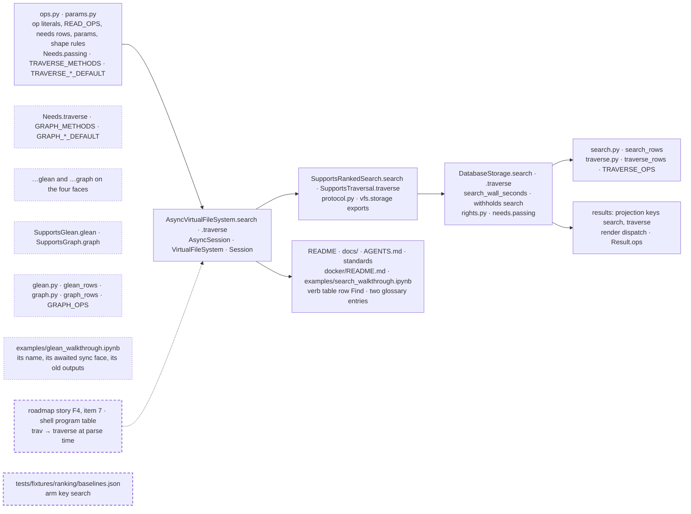

# The verbs take the names agents know: glean is search, graph is traverse, trav is a shell alias and never an op, the needs table's traverse rung is renamed so the word has one meaning, and the four-verb family is labelled Find

A refactor that renames two verbs across the kernel, the session, the two synchronous faces, the storage protocol, the database backend, the result renderer, the docs, the README, the Docker README and the walkthrough notebook, and renames one field of the needs table that would otherwise share a word with a verb. It carries one fix beside the rename: the walkthrough notebook awaits the synchronous face and stops there today, and decision 9 repairs that call so the example can be re-run. It is structural in name only: the modules `glean.py` and `graph.py` become `search.py` and `traverse.py`, and the protocol classes `SupportsGlean` and `SupportsGraph` become `SupportsRankedSearch` and `SupportsTraversal`, so two modules and two public classes are removed and two of each added, and the spec review scores structure. It changes the public API: the methods `glean` and `graph` are gone from every face and `search` and `traverse` stand in their place, and the hand-written reference pages under `docs/reference/` are updated. It changes no schema. It needs the engine legs, because it edits `backend.py` and the two renamed modules under `storage/backends/database/`, and the conformance rows that prove both verbs must prove them under their new names on every engine. It does not touch rights: the posture gate's inputs and judged set are unchanged, and the needs table's rungs keep their values under a renamed field. It does not touch the Rust engine: `crates/` names neither verb. It stands on no research memo, because nothing a study would change: the choice is a naming convention, and the problem section records the prior art read for it. No intention: the audience gains no experience, it gains names it already knows. It is not parallel-safe. Five active specs, none of them built, share files with it: [scope crosses the seam in one shape](../active/2026-11-07-scope-crosses-the-seam-in-one-shape.md) (`base.py`, `protocol.py`, `backend.py`, `reads.py`, `grep.py`, `scope.py`, `glean.py`, `test_glean.py`, `test_reads.py`, `test_rights.py`, `test_dispatch.py`, `storage_contract.py`), [bounded work has one home](../active/2026-11-07-bounded-work-has-one-home.md) (`base.py`, `backend.py`, `reads.py`, `grep.py`, `scope.py`, `rights.py`, `glean.py`, and the database `offload.py`, which it deletes), [the router keeps routing](../active/2026-11-07-the-router-keeps-routing.md) (`base.py`, `test_dispatch.py`), [refresh the incremental index verb](../active/2026-10-31-refresh-the-incremental-index-verb.md) (`protocol.py`, `backend.py`, `reads.py`, `grep.py`, `glean.py`, `render.py`, `signals.py`, `test_glean.py`, `test_models.py`, `storage_contract.py`, `examples/glean_walkthrough.ipynb`) and [the gate and the review read the layer map and the size baseline](../active/2026-11-07-the-gate-and-the-review-read-the-layer-map-and-the-size-baseline.md) (`context/standards/how-we-code.md`, and its problem section names `glean.py` among the modules its size baseline holds). The sixth active dated spec, [the release audit is a review](../active/2026-11-07-the-release-audit-is-a-review.md), shares no file with it and names neither verb. Three specs drafted beside it have landed since and are in the archive: [the chunk page filter takes the shape each planner serves](../archive/2026-11-09-the-chunk-page-filter-takes-the-shape-each-planner-serves.md) at `682182f` (`backend.py`, `storage_contract.py`), [the overlay counts in the engine and the scan tier shares one budget](../archive/2026-11-09-the-overlay-counts-in-the-engine-and-the-scan-tier-shares-one-budget.md) at `f1e17f0` (`base.py`, `glean.py`, `grep.py`, `scope.py`, `test_glean.py`, `storage_contract.py`) and [the lexical builder interns each term once](../archive/2026-11-09-the-lexical-builder-interns-each-term-once.md) at `e094679` (Rust only); the first two were built on the old names, and this landing renames the files as they left them. It depends on no unbuilt spec, and decision 11 puts it ahead of the six that remain active.

## The problem

READ at `62676bf`, the commit every count in this section is read at. The ranked-search verb is called `glean`. The name is spelled in 22 files under `src/` (95 mentions), among them the op literal and `READ_OPS` in `ops.py`, the parameter table and shape rules in `params.py`, the needs table, the kernel method `AsyncVirtualFileSystem.glean` in `base.py` and its `match` arm, `AsyncSession.glean`, `VirtualFileSystem.glean` and `Session.glean` in `sync.py`, the protocol class `SupportsGlean` and its one method in `protocol.py`, the module `storage/backends/database/glean.py` with `glean_rows`, the backend method `DatabaseStorage.glean` with its `glean_wall_seconds` constructor argument, the `_render_glean` dispatch on the op name in `results/render.py`, the projection default keyed `"glean"`, every `Result(ops=("glean",), ...)`, the capability withheld from an unknown dialect, and the error details that say so in words.

READ. The edge-walking verb is called `graph`. The op string `"graph"` is spelled at 21 sites in 10 files under `src/`: the op literal, `READ_OPS` and the needs row in `ops.py`, three table entries in `params.py`, the kernel method `AsyncVirtualFileSystem.graph` with its gate, its route and its `match` arm, `AsyncSession.graph`, the two faces in `sync.py`, the `_FAMILY_OPS` row beside `SupportsGraph` in `protocol.py`, four sites in `backend.py`, `GRAPH_OPS: Final = ("graph",)` in `graph.py`, the projection default, and the projection-free set and the dispatch in `results/render.py`. Beside the op string stand, under `src/`, `graph_rows` (3 mentions), `GRAPH_OPS` (4), `GRAPH_METHODS` (3, with 2 more inside a frozen corpus document of the golden set), `GRAPH_DEPTH_DEFAULT` and `GRAPH_LIMIT_DEFAULT` (14 mentions each) and `_render_graph` (2); five error details and shape-rule messages open with the verb's name, as "graph seeds must be live paths outside /.vfs" does. The verb's own docstring opens "Walk the edges from the seeds", validates `method` against "the traversal vocabulary" and says "traversal is the whole verb"; the module docstring opens "The graph walk"; the protocol docstring says "The graph family: read-side traversals over the backend's own subgraph"; `test_graph_family_is_traversal_only` builds a double named `TraversalOnly`. The code describes a traversal and names it after the thing traversed.

READ. The needs table's `Needs` type has a field named `traverse`: the rung a verb is judged at on a row it reads without changing, "a copy's source, an edge's target, a walk's node". It is set on four rows (`graph`, `copy`, `mkedge`, `rmedge`), read at two sites in `backend.py` and two in `rights.py`, and pinned at six lines of `tests/test_ops.py`. Renaming the verb to `traverse` without renaming the field would spell the row `"traverse": Needs("read", traverse="list")`, the verb and a rung that is not the verb's own, under one word.

READ. Under `tests/`, outside the golden set, 32 Python files spell `glean`, 20 test functions carry it in their node ids, as do one test class (`TestGleanRendering`) and one test double (`GleanOnly`), two test modules are named for it (`tests/storage/database/test_glean.py`, `tests/base/test_glean_merge.py`), and the ranking harness names its arm `"glean"` in `tests/fixtures/ranking/baselines.json` under all three corpora. Eleven Python files spell the `graph` verb, and a twelfth, `tests/storage/test_ranking.py`, spells `"graph"` twice as the name of an unknown fusion leg, which is the noun; ten of the eleven also spell `glean`, so 33 Python files change. `tests/storage/database/test_graph.py` holds 15 tests, `TestGraphRendering` holds 6, three dispatch tests and one params test carry the verb in their node ids, and the conformance rows that prove the walk are named for what they prove (`test_a_walk_equals_the_breadth_first_oracle`, `test_meet_keeps_the_shared_dependency`), not for the verb. The frozen vfs-native golden set under `tests/fixtures/ranking/vfs_native/` carries `glean` 136 times in `qrels.txt` and 146 times across its three `top10*.json` files, every one inside a corpus document's path, and again in the corpus documents themselves; `graph` stands in two corpus file names. Its README says the snapshot must never be refreshed in place because the labels are valid only against that text.

READ. The README spells `kernel.glean(...)` and `kernel.graph(...)` in its fences, lists `glean` in the capabilities assertion, labels the four-verb row of its verb table "Search" with the heading "Search from every angle: glob, grep, glean, graph", and lists the protocol families as "reads, pattern search, ranked search, mutation, graph, run". `docs/index.md` says "One is new, and we are calling it `glean`" and "`graph` from how we already think about connected data", and heads its section "Agentic Search has Four Verbs". `docs/how-to/walk-the-edges-around-a-file.md` calls `fs.graph(...)` seven times in six fences; `docs/reference/api.md` heads a section `## graph`, gives the signature and calls the verb twice in one fence; `docs/reference/session.md` and `docs/reference/sync.md` list both verbs once each. `AGENTS.md` names `glean` on three lines: twice as a verb, in the unknown-dialect rule and in the agent-verb-calls row of the reference deployment table, and once as a company, in that table's partial-index-pass row: "Glean's connectors run at 10 minutes to 1 hour". `context/standards/how-we-code.md` cites the capability gate that withholds `glean`; `context/standards/roadmap.md` names `glean` on 18 lines and `graph` beside it, and its shell domain says nothing of how either verb is spelled at the shell.

READ, the rest of the tracked tree, by `git grep -il glean` and the verb pattern of criterion 2 over every path outside `src/`, `tests/`, `docs/`, `README.md`, `AGENTS.md` and `context/`. Two files spell the ranked verb and none spells the walking verb. `docker/README.md` says at line 93 that a `mysql://` URL is served the core verbs on the generic floor "and withholds `glean`". `examples/glean_walkthrough.ipynb` is named for the verb, is titled "glean in action", spells `glean` in the sources of 14 of its 25 cells, among them the scratch database name `glean.sqlite` and eight calls `storage.glean(...)` or `fs.glean(...)`, and holds stored outputs in 12 code cells that print `/src/vfs/storage/backends/database/glean.py` and paths under `context/research/studies/2026-08-26-glean/`. `scripts/`, `.github/`, `.claude/skills/` with its vendored `security-audit` folder, `documentation/`, `pyproject.toml`, `mkdocs.yml` and `crates/` spell neither verb; `crates/` says `graph` three times as the noun. Ripgrep skips the notebook when it walks a directory, because `.gitignore` line 237 ignores `*.ipynb` and the two notebooks under `examples/` are tracked by force, so the criteria read it with `git grep` and a check over its JSON, never with `rg`. Under `context/` outside `standards/`, three files that carry no date in their names spell `glean`: the frozen `specifications/STATUS.md`, `specifications/archive/MINING.md`, and one catalog line of `research/README.md` ("glean stories").

EXECUTED on 2026-11-12 at `62676bf`: a copy of the notebook in a scratch folder, executed with nbclient under `uv run --with nbclient --with ipykernel` with the repository root as the kernel's working directory, offline, on local SQLite stores and with no embedding provider, ran its first ten code cells and stopped at the eleventh, the router cell, with `TypeError: object NoneType can't be used in 'await' expression` at `await fs.add_mount(code_store, "/code")`. `VirtualFileSystem` has been the synchronous face since [the two faces were named](../archive/2026-11-06-the-two-faces-named.md), and the notebook still awaits it. A second run with `AsyncVirtualFileSystem` swapped in memory at its two code lines ran every code cell with no error. The notebook is therefore already broken before any verb is renamed, for a reason that is not a verb's name, and its stored outputs are older than that break: they report 232 files written where today's tree writes 557.

EXECUTED the same day, the command the build uses, `uv run --with nbclient --with ipykernel jupyter execute --inplace <notebook>`, on two scratch copies under a scratch root that stands in for the repository (a `pyproject.toml` marker and links to `src/` and `context/`, because the notebook finds its root by walking up to that file). The copy as committed exits 1 on the same `TypeError`. The copy with `AsyncVirtualFileSystem` at its three mentions of the class, the import line of the first code cell, the constructor line of the router cell and the Markdown sentence above that cell, exits 0: all 12 non-empty code cells hold output, their execution counts run 1 to 12, and no output is an error or a stderr stream. Its fresh outputs spell `glean` on 15 lines, 9 of them the path of `glean.py`, which this landing renames, and 6 of them paths of dated research documents.

READ. The word `search` already stands under `src/` 45 times as a whole lowercase word, each time a common noun ("the pattern-search verbs", "ranked search", "a built search tier") and in the class names `SupportsPatternSearch` and `SearchChannels`; it is never the name of a verb. The word `graph` names the thing throughout: `vfs_edges`, `GraphRequest`, `GraphInputs`, `GraphError`, `collect_graph`, the oracles `graph_walk.py` and `meeting_subgraph.py`, "the backend's own subgraph". The noun stays wherever it names the thing; only the verb and the identifiers built on the verb move.

EXECUTED on this machine on 2026-11-09, for `search`: `gh search --help` opens "Search across all of GitHub"; `brew`, `cargo`, `npm`, `gem`, `pip` and `docker` are present and each takes `search` as the subcommand for free text in and a ranked list out. INFERRED from prior knowledge of their current documentation: zoekt's web API answers at `/search`, Sourcegraph's CLI is `src search`, Claude Code's tools are `Grep`, `Glob` and `WebSearch`, Cursor's is `codebase_search`, the MCP filesystem reference server's is `search_files`. No CLI or agent harness names a verb `glean`.

EXECUTED on this machine on 2026-11-09, for `traverse`, over the sibling reference clones: TinkerPop names its whole query model a traversal (`GraphTraversal`, `TraversalSource`, 1,713 files say traverse or traversal against 47 that say walk); Neo4j's public API is `org.neo4j.graphdb.traversal.TraversalDescription` with `.traverse(node)` at 321 call sites; HelixDB says traversal about 2,700 times with `plan_traversal` as its planner; Kuzu, networkx, rustworkx, Jena, GraphLite and TerminusDB each use the word for the operation class, networkx as its module `algorithms.traversal` whose functions are `bfs_edges` and `dfs_edges`; Cayley's query API names the directions `Out`, `In`, `Both` and `Follow`; openCypher, Oxigraph and DuckPGQ say traverse nowhere, because Cypher, SPARQL and SQL/PGQ expose a pattern (`MATCH`) and no verb. No engine exposes `walk` as its public verb.

READ on 2026-11-09, the public docs: [ArangoDB's AQL page is titled "Graph traversals in AQL"](https://qubitpi.github.io/arangodb-docs/stable/aql/graphs-traversals.html) and its form is `FOR v IN 1..5 OUTBOUND start GRAPH g` with the directions `OUTBOUND`, `INBOUND` and `ANY`, the direction before the start vertex, which is this verb's `("inbound", path)` order and its `inbound`, `outbound`, `neighborhood` vocabulary; [Amazon Neptune's guide](https://docs.aws.amazon.com/neptune/latest/userguide/access-graph-gremlin.html) says a Gremlin traversal is a chain of steps that begins at a vertex and moves through the graph; [Dgraph's tour](https://dgraph.io/tour/basic/5) says to formulate the query as a traversal through the graph. Among MCP memory servers that walk a knowledge graph, [palimpsest-labs memory-mcp](https://glama.ai/mcp/servers/palimpsest-labs/memory-mcp/tools/traverse) and arca-mcp name the tool `traverse`, [MCP AI Memory](https://policylayer.com/tools/scanadi-mcp-ai-memory/memory-traverse) names it `memory_traverse`, and others say `graph_explore` or `memory_graph`; the reference memory server's `read_graph` returns the whole graph, which is what a tool named for the noun is read to do.

INFERRED. The callers of these verbs are agents. `search` is the one name every agent harness and every package-manager CLI already teaches, so it is learned once and never from a docstring. `traverse` wins on a different ground: there is no universal CLI verb for walking a graph, but the operation class is called a traversal by every engine studied, the one engine that exposes a single verb spells it `traverse`, the pattern languages that expose none use this verb's direction words, and the MCP servers that name a tool for it most often say `traverse`. `graph` is a noun doing a verb's job and reads as "return the graph". `walk` is a real verb with the wrong prior in a filesystem: `os.walk` and `filepath.Walk` walk directory trees, which is `tree`. The cost of taking `search` is that the four-verb family can no longer be labelled by the same word, so the family needs a label of its own.

INFERRED. A short form `trav` is a convenience for a person at a keyboard, where `npm i`, `cargo b`, `kubectl get po` and `docker ps` set the precedent: each is a parse-time alias the shell accepts and the engine never sees. An agent pays nothing for four more letters, and a second spelling in the op vocabulary would ride every seam the op string crosses and split the examples an agent learns from.

## Architecture

Dashed is what this spec adds or writes for the first time; dotted is what it retires; every solid component keeps its shape and loses the old name.

Page this changes: none; the architecture folder was retired on 2026-10-31, and the landing notes will say so in one line.

Terms. **The ranked verb** is text in, one fused ranked list out, today `glean`, after this spec `search`. **The walking verb** is a frontier walk over the edges from seeds in a direction, or a meet of seeds, today `graph`, after this spec `traverse`. **The pattern-search family** is `SupportsPatternSearch` serving `glob` and `grep`; **the ranked-search family** is the protocol serving the ranked verb; **the traversal family** is the protocol serving the walking verb; all three family names are qualified. **The Find family** is the README's row of four verbs, `glob`, `grep`, `search` and `traverse`, today labelled "Search". **The passing rung** is the needs table's rung for a row a verb reads without changing, today the field `traverse`. **A shell alias** is a program name the shell program table resolves to another program at parse time, before dispatch; it is never an op. **Story F4** is the roadmap's shell story whose acceptance list the program table is built against.

## Decisions

### 1. The ranked verb is `search` at every layer: the op literal, the kernel method, the session method, both synchronous faces, the protocol method, the backend method, every `Result.ops` tuple, every capability string, the two trait keys, `search_signals` and `search_staleness`, the parameter table and shape rule, the needs row, the projection key, the render dispatch, every error detail that names the verb in words, and every other identifier that carries the old name, respelled letter for letter

One name everywhere, because the op string crosses every seam (router to storage, storage to result, result to renderer) and a verb spelled two ways at two layers is a bug class this project has not had and will not start. The name is `search` because it is the name every agent harness and every package-manager CLI already uses for this operation, and because the audience is agents: a name with no prior is a docstring read on every call. Pre-release, the wire strings change freely; the project-stage rule says there are no users to migrate. The two trait keys, today `glean_signals` and `glean_staleness`, are a declared vocabulary a caller reads through `traits()`, so they move with the verb for the reason the capability string does. Every other identifier that carries `glean` takes `search` in its place, letter for letter with its case kept (`glean_rows` to `search_rows`, `_render_glean` to `_render_search`, `_GLEAN_LINE_LEVEL_FIELDS` to `_SEARCH_LINE_LEVEL_FIELDS`, the test double `GleanOnly` to `SearchOnly`), so no name is chosen at build time; only the two protocol classes take the qualified names of decision 3, and where the letters alone give a non-word the identifier takes the grammatical form, as `test_scope_channel_gleans_as_composition` becomes `test_scope_channel_searches_as_composition`. Prose follows the same literal rule wherever the rule changes neither the sentence's truth nor its grammar, and where it does not, the Design gives the words.

### 2. The walking verb is `traverse` at the same layers, and the identifiers built on the verb follow: `GRAPH_OPS` becomes `TRAVERSE_OPS`, `GRAPH_METHODS` becomes `TRAVERSE_METHODS`, `GRAPH_DEPTH_DEFAULT` and `GRAPH_LIMIT_DEFAULT` become `TRAVERSE_DEPTH_DEFAULT` and `TRAVERSE_LIMIT_DEFAULT`, `_render_graph` becomes `_render_traverse`

`graph` is a noun doing a verb's job: the code's own docstrings say "walk the edges", "the traversal vocabulary" and "traversal is the whole verb", and a tool named for the noun is read, as the MCP reference memory server's `read_graph` is, to return the graph. `traverse` is the word every engine studied uses for the operation class, the word Neo4j's public API uses as its one verb, and the word the MCP servers that name such a tool most often choose; ArangoDB's `OUTBOUND start` order and direction words are this verb's own. The method vocabulary `inbound`, `outbound`, `neighborhood`, `meet` is unchanged: `kernel.traverse("inbound", path)` reads as the sentence it is. `walk` is rejected because its prior in a filesystem is the directory walk, which is `tree`.

### 3. The protocol classes are `SupportsRankedSearch` and `SupportsTraversal`, beside `SupportsPatternSearch`; the family names are pattern search, ranked search and traversal

`SupportsSearch` beside `SupportsPatternSearch` would read as the general case beside a special case, which is the wrong relation: they are independent families a partial backend has one of without the other, and `test_search_families_are_independent` pins that. `SupportsRankedSearch` keeps the qualified name the docstrings already use. `SupportsTraversal` is the name the protocol's own docstring and `test_graph_family_is_traversal_only` already reach for. The `vfs.storage` export list and `_FAMILY_OPS` change with them.

### 4. The modules are `storage/backends/database/search.py` with `search_rows` and `storage/backends/database/traverse.py` with `traverse_rows`; the backend's constructor argument is `search_wall_seconds`; no old keyword survives as an alias

`grep.py` with `grep_rows` and `glob_rows` in `reads.py` set the pattern: the module and the builder carry the verb's name. The wall budget follows `grep_wall_seconds` and `glob_wall_seconds`. A `glean_wall_seconds=` call is a `TypeError` as any unknown keyword is, because an alias is a second spelling and decision 1 allows one.

### 5. The graph as a noun keeps its name: `GraphRequest`, `GraphInputs`, `GraphError`, `collect_graph`, `Site`, `vfs_edges`, the oracles `graph_walk.py` and `meeting_subgraph.py`, the how-to page `walk-the-edges-around-a-file.md` with its title, and the word in prose wherever it names the thing

The verb is the act and the graph is the thing acted on; renaming the thing would make "the backend's own subgraph" read as "the backend's own subtraversal". The criteria therefore pin identifiers (the op string, the method, the class, the module, the constants), never the word. The how-to page is a task, "walk the edges", and a link target; its fences change and its name does not.

### 6. The needs table's field `traverse` is renamed `passing`: `Needs(primary, create=None, passing=None)`, read as `needs.passing` at its two backend sites and two rights sites, and pinned as `VERB_RUNGS["traverse"].passing == "list"`

A verb named `traverse` and a rung named `traverse` that is not the verb's own would be one word with two meanings in one table row. `passing` is the word `backend.py`'s own local variable (`passing: Rung = ...`) already uses for the row a verb passes through, and the class docstring already says "a row it only passes or reads". The values are unchanged on every row, so no rights answer moves; the rights lens is not engaged, and criterion 7 pins the four values.

### 7. `trav` is a shell alias and never an op: the shell program table resolves `trav` to `traverse` at parse time, before dispatch, so it appears in no `Result.ops`, no `capabilities()`, no `tools/list`, no face of the kernel and no reference page; this landing writes that rule as item 7 of the roadmap's shell story F4, the live page the shell is built against, and the alias itself is built with the shell

A short form is for a person at a keyboard; `npm i`, `cargo b`, `kubectl get po` and `docker ps` are each a parse-time alias the engine never sees. An agent pays nothing for the long form, and a second spelling in the op vocabulary would ride every seam the op string crosses and split the examples an agent learns from. The shell program table is the layer where typing happens, so it is the one layer that holds the alias. The rule cannot live in this spec alone: a landed spec moves to the archive and governs nothing, and [the shell pipeline core](../active/167-the-shell-pipeline-core/spec.md), a numbered spec from before this process whose program table lists the verbs under their old names, is not edited to point forward. [The roadmap](../../standards/roadmap.md) is a live standard this spec already edits, and the acceptance list of its story F4 is what the program table is built against, so the landing appends one item to that list, in these words: "7. The program table resolves `trav` to `traverse` at parse time, before dispatch, and no short form of a verb is ever an op: `trav` appears in no `Result.ops`, no `capabilities()` and no `tools/list`." Criterion 17 pins that line and pins that nothing under `src/`, `tests/`, `docs/` or the README spells the alias. No other short form is decided here: whether `search` or any other verb takes one is the shell's call, under the roadmap line's rule that none is ever an op.

### 8. The README's four-verb row is labelled "Find", its heading reads `## Find anything from every angle: glob, grep, search, traverse`, the family list in its node paragraph says "traversal" where it said "graph", and the phrases `search verbs` and `search family` are never written unqualified; the common noun stays wherever it names searching in general, as in `docs/index.md`'s account of agentic search; the family of four is named by its members or as the Find family, and the three protocol families keep their qualified names

Taking `search` for one member means the row can no longer be called "Search" without saying the other three are not search. "Find" is the plain word for the family's job (where it sits, what it says, what it means, how it connects) and collides with nothing in the tree: no verb, class or module is named `find`. The shell's `find` program is a Unix name for a glob-shaped query, not a family label; the README row never names a program, so the two do not meet. The heading is given word for word so the build chooses nothing: it keeps "from every angle" from the heading it replaces and names the four verbs in the table's order. Its wording is a matter of voice more than of design, so the landing notes flag it to the owner as a line he may reword. The product tagline in `docs/index.md`, "Agentic Search on your Database", is a product noun, not a family label, and stays. So does that page's section heading, `## 5. Agentic Search has Four Verbs`, which names agentic search, the common noun, and no verb. The paragraph under it that calls three verbs familiar and one coined cannot take the literal rule: respelled, it would say a name every harness uses was coined for its alliteration, the opposite of decision 1's reason. The Design gives its one sentence word for word, and the landing notes flag that sentence to the owner beside the heading, as they flag the two glossary definitions of decision 9. The grep in criterion 14 holds the rule: no line under `src/`, `docs/` or the README says "search verbs" or "search family" unqualified.

### 9. The live documents change and the dated ones do not: `src/`, `tests/`, `README.md`, `docs/`, `AGENTS.md`, `docker/README.md`, the walkthrough notebook under `examples/`, `context/standards/how-we-code.md` and `context/standards/roadmap.md` are renamed; the notebook moves to `examples/search_walkthrough.ipynb` with every cell source respelled, its three mentions of `VirtualFileSystem` made `AsyncVirtualFileSystem` so that it runs, and its outputs regenerated by one re-execution on the renamed tree; no document under `context/` outside `standards/` is edited; the glossary gains `Search` and `Traverse` entries whose one clause each, "formerly `glean`" and "formerly `graph`", is the only place a live document keeps an old name

Specs, reviews, research memos and archived specs are dated records that link backward and name the verbs as they were when they were written; editing them would make a 2026-08 memo describe a 2026-11 name. The standards are live pages the lint already maintains (`test_the_standards_agree_with_the_tree` forbids stale strings in `roadmap.md`), so they say the current names. `AGENTS.md`'s mention of Glean the company is a different word and stays. The glossary pointers exist so a reader coming from a dated document can find the verb; each is one clause, not an alias. The two entries are given word for word in the Design, a one-sentence definition each and a link from Traverse to the how-to, and the landing notes flag the two definitions to the owner as his to reword. The three undated files under `context/` that spell `glean`, `specifications/STATUS.md`, `specifications/archive/MINING.md` and `research/README.md`, fall under the same rule as the dated ones and are not edited; the research README's catalog line says "glean stories" as a topic label for the studies of that period, and it stays.

A rename that leaves a runnable example calling a method that no longer exists is not one name everywhere, so the two live files outside those roots that spell the verb are renamed with them. `docker/README.md` is the live guide to the engine legs, and its one line says the floor withholds `search`. The notebook is the one runnable example of the ranked verb: it is moved with `git mv` to `examples/search_walkthrough.ipynb`, as decision 4 moves the modules, and every Markdown cell and code cell source spells the verb `search`, its title "search in action", its scratch database `search.sqlite` and its eight calls included.

The notebook's stored outputs must come from the renamed tree; they are never left from an older one, because under respelled cells they would print `glean.py`, a path the tree no longer holds. A walkthrough exists to show its outputs, so clearing them would throw away what the file is for. The notebook is therefore re-executed top to bottom after the rename, offline, from the repository root with the tree green, by `uv run --with nbclient --with ipykernel jupyter execute --inplace examples/search_walkthrough.ipynb`, and the fresh outputs are committed. Neither package joins `pyproject.toml`; `--with` supplies them for the one run.

The notebook cannot be shown working under the new names without one repair, and leaving a known failure in a file this landing rewrites would be poor stewardship. Its router cell awaits `VirtualFileSystem`, which has been the synchronous face since [the two faces were named](../archive/2026-11-06-the-two-faces-named.md); that landing left this file behind, and The problem's run stops there. The repair is the smallest that lets the notebook run: `AsyncVirtualFileSystem` at the import line of the first code cell, at the constructor line of the router cell, and in the one Markdown sentence above that cell, which names the class the cell constructs. This is the one departure from decision 12's "nothing but names moves": that holds for `src/` and `tests/`, and the example carries one repair of a call that was already broken.

Old words that appear in the fresh outputs only as paths or quoted lines of dated documents and corpus files, a research studies folder named for glean among them, are data, not the verb, and they stay. Criterion 18 therefore reads the cell sources and the shape of the outputs, never their text. The outputs change with the tree, so this move is held to no similarity bar: criterion 13 reads only `src` and `tests`, and criterion 18 holds the notebook by its path and its cells.

### 10. The ranking harness arm is renamed in `tests/fixtures/ranking/baselines.json` under all three corpora with its numbers unchanged; the vfs-native golden set is not touched

The arm name labels the verb under test, so it follows the verb. The numbers are the frozen baseline the gate compares against; a rename of the key moves no number, and criterion 12 checks the values against the key's values at the landing commit's parent. The golden set's `corpus/`, `qrels.txt`, `queries.tsv` and `top10*.json` carry both words only inside corpus documents and their paths, and its README forbids refreshing the snapshot in place because the relevance labels are valid only against that text.

### 11. This spec is built next and lands before the six dated specs that remain active; every active spec that names `glean.py`, `graph.py`, `SupportsGlean`, `SupportsGraph` or either verb is built against the new names with its text unedited, and its landing notes say in one line that `glean` in its text reads `search` and `graph` as a verb reads `traverse`; the three specs that landed first were built on the old names and are renamed by this landing

A rename is cheapest when nothing is in flight, and nothing is: at `62676bf` `git status --porcelain -- src tests crates` prints nothing, every uncommitted path is under `context/` or `documentation/`, and no build has started. The order was first written at `b85e3df` to put this spec ahead of every spec naming the verbs, and three landed before it: the chunk-page-filter spec at `682182f`, the overlay kernel spec at `f1e17f0` and the lexical builder spec at `e094679`, the first two on the old names, as the overlay spec's landing notes record. Nothing is owed for that: their code is in the tree this spec renames, `glean.py` and `test_glean.py` move with the overlay's work inside them, and the counts in The problem and the scores in decision 12 are read after them. Six dated specs remain active and none is built. Five name the modules or the verbs: scope crosses the seam, bounded work, the router, refresh and the layer map. Building them first would mean renaming inside their diffs; building them after means one line in each landing note. Refresh also names the notebook in its scope under the old file name, so its line says as well that `examples/glean_walkthrough.ipynb` reads `examples/search_walkthrough.ipynb`. The sixth, the release audit, names neither verb and shares no file, so it follows by order alone and owes no line. The numbered specs from before the process that name either verb, fourteen under `active/` at `62676bf`, fall under the same rule when one is picked up: it is built against the new names and its landing notes carry the line. Dated documents are not edited (decision 9), so the translation is stated at landing rather than written into the spec.

### 12. The rename changes no behaviour and no statement: the SQL each dialect receives is byte-identical, the plan pins pass unchanged, every needs rung keeps its value, and git detects the two moved source modules as renames at 95% similarity or more and the three moved test modules at 75% or more

A rename that also edits a builder is two changes in one commit, and the second one is unreviewed under the first one's name. Criterion 13 pins the file moves as renames and criterion 16 runs the plan pins unchanged. The rule binds `src/` and `tests/`: a line the longer name pushes past 120 columns is re-wrapped and an import block the new name reorders is re-sorted, and neither changes a token; its one departure is the example notebook's repair, which decision 9 carries with its reason. The two bars are the scores the literal rename measures. EXECUTED on 2026-11-12 in a scratch repository holding the five files as they stand at `62676bf`, with the names respelled, the files moved with `git mv` and nothing else changed, `git diff --cached -M50% --name-status` scores `graph.py` 99%, `glean.py` 98%, `test_graph.py` 91%, `test_glean_merge.py` 87% and `test_glean.py` 81%, the same five scores the spec review measured at `b85e3df`; at `-M90%` the two `test_glean*` modules are listed as a delete and an add. `graph.py` scores 97 to 99 by how much of the rename the measurement applies: 99 with the identifiers alone, 97 in the second review's run, which also respells the two error details and the docstring the Design names. The bar of 95 stands under both. A test module names the verb on about one line in seven (119 of the 883 lines of `test_glean.py`), so it cannot reach the bar a source module does. A source module below 95% is the signal that something other than a name moved, since a builder line is never a verb line; the test bar of 75% sits under the lowest measured score and leaves room for the new pins of criterion 6, which are added to two of the moved test modules.

## Intent

After this spec, an agent that has used any package-manager CLI or any agent harness calls `kernel.search("...")` and gets the ranked list it expects, and one that has used any graph engine calls `kernel.traverse("inbound", path)` and gets the walk it expects, with no name to learn; the README's verb table shows a Find family of `glob`, `grep`, `search` and `traverse`; the storage protocol has a pattern-search family, a ranked-search family and a traversal family; the needs table judges a passing row under a field that is not a verb's name; the roadmap's shell story requires that a person at the shell can type `trav` for `traverse` and that nothing below the shell ever sees that spelling; the walkthrough notebook is `examples/search_walkthrough.ipynb`, spells the verb `search` in every cell source, runs top to bottom on the landed tree and carries the outputs of that run; and in the tracked tree the words `glean` and `graph`-as-a-verb remain in exactly six kinds of place and nowhere else: the glossary's two "formerly" clauses, the reference deployment row of `AGENTS.md` that names a company, the test nodes that assert the old names are gone, the frozen golden set, the notebook's stored outputs where they print paths or quoted lines of dated documents or corpus files, and the documents under `context/` outside `standards/`, dated or frozen, which still read as they were written. `documentation/`, the owner's draft in progress, is outside that statement; it names neither verb today.

## Design

**`src/vfs/ops.py`, `src/vfs/params.py`.** The two op literals, `READ_OPS`, the two needs rows, the `Needs` field and its docstring, the two parameter table entries, the shape rules and their messages, `GRAPH_METHODS` and the two defaults. **`src/vfs/base.py`.** `glean` becomes `search` and `graph` becomes `traverse`; their docstrings keep their opening sentences; the `_gate_params`, `_route_fanout` and `_route_single` op strings and the two `match` arms follow; the protocol imports follow. **`src/vfs/session.py`, `src/vfs/sync.py`.** The six facade methods and their `_refuse_closed` and `_result` op strings. **`src/vfs/storage/protocol.py`, `src/vfs/storage/__init__.py`.** The two classes, their methods, the `_FAMILY_OPS` rows, the export list, the trait vocabulary's two keys at lines 78, 85 and 86 of `protocol.py`, and the docstrings that cite a family by class name. **`src/vfs/storage/backends/database/`.** `glean.py` is moved with `git mv` to `search.py` and `graph.py` to `traverse.py`; `glean_rows` becomes `search_rows`, `graph_rows` becomes `traverse_rows`, `GRAPH_OPS` becomes `TRAVERSE_OPS`; `backend.py` renames both methods, both imports, `_glean_wall_seconds` and the constructor argument, the withheld capability and its docstring, the trait keys `glean_signals` and `glean_staleness` to `search_signals` and `search_staleness` where `traits()` returns them, the four `"graph"` op strings (two `ops=("graph",)` refusals and the two arguments of the dispatch), and `needs.traverse` to `needs.passing` at two sites; `rights.py` reads `needs.passing` at two sites and its assert message says "a verb with a passing slot", and the two docstrings that name the rung, one in `rights.py` and one in `backend.py`, say the passing rung; `distance.py`, `grep.py`, `offload.py`, `reads.py`, `render.py`, `scope.py`, `signals.py` respell the ranked verb in their docstrings and the one error detail. **`src/vfs/results/render.py`, `src/vfs/results/projection.py`, `src/vfs/results/preview.py`, `src/vfs/models/entry.py`, `src/vfs/rerank.py`, `src/vfs/storage/ranking.py`.** The two dispatches, `_PROJECTION_FREE_FUNCTIONS`, the two projection keys, the fan-out cap detail and the docstrings. **The walking verb in words.** The five details that open with the verb's name open with `traverse`: `graph seeds must be live paths outside /.vfs` and `graph returned the nearest …` in the moved module, `graph names … edge types` in `backend.py`, and the two shape-rule messages in `params.py`. The longer names move line breaks and import order where the gate requires it, and no token but a name changes: `ruff format` re-wraps the lines the new names push past 120 columns, the `depth` and `limit` refusal above `backend.py:463` among them; `ruff check --fix` re-sorts the import blocks and the one `__all__` the new names reorder; and the detail at `backend.py:463`, which no tool can re-wrap, is written as two adjacent f-string literals broken after 'edge types; ', so the message is the same bytes but for the verb. A docstring that names the verb in double backticks takes `traverse` in its place, and the `backend.py` docstring that points at `graph.py` points at `traverse.py`. Nine lines of comment and docstring are given word for word, the names inside them in the docstring's double backticks. The three that name the family: `protocol.py:166` says "not in the traversal family", the `SupportsTraversal` docstring at `protocol.py:342` reads "The traversal family: read-side traversals over the backend's own subgraph.", and the banner at `backend.py:433` reads `# Traversal family`. The three banners `# search, graph, execution` at `session.py:264`, `sync.py:451` and `sync.py:906` read `# find, execution`, and the banner `# public methods — search` at `base.py:1328`, which heads the same four verbs, reads `# public methods — find`. The `SupportsReindex` docstring at `protocol.py:479` says "between builds `grep` and `search` must serve correct results from their scan tier", wrapped to the line length. The module docstring of `results/render.py` says "the walk's hierarchy with its edge types for traverse". The noun stays under decision 5. **The literal rule.** Decision 1 gives it: every other identifier, comment and docstring that carries `glean` takes `search` in its place, case kept.

**Tests first.** `tests/storage/database/test_glean.py` is moved with `git mv` to `test_search.py`, `tests/base/test_glean_merge.py` to `test_search_merge.py`, and `tests/storage/database/test_graph.py` to `test_traverse.py`; every test node that carries `glean`, the four nodes of criterion 10 that carry `graph` as the verb, the two rendering classes and the double `GleanOnly` are renamed, and `test_graph_family_is_traversal_only` keeps its name, as criterion 4 gives it; `tests/support/base_doubles.py`, `tests/support/storage_contract.py`, `tests/support/grants_contract.py`, `tests/ranking/driver.py`, `tests/ranking/merge.py`, `tests/ranking/pins.py`, `tests/test_ops.py`, `tests/test_params.py`, `tests/base/test_dispatch.py` and the rest of the 33 Python files that spell either verb respell the verbs, the constants and the field; `tests/storage/test_ranking.py` is not touched, because its `"graph"` is a fusion leg's name; `baselines.json` renames its arm key. The new pins of criteria 2 to 11 are written and seen failing on `AttributeError`, `KeyError`, `TypeError` or the missing module before any file under `src/` changes. The `TypeError` pin of criterion 6 writes the old keyword literally and carries a `# ty: ignore[unknown-argument]` comment, the form 79 lines of Python under `tests/` carry a `ty: ignore` in today, so the type gate stays at zero. The nodes that assert an old name is gone (criteria 3, 4, 5, 6 and 9) must spell it to refuse it, so they are the only lines under `tests/`, outside the golden set, that keep one, and criteria 1 and 2 count their files.

**Then the docs.** A changed line in a live document either takes the literal rule, under which `glean` becomes `search`, a backticked `graph`, `.graph(` and `## graph` become `traverse`, and nothing else in the line moves, or is given here word for word. The build writes no other prose.

**`README.md`.** Literal: the call at line 56; the two calls at lines 84 and 85, their comments unchanged and the four trailing comments of the fence kept on one column by whitespace alone; the bolded verb that opens each of the bullets at lines 90 and 91; the capabilities assertion at line 121; the status line at line 145. Word for word: the table row at line 71 reads ``| Find | `glob` · `grep` · `search` · `traverse` | *where it sits · what it says · what it means · how it connects* |``; the heading at line 77 reads as decision 8 gives it; the family list in line 115 reads "reads, pattern search, ranked search, mutation, traversal, run". Not touched: "(lexical, vector, graph)" in line 90 and "the graph engine" in line 147, which name the noun.

**`docs/`.** `docs/index.md`: the claim sentence at line 3 names "glob, grep, search, and traverse"; the heading `## 5. Agentic Search has Four Verbs` is not touched, because it names agentic search, the common noun decision 8 keeps; the paragraph at line 63 is replaced whole and reads, word for word, "All four of these verbs are already familiar: `glob` and `grep` from any Unix terminal, `search` from every package manager and agent harness, and `traverse` from how graph engines name a walk over connected data."; the bullets at lines 67 and 68 take the literal rule at their first word and nothing else. `docs/how-to/walk-the-edges-around-a-file.md`: the seven calls in its six fences, literal. `docs/reference/api.md`: the heading `## graph` becomes `## traverse`, and the signature and the two calls in its one fence are literal. `docs/reference/session.md`, `docs/reference/sync.md`: the two names in each verb list, literal. `docs/reference/glossary.md` gains two entries, word for word, each in its alphabetical place. Between the Road directory and Session entries: "**Search.** The ranked verb: text in, one fused ranked list of entries out, each with its `score` and `matches`; formerly `glean`." Between the System actor and Unauthenticated entries: "**Traverse.** The walking verb: a frontier walk over the edges from seeds by one of four methods, `inbound`, `outbound`, `neighborhood` and `meet`; formerly `graph`.", and the same entry closes with the word "See", a link whose text is "walk the edges around a file" and whose target is `../how-to/walk-the-edges-around-a-file.md`, and a full stop, the form the glossary's other "See" links take.

**`AGENTS.md`, `docker/README.md`, `context/standards/how-we-code.md`.** Literal, one word a line: `AGENTS.md` at line 57 ("`search` is withheld from their declared capabilities") and at line 74 ("`search` under a tenth"), with line 77, which names the company, not touched; `docker/README.md` at line 93 ("and withholds `search`"); `how-we-code.md` at line 31 ("withholds `search` when the profile has no distance function").

**`context/standards/roadmap.md`.** Literal on lines 35, 95, 213, 455, 478, 505, 521, 523, 524, 563, 565, 567, 756, 762, 824 and 844 and in the first cell of line 437: `glean` to `search` and a backticked `graph` to `traverse`, which carries `glean.py` to `search.py` at line 95, `glean_staleness` to `search_staleness` at lines 521 and 563, and `glean_walkthrough.ipynb` to `search_walkthrough.ipynb` at line 844. Word for word on four lines, where the walking verb stands in bare words or the literal sentence would be false. The second cell of line 437 reads "built (spec 171 still says the floor withholds the walking verb too)": of the four documents the old parenthesis names, only [spec 171](../active/171-the-mcp-adapter-and-the-cli-tool/spec.md) still says so at `62676bf`, since `AGENTS.md` names the ranked verb alone, `context/architecture/` is retired and the glossary says nothing of the floor, so the landing drops the three stale names with the old verbs. The verb list of line 443 reads "write, edges, glob, delete/restore, tombstoned read, traverse; none for move, copy, mkdir, sweep, grep, search, grants". The heading at line 503 reads `## 8. Domain E — Search: search, providers, renderers, traverse`. Line 795 says "`api.md` covers identity and traverse only". Lines 771 ("import-graph test") and 897 ("the graph walk") name the noun and are not touched. Item 7 is appended to the acceptance list of story F4 in the words decision 7 gives.

**The notebook.** `examples/glean_walkthrough.ipynb`: moved with `git mv` to `examples/search_walkthrough.ipynb`, which works on a tracked file though `.gitignore` ignores `*.ipynb`; the 14 cells whose sources spell `glean` take the literal rule, case kept, so the title reads "search in action", the scratch database is `search.sqlite`, the eight calls are `.search(` and "Glean still finds it" reads "Search still finds it"; `VirtualFileSystem` becomes `AsyncVirtualFileSystem` at its three mentions, the import line of the first code cell, the constructor line of the router cell and the Markdown sentence above that cell, where the article follows the class: "An `AsyncVirtualFileSystem` routes one namespace over many stores"; no other source line changes. The notebook is executed last, once every file under `src/` and `tests/` is renamed and the suite is green, by `uv run --with nbclient --with ipykernel jupyter execute --inplace examples/search_walkthrough.ipynb` from the repository root, and the file as that run leaves it is what lands. The landing notes record that run's exit code and flag three wordings to the owner as his to reword: the README heading, the paragraph of `docs/index.md`, and the two glossary definitions. Two sentences that take the literal rule were false before this landing and are not corrected by it: cell 0 of the notebook calls the verb lexical-only and the vector leg and fusion the next specs, and the bullet at `docs/index.md:68` says the walking verb ranks files with centrality algorithms; the landing notes name both to the owner in one line.

**Size.** 95 `glean` mentions in 22 files and 75 verb-bound `graph` identifiers in 11 files under `src/`, 24 source files in all with `graph.py` and `rights.py`; 33 Python files and one fixture under `tests/`; five moved files under `src/` and `tests/` and one moved notebook; eleven documents beside it.

**Scale.** None: no statement, loop, budget or index path changes. The SQL is byte-identical by decision 12.

## Scope

In: decisions 1 to 12. Files: `src/vfs/ops.py`, `src/vfs/params.py`, `src/vfs/base.py`, `src/vfs/session.py`, `src/vfs/sync.py`, `src/vfs/rerank.py`, `src/vfs/models/entry.py`, `src/vfs/results/render.py`, `src/vfs/results/projection.py`, `src/vfs/results/preview.py`, `src/vfs/storage/__init__.py`, `src/vfs/storage/protocol.py`, `src/vfs/storage/ranking.py`, and under `src/vfs/storage/backends/database/`: `glean.py` moved to `search.py`, `graph.py` moved to `traverse.py`, `backend.py`, `rights.py`, `distance.py`, `grep.py`, `offload.py`, `reads.py`, `render.py`, `scope.py`, `signals.py`; the 33 Python files under `tests/` that spell either verb, the constants or the field, with `tests/storage/database/test_glean.py` moved to `test_search.py`, `tests/base/test_glean_merge.py` to `test_search_merge.py` and `tests/storage/database/test_graph.py` to `test_traverse.py`; `tests/fixtures/ranking/baselines.json`; `README.md`; `docs/index.md`, `docs/how-to/walk-the-edges-around-a-file.md`, `docs/reference/api.md`, `docs/reference/session.md`, `docs/reference/sync.md`, `docs/reference/glossary.md`; `AGENTS.md`; `docker/README.md`; `examples/glean_walkthrough.ipynb` moved to `examples/search_walkthrough.ipynb`; `context/standards/how-we-code.md`; `context/standards/roadmap.md`, with the one line decision 7 adds to story F4; and this spec's landing notes.

Out: any change to either verb's parameters, defaults, method vocabulary, fusion, merge, walk or scope handling, which belong to the active storage specs this one precedes; renaming `SupportsPatternSearch`, `SearchChannels` or the phrase "pattern search", which are qualified family names and stay; renaming anything that names the graph as a thing (decision 5); the product tagline "Agentic Search on your Database", a product noun; the `trav` alias's implementation and any other short form, which [the shell pipeline core](../active/167-the-shell-pipeline-core/spec.md) builds in its program table against the roadmap line decision 7 writes; `tests/storage/test_ranking.py`, whose `"graph"` names a fusion leg; the CLI and MCP tool names, which [the MCP adapter and the CLI tool](../active/171-the-mcp-adapter-and-the-cli-tool/spec.md) takes from the op vocabulary when it is built; the vfs-native golden set, frozen by its own README; any change to the walkthrough notebook beyond the respelling, the three mentions of the face and the regenerated outputs of decision 9; `examples/glob_residuation.ipynb`, which spells neither verb; `documentation/`, the owner's draft in progress, which spells neither verb at `62676bf` and which no criterion reads; the vendored `.claude/skills/security-audit/` folder, pinned by hash and never edited, which spells neither verb; every document under `context/` outside `standards/`, dated or not.

## Acceptance criteria

Counts and states, never clocks.

1. `rg -i glean src README.md docs pyproject.toml context/standards/how-we-code.md context/standards/roadmap.md --glob '!docs/reference/glossary.md'` exits 1; `rg -l -i glean tests --glob '!tests/fixtures/ranking/vfs_native/**'` prints no file outside `tests/test_ops.py`, `tests/storage/test_protocol.py`, `tests/test_sync.py` and `tests/storage/database/test_search.py`, and in those four every matching line is inside a node of criteria 3, 4, 5, 6 or 9 that asserts the old name is gone; `rg -n -i glean AGENTS.md` prints exactly one line, the `Partial index pass` row of the reference deployment table, whose one match is the company in "Glean's connectors run at 10 minutes to 1 hour".
2. `rg -n 'SupportsGraph|graph_rows|GRAPH_OPS|GRAPH_METHODS|GRAPH_(DEPTH|LIMIT)_DEFAULT|_render_graph|def graph\(|\.graph\(|"graph"' src docs README.md` exits 1; the same pattern under `rg -l` over `tests --glob '!tests/fixtures/ranking/vfs_native/**' --glob '!tests/storage/test_ranking.py'` prints no file outside `tests/test_ops.py`, `tests/storage/test_protocol.py` and `tests/test_sync.py`, and in those three every matching line is inside a node of criteria 3, 4, 5 or 9 that asserts the old name is gone; ``rg -n '`graph`|`graph\.py`|\bgraph (seeds|returned|names|minimal|edge_types)|[Gg]raph family|\bfor graph\b' src docs README.md --glob '!docs/reference/glossary.md'`` exits 1, where at `62676bf` it prints 20 lines, every one the verb or its family; ``rg -n '`graph`' AGENTS.md context/standards/how-we-code.md context/standards/roadmap.md`` exits 1, where at `62676bf` it prints four lines, all in the roadmap; `rg -c '\bgraph\b' context/standards/roadmap.md` prints 2, the two lines that name the noun, where at `62676bf` it prints 9; `rg -n '# search, graph, execution' src` exits 1, where at `62676bf` it prints three banners; `rg -c 'GraphRequest|GraphInputs|GraphError|collect_graph' src` prints a nonzero count for `src/vfs/exceptions.py`, `src/vfs/storage/backends/database/traverse.py` and `src/vfs/storage/backends/database/signals.py`, the noun kept.
3. `tests/test_ops.py::test_search_and_traverse_are_the_ranked_and_walking_read_ops`: `"search"` and `"traverse"` are in the op vocabulary and in `READ_OPS`, `VERB_RUNGS["search"] == Needs("read")`, `VERB_RUNGS["traverse"] == Needs("read", passing="list")`, and neither `"glean"` nor `"graph"` is in the vocabulary or in `READ_OPS`.
4. `tests/storage/test_protocol.py::test_search_families_are_independent`: a backend with `search` alone is a `SupportsRankedSearch` and not a `SupportsPatternSearch`, and the converse; `tests/storage/test_protocol.py::test_graph_family_is_traversal_only`: a backend with `traverse` alone is a `SupportsTraversal` and its `storage_ops` are the read-only set plus `{"traverse"}`; `tests/storage/test_protocol.py::test_the_old_family_names_are_gone`: `vfs.storage` has neither `SupportsGlean` nor `SupportsGraph`, `importlib.util.find_spec` returns `None` for `vfs.storage.backends.database.glean` and for `vfs.storage.backends.database.graph`, and `vfs.storage.backends.database.search` and `.traverse` import.
5. `tests/test_sync.py::test_every_face_spells_the_verbs_search_and_traverse`: `AsyncVirtualFileSystem`, `AsyncSession`, `VirtualFileSystem` and `Session` each have `search` and `traverse` attributes and none has `glean` or `graph`; a `VirtualFileSystem.search` call over one mounted store returns `ops == ("search",)` and a `VirtualFileSystem.traverse("inbound", path)` call returns `ops == ("traverse",)`.
6. `tests/storage/database/test_search.py::test_the_backend_answers_search_with_its_own_op_name`: `DatabaseStorage.search` returns `ops == ("search",)` on an answer and on an invalid-pattern refusal, two results; `tests/storage/database/test_search.py::test_the_wall_budget_is_spelled_search`: constructing with `glean_wall_seconds=1.0` raises `TypeError`, the call writing the old keyword literally under a `# ty: ignore[unknown-argument]` comment so the type gate stays at zero, and `search_wall_seconds=0` raises `ValueError` whose message names `search_wall_seconds`; `tests/storage/database/test_traverse.py::test_the_backend_answers_traverse_with_its_own_op_name`: `DatabaseStorage.traverse` returns `ops == ("traverse",)` on an answer, on a `depth=0` refusal, on a seed under `/.vfs` and on a walk from a seed with no edges, four results, and `TRAVERSE_OPS == ("traverse",)`.
7. `tests/test_ops.py::test_the_passing_rung_is_set_where_a_verb_reads_a_row_it_does_not_change`: `VERB_RUNGS["traverse"].passing == "list"`, `VERB_RUNGS["mkedge"].passing == VERB_RUNGS["rmedge"].passing == "list"`, `VERB_RUNGS["copy"].passing == "read"`, every other row's `passing` is `None`, and `Needs._fields == ("primary", "create", "passing")`; `rg -n 'needs\.traverse|traverse=' src` exits 1, and `rg -n 'traverse.{0,2} (slot|rung|judges)' src` exits 1, where at `62676bf` it prints four lines: the `Needs` docstring in `ops.py`, the assert message in `rights.py` and the two docstrings that name the rung.
8. `tests/storage/database/test_sqlite_vec.py::test_an_unknown_dialect_serves_the_core_verbs_and_withholds_search`: an unknown dialect's `capabilities()` holds `read`, `write`, `glob`, `grep` and `traverse` and not `search`, and the distance refusal's detail ends "withholds search from it".
9. `tests/test_ops.py::test_search_and_run_have_default_projections`: the projection default for `"search"` is `("path", "score", "matches")` and for `"traverse"` is `("path", "kind", "depth")`, and there is no `"glean"` or `"graph"` key; `tests/results/test_render.py::TestSearchRendering` renders a `Result` with `ops == ("search",)` as ranked lines, the same eight cases the class pins today under its old name; `tests/results/test_render.py::TestTraverseRendering` renders `ops == ("traverse",)` projection-free, the same six cases.
10. `tests/base/test_dispatch.py::test_traverse_rejects_unknown_and_centrality_methods`, `::test_traverse_path_routes_to_one_terminal` and `::test_traverse_observations_group_per_mount` pass with the assertions of their `graph` predecessors; `tests/test_params.py::test_the_traverse_signature_defaults_equal_the_table_defaults` reads `TRAVERSE_DEPTH_DEFAULT == 1` and `TRAVERSE_LIMIT_DEFAULT == 128` from the signature and the table.
11. `tests/storage/database/test_traverse.py` holds the 15 tests of `test_graph.py` under their names with `graph` respelled `traverse` where a name carries the verb, and `tests/support/storage_contract.py`'s walk and meet rows pass unchanged in name and assertion on every backend.
12. `tests/ranking/test_harness.py::test_search_equals_the_bm25_baseline_on_vfs_native` and `::test_search_equals_the_bm25_baseline_on_beir` gate the arm `"search"`; in `tests/fixtures/ranking/baselines.json` each of the three corpora has a `"search"` key and no `"glean"` key, and EXECUTED in the landing notes, each `"search"` value equals the `"glean"` value `git show P:tests/fixtures/ranking/baselines.json` holds for that corpus, where `P` is the landing commit's parent: `HEAD` while the change waits in the working tree, the landing commit's first parent once it is committed.
13. `git diff -M75% --name-status P -- src tests`, with `P` the landing commit's parent as in criterion 12, lists exactly five `R` rows: `src/vfs/storage/backends/database/glean.py` to `search.py`, `src/vfs/storage/backends/database/graph.py` to `traverse.py`, `tests/storage/database/test_glean.py` to `test_search.py`, `tests/storage/database/test_graph.py` to `test_traverse.py`, `tests/base/test_glean_merge.py` to `test_search_merge.py`; the two source modules score 95% or above and the three test modules 75% or above, the scores of the measured rename in decision 12.
14. The README's verb table has a row whose first cell is `Find` and whose second cell lists `glob`, `grep`, `search` and `traverse` in that order, and no row whose first cell is `Search`; `rg -c '^## Find anything from every angle: glob, grep, search, traverse$' README.md` prints 1 and `rg -c '^## Search from every angle' README.md` exits 1; its node paragraph lists the families as "reads, pattern search, ranked search, mutation, traversal, run"; `rg -n 'search (verbs|family)' README.md docs src | rg -v -- '-search'` prints nothing; `rg -c 'formerly .glean.' docs/reference/glossary.md` and `rg -c 'formerly .graph.' docs/reference/glossary.md` each print 1, inside `**Search.**` and `**Traverse.**` entries, and `rg -c '^\*\*Search\.\*\* The ranked verb: |^\*\*Traverse\.\*\* The walking verb: ' docs/reference/glossary.md` prints 2; `rg -c 'we are calling it|alliteration' docs/index.md` exits 1, where at `62676bf` it prints 1, `rg -c '^## 5\. Agentic Search has Four Verbs$' docs/index.md` prints 1, and `rg -c '^All four of these verbs are already familiar: ' docs/index.md` prints 1.
15. `uv run pytest docs README.md --tb=short -p no:cov -n 0` exits 0 with `kernel.search(` and `kernel.traverse(` in the README's fences; `rg -c 'fs\.traverse\(' docs/how-to/walk-the-edges-around-a-file.md` prints 7 and `rg -c 'fs\.traverse\(' docs/reference/api.md` prints 2, the seven calls of the how-to's six fences and the two calls of the reference page's one.
16. Every other existing test passes under its new name with its assertions otherwise unchanged; the two-channel plan pins (`test_the_scope_fan_keeps_the_multi_index_or`, `test_the_roots_alone_plan_is_index_served`, `test_the_scope_fan_plan_is_index_served`) and `test_every_scope_statement_fits_the_budget` pass unchanged; `uv run pytest tests/storage/test_conformance.py -m "postgres or mariadb or mssql or oracle"` with all four `VFS_TEST_<ENGINE>_URL` variables set, through the `db_test` skill, exits 0; `scripts/ci.sh` is green on the tree as committed.
17. `rg -n '\btrav\b' context/standards/roadmap.md` prints exactly one line; it is item 7 of the acceptance list of story F4, under the heading that begins `#### F4`, and it holds both "resolves `trav` to `traverse` at parse time" and "no short form of a verb is ever an op"; `rg -n '\btrav\b' src tests docs README.md` exits 1, as it does at `62676bf`.
18. `git ls-files examples` prints exactly `examples/glob_residuation.ipynb` and `examples/search_walkthrough.ipynb`; `uv run --with nbclient --with ipykernel jupyter execute --inplace examples/search_walkthrough.ipynb`, run from the repository root on the renamed tree, exits 0, EXECUTED in the landing notes, where on a copy of the notebook as committed at `62676bf` it exits 1; `uv run python -c "import json; nb = json.load(open('examples/search_walkthrough.ipynb')); src = [''.join(c['source']) for c in nb['cells']]; code = [c for c in nb['cells'] if c['cell_type'] == 'code' and ''.join(c['source']).strip()]; print(len(code), [c['execution_count'] for c in code] == list(range(1, len(code) + 1)), sum(1 for c in code if not c['outputs']), sum(1 for c in code for o in c['outputs'] if o['output_type'] == 'error' or o.get('name') == 'stderr'), [i for i, s in enumerate(src) if 'glean' in s.lower() or '.graph(' in s], sum(s.count('AsyncVirtualFileSystem') for s in src), sum(s.count('VirtualFileSystem') - s.count('AsyncVirtualFileSystem') for s in src))"` prints `12 True 0 0 [] 3 0`: twelve non-empty code cells, their execution counts 1 to 12 in order as one top-to-bottom run leaves them, none without an output, no output that is an error or a stderr stream, no cell whose source spells `glean` or calls `.graph(`, three source mentions of the asynchronous face and none of the synchronous one, where over the old path at `62676bf` the same command prints `12 False 0 0`, 14 cell indexes, and `0 3`; `git grep -il glean -- . ':!context' ':!documentation' ':!tests/fixtures/ranking/vfs_native' ':!examples/search_walkthrough.ipynb'` prints no file outside `AGENTS.md`, `docs/reference/glossary.md` and the four test files of criterion 1, where at `62676bf` it prints 62 files, `docker/README.md` and the notebook among them; and the pattern of criterion 2's first command with the alternative `` `graph` `` added, under `git grep -lE` over the same paths less `tests/storage/test_ranking.py`, prints no file outside `docs/reference/glossary.md` and the three test files of criterion 2, where at `62676bf` it prints 28. The two sweeps leave the notebook out by name because its fresh outputs print paths of dated documents, which are data; the JSON check holds its sources.

## Landing notes

Built 2026-11-12 in the working tree over `62676bf`, by a sub-agent of the session lead, and left uncommitted for a code review by an agent who did not write it. Before any code the two Lows of the second spec review were applied to this text as that review words them, L8 in the Design and decision 12 and L9 in decision 1 and the Design, with one Disposition line each in the review file. Tests first: the three test modules were moved with `git mv`, the 33 Python files and the fixture respelled and the new pins written while `src/` still held the old names, and the pins were run red. `tests/storage/test_protocol.py`, `tests/storage/database/test_search.py`, `tests/storage/database/test_traverse.py`, `tests/test_params.py` and `tests/ranking/test_harness.py` failed at collection on `ImportError` or `ModuleNotFoundError` (`cannot import name 'SupportsRankedSearch' from 'vfs.storage'`, `cannot import name 'search' from 'vfs.storage.backends.database'`, `No module named 'vfs.storage.backends.database.traverse'`, `cannot import name 'TRAVERSE_DEPTH_DEFAULT' from 'vfs.ops'`, `No module named 'vfs.storage.backends.database.search'`). Of the nodes that collected, 19 failed and 3 passed: `test_search_and_traverse_are_the_ranked_and_walking_read_ops` on the two new names missing from the vocabulary, `test_the_passing_rung_is_set_where_a_verb_reads_a_row_it_does_not_change` on `KeyError: 'traverse'`, `test_search_and_run_have_default_projections` on the fallback projection `('path',)`, `test_every_face_spells_the_verbs_search_and_traverse` on `AttributeError: type object 'AsyncVirtualFileSystem' has no attribute 'search'`, the capability node on `'search' in frozenset({... 'glean' ...})`, the three dispatch nodes on `AttributeError: ... has no attribute 'traverse'`, and seven of the eight search rendering cases and four of the six traverse rendering cases on the renderer's fallback arrangement; the three that passed are the two empty-result cases and the `ls` table case, which read no op name. Then the two source modules were moved and `src/` renamed in the Design's order, then the documents, then the notebook.

Per criterion, each command run on the finished tree. 1: the first `rg` exits 1 where at `62676bf` it printed 121 lines; the second prints `tests/storage/database/test_search.py`, `tests/storage/test_protocol.py`, `tests/test_ops.py` and `tests/test_sync.py`, seven lines in all, each inside a node that refuses an old name (`test_ops.py:111` and `:196`, `test_sync.py:242`, `test_protocol.py:228` and `:229`, `test_search.py:166` and `:167`); `rg -n -i glean AGENTS.md` prints line 77 alone, the company. 2: the first `rg` exits 1 where it printed 78 lines; the `-l` form prints `tests/storage/test_protocol.py`, `tests/test_ops.py` and `tests/test_sync.py`, four lines, each inside such a node; the verb-in-words pattern prints nothing where it printed 20 lines; the standards pattern prints nothing where it printed four; `rg -c '\bgraph\b' context/standards/roadmap.md` prints 2 where it printed 9; the banner pattern exits 1 where it printed three; the noun count is 1 for `exceptions.py`, 12 for `traverse.py`, 7 for `signals.py` and 4 for `backend.py`. 3: `tests/test_ops.py::test_search_and_traverse_are_the_ranked_and_walking_read_ops` passes. 4: `tests/storage/test_protocol.py::test_search_families_are_independent`, `::test_graph_family_is_traversal_only` and `::test_the_old_family_names_are_gone` pass. 5: `tests/test_sync.py::test_every_face_spells_the_verbs_search_and_traverse` passes, the two calls made over one store mounted at `/m`. 6: `tests/storage/database/test_search.py::test_the_backend_answers_search_with_its_own_op_name` and `::test_the_wall_budget_is_spelled_search` and `tests/storage/database/test_traverse.py::test_the_backend_answers_traverse_with_its_own_op_name` pass, and `ty` is at zero with the one `# ty: ignore[unknown-argument]`; since the code review the search node reads a third result, the no-term refusal, and the traverse node a fifth, the edge-type budget refusal. 7: `tests/test_ops.py::test_the_passing_rung_is_set_where_a_verb_reads_a_row_it_does_not_change` passes; `rg -n 'needs\.traverse|traverse=' src` exits 1 where it printed 8 lines and the rung pattern exits 1 where it printed four. 8: `tests/storage/database/test_sqlite_vec.py::TestCapabilityGate::test_an_unknown_dialect_serves_the_core_verbs_and_withholds_search` passes. 9: `tests/test_ops.py::test_search_and_run_have_default_projections` passes, and `tests/results/test_render.py::TestSearchRendering` holds 8 passing cases and `::TestTraverseRendering` 6. 10: `tests/base/test_dispatch.py::test_traverse_rejects_unknown_and_centrality_methods`, `::test_traverse_path_routes_to_one_terminal` and `::test_traverse_observations_group_per_mount` and `tests/test_params.py::test_the_traverse_signature_defaults_equal_the_table_defaults` pass. 11: `tests/storage/database/test_traverse.py` holds 16 test functions, the 15 of `test_graph.py` under their old names, none of which carried the verb, and the new node of criterion 6; 215 collected cases pass; the walk and meet rows of the contract pass unchanged in name and assertion on SQLite and the in-memory backend. 12: `tests/ranking/test_harness.py::TestBaseline::test_search_equals_the_bm25_baseline_on_vfs_native` and `::test_search_equals_the_bm25_baseline_on_beir[scifact]` and `[nfcorpus]` pass; EXECUTED against `git show HEAD:tests/fixtures/ranking/baselines.json` with `HEAD` at `62676bf`, each of the three corpora has a `"search"` key and no `"glean"` key, each `"search"` value equals the old `"glean"` value (`nfcorpus` 0.5152, 0.3052, 0.1459, 0.2045; `scifact` 0.6235, 0.658, 0.789, 0.8737; `vfs_native` 0.9833, 0.7589, 0.4134, 0.7852, in the order `mrr@10`, `ndcg@10`, `recall@10`, `recall@50`), and every other arm is unchanged. 13: `git diff -M75% --name-status HEAD -- src tests` lists exactly five `R` rows and no `A` or `D` row: `R098` `glean.py` to `search.py`, `R097` `graph.py` to `traverse.py`, `R087` `test_glean_merge.py` to `test_search_merge.py`, `R079` `test_glean.py` to `test_search.py`, `R085` `test_graph.py` to `test_traverse.py`. 14: the README row at line 71 reads `| Find | glob · grep · search · traverse |` with its backticks and there is no `Search` row; the heading count is 1 and the old heading's `rg` exits 1; line 115 lists "reads, pattern search, ranked search, mutation, traversal, run"; the `search (verbs|family)` pipe prints nothing; both "formerly" counts are 1 and the two-definition count is 2; `rg -c 'we are calling it|alliteration' docs/index.md` exits 1, and the section heading and the new sentence each count 1. 15: `uv run pytest docs README.md --tb=short -p no:cov -n 0` exits 0 with 44 passed; the README holds `kernel.search(` twice and `kernel.traverse(` once; `fs\.traverse\(` counts 7 in the how-to and 2 in `api.md`. 16: `uv run pytest` gives 4856 passed and 6 skipped, the 4849 of the tree before it and seven new nodes; the three plan pins, `test_every_scope_statement_fits_the_budget` and the walk and meet rows pass unchanged (30 passed, 2 skipped under `-k`); `scripts/ci.sh` is green, below; the engine legs are in the line the session lead completes. 17: `rg -n '\btrav\b' context/standards/roadmap.md` prints line 629 alone, item 7 under `#### F4`, holding both phrases; the same search over `src tests docs README.md` exits 1. 18: `git ls-files examples` prints `examples/glob_residuation.ipynb` and `examples/search_walkthrough.ipynb`; EXECUTED from the repository root after the last edit under `src/` and `tests/` and a green `uv run pytest`, `uv run --with nbclient --with ipykernel jupyter execute --inplace examples/search_walkthrough.ipynb` exits 0; the JSON check prints `12 True 0 0 [] 3 0`; the first sweep prints `AGENTS.md`, `docs/reference/glossary.md` and the four test files of criterion 1, and the second `docs/reference/glossary.md` and the three test files of criterion 2.

Counts. Six files moved with `git mv`: two source modules, three test modules and the notebook. Seventy-one paths changed: 24 under `src/` (191 lines added, 189 removed), 34 under `tests/` (33 Python files and `baselines.json`; 624 added, 508 removed), six pages under `docs/`, `README.md`, `AGENTS.md`, `docker/README.md`, the notebook, and three standards, the mutant ledger the third. Mentions respelled, counted by `git grep -io glean` at `62676bf` and now: `src/` 95 to 0, `tests/` outside the golden set 438 to 7, `docs/` 5 to 1, the README 7 to 0, `AGENTS.md` 3 to 1, `docker/README.md` 1 to 0, the two standards 21 to 0, and the notebook 50 to 6, the six being output lines that print paths under `context/research/studies/2026-08-26-glean/`. The verb-bound walking identifiers of criterion 2's first pattern: 75 to 0 under `src/`, 95 to 4 under `tests/`, 11 to 0 in `docs/` and the README. The roadmap changes on 20 lines and gains one. The notebook changes on 23 source lines in 15 cells, checked by a JSON comparison against a scratch copy of the committed file, with every cell id and the metadata kept; its fresh outputs report 557 files written. `ruff format` re-wrapped five files, and the new names reorder eleven import blocks and the one `__all__`, each re-sorted by `ruff check --fix` or by hand to the order it gives; the one hand split is the detail in `backend.py`, written as two adjacent f-string literals as the Design gives it. The similarity scores of criterion 13, measured on the working tree against `HEAD`: 98, 97, 87, 79 and 85.

Deviations and choices, each with its reason. The two lowest scores sit under the measured rename of decision 12, 79 for `test_search.py` against 81 and 85 for `test_traverse.py` against 91, because those two modules carry the three new nodes of criterion 6, the two results the code review added to them, and the re-wraps; both stand above the bar of 75. In `baselines.json` the `"search"` key of `vfs_native` stands after `merge/round_robin`, not where `"glean"` stood: the harness writes the file with sorted keys, and the file as landed is byte for byte what a rebaseline writes. The notebook's cell sources were replaced cell by cell with the notebook editing tool, because the text editing tool refuses a notebook file; no script wrote into the repository. The locals named `gleaned` are `searched`, the literal rule and a word. Three kinds of test text the Design does not word took the verb's name or the family's: the nine `graph-…` ids of the garbage matrix in `tests/test_params.py` are `traverse-…`, the two section banners `# grouped shape: graph` in `tests/base/test_dispatch.py` and `# graph — the frontier walk and the meeting subgraph` in `tests/support/storage_contract.py` say `traverse`, and the comment in `tests/storage/test_protocol.py` says "belongs to mutation, not traversal", the family name the Design gives `protocol.py`. Criterion 8's node existed under the old name without two of the assertions the criterion states, so the renamed node gained them: `traverse` in the held set, and the refusal of `cosine_distance("exotic", ...)` matched on `withholds search from it$`. Criterion 6's fourth result, "a walk from a seed with no edges", is a live file with no edge, answered as one node at depth 0; a seed that resolves to no row is not among the four, and its return rides the same pinned constant. [The mutant ledger](../../standards/mutant-ledger.md) is a file the Scope does not list, and it gained nine rows, N1 to N9, for the pins this landing added, at the code review's asking; each row names a verb's former name in words, points once at the glossary's two "formerly" clauses for what it is, and never spells it, so decision 9's rule that the glossary alone keeps an old name in a live document holds and `rg -il glean context/standards` exits 1. At the build, before those rows, three of the new pins were replayed against a one-line mutant each under the safe-restore rule (the old op name on the `depth` refusal, on the invalid-pattern refusal, and the old word in the distance detail), each failed, and the three files were restored from their copies and checked by hash.

Flagged to Clay. Three wordings the Design gives word for word are his to reword: the README heading `## Find anything from every angle: glob, grep, search, traverse`, the paragraph of `docs/index.md` that begins "All four of these verbs are already familiar", and the two glossary definitions of Search and Traverse. Two sentences were false before this landing and are not corrected by it: cell 0 of the notebook says search is lexical-only and the vector leg and fusion are the next specs, and the bullet of `docs/index.md` says `traverse` ranks files with centrality algorithms. The notebook's face repair: `AsyncVirtualFileSystem` at its three mentions, the one change in this landing that is not a name. Found at the build and left as they were, on the session lead's ruling that no notebook prose is rewritten in this landing: a third stale sentence in the notebook, cell 20's "The cross-mount *rerank* is a later spec", beside cell 2's "about 200 files" where the run writes 557. The phrase "graph queries" in the module docstring of `src/vfs/results/envelope.py` names the noun and stays. Four things the code review found and this landing does not fix. The Postgres hybrid top-10 ranking pin, `TestPostgresRankingPin::test_ordered_top10_matches_the_pin`, fails about one run in fourteen on this tree and equally on the commit before it; it looks like the native vector tier dropping one document with no error on the envelope, so criterion 16's conformance command can go red on a correct tree until that is studied. Under the reviewer's own load, the 10,000-root glob node `TestScopeChannel::test_ten_thousand_roots_and_64_arms_build_10064_sql_arms` answered no rows once; it was not reproduced and its cause is not isolated. The exact words of the error details this landing respelled are read by no test: two of them, put back to the old word, left the reviewer's scoped suite green, and no line under `tests/` reads either detail, so after the landing nothing in the gate holds them. And the op tuple is spelled inline, twice for `traverse` in `backend.py` beside the constant in `traverse.py` and five times for `search` across `backend.py` and `search.py` with no constant, so a verb's op name has no single home; two refusal arms that spell it, the scope-admission refusal and the not-ready refusal of `DatabaseStorage.search`, are still read by no test.

Decided at the build, by the session lead, on four points the builder reported; each is applied in the tree and none remains a gap. One: the contract row is `test_scope_channel_searches_as_composition`, because decision 1 after L9 takes the literal rule only where grammar survives it and the letters alone gave a non-word; a search of the tracked tree for other non-words and broken articles under the rename found none. Two: the banner at `src/vfs/base.py:1328` reads `# public methods — find`, because it heads the same four verbs as the three banners the Design already words `# find, execution`. Three: the node in `tests/test_ops.py` is `test_the_listing_verbs_name_at_list_and_the_find_verbs_read`, because "search verbs" unqualified is the phrase decision 8 retires; no ledger row, roadmap line or docs page cited the old node id. Four: the four trailing comments of the README fence stand on one column, whitespace only, so the fence reads cleanly. The spec's own wording was corrected to match, in three places: decision 1's body gains the clause on the grammatical form with that row as its example, the Design counts nine lines given word for word and names the `base.py` banner, and the Design's README sentence says the four comments are kept on one column where it said two spaces. No notebook cell source changed in this round, so the notebook was not run again; the banner edit is the one change under `src/vfs` after its run, and EXECUTED, a scratch copy of the landed notebook run by the same command on the tree after these edits prints the same 242 output lines, the two that name the repository and the scratch directory aside.

After the code review, on 2026-11-12, its four Lows and one of its notes were answered in the tree. L1: the engine-leg line below was already complete, and the Reviews line links the code review. L2: nine rows, N1 to N9, stand at the end of [the mutant ledger](../../standards/mutant-ledger.md), one for each mutation the review applied and killed, in a new id family for names, the deviation recorded above. L3: `test_the_backend_answers_search_with_its_own_op_name` reads a third result, a query with no term, and `test_the_backend_answers_traverse_with_its_own_op_name` a fifth, a call naming one edge type more than half the membership budget, as the fix text gives; nothing else under `src/` or `tests/` changed. EXECUTED on a scratch copy of the tree, the repository never written, the four mutants the review found alive were replayed against the two nodes: the old op name on the edge-type budget refusal is killed at `test_traverse.py:131` and on the no-term refusal at `test_search.py:160`; the old op name on the scope-admission refusal and on the not-ready refusal still survives, the two arms the review's own finding leaves to the next spec that edits `backend.py`. L4: the count of re-sorted import blocks above reads eleven and the one `__all__`. The note acted on: [how we code](../../standards/how-we-code.md) cites `backend.py:318` for the withheld capability, the line that holds it, where it cited 276. On its re-read the same day the review raised one Medium, M1, and one Low, L5. M1 is closed without a spec round: the Scope and the Intent stand as the spec review signed them, the ledger's rows are a deviation recorded above, and no row spells an old name. L5: the sentence on the two details above says the reviewer's scoped suite, in the fix text's words, and row N2 of the ledger records one failure and two for its twin.

What did not run. The other CI legs, 3.11, 3.12 and 3.14, are CI's on the push. No Docker was started by the builder, so the four real-engine legs of criterion 16 did not run in the build; they are recorded by the session lead in the line after this one.

Engine legs: run by the session lead on 2026-11-12 through the `db_test` cycle on fresh containers, the four legs at once, each `uv run pytest -m <engine> -q` with its `VFS_TEST_<ENGINE>_URL` set, on the built working tree over `62676bf`: Postgres 389 passed, MariaDB 379 passed and 8 skipped, SQL Server 389 passed, Oracle 384 passed, no failures, each count equal to the overlay kernel landing's at `f1e17f0`, so the rename moved no engine node and criterion 16's engine clause is met.

Architecture pages: unchanged.

Reviews: [the first spec review](../../reviews/2026-11-09-the-verbs-take-the-names-agents-know-spec-review.md) ended "Not yet" on 2026-11-09 and every finding of it is fixed and confirmed in its Disposition; [the second spec review](../../reviews/2026-11-12-the-verbs-take-the-names-agents-know-spec-review.md), the standing one, was signed "Fit to build" on 2026-11-12 after H1 and M1 were fixed, and its two later Lows, L8 and L9, are fixed in this text; [the code review](../../reviews/2026-11-12-the-verbs-take-the-names-agents-know-code-review.md) found four Lows, L1 to L4, each with its fix text, and eight unranked notes on its first read and signed "Lands" on 2026-11-12; on its re-read the same day it raised one Medium, M1, and one Low, L5; every finding is answered in its Disposition, and its standing verdict is the last dated line of its Verdict section.

`scripts/ci.sh` on the working tree after the code review's Lows were answered, before the spec's move to the archive: install, lint, format and types PASS; 4856 passed, 6 skipped, coverage 100 %; 44 docs fences; the wheel 9 MB under the 50 MB budget; all legs green.

**Changelog:** Changed — the ranked verb `glean` is `search` and the walking verb `graph` is `traverse` on every face, in the storage protocol (`SupportsRankedSearch`, `SupportsTraversal`), in `Result.ops`, `capabilities()` and the traits (`search_signals`, `search_staleness`); `DatabaseStorage` takes `search_wall_seconds`; the constants are `TRAVERSE_METHODS`, `TRAVERSE_DEPTH_DEFAULT` and `TRAVERSE_LIMIT_DEFAULT`; the needs field `traverse` is `passing`; no old name is kept as an alias.

## One line

The ranked verb is `search` and the walking verb is `traverse` at every layer, `trav` is a shell alias the engine never sees, the needs table's passing rung no longer shares a word with a verb, the README's four-verb row is labelled Find, the dated documents keep the old names and the live ones lose them, the walkthrough notebook is repaired at one call and re-run so it shows the new names working, and nothing but names moves in `src/` and `tests/`.
