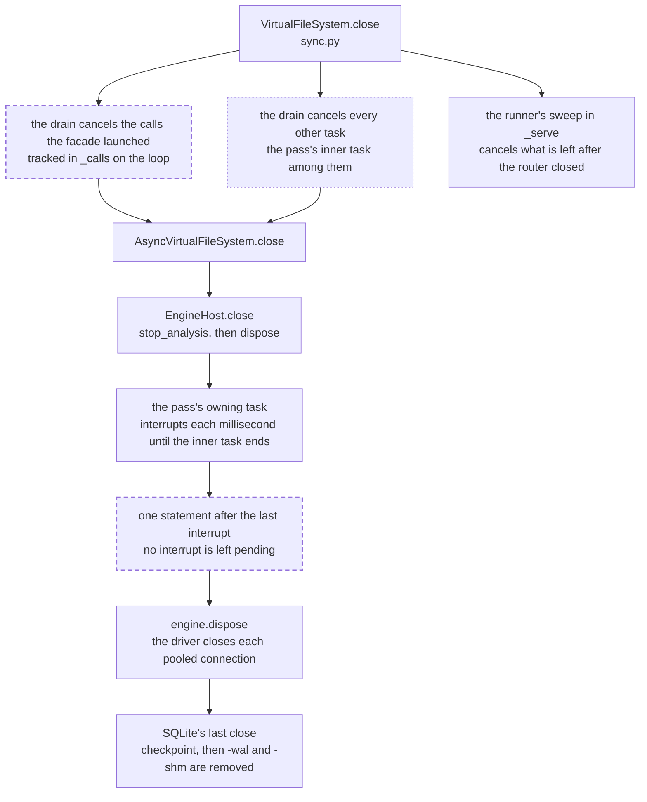

# Close leaves no SQLite side files: a cancelled statistics pass starts one statement after its last interrupt, and the sync facade's drain cancels only the calls it launched

A fix to how a file-backed SQLite store closes: not structural (no module, public class, protocol method or seam is added or removed), no public API change, no schema change. It needs the engine legs: its `engine.py` lines run only on SQLite, and its `sync.py` lines run on every engine. It does not touch rights or the Rust engine. It touches the gate's size baseline and not its ladder: both modules it edits are held at their exact counts in `MODULE_LINE_BASELINE` (`tests/lint/allowlist.py`), its build grows each by 12 lines, and it raises the two entries by exactly that, `src/vfs/storage/backends/database/engine.py` from 1,139 to 1,151 and `src/vfs/sync.py` from 1,086 to 1,098, in the one way the gate sanctions, with a placeholder memo for each module that carries its reduction (decision 4); it adds no import and no module, so `LAYERS` is unchanged. It comes from no intention: the defect was found while writing a tutorial whose last step deletes its database file and found two more files beside it. It stands on no research memo: the facts are executed runs recorded in the problem section, and the two SQLite behaviours behind them are reproduced there in a few lines of standard-library Python. It builds on, and in one clause departs from, [SQLite gathers planner statistics after each write](2026-11-07-sqlite-gathers-planner-statistics-after-each-write.md), and it narrows one sentence of [the sync facade](2026-11-06-the-sync-facade.md); decisions 1 and 2 name the places. It meets [the gate and the review read the layer map and the size baseline](2026-11-07-the-gate-and-the-review-read-the-layer-map-and-the-size-baseline.md) by that spec's decisions 6 and 7, which decision 4 follows. Its pinned mutations land as rows F1 to F4 of [the mutant ledger](../../standards/mutant-ledger.md), as [the testing standard](../../standards/testing.md) asks.

Landing order and shared files, READ in the working-tree copies on 2026-11-13 at `5d47a21a`; each spec's own review records the copy it read. The queue, in landing order: [scope crosses the seam in one shape](2026-11-07-scope-crosses-the-seam-in-one-shape.md); this spec; [search survives a chunk row deleted under its read](../active/2026-11-12-search-survives-a-chunk-row-deleted-under-its-read.md); [the scan tier reveals nothing about rows a caller cannot read](../active/2026-11-12-the-scan-tier-reveals-nothing-about-rows-a-caller-cannot-read.md); the index-publish fix, [the index publishes only what its build read](../active/2026-11-13-the-index-publishes-only-what-its-build-read.md); the rebuild refactor, [the full pass is named rebuild and its pipeline leaves the backend](../active/2026-11-12-the-full-pass-is-named-rebuild-and-its-pipeline-leaves-the-backend.md); the three rendering fixes; [refresh, the incremental index verb](../active/2026-10-31-refresh-the-incremental-index-verb.md); and the release-audit record, [the release audit is a review](../active/2026-11-07-the-release-audit-is-a-review.md), last. This spec lands second and is parallel-safe with none of the specs after it but the release-audit record. Every one of them but that record appends rows to `context/standards/mutant-ledger.md`, and every one but that record and the three rendering fixes edits `tests/lint/allowlist.py`, as this spec now does. Those two files are shared line-apart: no other spec changes the `sync.py` entry, only the index-publish fix changes the `engine.py` entry after this landing, and each spec's rows take ids of its own; so each later landing rebases onto this one. Beyond those two files: scope crosses the seam edits none of this spec's four code files (`engine.py`, `src/vfs/sync.py`, `tests/test_sync.py`, `tests/storage/database/test_statistics.py`), names this spec, and says it lands first, before this spec, and that the two share no file, which held until decision 4 added the allowlist and the ledger here; search survives edits none of the four. The scan tier adds one node, `test_a_partial_callers_overlay_fetch_keeps_its_seek_under_statistics`, to `TestPlannerStatistics` in `test_statistics.py`, the class whose two close pins this spec changes and to which it adds criterion 1's node. The index-publish fix edits `engine.py`'s `_provision`, which this spec does not touch, and it raises by exactly 1 the `engine.py` entry this landing leaves, so it starts from 1,151. In `test_statistics.py` the fix changes the `chunk_store` fixture (lines 118 to 136 at `5d47a21a`), which after its one `reindex()` empties `sqlite_stat1` with `_empty_statistics` and settles a fresh analysis, and two chunk-page nodes of `TestPlannerStatistics`, `test_the_chunk_store_makes_the_shipped_join_build_a_filter` and `test_the_chunk_pages_build_no_filter_per_page` (lines 864 to 894). It edits no line this spec edits, but it calls the helper this spec changes; this spec's change keeps what the helper does, deleting the rows and committing, and only closes its connection, which the fixture needs: with the helper as it is at `5d47a21a`, its connection is still open when the fixture's store closes, the last close does not fold the log in, and the copy `_copied` hands the chunk-page nodes has no `sqlite_stat1`; so the fix lands after this spec, as the queue has it. The rebuild refactor renames `reindex` in `engine.py`'s two docstrings that say it (lines 283 and 929 at `5d47a21a`, 286 and 941 once this lands) and throughout `test_statistics.py`: the fixture docstrings and `chunk_store`'s call at lines 94 to 130, the reindex test at 642 to 667, and `test_reindex_leaves_every_filled_table_analyzed` with the overlay test's call at 824 to 846, none of which this spec edits. It says that rename is its own and not refresh's, and that this spec's `sync.py` and `tests/test_sync.py` do not say the word. The three rendering fixes, the office container check, the docx fix and the xlsx fix, share the ledger alone, appending rows under the letters Z, G and X; none names any other file of this spec (READ, grep), and whichever of this spec and each of them lands later rebases its rows onto the other's. Refresh now says it edits none of this spec's four code files, and its text carries no edit of `engine.py` or `test_statistics.py`. The release-audit record names none of the four, leaves the allowlist unchanged, appends no ledger row and shares no file. The counts this spec leaves, for the next landing that reads them: `engine.py` at 1,151 lines with its entry at 1,151, and `sync.py` at 1,098 with its entry at 1,098. Several of those texts describe this spec as editing one tutorial page, or place its `test_statistics.py` edits outside `TestPlannerStatistics`; it edits no tutorial, and its three nodes are in that class. The Disposition of this spec's review lists each such sentence for its author, and this spec edits none of them.

## The problem

READ at `5d47a21a`; the four code files this spec edits are unchanged since `3ea2465e`, where the runs below were first made (EXECUTED: `git diff 3ea2465e f7539910`, `git diff f7539910 bba0999c` and `git diff bba0999c 5d47a21a` over them are all empty, and `git diff f7539910 5d47a21a -- src tests crates` is empty too, the commits between being documentation only). EXECUTED on Python 3.13.11, SQLite 3.50.4, SQLAlchemy 2.0.52 and aiosqlite 0.22.1. vfs puts a SQLite file in write-ahead-log mode (`dialects.py`, `file_settings`), so an open store is three files: the database, `-wal` and `-shm`. SQLite removes the two side files itself when the last connection closes cleanly. After a vfs `close()` that lands while the planner-statistics pass of a recent write is still running, the two side files stay. No data is lost: the log holds committed pages, the next open reads them, and the next clean close removes the files. But a caller who deletes or moves the database file after `close()` leaves two orphans, and a store that looks closed is not in the state SQLite calls closed.

EXECUTED, the size of it. One loop per arm: create a store over a fresh file, write one file, pause, `close()`, and test whether `-wal` exists; 60 runs per cell.

| Change applied | Pause 0 ms, async / sync | Pause 2 ms, async / sync | Pause 5 ms, async / sync |
|---|---|---|---|
| None | 41 / 15 | 51 / 31 | 46 / 53 |
| Decision 2 alone | 45 / 40 | 44 / 47 | 41 / 24 |
| Decision 1 alone | 0 / 17 | 0 / 45 | 0 / 41 |
| Decisions 1 and 2 | 0 / 0 | 0 / 0 | 0 / 0 |

The changes were applied by patching the two methods at run time, in the shapes the design below gives. Each alone is not enough, and the two together left no side file in 360 runs. A close issued 20 ms or more after the write, with the pass already finished, left none in 36 runs with no change applied. The two landed pins of a close during a pass, `test_close_interrupts_a_running_pass_and_disposes` and `test_the_sync_facade_close_disposes_with_no_pending_task`, both held `copy.sqlite-wal` and `copy.sqlite-shm` at the moment the router's close returned, in 3 runs of 3.

EXECUTED again on 2026-11-12 at `f7539910`, 30 runs per cell: today's tree left `-wal` after 14 async and 0 sync closes at 0 ms, and after 3 async and 18 sync closes at 2 ms. With decisions 1 to 3 built from the design's text into a plain copy of `src/`, 0 of 240 closes left a side file, at 0, 1, 2 and 5 ms on both faces. The rates move with the machine and its load from one run to the next, so the table is a measurement of the defect and not a pin of it; no criterion below counts it.

There are two causes, one on each path a close can take.

EXECUTED and READ, the first cause: an interrupt outlives the statement it was aimed at. The pass's owning task, cancelled by `stop_analysis` (`engine.py:476`), interrupts the pass's driver connection every millisecond until the inner task ends (`engine.py:849`, the loop at `:873`, the interrupt at `:876`). SQLite keeps an interrupt pending when no statement is running, and clears it only when the next statement starts. A statement trace of one close shows the last `interrupt()` 0.57 ms after the pass's `COMMIT` and 1.34 ms before the driver's `close()`, with no statement between them; in a run that left no side file the last interrupt came 0.09 ms before `COMMIT`. At close SQLite's last act is the checkpoint that folds the log into the database and deletes it, and that checkpoint honours the pending interrupt and stops. The trace also shows that on a store this small the interrupts stop nothing: every statement of the pass is shorter than the millisecond between interrupts, each new statement clears the one before it, and the pass runs to its `COMMIT`. On the large store of the landed pin the interrupt does end an `ANALYZE`, SQLite rolls the transaction back itself, no `ROLLBACK` statement follows (the statistics spec measured "no transaction is active"), and the interrupt is left pending the same way.

EXECUTED and READ, the second cause: a cancellation inside a statement strands its cursor. The sync facade's `_drain_and_close` cancels every other task on its loop before it closes the router (`sync.py:651`, the cancel at `:656`). A stack captured at the cancel names two tasks, `vfs_statistics` and `vfs_statistics-pass`: the second is the inner task that the pass's own design never cancels. The cancellation lands inside a statement, in the captured run the `SELECT vec_version()` of the checkout listener (`engine.py:1001`). SQLAlchemy treats it as an exit, invalidates the connection and force-closes it, and the driver cursor that had run the statement and not yet read its row is never closed. SQLite defers the real close of a connection for as long as one of its statements is unfinished, so the checkpoint never runs. In these runs no interrupt was sent at all: the trace is the probe statement, then the driver's `close()` 0.16 ms later.

EXECUTED, both SQLite behaviours with no vfs in the process. Each function below leaves `-wal` and `-shm` beside its database. The first leaves the database alone when the `interrupt()` line is removed, or when one `SELECT 1` runs between the interrupt and the close. The second leaves the database alone when `fetchone()` is replaced by `fetchall()`, and its side files are removed the moment the returned cursor is dropped.

```python
import sqlite3


def store(name: str) -> sqlite3.Connection:
    connection = sqlite3.connect(name)
    connection.execute("PRAGMA journal_mode = WAL")
    connection.execute("CREATE TABLE t (x)")
    connection.execute("INSERT INTO t VALUES (1), (2), (3)")
    connection.commit()
    return connection


def a_pending_interrupt() -> None:
    connection = store("interrupt.db")
    connection.interrupt()  # nothing is running, so the interrupt stays pending
    connection.close()


def a_stranded_cursor() -> sqlite3.Cursor:
    connection = store("cursor.db")
    cursor = connection.execute("SELECT x FROM t")
    cursor.fetchone()  # two rows are unread, so the statement is unfinished
    connection.close()
    return cursor
```

READ, what the landed specs say. The statistics spec's decision 26 put the pass's SQL in an inner task "the pass's own task never cancels", and accepted in its last clause that "a pass whose inner task is cancelled as well, as the sync facade's drain and the loop's shutdown do, has its connection invalidated by SQLAlchemy rather than rolled back"; its criterion 17 counts that invalidation. Neither spec looked at the files a close leaves. The facade's `close` docstring (`sync.py:152`) gives the drain's purpose as "the in-flight calls of other threads are cancelled and gathered on the loop before the router closes, so the engine never disposes a pool a verb is still drawing on", which is narrower than what the drain does.

## Architecture

Dashed is what this spec adds; dotted is what it retires.



Page this changes: none; the architecture folder was retired on 2026-10-31, and the landing notes will say so in one line.

Terms. The **side files** are the two files SQLite keeps beside a write-ahead-log database, named after it with `-wal` and `-shm` appended. A **pending interrupt** is an interrupt SQLite received while no statement was running on the connection; it lasts until the next statement starts there. A **stranded cursor** is a driver cursor whose statement has unread rows and which nothing will close. A **launched call** is a coroutine the facade submitted to its loop for a caller's thread through `_submit`.

## Decisions

### 1. A cancelled pass starts one statement on its driver connection after its last interrupt, before it re-raises

SQLite has no call that clears a pending interrupt; the start of a statement on a connection with none running is what clears it. The owning task's handler is the one place that knows the last interrupt has been sent, because it sends them: its loop ends when the inner task has ended, and nothing interrupts after that. So the handler, after the loop and before the re-raise, runs `SELECT 1 /* vfs_statistics */` on `state.driver` and closes that cursor, under the same suppression of `sqlite3.Error` and `ValueError` that guards the interrupts, since a driver that is already closed has nothing left to clear. The comment tags the statement as the pass's own in any trace, as the pass's `BEGIN IMMEDIATE` is tagged. The statement runs on the driver and not through the pool because the pass's session has ended by then and the fact to clear belongs to that one connection, whoever holds it next. This extends the statistics spec's decision 26, whose handler interrupts "until the inner task ends, then re-raises": it now interrupts until the inner task ends, starts one statement, then re-raises. `stop_analysis` shields its wait as before, so the statement cannot be cancelled away. An alternative, having the inner task end with a statement of its own, was rejected: the owning task can send an interrupt after any statement the inner task issues and before the inner task is done, which is the 0.57 ms gap the trace shows.

### 2. The facade's drain cancels the calls the facade launched and nothing else; the storage's own background work is stopped by the router's close

This departs from the last clause of the statistics spec's decision 26 and from the "exactly 1 `invalidate` event" of its criterion 17, and it narrows the facade spec's design sentence that the drain cancels every other task. A cancellation inside a statement strands a cursor, and a stranded cursor keeps SQLite from closing; the host already has a way to stop its pass that ends in a rollback and a pooled connection, and the router's close runs it. The drain's stated purpose is the calls of other threads, so that the engine never disposes a pool a verb is drawing on, and cancelling those calls still serves it; criterion 4 holds both halves, the launched call cancelled and the storage's own task left to the router. Whatever is left on the loop after the router has closed is still cancelled by the runner's sweep in `_serve`, unchanged, so a task born during shutdown ends as it does today.

### 3. The facade tracks its launched calls in a set touched only on the loop thread

`asyncio.run_coroutine_threadsafe` creates the task on the loop some time after the calling thread returns from it, so the calling thread cannot hold the task. `_submit` therefore wraps each coroutine in one that adds its own running task to `self._calls` as it starts and discards it as it ends, and `_drain_and_close` cancels and gathers that set. The set is read and written only on the loop thread and needs no lock. `_drain_and_close` is submitted by `close` directly, not through `_submit`, so it is never in the set it cancels. The discard sits in a `finally`, so a call leaves the set however it ends: answered, raised, cancelled by its caller, or cancelled by the drain. A task cancelled before its first step never ran the wrapper, so it never entered the set. The set therefore holds only the calls still running: one per caller thread waiting on the facade, plus any call a caller abandoned by an interrupt that has not yet finished cancelling. The cost, per verb call: one insertion and one removal on a hash set, on the loop thread, with no statement and no lock. At the reference deployment that is about 150,000 of each a day, and at the 20-a-second peak the set holds a handful of entries. Without the removal the cost would be different in kind: each finished task would stay in the set, holding that call's `Result`, so a long-lived facade would keep one more task per call, about 150,000 a day, with no bound. Criterion 5 counts the set after answered and raised calls, and criterion 4 counts it after a drained call.

### 4. The build raises the size baseline's entries for `engine.py` and `sync.py` by exactly their growth, 12 lines each, and the code review answers each raise with a placeholder memo that carries that module's reduction

The gate holds both modules at their exact counts at `5d47a21a`: `src/vfs/storage/backends/database/engine.py` at 1,139 and `src/vfs/sync.py` at 1,086 (READ, `tests/lint/allowlist.py`). The gate's spec, in its decision 6, says a landing that must add to a listed module moves or removes as much as it adds; its decision 7 makes an entry raised all the same a finding that the code review files and the author answers. EXECUTED on 2026-11-13: the Design's diff, applied to plain copies of both files at `5d47a21a` and run through `ruff format`, grows `engine.py` to 1,151 (the constant 3 lines, the clearing statement 4, `_analysis_pass`'s docstring 3, `close`'s docstring 2) and `sync.py` to 1,098 (`_tracked` 10, the set 1, `close`'s docstring 2, the drain one fewer). `size_faults(line_counts())` over that copy then gives exactly two faults, "grew to 1151 lines from its entry of 1139" and "grew to 1098 lines from its entry of 1086", and none over the unchanged copy. Paying in place was tried and falls short. EXECUTED: the tightest build that keeps decisions 1 to 3 (the clearing statement on one line, `engine.py`'s `close` docstring left as it is, `_analysis_pass`'s new clause costing one line, the drain iterating the set with no copy), and that also folds the three three-line comments of `engine.py` (in `_apply_file_settings`, `_verify_or_provision` and `_serialization_point`, which break the two-line rule) into two lines each, still grows `engine.py` by 4, to 1,143, and `sync.py` by 9, to 1,095. Nothing else in either file is slack this change can claim. Past its loop runner, `sync.py` is forwarding twins, each signature mirroring its original's line for line; seven of them, 42 lines, are split only by a trailing comma and would fit on one line, but collapsing a twin alone would break that mirror to meet a count. The rest of `engine.py` is code this change does not touch: the host's engine lifecycle, its retry and provisioning, and the rest of the statistics step. Cutting there would mean moving code or thinning docstrings to meet a count, which is the drift the gate's review exists to catch. So the two entries are raised, in the one way the gate sanctions. The build keeps the Design's docstrings whole, because they state each rule where a reader of the method meets it, and leaves the three comments as they are, since they lie outside this change.

What the raise requires, in order, by decision 7 of the gate's spec. First, the build sets the two entries to 1151 and 1098, and `git diff` from the commit the build starts from over `tests/lint/allowlist.py` shows those two lines changed and no other. Second, the code review's Ownership subsection opens with its two lines: `Layer map:` closes "ladder unchanged", since no import and no module is added, and `Size:` reads `Size: src/vfs/storage/backends/database/engine.py 1,139 to 1,151; src/vfs/sync.py 1,086 to 1,098; allowlist changed: src/vfs/storage/backends/database/engine.py raised from 1,139 to 1,151, src/vfs/sync.py raised from 1,086 to 1,098.` The review files each raise as a finding of kind `misplacement` at `major`, which it ranks Medium. Third, the build's author answers each Medium in that review's Disposition with "kept because", names the lines this landing added to the module, and links the placeholder memo that carries that module's reduction. No document carries either reduction today (READ: no active spec and no memo under `context/research/` names a reduction of either module), so, by the gate spec's decision 9, the build's author writes both memos on the day of the build, before the code review, and they land with this spec. Fourth, the reviewer opens each link and confirms that it names the module and a reduction of it; only then may the verdict begin "Lands". A raise answered with neither a move nor a link is "Not confirmed": the Medium stands and the verdict is "Does not land yet".

The two memos, one question each, named here by slug and dated the day they are written. `whether-the-planner-statistics-step-leaves-the-engine-host`: the SQLite planner-statistics step in `engine.py` (the `STATISTICS_*` constants, `_AnalysisPass`, the public methods of its section from `detect_due` to `take_advisories`, and the private helpers from `_statistics_schema` to `_analysis_transaction`, about 300 lines at `5d47a21a`) is a concern of its own beside the host's engine lifecycle, and a module of its own under `storage/backends/database/`, which the ladder places by prefix, would take `engine.py` under the ceiling and remove its entry. `whether-the-session-twin-leaves-the-sync-facade`: `Session` in `sync.py` (lines 717 to 1066 at `5d47a21a`, 350 lines) reaches the facade only through its `_result` hop and the router it wraps, and a module of its own would take `sync.py` under the ceiling; a new top-level module names its rung in the landing that adds it. Each memo states its question, what is known and the study that answers it, and decides nothing; this spec does not wait on either. Each memo's first paragraph says it is a placeholder raised by this spec's decision 4 and linked from its code review's answer to that module's raise, that no spec waits on it, that the spec which lowers or removes the entry will use its answer, and that its research has one 45-minute box. The statistics memo records, as known, that the step also runs through `close` (which awaits `stop_analysis`), `_policy` (which installs `_replace_stale`) and `_first_touch` (which reads `_read_in_memory` and `statistics_enabled`), and that `backend.py` calls `statistics_enabled`, `detect_due`, `request_analysis` and `take_advisories`. The session memo records, as known, that `VirtualFileSystem.session` builds `Session` while `Session` is typed against `VirtualFileSystem`, so a separate top-level module would name the other in both directions unless `vfs.sync` becomes a package, and that `_caller_stacklevel` skips frames by this module's name, so a moved twin would point its warning at its own frame. There is one memo per module because the two are separate questions with separate owners.

## Intent

After this spec, a developer who closes a file-backed SQLite store built from a URL, `DatabaseStorage(url=...)`, whose engine vfs owns, mounted on either face with the default ownership or used alone and closed with the storage's own `close()`, finds one file where the store was, however soon after a write they closed it; deleting or moving that file leaves nothing behind; and the planner-statistics pass is stopped the same way on both faces, by the interrupt the host owns and never by a cancellation inside its statement.

## Design

**`src/vfs/storage/backends/database/engine.py`.** A module constant for decision 1's statement, `STATISTICS_CLEAR = f"SELECT 1 /* {STATISTICS_NAME} */"`, placed directly under `STATISTICS_NAME`, with the docstring "The statement a cancelled pass starts after its last interrupt, which is what clears a pending one." `_analysis_pass`: after the `while not inner.done()` loop and before `raise`, when `state.driver` is not `None`, execute `STATISTICS_CLEAR` on the driver and close the cursor, suppressing `sqlite3.Error` and `ValueError`. The docstring of `_analysis_pass` gains the rule in one sentence, and the docstring of `close` says that the pass leaves no interrupt pending on a connection the dispose closes. Twelve lines, 1,139 to 1,151.

**`src/vfs/sync.py`.** `__slots__` gains `_calls`; `_attach` sets it to an empty set. A private coroutine method `_tracked(coroutine)` adds `asyncio.current_task()` to `self._calls`, awaits the coroutine and discards the task in a `finally`, never after the awaited return alone, so a call that raises or is cancelled leaves the set as an answered one does. `_submit` passes `self._tracked(coroutine)` to `run_coroutine_threadsafe`. `_drain_and_close` cancels and gathers a copy of `self._calls` in place of every other task on the loop, then closes the router. The docstrings of `close` and `_drain_and_close` say "the calls this facade launched", and `close`'s says that a storage's own background work is left to its own close. Twelve lines, 1,086 to 1,098.

The two source files' change is this diff, word for word, against `5d47a21a`; it is the text decision 4 measured, so the counts it leaves are fixed. EXECUTED on 2026-11-13 on plain copies at `5d47a21a` with the diff applied: `ruff format --check`, `ruff check` and `ty check` pass on both files, and `tests/test_sync.py` with `tests/storage/database/test_statistics.py` gave 186 passed and 4 failed, the four being `test_the_sync_facade_close_disposes_with_no_pending_task` on `'rollback' == 'invalidate'`, which criterion 3 changes, and three documentation checks of `tests/test_sync.py` that read `README.md` and `docs/`, which the copy does not hold.

```diff
--- a/src/vfs/storage/backends/database/engine.py
+++ b/src/vfs/storage/backends/database/engine.py
@@ -123,2 +123,5 @@
 """The statistics step's one name: the detection savepoint, the pass's begin tag and option, the record key."""
+
+STATISTICS_CLEAR = f"SELECT 1 /* {STATISTICS_NAME} */"
+"""The statement a cancelled pass starts after its last interrupt, which is what clears a pending one."""
 
@@ -536,3 +539,5 @@
         the table stays due and the next write asks again. The dispose
-        below runs either way, in a ``finally``.
+        below runs either way, in a ``finally``, and the pass leaves no
+        interrupt pending on a connection it closes: one would stop
+        SQLite's last close from folding the log in and deleting it.
         """
@@ -859,4 +864,7 @@
         every millisecond until the inner task ends (the first interrupt
-        can land before the statement has started), and only then
-        re-raises. The interrupted statement fails inside the inner task
+        can land before the statement has started), then starts one
+        statement there, and only then re-raises: SQLite keeps an
+        interrupt that finds nothing running until a statement starts,
+        and the last close's checkpoint would honour it and leave the
+        log behind. The interrupted statement fails inside the inner task
         with the driver's own error, which rolls the pass back as any
@@ -877,2 +885,6 @@
                 await asyncio.sleep(0.001)
+            if state.driver is not None:
+                with suppress(sqlite3.Error, ValueError):
+                    cursor = await state.driver.execute(STATISTICS_CLEAR)
+                    await cursor.close()
             raise
--- a/src/vfs/sync.py
+++ b/src/vfs/sync.py
@@ -96,3 +96,3 @@
 
-    __slots__ = ("_closed", "_fs", "_loop", "_thread", "_warned")
+    __slots__ = ("_calls", "_closed", "_fs", "_loop", "_thread", "_warned")
 
@@ -154,7 +154,9 @@
 
-        Idempotent and final. The in-flight calls of other threads are
-        cancelled and gathered on the loop before the router closes, so the
-        engine never disposes a pool a verb is still drawing on; the loop
-        thread then shuts itself down in its runner, so nothing here runs a
-        loop on the caller's thread (which may be running a loop of its own).
+        Idempotent and final. The calls this facade launched for other
+        threads are cancelled and gathered on the loop before the router
+        closes, so the engine never disposes a pool a verb is still drawing
+        on; a storage's own background work is left to its own close. The
+        loop thread then shuts itself down in its runner, so nothing here
+        runs a loop on the caller's thread (which may be running a loop of
+        its own).
         """
@@ -646,2 +648,3 @@
         self._warned = False
+        self._calls: set[asyncio.Task[Any]] = set()
         self._loop = asyncio.new_event_loop()
@@ -651,5 +654,4 @@
     async def _drain_and_close(self) -> None:
-        """On the loop: cancel every other task and wait for it, then close the router with nothing in flight."""
-        current = asyncio.current_task()
-        others = [task for task in asyncio.all_tasks() if task is not current]
+        """On the loop: cancel the calls this facade launched and wait for them, then close the router."""
+        others = list(self._calls)
         for task in others:
@@ -659,2 +661,12 @@
 
+    async def _tracked(self, coroutine: Coroutine[Any, Any, Any]) -> Any:
+        """On the loop: hold this call's task in ``_calls`` while it runs, however it ends."""
+        task = asyncio.current_task()
+        assert task is not None
+        self._calls.add(task)
+        try:
+            return await coroutine
+        finally:
+            self._calls.discard(task)
+
     def _serve(self) -> None:
@@ -708,3 +720,3 @@
         """Run one coroutine on the loop and block; an escaping exception cancels what is in flight."""
-        future = asyncio.run_coroutine_threadsafe(coroutine, self._loop)
+        future = asyncio.run_coroutine_threadsafe(self._tracked(coroutine), self._loop)
         try:
```

**`tests/lint/allowlist.py`.** In `MODULE_LINE_BASELINE`, `"src/vfs/storage/backends/database/engine.py"` goes from 1139 to 1151 and `"src/vfs/sync.py"` from 1086 to 1098. No other line of the file changes (decision 4).

**`context/standards/mutant-ledger.md`.** Four rows appended, one per pinned mutation the criteria name, each with its intent and anchor, target, scope, killers and provenance in the ledger's columns. F1: the clearing statement dropped from `_analysis_pass`'s handler, or run with its cursor left open, two mutations; target `engine.py`; scope `tests/storage/database/test_statistics.py`; killer criterion 1's node, on the side files. F2: the drain's choice of tasks undone, two mutations, `_drain_and_close` cancelling nothing (record `(False, False)`) or every other task on the loop as before this landing (record `(True, True)`); target `sync.py`; scope `tests/test_sync.py`; killer criterion 4's node. F3: `_submit` passing the bare coroutine and not `self._tracked(coroutine)`; the same target and scope; killer criterion 4's node, record `(False, False)`. F4: the `discard` in `_tracked` removed, or moved after the awaited return, two mutations; the same target and scope; killers criterion 4's node (1 entry left after the drained call) and criterion 5's (100 entries left after the answered calls for the first, 1 after the raised call for the second). Provenance, in the ledger's own words: F1 "close leaves no SQLite side files"; F2 and F3 "close leaves no SQLite side files, its spec review's M1"; F4 "close leaves no SQLite side files, its spec review's M2". The build proves each row on the built tree in place, under the safe-restore rule of [the testing standard](../../standards/testing.md), and records the date.

**Two placeholder memos** under `context/research/`, written by the build's author on the day of the build and before the code review, as decision 4 names them.

**`tests/storage/database/test_statistics.py`.** Criterion 1's node is added to `TestPlannerStatistics`; the two landed pins gain criterion 2's and criterion 3's assertions. Two docstrings the build makes false change: `_pass_outcome`'s docstring drops the clause about the sync facade's drain and says a pass whose inner task is cancelled, as the loop's shutdown does, has its connection invalidated; the sync pin's docstring says "Guards: a facade close that cancels the pass inside its statement, leaving a stranded cursor, a task or an undisposed engine." One test-support edit: `_empty_statistics`, the helper both pins prepare their store with (`test_statistics.py:146`), closes the connection it opens, `with closing(sqlite3.connect(url.removeprefix("sqlite+aiosqlite:///"))) as connection, connection:`, with `from contextlib import closing` among the imports. The reason in one sentence: a connection left open holds the side files, and a `with sqlite3.connect(...)` block commits without closing, so under the coverage leg of `scripts/ci.sh`, which keeps that connection alive past the store's close, the side files stay whatever the production code does. The pins' later `with sqlite3.connect(...)` blocks come after the side-file assertion and are left as they are.

**`tests/test_sync.py`.** Criterion 4's node and its double, `DrainOrderStorage`, a subclass of the file's `HangingReadStorage`, beside the tests of close; and criterion 5's node, `test_the_facade_holds_no_call_it_has_answered`, beside `test_one_thread_per_facade_not_per_call`.

**Tests first.** Every new or changed node is red on today's tree by construction, never by a race: nothing in this spec depends on a race to fail. `test_a_cancelled_pass_leaves_no_interrupt_pending` is written first and seen failing on the side files; it holds the inner task open after its transaction has committed, so the stray interrupt is certain and no timing is involved. `test_the_drain_cancels_the_launched_call_and_leaves_the_background_task` is seen failing on its background half, its record reading `(True, True)`, because today's drain cancels every task. `test_the_facade_holds_no_call_it_has_answered` is seen failing on the missing `_calls` attribute. The two landed pins gain their side-file assertion, placed at the close's return and before the test opens a connection of its own, and are seen failing on it. EXECUTED on 2026-11-12, on plain copies of the tree with the design built from its text: criterion 1's node red 10 runs of 10 on today's tree and green 10 of 10 on the build; criterion 4's node red 20 of 20 today with `(True, True)`, green 20 of 20 on the build, and red 20 of 20 with `(False, False)` both when `_drain_and_close` cancels nothing and when `_submit` is not routed through `_tracked`; criteria 2 and 3 red 3 of 3 today and green 3 of 3 on the build. Criteria 2 and 3 are seen red on today's tree and green on the build both without coverage and under `--cov`, as `scripts/ci.sh` runs them; EXECUTED by this spec's review of 2026-11-13, with `_empty_statistics` closing its connection in both copies, criteria 1 to 3 were red 3 of 3 today and green 3 of 3 on the build under `--cov`, where with the helper as it is criteria 2 and 3 stayed red on the build under `--cov`. Criterion 5's node, and criterion 4's node with its set assertion, 10 and 20 runs: red today on the missing attribute and on `(True, True)`, green on the build; with the `discard` removed, red with 100 entries left after the answered calls and 1 after the drained one; with the `discard` moved after the awaited return, red with 1 entry left after the raised call and 1 after the drained one. A call cancelled by its caller's interrupt, then one answered call, left 0 entries in 30 runs of 30 on the build; it takes the same `finally` as the drained call, which criterion 4 holds without depending on the loop's order. With the `engine.py` half alone, criteria 3, 4 and 5 fail; with the `sync.py` half alone, criteria 1, 2 and 3 fail; so each half is held on its own by a node that does not race. A write-then-close loop is not a criterion: its red depends on the machine's timing (on today's tree its sync face left a side file in 0 of 30 closes at 0 ms and 18 of 30 at 2 ms), and criteria 1 and 3 are the deterministic pins of the two causes it measures. Criterion 8's node, `tests/lint/test_code_shape.py::test_a_listed_module_never_grows_and_an_unlisted_one_stays_under_the_ceiling`, is seen failing once the source diff is in and before the two entries are raised, naming both files; EXECUTED on 2026-11-13 on the plain copies, the gate's `size_faults` gave exactly those two faults there and none on the unchanged copy.

**Scale.** Nothing here rides a per-corpus or per-index multiplier. Decision 1 costs one constant statement per cancelled pass, which happens at most once per close of a host. Decision 3 costs one set insertion and one removal per facade call, about 150,000 a day at the reference deployment, on the loop thread, with no statement and no lock; the set is bounded by the calls in flight because the removal is in a `finally`, and criteria 4 and 5 count it. A 10,000-entry write is one call and one entry. No statement grows with batch size.

## Scope

In: decisions 1 to 4. Files: `src/vfs/storage/backends/database/engine.py`, `src/vfs/sync.py`, `tests/storage/database/test_statistics.py` (with one test-support edit, `_empty_statistics` closing its connection), `tests/test_sync.py`, `tests/lint/allowlist.py` (two entries raised), `context/standards/mutant-ledger.md` (rows F1 to F4), the two placeholder memos of decision 4 under `context/research/`, and this spec's landing notes. No other file.

Out: a verb call of another thread that the drain cancels inside a statement can strand its cursor in the same way and leave the side files; it needs a second thread in flight at the moment of close, it loses no data, and closing it means reaching the driver cursor SQLAlchemy's adapter holds, which is a spec of its own if a run shows it. A store mounted on the facade with `owned=False` and a pass in flight at close: the router does not close a storage it does not own (`base.py:675`, READ), so the pass is still running when the loop shuts down, the runner's sweep cancels it inside a statement as the drain did before, and its side files can stay even after its owner's own close. The store is the host's to close, and stopping a borrowed store's background work at the facade's close would cross the ownership line the router keeps; it is a spec of its own if a caller needs it. EXECUTED: the reviewer's probe (a store mounted with `owned=False`, one write, the facade closed, then the owner's `close()` awaited on a new loop) left `-wal` in 11 of 30 runs on the build and 9 of 30 on today's tree; the author's re-run on 2026-11-12 saw 0 of 90 on each, so the rate is the machine's timing, and no data is lost either way. A store over an injected `session_factory=`: its close never touches the host's pool (`engine.py:184`: "borrowed: injected sessions; close() never touches the pool"), so its side files stay until the host application disposes its own engine, after which none is left. EXECUTED: the reviewer saw `-wal` after the storage's `close()` in 30 of 30 runs and after the host's `engine.dispose()` in 0 of 30, on today's tree and on the build; the author's re-run saw 10 of 10 and 0 of 10 on each. That is the right behaviour for a borrowed engine, and nothing here changes it. The interrupts that stop nothing on a small store, because every statement of the pass is shorter than the millisecond between them: the pass then commits statistics that are correct, the close still waits only for the pass's end, and a finer cadence is a decision for the statistics step's own next spec. The tutorial `documentation/tutorials/keep-your-files-in-a-database.md`, which at `5d47a21a` deletes `vfs.db` alone and says at its line 89 that it is the only file there is to remove: this spec makes that sentence hold for a close that lands during a pass too, and the tutorial needs no edit. Any change to write-ahead-log mode, to the checkpoint policy, or to engines other than SQLite. Moving the planner-statistics step out of `engine.py` or the `Session` twin out of `sync.py`: each is the question of its memo (decision 4). The three three-line comments of `engine.py`, which this change does not touch, are left to the next landing that edits their functions.

## Acceptance criteria

Counts and states, never clocks; and no criterion depends on a race to fail, so each new or changed node is red on today's tree by construction.

1. `tests/storage/database/test_statistics.py::TestPlannerStatistics::test_a_cancelled_pass_leaves_no_interrupt_pending`: over `DatabaseStorage(url=_url(tmp_path))`, with `EngineHost._analysis_transaction` wrapped to set a test-held `committed` event once the wrapped transaction returns and then wait on a test-held `held` event, and with `aiosqlite.Connection.interrupt` and `aiosqlite.Connection.execute` patched to append to one list: one write returns, the test waits on `committed`, starts `storage.close()` as a task, sets `held` once the list holds at least 1 interrupt, and awaits the close. Then `tmp_path` holds exactly 1 file whose name starts with `vfs.sqlite`, the list holds at least 1 interrupt, and it holds exactly 1 execute, of `STATISTICS_CLEAR`, which is its last entry.
2. `tests/storage/database/test_statistics.py::TestPlannerStatistics::test_close_interrupts_a_running_pass_and_disposes` passes with one assertion added at the return of `fs.close()`: the copied store's directory holds 0 files ending `-wal` or `-shm`. Its other counts are unchanged: 1 dispose, the pass outcome `rollback`, 0 `sqlite_stat1` rows, 0 pending tasks. It passes without coverage and under `--cov`, as the gate runs it, with `_empty_statistics` closing its connection as the Design says.
3. `tests/storage/database/test_statistics.py::TestPlannerStatistics::test_the_sync_facade_close_disposes_with_no_pending_task` passes with the same assertion added at the return of `facade.close()`, and its pass outcome reads `rollback` where it reads `invalidate` today, as the statistics spec's criterion 17 had it. Its other counts are unchanged: the loop thread ended, 0 pending tasks at the runner's sweep, 1 dispose, 0 `sqlite_stat1` rows, at least 1 interrupt. It passes without coverage and under `--cov`, as the gate runs it. It is the sync face's deterministic pin.
4. `tests/test_sync.py::test_the_drain_cancels_the_launched_call_and_leaves_the_background_task`: a `DrainOrderStorage` double, a subclass of `HangingReadStorage`, whose read records its own task and starts one background task on the loop before it hangs, and whose `close` records whether each of the two is done, then cancels the background task. A second thread's `facade.read` is waiting when `facade.close()` is called. After `close()` returns, the record reads `(True, False)`, the read's task done and the background task not done; the second thread got `concurrent.futures.CancelledError`; no loop thread is left; and `len(facade._calls)` is 0. With `_drain_and_close` made to cancel nothing, or with `_submit` not routed through `_tracked`, the record reads `(False, False)` and the node fails; with the `discard` in `_tracked` removed or moved out of its `finally`, the set keeps the drained call and the node fails; on today's tree the record reads `(True, True)` and the node fails.
5. `tests/test_sync.py::test_the_facade_holds_no_call_it_has_answered`: through `VirtualFileSystem(storage=InMemoryStorage())`, 100 `ls('/')` calls each return `success` true, and then `len(fs._calls)` is 0; then one `remove_mount('/nope')` raises `ValueError`, and `len(fs._calls)` is still 0. With the `discard` in `_tracked`'s `finally` removed, it reads 100 and the node fails; with the `discard` moved after the awaited return, the raised call leaves 1 and the node fails; on today's tree the node fails on the missing attribute.
6. `tests/test_sync.py::test_close_cancels_the_calls_other_threads_are_waiting_on`, `::test_the_runner_sweeps_a_task_born_during_shutdown` and `::test_close_under_load_on_a_real_storage_returns_cleanly` pass unchanged.
7. Every other existing test passes. `uv run pytest tests/storage/test_conformance.py -m "postgres or mariadb or mssql or oracle"` with all four `VFS_TEST_<ENGINE>_URL` variables set, through the `db_test` skill, exits 0, and `uv run pytest tests/test_sync.py -m postgres` with `VFS_TEST_POSTGRES_URL` set exits 0, which runs the facade's close over asyncpg. `scripts/ci.sh` is green on the tree as committed.
8. `tests/lint/test_code_shape.py::test_a_listed_module_never_grows_and_an_unlisted_one_stays_under_the_ceiling` passes on the tree as committed, with `MODULE_LINE_BASELINE` holding `src/vfs/storage/backends/database/engine.py` at 1151 and `src/vfs/sync.py` at 1098, each equal to `wc -l` of its file; `git diff` from the commit the build starts from over `tests/lint/allowlist.py` shows those two lines changed and no other; with either entry left at its old count, 1139 or 1086, the node fails naming that file. Both placeholder memos of decision 4 exist under `context/research/`, each names its module and a reduction of it, and the code review's Disposition links each from its answer to that module's raise.
9. `context/standards/mutant-ledger.md` gains rows F1 to F4 as the Design gives them, and no other line of it changes in this landing; each row's mutation, applied in place to the built tree and restored from its backup, makes the row's recorded killer fail.

## Landing notes

Built on 2026-11-13 in the working tree over `732425ea`, by a sub-agent of the session lead (Claude Fable 5.2) who wrote the code from this spec's text and its two reviews, and left uncommitted for a code review by an agent who did not write it. No text above these notes was changed by the build; the file as signed has a SHA-256 beginning `a6e88af47000`. The order of work was the tests first, then `engine.py`, then `sync.py`, the two baseline entries, the nine mutations, the two memos, the ledger rows and these notes. Nothing under `crates/` changed; `cargo test -p vfs-core` passes 115 and 2. Every run was on Python 3.13.11, SQLite 3.50.4, SQLAlchemy 2.0.52 and aiosqlite 0.22.1.

The anchors. The spec cites lines at `5d47a21a` and the build stands on `732425ea`. `git diff 5d47a21a 732425ea` over the four code files is empty; over `tests/lint/allowlist.py` it changes the `backend.py` and `reads.py` entries, and over the ledger rows W4 and K1, none of them a line this spec touches. Each cited anchor was found again at `732425ea` where the spec puts it, and none moved: `engine.py:184`, `:476`, `:849`, `:873`, `:876` and the checkout listener at `:1001`; `sync.py:152`, `:166`, `:651`, `:656`, `:686` and `:707`; `_empty_statistics` at `test_statistics.py:146`; and `base.py:675`, which is still the owned check although the scope landing edited that file.

Tests first, each seen failing before the code that passes it. With the three new nodes written, the two pins given their side-file assertion, `_empty_statistics` closing its connection and `src/` untouched, the five nodes gave 5 failed, 3 runs of 3 without coverage and 3 of 3 under `--cov`, each for the reason the Design names. `test_a_cancelled_pass_leaves_no_interrupt_pending` failed on `vfs.sqlite-shm` and `vfs.sqlite-wal` beside `vfs.sqlite`. `test_close_interrupts_a_running_pass_and_disposes` and `test_the_sync_facade_close_disposes_with_no_pending_task` failed on `copy.sqlite-shm` and `copy.sqlite-wal`. `test_the_drain_cancels_the_launched_call_and_leaves_the_background_task` failed on `(True, True) == (True, False)`. `test_the_facade_holds_no_call_it_has_answered` failed on `'VirtualFileSystem' object has no attribute '_calls'`. Then the `engine.py` half alone was built: criteria 1 and 2 passed and criteria 3, 4 and 5 failed, 3 failed and 2 passed. With the `sync.py` half alone (the built `engine.py` put back to its base copy for one run and restored), criteria 1, 2 and 3 failed and 4 and 5 passed. With both halves built and the two entries still at 1139 and 1086, `test_a_listed_module_never_grows_and_an_unlisted_one_stays_under_the_ceiling` failed naming both files, "grew to 1151 lines from its entry of 1139" and "grew to 1098 lines from its entry of 1086". With one entry raised and the other put back to its old count, it failed naming that file alone, once for each.

What was built, by decision. 1: `STATISTICS_CLEAR` stands under `STATISTICS_NAME` with the Design's docstring, and `_analysis_pass`'s handler, after its interrupt loop and before the re-raise, runs it on `state.driver` and closes the cursor under the same suppression as the interrupts; the docstrings of `_analysis_pass` and `close` say the rule. 2: `_drain_and_close` cancels and gathers a copy of `self._calls` and then closes the router; it no longer reads `asyncio.all_tasks()`. The runner's sweep in `_serve` is unchanged. 3: `__slots__` gains `_calls`, `_attach` sets it to an empty set, `_tracked` adds the running task and discards it in a `finally`, and `_submit` passes `self._tracked(coroutine)`. 4: the two entries are 1151 and 1098, and the two memos are written. The source change is the Design's diff word for word: the diff, read out of this file and handed to `git apply --check -R`, reverse-applies cleanly to the built `engine.py` and `sync.py`.

Per criterion, each node run on the tree as first built; what the code review's round changed is in its own paragraph below, and every node named here passes on the tree as it stands. 1: `tests/storage/database/test_statistics.py::TestPlannerStatistics::test_a_cancelled_pass_leaves_no_interrupt_pending` passes: `tmp_path` holds `vfs.sqlite` alone, the list holds at least 1 interrupt and exactly 1 execute, `STATISTICS_CLEAR`, as its last entry. 2: `::test_close_interrupts_a_running_pass_and_disposes` passes with 0 files ending `-wal` or `-shm` at the return of `fs.close()`, and its other counts as they were: 1 dispose, `rollback`, 0 `sqlite_stat1` rows, 0 pending tasks. 3: `::test_the_sync_facade_close_disposes_with_no_pending_task` passes with the same assertion at the return of `facade.close()` and `rollback` where it read `invalidate`; the loop thread ended, `pending == [0]`, 1 dispose, 0 rows, at least 1 interrupt. Criteria 1 to 3, with criteria 4, 5 and 8, passed 3 runs of 3 without coverage and 3 of 3 under `--cov`, 6 passed each time. 4: `tests/test_sync.py::test_the_drain_cancels_the_launched_call_and_leaves_the_background_task` passes: the record reads `(True, False)`, the second thread got `concurrent.futures.CancelledError`, `_loop_threads()` is empty and `len(fs._calls)` is 0. 5: `tests/test_sync.py::test_the_facade_holds_no_call_it_has_answered` passes: 100 `ls('/')` calls succeed and leave 0 entries, and `remove_mount('/nope')` raises `ValueError` and leaves 0. The three fast nodes of criteria 1, 4 and 5 passed 10 more runs of 10. 6: `test_close_cancels_the_calls_other_threads_are_waiting_on`, `test_the_runner_sweeps_a_task_born_during_shutdown` and `test_close_under_load_on_a_real_storage_returns_cleanly` pass with no line of them edited. 7: the suite passes, 4,969 passed and 9 skipped; the gate's result is in the paragraph before the changelog, and the engine legs are in their own line. 8: the size node passes with the entries at 1151 and 1098, each equal to `wc -l` of its file and to the spec's figure (the `engine.py` entry is 1157 after the code review's round, the fourth departure); `git diff 732425ea -- tests/lint/allowlist.py` shows those two lines changed and no other; both memos exist and each names its module and a reduction of it. The links from the code review's Disposition are that review's to make. 9: the ledger gains rows F1 to F4, 4 lines inserted and none changed, and each mutation was executed, as the ledger paragraph records.

Counts, as the tree stands after the code review's round. The suite collects 4,980 nodes where the base collected 4,975, 5 more: 3 in `tests/storage/database/test_statistics.py`, now 30 nodes, and 2 in `tests/test_sync.py`, now 165 with its one `postgres` node deselected. As first built it collected 4,978, with 28 nodes in `test_statistics.py`; the review's round added 2. Module sizes by `wc -l`: `engine.py` 1,139 to 1,157 and `sync.py` 1,086 to 1,098, each raised entry equal to its file; `engine.py` stood at 1,151 as first built, the spec's figure, and the round's six docstring lines are the fourth departure. `test_statistics.py` 1,003 to 1,121 and `test_sync.py` 755 to 825. `LAYERS` and `tests/lint/test_code_shape.py` are unchanged, and no import was added to either source file.

The ledger. Each mutation was applied by an edit to the tree as built, checked with `cmp` to differ from its scratch copy, run over its row's scope, restored from the copy with `cp` and checked with `cmp` to be identical; `ruff check` and `ruff format --check` pass on `src/` after the last restore. F1 over `tests/storage/database/test_statistics.py`, 28 nodes: the clearing block deleted, 3 failed, criterion 1's node on `vfs.sqlite-shm` and `vfs.sqlite-wal` and both pins on `copy.sqlite-shm` and `copy.sqlite-wal`; `await cursor.close()` deleted with the `cursor` binding kept, the same 3 failed. F2 over `tests/test_sync.py`, 165 nodes: the drain cancelling nothing, 1 failed, criterion 4's node on `(False, False)`; the drain cancelling every other task, 1 failed, the same node on `(True, True)`, and the sync pin in `test_statistics.py`, run beside it outside the scope, failed on the side files. F3: `_submit` passing the bare coroutine, 1 failed, the same node on `(False, False)`, with criterion 5's node passing under it. F4: the `discard` removed, 2 failed, criterion 4's node on `1 == 0` and criterion 5's on `100 == 0`; the `discard` moved after the awaited return, 2 failed, criterion 4's node on `1 == 0` and criterion 5's on `1 == 0` after the raised call. One more form of F1's second mutation was executed first and is not the row: `await state.driver.execute(STATISTICS_CLEAR)` with no binding at all passes all 28 nodes. EXECUTED, a standard-library probe in the scratch directory: a `SELECT 1` cursor that is held and never fetched leaves both side files at its connection's close, and a cursor that nothing holds leaves none. INFERRED from that, as first written: with no binding CPython closes the cursor the moment the call returns, so nothing is left open; with the binding kept, the re-raised cancellation's traceback holds the handler's frame and so the cursor. The code review's L3 corrected the first half: the driver's worker thread holds the cursor until its next operation returns, which is the close itself, and SQLite then finishes the close it deferred. The row records both forms and now gives the review's reason. Replayed on the tree as it stands after the code review's round, each mutation by the same steps. F1 over `test_statistics.py`, 30 nodes: the clearing block deleted, 4 failed, the three above and `test_a_pass_cancelled_with_its_inner_task_ends_cancelled` on no refused statement; `await cursor.close()` deleted with the binding kept, 3 failed; the suppression around the clear removed, 1 failed, `test_a_pass_cancelled_with_its_inner_task_ends_cancelled`, its owning task ended by `ValueError: no active connection`; the driver test before the clear removed, 1 failed, `test_close_stops_a_pass_that_never_held_a_connection`, on `AttributeError: 'NoneType' object has no attribute 'execute'` out of the close; the unbound form, 30 passed. F2 over `tests/test_sync.py`, 165 nodes, against the double as the round left it: the drain cancelling nothing, 1 failed on `(False, False)`; the drain cancelling every other task, 1 failed on `(True, True)`; the drain's `gather` deleted, 1 failed on `(False, False)`, the mutant the review found alive. F3, 1 failed on `(False, False)`. F4, 2 failed under each form, as before. Rows F1 and F2 carry the three new mutations.

Numbers reproduced, none of them a criterion. The spec's write-then-close loop, EXECUTED on this machine at 0, 1, 2 and 5 ms on both faces, 30 closes a cell: the built tree left a side file after 0 of 240 closes; the base source, copied in for the one run and restored, left one after 88 of 240 (async 12, 19, 24 and 0 of 30; sync 1, 29, 3 and 0 of 30). The same probe showed both SQLite behaviours of the problem section with no vfs in the process: a pending `interrupt()` leaves both side files, and one closed `SELECT 1` between the interrupt and the close leaves none. The Scope's in-flight case was run by the code review: with eight threads looping `glob` at the close, 24 of 30 closes left a side file on the build and 25 of 30 on the base.

Departures from the signed text, none of which changes a decision. First, the sync pin's new docstring is the Design's sentence word for word, wrapped over two lines: on one line it is 143 columns and ruff holds 120. Second, criterion 9 says each row's recorded killer fails under each mutation; that holds for F1's second mutation only in the form that keeps the `cursor` binding, as the ledger paragraph says, and the row says so. Third, the ledger's own "Replay protocol" section still tells a replay to use a git worktree, which [AGENTS.md](../../../AGENTS.md) forbids and [the testing standard](../../standards/testing.md) replaced with the in-place safe-restore rule; the build followed the testing standard, as the Design says, and left that section alone because criterion 9 allows no other line of the ledger to change. Fourth, after the code review: `engine.py` stands at 1,157 lines and its entry at 1157, where the first paragraph, decision 4, the Design and criterion 8 say 1,151 and "twelve lines". The six more lines are one sentence of `close`'s docstring, which names the second case in which a close can wait (the code review's M3, kept by the session lead's ruling); the Design's diff is otherwise as built. So three sentences of the signed text are now out of date: "the counts this spec leaves" are `engine.py` at 1,157 with its entry at 1157 and `sync.py` at 1,098 with its entry at 1098; the index-publish fix, which raises the `engine.py` entry by exactly 1, starts from 1,157 and not from 1,151; and the two docstrings the rebuild refactor renames stand at `engine.py:286` and `:947` once this lands, not `:286` and `:941`, as does every line the second paragraph and the first review's Disposition move that lies beneath `close`, six lines further on. Fifth, the code review's L2: the Intent's "however soon after a write they closed it" and the One line promise one file after every close of such a store, and the Scope puts out a close with a call of another thread still in flight, which the review's run shows can still leave the side files, on the build as on the base. The signed text stays as it is; the Changelog carries the qualifier.

Decided at the build, each a choice the Design leaves open. Criterion 1's node reads the constant as `engine_module.STATISTICS_CLEAR` and does not import the name, so the node that lands is the node seen red on the side files; an import of a name the base lacks would have failed the whole file at collection. It waits for the first interrupt on an `asyncio.Event` the patched `interrupt` sets, never on a sleep. `_empty_statistics` keeps the Design's one line and gains two docstring lines that give its reason. `DrainOrderStorage` sits with the file's other doubles, under `RespawningReadStorage`, and its node sits beside the tests of close; the node carries `pytest.mark.timeout(60)` as its two neighbours do. Criterion 5's node expects the raise with `match="No mount"`, the router's own words. Each new node's docstring names the mutations it guards and no document.

Flagged to Clay. The unbound form of F1's second mutation shows what the explicit `cursor.close()` buys on CPython. INFERRED: it matters there because the cancellation's traceback keeps a bound cursor alive, and on an interpreter without reference counting it would matter in every form. The ledger's "Replay protocol" still names a worktree, as the third departure says; it wants a change of its own. The gate's coverage run prints one or two `ResourceWarning: unclosed database` lines against nodes of `test_statistics.py`. EXECUTED, the pins under `--cov` with `tracemalloc` on: the connection the warning names was opened at `test_statistics.py:741`, the first pin's later `with sqlite3.connect(...)` block, which commits and never closes and which the Design leaves as it is; the blocks at lines 797 and 980 have the same shape. They come after the side-file assertions and no criterion reads them. The build did not run the base under coverage to count the warnings there. Other agents edited other specs and reviews under `context/` while this build ran; none is a file of this Scope, and the lint tier passed 38 each time it was run. From the code review's L1: a call whose task the runner's sweep cancels before its first step leaves its verb coroutine unstarted, and CPython reports it as never awaited when it is collected; the base threw the cancellation into the verb coroutine itself and printed nothing. The caller's answer is unchanged. Closing it means tracking the task without a wrapping coroutine, which is a change to decision 3 and a spec of its own. From its M3: a close can wait behind one statement of a verb that drew the pass's connection in the instant before the handler woke, up to `busy_timeout` for a `BEGIN IMMEDIATE` and the router's `close_timeout` above that; `close`'s docstring now says so, and a handler that never waits there would change decision 1. Two leads the code review found outside this diff, each the same on the base and neither fixed here. After a call interrupted at its wait on an in-memory store, the next call answers `vfs.unavailable`, "no such table: vfs_principal_revisions", in 100 interrupts of 100 in the review's run. And a write that starts as an async `close()` runs leaves its connection in the pool the close disposed, with both side files still there after the write has answered and after a second close, in 60 runs of 60. Five documents of other specs read `engine.py` as 1,151 after this landing and now meet 1,157: the index-publish fix and its spec review, the rebuild refactor, refresh, and the memo on the driver-error classifiers; they are their authors' to update.

After the code review, which ended "Does not land yet" on 2026-11-13 and judged the code right, each finding was answered in the tree, tests first, and in the review's Disposition; no text above these notes changed, and no line of code under `src/` changed: the one source edit is a docstring. H1, two lines of the clearing statement that no test held. `test_statistics.py::TestPlannerStatistics::test_a_pass_cancelled_with_its_inner_task_ends_cancelled` cancels both of a pass's tasks inside its first `ANALYZE`, as a loop's shutdown does, and asserts that the pass's connection was invalidated, that the closed driver refused exactly 1 statement, the clearing one, and that the owning task ended cancelled. `::test_close_stops_a_pass_that_never_held_a_connection` replaces the pass's transaction with one that takes no connection and ends once the handler has begun, and its close returns with one file beside the store. Both wait on events and neither sleeps. Each passed on the tree as built and failed under its mutant, 5 runs of 5 alone and 1 of 30 in the file: the suppression removed, on `ValueError: no active connection`; the driver test removed, on `AttributeError` out of the close. M1 and M2, the two raised entries: kept, each answered in the Disposition with the lines added and its memo. M3, kept and named by the session lead's ruling: `close`'s docstring says "Two exceptions" and gives the second, six lines; the `engine.py` entry is 1157 and the planner-statistics memo's counts and line numbers were taken again. M4: `DrainOrderStorage.read` takes one more loop step to finish its cancellation, an `await asyncio.sleep(0)` before it re-raises, as a real statement does; criterion 4's node still reads `(True, False)` on the build, 10 runs of 10, and reads `(False, False)` with the drain's `gather` deleted, 5 runs of 5. L1: the text in "Flagged to Clay". L2: the Changelog's qualifier, the sentence in "Numbers reproduced" and the fifth departure. L3: row F1 gives the review's reason. Every ledger mutation was replayed on the tree as it stands, as the ledger paragraph records.

What did not run. The other CI legs, 3.11, 3.12 and 3.14, are CI's on the push. The builder started no Docker, so criterion 7's two engine commands did not run in the build. The spec's `owned=False` and injected-`session_factory` probes, which the Scope puts out, were not re-run.

Engine legs: run by the session lead through the `db_test` cycle on the tree as built, one engine at a time and each torn down with its volume, as a superset of criterion 7's two commands: each leg ran the whole suite under its marker, `uv run pytest -m <engine>`, which holds every conformance node of that engine and, on Postgres, `tests/test_sync.py::test_the_facade_owns_its_asyncpg_loop_beside_the_main_threads_own`, the one node `uv run pytest tests/test_sync.py -m postgres` collects. Postgres 392 passed; MariaDB 382 passed, 8 skipped; SQL Server 392 passed; Oracle 387 passed; no container left. The legs ran before the code review's round; the session lead compared the two source files as the legs ran them with the tree as it lands (`diff` against the builder's scratch copies): `sync.py` is identical and `engine.py` differs only in the sentences the round added to `close`'s docstring, so the legs were not run again.

Architecture page: none; the architecture folder was retired on 2026-10-31.

Reviews: [the first spec review](../../reviews/2026-11-12-close-leaves-no-sqlite-side-files-spec-review.md) ended "Not yet" twice on 2026-11-12, on M1 and then on M2, and "Fit to build" on its second re-read; its standing verdict is its last dated line, the second reviewer's re-read of 2026-11-13: "Fit to build". [The second spec review](../../reviews/2026-11-13-close-leaves-no-sqlite-side-files-spec-review.md) ended "Not yet" on 2026-11-13 on H1, and its standing verdict is its last dated line, on the digest beginning `a6e88af47000`, which is this file as it stood before these notes: "Fit to build". [The code review](../../reviews/2026-11-13-close-leaves-no-sqlite-side-files-code-review.md), written by a reviewer who did not write this change, read the working tree over `732425ea` and ended "Does not land yet" on 2026-11-13 on one High, H1, and four Mediums, M1 to M4, with three Lows, L1 to L3; every finding is answered in its Disposition, and its standing verdict is the last dated line of its Verdict section, or the section's first line while no line there carries a date. The two memos decision 4 asks for are [whether the planner-statistics step leaves the engine host](../../research/2026-11-13-whether-the-planner-statistics-step-leaves-the-engine-host.md), for `engine.py`'s raise, and [whether the session twin leaves the sync facade](../../research/2026-11-13-whether-the-session-twin-leaves-the-sync-facade.md), for `sync.py`'s.

`scripts/ci.sh` on the working tree as built, with the memos and the ledger rows written and before these notes, exited 0: install, lint, format and types PASS; 4,969 passed and 9 skipped; coverage 100% over 13,260 statements; 44 docs examples; the wheel 9 MB under the 50 MB budget; all legs green. Run again with these notes written, it exited 0 with the same counts. `uv run ruff check src/ tests/`, `uv run ruff format --check src/ tests/` and `uv run ty check src/ tests/` are at zero, and `uv run pytest tests/lint -q -n 0` passes 38. No node failed in either run of the gate. Run a third time on the tree as it stands after the code review's round, with the review's Disposition and these notes written but for this sentence and the next two, it exited 0: the same legs PASS; 4,971 passed and 9 skipped; coverage 100% over the same 13,260 statements; 44 docs examples; the wheel 9 MB; all legs green; the three checks at zero and the lint tier 38 passed. No node failed. That run printed three `ResourceWarning: unclosed database` lines; EXECUTED, the two nodes the round added and criterion 1's, run under `--cov` with `tracemalloc` on, print none. The session lead ran the gate on the same tree after each of the builder's two rounds, each exit 0 with the builder's counts, and a last time with the code review's re-read of 2026-11-13 written, whose standing verdict is "Lands", and this file moved to the archive with its links to the queued specs rewritten to `../active/`.

**Changelog:** Fixed — closing a file-backed SQLite store built from a URL leaves the database file alone, with no `-wal` or `-shm` file beside it, however soon after a write the close comes when no call of another thread is still in flight at the close; before, a close that landed while the planner-statistics pass of a recent write was still running could leave both. The synchronous facade's `close()` now cancels only the calls it launched for other threads and leaves a storage's own background work to that storage's close.

## One line

A close of a file-backed SQLite store built from a URL, whose engine vfs owns, leaves the database file alone, because a cancelled statistics pass clears its own last interrupt and the sync facade no longer cancels that pass inside a statement.
