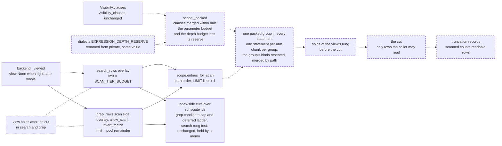

# The scan tier reveals nothing about rows a caller cannot read: the caller's compiled rights clauses ride the statements that cut the dirty rows, packed into as few as the budgets allow, so the cut, its record and the answer count only rows the caller may read

A fix to the scan tier that grep and ranked search share on the database backend (`src/vfs/storage/backends/database/scope.py`, `grep.py`, `search.py`). It touches rights: it moves where a partial caller's visibility predicate is applied, from Python after the cut to the SQL statements that make the cut, and it changes what a partial caller observes (a count, a truncation record, and which of its own readable rows answer), so the security lens is mandatory in both reviews and criterion 1 is a leak test over two stores that differ only in documents hidden from the caller. It changes no rights rule, no grant path, no `Visibility` method and no compile: the predicate is the clauses `visibility_clauses` already builds, merged into fewer statements. It needs the engine legs: the clauses ride a statement on every engine, criteria 2 and 3 are conformance rows, and criterion 7 reads each server engine's plan of the changed statement, all run on Postgres, MariaDB, SQL Server and Oracle through the `db_test` skill. It is not structural (no module, public class, protocol method or seam is added or removed), changes no public API (`VirtualFileSystem` and the storage protocol keep every signature; `entries_for_scan` gains one keyword), no schema, no stored byte and no Rust. It touches the gate's size baseline in one entry: `search.py` shrinks by three lines and its `MODULE_LINE_BASELINE` entry is lowered by three; `dialects.py`, also held, keeps its exact count (decision 11). It comes from no intention: the claim was made in passing by [the refresh spec](../active/2026-10-31-refresh-the-incremental-index-verb.md), whose scale paragraph names it as outside its scope, and every fact here was read or executed for this spec or its review and is recorded in the problem section. The index-side cuts it does not fix are held by [a placeholder memo](../../research/2026-11-13-how-the-index-side-cuts-are-bounded-over-the-visible-set.md), on which this spec does not wait (decision 9). Landing order and shared files, READ in the working-tree copies on 2026-11-13 at `5d47a21a`: the queue is [scope crosses the seam in one shape](2026-11-07-scope-crosses-the-seam-in-one-shape.md), [close leaves no SQLite side files](2026-11-12-close-leaves-no-sqlite-side-files.md), [search survives a chunk row deleted under its read](2026-11-12-search-survives-a-chunk-row-deleted-under-its-read.md), this spec, [the index publishes only what its build read](../active/2026-11-13-the-index-publishes-only-what-its-build-read.md), [the full pass is named rebuild](../active/2026-11-12-the-full-pass-is-named-rebuild-and-its-pipeline-leaves-the-backend.md), three rendering fixes dated 2026-11-13, [refresh, the incremental index verb](../active/2026-10-31-refresh-the-incremental-index-verb.md), and [the release audit is a review](../active/2026-11-07-the-release-audit-is-a-review.md) last; this spec is not parallel-safe with any spec below that shares a file with it. Scope crosses the seam edits `scope.py`, `grep.py`, `search.py`, `tests/storage/database/test_grep.py`, `tests/storage/database/test_search.py`, `tests/support/storage_contract.py`, `tests/lint/allowlist.py` and `context/standards/mutant-ledger.md`, and runs the `plan_store` fixture's plan pins, whose file this spec edits. Its prefilter reaches `entries_for_scan` as more admissions, and this spec rebases onto that landing and adds its `view` keyword beside them. That landing is built in the working tree and not yet committed: it adds `src/vfs/storage/backends/database/addressing.py` and leaves `scope.py` at 349 lines, `search.py` at 1,248, `grep.py` at 650 and `reads.py` at 1,268 (READ, `wc -l` over the working tree), and this spec's line counts start from those. Close leaves no SQLite side files edits `tests/storage/database/test_statistics.py`, which this spec also edits in another class (`TestPlannerStatistics`, one new node); the two are independent and this spec follows it by the queue's order. Search survives a chunk row deleted edits `search.py` (the answer assembly, a new `_resplit_bodies` beside `_overlay_bodies`, the module docstring; not the overlay block this spec edits), `test_search.py` (its class `TestVanishedChunks`, which this spec's nodes do not touch), `tests/lint/allowlist.py` (it raises `search.py`'s entry by 33) and the ledger (rows S1 to S4), and its own first paragraph names this spec and these files; this spec rebases onto it, lowers by three the entry it leaves, and takes ledger rows V1 to V3. The rename edits `search.py` (it moves the lexical reads to `lexical.py`; the overlay block and `search_rows` stay), `grep.py`, `test_search.py`, `test_grep.py`, `test_statistics.py`, `storage_contract.py`, `tests/lint/allowlist.py` (it removes `search.py`'s entry once the file is under the ceiling) and the ledger, and it renames `reindex` in every test file that says it, which includes `tests/support/grants_contract.py` and `tests/support/plan_store.py`. The index publishes only what its build read, which lands right after this spec, edits `dialects.py` (a new function, `is_unique_violation`, beside `is_retryable`, on lines this spec does not touch), `tests/storage/database/test_grep.py`, `test_statistics.py` (two `TestPlannerStatistics` nodes), `tests/support/plan_store.py`, `tests/support/storage_contract.py`, `tests/lint/allowlist.py` and `context/standards/mutant-ledger.md`, all of which this spec also edits, by its Scope section. Refresh's Scope section names `grep.py`, `search.py`, `test_grep.py`, `test_search.py`, `tests/support/storage_contract.py`, `tests/lint/allowlist.py` and `context/standards/mutant-ledger.md` among its files, all of which this spec also edits. The three rendering fixes share only `context/standards/mutant-ledger.md` with this spec, by their Scope sections. The rename, the index-publish fix and refresh each name this spec in their working-tree copies; each rebases onto this landing. The release audit is a review shares no file.

## The problem

READ at commit `5d47a21a`, whose `src/` and `tests/` are unchanged since `f7539910` (EXECUTED, `git diff --stat f7539910 HEAD -- src tests` is empty); every line number below is that commit's, and the runs were made while the working tree still matched it (EXECUTED, `git status`). The scope landing built since then moves some of these lines; the first paragraph gives the counts it leaves. EXECUTED runs used Python 3.13 through `uv run` on SQLite, with scripts kept in the session scratchpad; some ran on the spec reviewer's build of the first draft (`src/` copied, the Design applied), named "the draft build" below; no Docker leg was run. Where a run lowers `SCAN_TIER_BUDGET` to 2 or 3 on the `search` and `grep` modules, it does so to keep the stores small; the defect does not depend on the number.

**The law.** READ. [The grants spec](058-row-level-permission-grants/spec.md) pins every read builder with "a test that plants a hidden row whose content would match and asserts it never appears, never changes a count, and never changes a visible row's score" (its Tests paragraph), and [rights at scale](150-rights-at-scale/spec.md) restates the rule it implements: hidden rows are absent, statistics are over the visible set. Nothing a caller can observe (a score, a statistic, a count, a truncation, an error) may change with the existence of a row it cannot read.

**Where the scan tier cuts.** READ. Both verbs serve the `NOT encoded` content rows from live bodies through one nominator, `entries_for_scan` (`scope.py:245`). It takes no view. Its statement is `SELECT … WHERE <content kinds> AND NOT encoded AND <arms or root fan> ORDER BY path LIMIT limit + 1` (`scope.py:313`; the ungated form at `:324`), the chunks merge by path, pruned to the lowest `limit + 1` (`:316` to `:318`), and the cut is `rows[:limit]` with an overflow flag (`:327` to `:329`). Search calls it with `limit=SCAN_TIER_BUDGET` (`search.py:425` to `:440`), applies the caller's view to the rows that came back (`:447`), and records `{"scanned": len(nominees.rows), "budget": SCAN_TIER_BUDGET}` on overflow (`:457`). Grep calls it with the pool's remainder (`grep.py:306` to `:321`), counts `scanned = len(nominated)` (`:322`), turns overflow into the "candidate budget" record (`:323` to `:324`), applies the view after (`:330` to `:332`), and puts `{"scanned", "index", "budget"}` on the record (`:394`). Grep runs the same nominator in three modes: the overlay of a gram-indexed pattern, `allow_scan` for a pattern with no gram, and `invert_match`; the last two pass `everything=True`, so their cut is over every content row, indexed or not (`grep.py:216`, `:314`). The cut is a SQL `LIMIT` in path order over rows the caller may not read; the view filters afterwards in Python. So hidden rows take slots in the cut, and every number derived from the cut counts them.

**What the rights module already offers.** READ. The rights module's docstring says SQL predicates are pushdowns "where a statement's shape needs one (a `LIMIT`, an aggregate, a subtree scan)" (`rights.py:38` to `:40`). `visibility_clauses` compiles a caller's rights into OR-clauses, each within half the membership budget in binds and at most one arm budget of units, 200 (`rights.py:480` to `:506`), exposed as `Visibility.clauses` (`:584`). The vector leg already rides it inside its `ORDER BY distance LIMIT k` statement, one statement per clause, merged (`search.py:775` to `:776`). Its exactness against the Python authority is pinned by `tests/storage/database/test_rights.py::test_the_clauses_admit_exactly_what_the_rights_admit` (`:163`), under bind budgets of 4, 9 and 2,099. The backend passes no view at all when the caller's read rights are whole (`backend.py:1702` to `:1703`).

**Was the order a decision.** READ. No. [The overlay spec](2026-11-09-the-overlay-counts-in-the-engine-and-the-scan-tier-shares-one-budget.md), which made the shared cut, says in its first paragraph that it changes "no rights rule", and none of its decisions names the order of cut and view. Its [first spec review](../../reviews/2026-11-09-the-overlay-counts-in-the-engine-and-the-scan-tier-shares-one-budget-spec-review.md) checked the flag "no … rights … change" and nothing more; its [code review](../../reviews/2026-11-10-the-overlay-counts-in-the-engine-and-the-scan-tier-shares-one-budget-code-review.md) rejected a data-isolation record because "the record's `data` carries three counts and no path", without asking whether the counts move with hidden rows. The older form of the question is on record as unanswered: grep's docstring says "the candidate budget still counts hidden candidates, so a partial caller can reach it sooner than a whole one" (`grep.py:195` to `:196`); [the permission ladder spec](../active/165-the-permission-ladder-list-and-contribute/spec.md) left "grep's candidate budget counts hidden candidates" open and out of its scope; and [the identity audit of 2026-10-28](../../research/studies/2026-10-28-the-0-1-0-roadmap-audits/05-identity-rights-and-the-trust-edge.md) found it still open, "a visible-set/statistics inconsistency". No decision with a reason, and no review that accepted the observable effect.

**What a partial caller observes.** EXECUTED. Two SQLite stores hold the same world: posture `none` at `/`, `bob` granted `read` on `/pub`, a few indexed files, readable dirty files under `/pub`. Store B also holds dirty files under `/hr`, which bob cannot read and which sort ahead of `/pub`. With the cut at 2, bob's calls on both stores were compared field for field: observations (paths, order, scores), errors (kind, severity, data, message), `lexical_stats` and `legs`. With one hidden dirty file in B, bob's grep lost its readable dirty file and gained a `truncated` warning carrying `{"scanned": 1, "index": 1, "budget": 2}`; store A answered the file with no record. With five hidden dirty files in B ahead of two readable ones, bob's search lost both readable files, gained the overlay-budget record `{"scanned": 2, "budget": 2}`, and reported `legs.lexical.hits` of 1 where A reported 3; bob's grep lost its readable dirty file; bob's `allow_scan` and `invert_match` greps answered nothing where A answered `/pub/indexed.md`. So both halves of the claim hold: a number and a record a partial caller sees change with the existence of rows it cannot read, and hidden rows crowd the caller's own readable rows out of an answer that then reports truncation. Search's `lexical_stats` stayed equal in every case, because the export reads the visible lexicon, not the overlay. The spec review re-ran these cases and 88 calls by partial callers of every kind (one clause, seventeen clauses, no rights, the owner floor, anonymous under a settled posture and under an in-flight cover and hole, the trash view, two scope roots): 56 differ between two such stores today; on the draft build 1 differs, through the index side (below).

**The fix, applied.** EXECUTED, first with the nominator replaced at run time, then on the draft build: every field of every scan-tier case above was equal between stores A and B, and B answered what A answered. On the grants contract's own world, with the cut at 2, five hidden dirty files and two readable ones, both local legs' shapes (the in-memory store, and a file store with the hash embedder) answered today with no readable dirty file and a record, and on the draft build with bob's search answering `/pub/fresh0.md` and `/pub/fresh1.md` first and then the two indexed files bob may read through the vector leg, `legs.lexical.hits` 2 and no record, and bob's grep answering exactly the two dirty files.

**What each form of the filter costs.** EXECUTED, the compile at each profile's real budget. The statement lets an engine start from the `(encoded, kind)` seek and evaluate the arms and the clause on each dirty content row, D of them, whatever its arms admit; SQLite's rarity hint holds that seek (the spec review, EXECUTED), and another engine's planner may serve a group from the caller's ranges or owner rows when its statistics say those are fewer (decision 15). Today a call issues one statement per arm chunk and visits D rows. Four named callers on one SQLite store, holding `read` on 20, 100, 300 and 800 folders, compile with their owner floor to 166, 811, 2,423 and 6,453 binds, about 8 binds a folder; that is 1, 2, 4 and 9 clauses on SQLite, Postgres and MariaDB, up to 1, 3, 7 and 18 on Oracle, whose clauses take half its 1,000-element membership budget. (a) One statement per clause visits D times the clause count. (b) The same clauses merged into statements whose summed binds stay within half the parameter budget and within the expression-depth budget less its reserve (936 binds on every profile) need 1, 1, 2 and 4 statements on SQLite, Postgres and MariaDB and 1, 1, 3 and 8 on SQL Server and Oracle. At 800 folders the spans' clauses hold 2,399 binds and pack three to a statement, and the owner floor is one clause of 4,054 binds on SQLite, wider than the cap and so a group of its own, where Oracle's and SQL Server's smaller clause budgets split it into several. INFERRED from that shape: at 1,000 folders about 5 statements on SQLite, Postgres and MariaDB and about 10 on SQL Server and Oracle, against about 11 and 22 clauses. The synthetic compile the spec review used, rights without an owner floor at 3 binds a folder, gives 1, 2, 11 and 51 clauses and 1, 1, 4 and 19 packed statements at 1, 100, 1,000 and 5,000 folders on all five profiles (EXECUTED). (c) The join to `Visibility.entries` is one statement, but its derived table enumerates every row the caller may see before the join; [the document-level security memo](../../research/2026-09-30-search-document-level-security-prior-art.md) measured that the join "still grows with visible rows", which at the reference deployment is up to 10,000,000 a call for a broad caller. (d) Choosing by the filter's size between a pre-filter and a post-filter, as Lucene's kNN query does: the only exact post-filter here streams every dirty row to Python and keeps the first readable ones, one statement and D visits but up to D rows shipped a call. At the dirty set this landing leaves (a daily rebuild, so up to about 50,000 rows by the end of a working day, and up to about 1,000,000 through the nightly batch), a call by a named caller with 1,000 folders visits 50,000 rows today, about 550,000 to 1,100,000 under (a) and about 250,000 to 500,000 under (b) by day; by night 1,000,000, about 11,000,000 to 22,000,000, and about 5,000,000 to 10,000,000 (the lower figure on SQLite, Postgres and MariaDB). A caller with 100 folders visits today's rows under (b), though each visited row now evaluates its group (decision 16), and two to three times them under (a). EXECUTED on SQLite at P of 800 over 10,000 files with statistics: the draft's form issued 9 scan-tier statements, the merged form 4, with the same answer; every merged statement planned as `SEARCH vfs_entries USING INDEX ix_vfs_entries_encoded_kind`, and one of the draft's nine, a clause of point grants alone, planned as `SEARCH vfs_entries USING INDEX ix_vfs_entries_path (path=?)`. EXECUTED: SQLite refuses an OR of about 2,000 terms as "Expression tree is too large (maximum depth 1000)", whether or not each clause is parenthesized, and runs one of about 800, so the depth budget, not only the bind budget, limits a merged statement.

**The plan.** EXECUTED on SQLite over 10,000 files in the plan store's shape, reindexed, statistics settled, bob granted `read` on twenty roots, one dirty file: the overlay statements a search and a 20-glob grep issue plan as `SEARCH vfs_entries USING INDEX ix_vfs_entries_encoded_kind (encoded=? AND kind=?)`, gated and ungated, and plan the same with bob's compiled clause ANDed in. The four server engines' plans of the changed statement have not been read; criterion 7 reads them.

**The neighbouring cuts.** Every budget, cap or early stop on a read path a partial caller reaches, and whether it counts rows before the view. (a) Grep's index-side candidate cap: the engine's candidate kernel caps the sorted surrogate doc ids at `SCAN_TIER_BUDGET` (`grep.py:453`) before any entry row is read; EXECUTED with the cap at 2, two hidden indexed matches with lower ids than bob's one readable match left bob with no answer and a `truncated` record, where the store without them answered the match. (b) Grep's deferred ladder: the price `_ladder_defers(chosen, meta, len(allow))` (`grep.py:445`) and the slice `allow[:SCAN_TIER_BUDGET]` with `len(allow)` as the nominated count (`:262`) read the scope's allow-list, which holds every entry in the scope, files awaiting the index included, since a written file already holds segment ids; EXECUTED by the spec review on the draft build with the cut at 2, the allow-list of one scoped grep counted 4 ids on one store and 9 on the other, of two that differ only in five hidden files awaiting the index, the ladder deferred on one and not the other, and only one answer carried a `truncated` record. The gram choice (`:484`) reads `doc_count` and changes an answer only through the cap. (c) Search's rung test, `len(allow) <= SCOPE_ID_BUDGET` (`search.py:346` for the lexical leg, `:786` for the vector leg), counts the same allow-list; EXECUTED with `SCOPE_ID_BUDGET` at 2 and `FUSION_K` at 1, three hidden files inside bob's glob scope moved his search to the wide rung and his one readable in-scope file was not answered. (d) Search's lexical depth `FUSION_K`, its deepening and its window record: under a partial view the scorer runs over the visible chunks only (`search.py:348` to `:354`); not this defect. (e) The vector leg's `LIMIT`: the clause already rides inside it (`:775` to `:776`); not this defect. (f) Glob: no count cut before the view; `max_count` cuts the served rows after it (`reads.py:439` to `:441`); its docstring records why its view stays in app code, "a clause beside the fan would demote its plan" (`:357` to `:358`); not this defect. (g) The wall: a time bound, not a count (decision 10).

**Whether the deferred ladder can come inside this spec.** EXECUTED on a 20,000-file SQLite store whose every body holds one common word, with a caller reading 10 files under `/big/mine` and none of the other 19,990 under `/big`. A grep scoped to `/big/**` builds an allow-list of 20,201 ids and does not defer; pricing it over what the caller can read needs every listed id's row, 21 statements at the 1,000-element floor and 20,201 row visits, where today the price reads a list's length. A grep scoped to `/big/mine/**` builds 10 ids, defers, and fetches no posting bytes; with deferral forbidden for it, it fetched the 60,009 posting bytes of the chosen grams, about 3 bytes a document. INFERRED from those figures at the reference deployment: a readable price or slice costs a row visit per listed id, about 2,000 statements a call for a scope over 2,000,000 files; never deferring for a partial caller fetches a common gram's postings on every narrow scoped grep, about 30 MB a call at 10,000,000 files, which the code's own cost model (`grep.py:137` to `:139`) prices near 1.65 s against about 0.75 ms to verify a 10-file scope. Neither is bounded, so the ladder stays with the two other index-side cuts (decision 9).

## Architecture

Dashed is what this spec adds; dotted is what it retires.

Page this changes: none; the architecture folder was retired on 2026-10-31, and the landing notes will say so in one line.

Terms. The **scan tier** is the set of content rows a verb reads from live bodies: the `NOT encoded` rows for search's overlay and grep's overlay, every content row for grep's `allow_scan` and `invert_match`. The **cut** is the path-ordered count at which `entries_for_scan` stops. A **partial caller** is one whose read rights are not whole, so the backend hands the verb a `Visibility`. A **clause** is one of the OR-clauses `visibility_clauses` compiles for that caller; a **packed group** is a run of consecutive clauses merged into one predicate for one statement. A **surrogate-id cut** is a cut over a list of entry ids that carries no path, made before any entry row is read. **D** is the number of dirty content rows the `(encoded, kind)` seek returns.

## Decisions

### 1. The scan tier's cut counts only rows the caller may read: `entries_for_scan` takes the call's view, and every statement it issues carries the caller's compiled clauses

The law says a count and a truncation may not move with a hidden row, and the cut is where both are made. The cut is the `LIMIT` of a SQL statement, which is exactly the shape the rights module's pushdowns exist for. Filtering after the cut cannot be repaired by fetching more, because any fixed overfetch is again a count that hidden rows can fill. The clauses are exact against the Python authority (pinned by `test_the_clauses_admit_exactly_what_the_rights_admit`), so the rows the `LIMIT` returns are the rows the caller may read, in path order, and the cut, its overflow flag and every number derived from them are taken over the visible set. One change in the shared nominator fixes both verbs and all three grep modes.

### 2. The filter is the compiled clauses packed into as few statements as the bind and depth budgets allow, on every dialect; not one statement per clause, not the range join, not a post-filter chosen by size

Every form keeps the law; they differ in cost, counted in the problem section. One statement per clause visits the dirty rows once per clause: 9 times for a named caller with 800 folders on SQLite, Postgres and MariaDB and 18 times on Oracle. Packing the same clauses into statements whose summed binds stay within half the parameter budget and within the depth budget less its reserve visits them once for a named caller up to about 100 folders, 4 times at 800 on three profiles and 8 on the other two (EXECUTED); it adds no compile, since the groups are unions of clauses the compile already made, and the depth cap is a fact SQLite enforces (EXECUTED). The cap counts binds, not terms: every term spends at least one bind, so a group within the cap is within the depth budget, and the `Clause` the compile already returns carries its binds and no term count; counting terms would need the compile to report them from `rights.py`, held at its exact count. The range join is one statement, but it enumerates every row the caller may see, which grows with the corpus, not with the dirty set. A post-filter visits the dirty rows once but ships up to all of them, hidden ones included, into Python on every call, 1,000,000 by night, and the threshold at which it beats the packed form is a ratio of transfer to visit cost that no run here has measured. So the packed form has the lowest per-call cost that is bounded by the dirty set on every engine. Amended 2026-11-13, after the build's engine legs: that bound holds where the engine starts from the rows awaiting the index or serves a group from the caller's own ranges, which Postgres and MariaDB do on the builder's counted world and Oracle and SQLite do on the corrected plan store (Oracle's work was not counted); SQL Server scans its clustered index for every caller once about 1 % of the table awaits the index, before this spec as after it (decision 18), and each visited row pays for its whole group (decision 16). The bounded form at any grant count is a partial index over the rows awaiting the index keyed by path, so that a range join seeks only the dirty rows inside the caller's ranges; it is a schema change, named under Scale as the direction, as the overlay spec already named the partial index.

### 3. One statement per arm chunk per packed group; the group's binds are reserved from the arm chunk and the root fan; the statements merge by path and prune to the lowest `limit + 1`

A packed group spends up to half the parameter budget in binds, so the arms beside it must leave room or a statement would overdraw the engine's bind cap on the least generous engine (SQL Server's 2,099, Oracle's 1,000-element `IN` list). The arm chunk is sized with `arm_budget(profile, parameter_budget - spend, …)` and the root fan with `reserved=kinds.binds + spend`, where `spend` is the widest group's binds, so every statement stays inside the budget. The merge is the top-k merge the grants spec's fan rule names exact: every row of the global first `limit + 1` by path is admitted by some group and ranks at least as high there. The deadline is consulted before every statement, as it is between chunks today. No statement grows with caller input: a group is bounded by the two budgets, the arms by the chunk.

### 4. `holds` at the view's rung stays the authority, and it runs inside `entries_for_scan` on the merged rows before the cut; search and grep stop filtering by the view after it

The rights module makes the Python check the authority every fetched row passes, and the pushdown only narrows toward it. Running it before the cut keeps every counted row a held row; the cut's exactness rests on the clauses', which `test_the_clauses_admit_exactly_what_the_rights_admit` pins. With the check inside the nominator, both callers' after-the-fact filters are dead and go, which is what pays for decision 11's three lines.

### 5. The records keep their reason words, kinds, severities, guidance and data keys; `scanned` now counts rows the caller may read, and overflow means more such rows than the cut

A caller already reads these records; a new vocabulary for the same fact would be churn. What changes is only the set the numbers are taken over, which is the law's set.

### 6. A caller whose read rights are whole is served exactly as today

The backend passes no view then (`backend.py:1702`), the nominator builds no clause, and the statements, their count and their binds are today's. A view reaches the nominator only when the caller's read rights are not whole, so `view.clauses()` is a list there; `None` is read as no view. The fast path is the default open posture's, and nothing a partial caller gains may cost it. The guard this rests on is `TestOverlayGate::test_the_scan_path_statement_count_is_unchanged`, which also asserts that a whole caller's call issues exactly one scan-tier statement.

### 7. The ungated statement and the gated ones share one loop

Today the ungated form (`scope.py:320` to `:325`) is a second statement shape with no merge. Under packed groups it would need its own loop and merge; expressing its terms as one `where` beside the arms' lets one loop issue every statement, merge and prune. The statement each form issues for a whole caller is unchanged.

### 8. The depth reserve becomes public as `EXPRESSION_DEPTH_RESERVE`, the one name both the arm budget and the packing read

The packing's depth cap is the profile's `expression_depth_budget` less the same reserve the arm fan holds back for the predicates AND-chained above it (`dialects.py:726`, `:753`). A second constant with the same meaning in `scope.py` would be a duplicate that drifts; importing a private name across modules is the smell the house rules name. The rename changes two lines and no count.

### 9. The index-side cuts over surrogate ids stay as they are, and the placeholder memo holds them: grep's candidate cap, grep's deferred ladder (its price and its slice), and search's `SCOPE_ID_BUDGET` rung test in both legs

Each is a count over a list of entry ids taken before any entry row is read, and an id carries no path for a clause to judge. Taking any of them over readable ids needs each listed id's row, so the work grows with the list: a common gram's candidates, or a scope's every entry, a row visit each. The problem section measures it for the deferred ladder (21 statements and 20,201 row visits for a 20,000-file scope, about 2,000 statements a call for a 2,000,000-file scope at the reference deployment), and forbidding deferral instead costs a narrow scoped grep the common gram's postings, about 30 MB a call; for the candidate cap it is about a thousand statements a call where today it is about 25. That is a per-call cost in proportion to the corpus, which the production posture forbids at about 150,000 verb calls a day. These cuts break the same law by a different mechanism: they still count ids the caller cannot read, and a file awaiting the index holds such an id, so they can still move with hidden files written since the last pass. [The placeholder memo](../../research/2026-11-13-how-the-index-side-cuts-are-bounded-over-the-visible-set.md) names each cut, what was executed, the cost argument and the direction prior work points to: path-ordered ids that make a caller's rights a range the kernel can meet before it cuts, which the grants spec deferred to a design of its own. Grep's docstring keeps its sentence, narrowed to those cuts.

### 10. The wall is unchanged

The wall bounds time, and the time any call takes includes the engine's index work on rows the caller cannot read, on every verb; no order of filter and cut makes a time bound independent of them, and a test may never assert on time. This spec narrows it as a side effect: hidden rows no longer cross the wire into the scan tier or reach its judge hop.

### 11. `search.py` shrinks by three lines and its `MODULE_LINE_BASELINE` entry is lowered by three; `dialects.py` keeps its exact count; `grep.py` keeps its length; `scope.py` grows under the ceiling

The call site gains one line (`view=view,`) and the five-line `admitted` comprehension becomes one line once its view test goes (decision 4), a net of three fewer (EXECUTED on the draft build: 1,248 to 1,245 at `5d47a21a`). The entry falls by three from the value the landing before this one leaves (1,248 after scope crosses the seam, then raised by 33 by search survives a chunk row deleted). `grep.py` (650 after scope crosses the seam) is unchanged in length: the scan side loses its view test and the call gains `view=view,`. `scope.py` (349 lines after scope crosses the seam) grows by about thirty with the loop, the packing helper under its banner and two docstring sentences, unlisted and under 1,000. `dialects.py` changes two lines and no count (decision 8). `rights.py`, `reads.py`, `backend.py` and `base.py` are not edited.

### 12. Each law lands with its mutant as a row of the mutant ledger: V1, V2 and V3

V1: the packed group left out of the scan-tier statement, so the cut counts hidden rows again; criteria 1 to 4 kill it. V2: the group's binds not reserved (the arm chunk sized on the full parameter budget); criterion 5 kills it, by counting statements at a budget where the reservation changes the arm chunk. V3: the group loop stops after the first group, so a caller's rows under later groups vanish; criterion 4 kills it.

### 13. The statement's shape stays as built: no forced seek, no materialized fence, no paging form

Decisions 13 to 18 were added on 2026-11-13, after the build's engine legs, by the session lead's rulings on what they found. The builder measured three alternatives on live Postgres, MariaDB and SQL Server over a deployment-shaped world of 202,003 and then 808,003 rows with 2,000 and then 8,000 rows awaiting the index, counting rows examined and buffers, pages or logical reads (EXECUTED by the builder). A derived table holding the dirty-row select is inlined by all three engines and changes no plan and no count. A Postgres `MATERIALIZED` common table expression forces the seek and is worse for the callers the planner had served from their own ranges: 2,000 rows and 2,003 buffers against 505 and 55 for a caller reading five roots, and 16,000 rows against 399 for a caller reading 300 roots once 8,000 rows await the index. Paging the dirty rows with no SQL group and filtering with `view.holds` pulls the planners onto the path index through its keyset term (330,002 rows on Postgres and 4,179,275 on SQL Server at 8,000 awaiting), ships every dirty row to Python whatever the caller sees, and makes the statement count grow with hidden rows. An index hint naming the `(encoded, kind)` index keeps the seek on MariaDB and SQL Server but costs narrow callers (on SQL Server 4,000 rows and 5,761 reads against 1,010 and 1,554 for the five-root caller); whether to carry one for SQL Server's corpus scans is decision 18's memo, not this spec. So the shape that lets each planner choose by its statistics is the cheapest of the measured forms on the callers that matter, and it stays.

### 14. Criterion 7 is a bound on scans over a world whose rows awaiting the index are asserted, not a comparison with the whole caller's plan

The criterion as first signed compared each partial plan with the whole caller's, over a plan store whose 50,000 files had the body `x`. A body shorter than three bytes is never encoded, so 50,001 of 50,200 content rows awaited the index, and every server planner chose rationally for that world: path-index walks, bitmap or index-merge plans over the grant ranges, and full scans (EXECUTED by the builder and by the code review). On a corrected world, with 0 rows awaiting the index after the reindex and exactly 1 after the late write, both asserted, Postgres, MariaDB, Oracle and SQLite keep the `(encoded, kind)` seek for every statement; SQL Server keeps it for the groups of grant ranges and serves the groups made only of owner-floor units by an equality seek of `ix_vfs_entries_owner_id`, which visits the caller's own rows, none there (EXECUTED by the builder). That plan is cheaper than the dirty-row seek and is not a scan, but it is not one of the whole caller's accesses, so the comparison fails a correct build. What the law and the cost need from a plan is that it never walks the table or an index: every access a seek of the index of the rows awaiting the index, or an equality seek of the caller's own rows or exact paths; on a world where one row awaits the index, a range over the caller's ranges can only be the wider plan, and the bound refuses it. Criterion 7 holds that, and a node pins the reader on the plans captured from the old world, so the reader that judges the bound is itself proven to see a walk.

### 15. Where the groups sit in the statement is a claim about cost, not about plans

The statement's shape lets an engine start from the rows awaiting the index and evaluate the arms and the packed group on each; a planner may instead serve a group from the caller's own ranges or owner rows when its statistics say those are fewer, and only SQLite's rarity hint pins the seek (EXECUTED by the builder: Postgres served a five-root caller from its ranges for 55 buffers against the seek's 2,003). Earlier text said the groups are residual filters on the rows the dirty-row seek returns and never a join to the caller's visible entries; as a statement about plans that is true on SQLite alone, so the Design's and the Scale paragraph's sentences now say what the shape guarantees about cost instead.

### 16. A packed group's engine work per statement is the rows awaiting the index times the group's terms; this landing accepts that profile and names the direction

Row visits are not the whole cost: each visited dirty row evaluates its group, and a hidden row fails each span unit after one or two comparisons and each owner unit at its `owner_id` equality. On SQLite the 300-root caller's first group, about 900 binds, took 86,405,300 virtual-machine steps over the same 50,001 rows where the whole caller's statement took 1,775,600, about 49 times as many (EXECUTED by the code review, a work count, not a clock). So the earlier claim that a caller whose rights pack into one statement pays what a call costs today is true of row visits and false of engine work. The direction that makes the per-row cost stop growing with the caller's units is a predicate that probes each dirty row's path against one bound list of the caller's spans, the value the range source already spells, so its cost per row grows with the logarithm of the spans or with their count, never with the rows the caller may see; it is not decision 2's join to the caller's visible entries; it is a spec of its own, and the Scale paragraph gives this landing's arithmetic. The deadline is read before each statement and does not interrupt one in flight, so a statement's engine work runs to its end even past the wall; that is true of today's statement too, and decision 16 makes it heavier for a caller of many grants.

### 17. Oversized, gram-saturated and sub-trigram bodies are never encoded and stand in the scan tier for good

An oversized, gram-saturated or sub-trigram body is stamped not indexable and stays on the scan side forever (READ, `indexing.py`, the module docstring), so such rows are a standing part of D, the rows the dirty-row read returns, on top of the rows written since the last pass; the plan store's first world was made of them. Their share at the reference deployment has not been measured, and empty files are among them.

### 18. SQL Server's full clustered-index scan of the scan tier's statement predates this spec and is not fixed here; a placeholder memo holds it

Once the rows awaiting the index reach about 1 % of the table, SQL Server plans every caller's scan statement, the whole caller's included and on the base code too, as a full scan of the clustered index: it read all 202,003 rows of a table with 2,000 awaiting (1 %) and all 808,003 with 8,000 awaiting, and sought the `(encoded, kind)` index with 2,000 awaiting in 808,003 rows (0.25 %) (EXECUTED by the builder). In logical reads the choice is rational at those ratios, because a seek with key lookups costs about three reads a dirty row, but the rows read grow with the corpus. The fix is a choice between carrying an index hint as a `DialectProfile` fact and accepting the scan above the threshold, and it depends on what the refresh spec's partial passes do to the share of rows awaiting the index; [the placeholder memo](../../research/2026-11-13-sql-server-scans-its-clustered-index-for-the-scan-tier-above-about-one-percent-awaiting.md) holds it, and Scope names it Out.

## Intent

After this spec, the scan tier's cut, its record and its answer are taken over rows the caller may read: a caller with partial read rights who greps or searches a store with files written since the last index pass gets, from the scan tier, the same rows and the same scan-tier counts whether or not the store also holds dirty files it cannot read, and its own readable dirty files are answered up to the cut, with a truncation record only when its own readable rows overflow the cut. The index side's cuts over surrogate ids, the candidate cap, the ladder's deferred allow-list slice and its price, and search's rung test, still count hidden ids, and a file awaiting the index holds such an id, so they can still move with hidden files written since the last pass; the placeholder memo holds that remainder. A caller whose rights are whole issues the same statements as today. A named caller whose rights pack into one statement, up to about 100 granted folders, visits the rows a call visits today, but each visited row now evaluates the caller's group, so the engine's work per statement is the rows awaiting the index times the group's terms (decision 16); one with more pays one more pass over the dirty rows per packed group, 4 at 800 folders on SQLite, Postgres and MariaDB and 8 on SQL Server and Oracle.

## Design

**Tests first.** Every node in the criteria is written and run red on the tree this spec builds on before any source line changes; the red result each shows today is given with its criterion.

**`src/vfs/storage/backends/database/dialects.py`.** `_EXPRESSION_DEPTH_RESERVE` is renamed `EXPRESSION_DEPTH_RESERVE` at its definition and its one use in `arm_budget`; its comment and value are unchanged.

**`src/vfs/storage/backends/database/scope.py`, `entries_for_scan`.** It gains the keyword `view: Visibility | None = None`, with `Visibility` imported under the module's `TYPE_CHECKING` block and `Clause` imported at the top from `rights`, which the module already imports, and `and_` from SQLAlchemy and `EXPRESSION_DEPTH_RESERVE` from `dialects`. It reads `clauses = None if view is None else view.clauses()`; a view that compiles to no clause makes no group, so the call issues no scan-tier statement and answers no rows with no overflow. The groups are `_packed(clauses, min(parameter_budget // 2, profile.expression_depth_budget - EXPRESSION_DEPTH_RESERVE))`, a private helper under the module's internal-helpers banner that walks the clauses in order and merges consecutive ones while their summed binds stay within the cap (a clause wider than the cap is its own group), each group one `Clause` of the `or_` of its predicates and the sum of their binds; every unit of a clause spends at least one bind, so a group within the cap is at most that many terms deep. `spend` is the widest group's binds, or 0 with no view; `rights` is `[None]` with no view, else each group's predicate. The gated form sizes the arm chunk with `arm_budget(profile, parameter_budget - spend, ARM_FIXED_BINDS + ride.binds + kinds.binds)` and passes `reserved=kinds.binds + spend` to `scope_fan`; the ungated form becomes one `where`, `and_(path != "/", *liveness_filters(...), ride)`, as decision 7 says. One loop runs every `where` against every group: the deadline consulted before each statement, `select(*columns).where(*base, where[, group]).order_by(path).limit(limit + 1)`, the overflow flag as today, the merge by path pruned to the lowest `limit + 1`. Then `rows` is the merged rows in path order that pass `view.holds(row, view.need)` (every row when there is no view), and the cut and overflow follow as today. The docstring gains two sentences: "Under a partial *view* every statement carries one packed group of the caller's compiled visibility clauses, merged within half the parameter budget and the depth budget, one statement per arm chunk per group, merged by path; the clauses are exact, so the cut counts only rows the caller may read, and every merged row still passes the view before the cut as a backstop. The statement's shape lets an engine start from the rows awaiting the index; on SQLite the rarity hint holds that seek, and another engine's planner may serve a group from the caller's own ranges or owner rows when its statistics say those are fewer." (Amended 2026-11-13 by decision 15: the sentence first said the groups are residual filters on the rows the dirty-row seek returns, never a join to the caller's visible entries, which is a claim about plans that holds on SQLite alone.)

**`src/vfs/storage/backends/database/search.py`, `search_rows`.** The `entries_for_scan` call gains `view=view,`; the `admitted` comprehension becomes `admitted = [m for m in nominees.rows if gated.admits(m, verdicts[m["entry_id"]])]`. The record at `:457` is unchanged. The docstring's sentence "Both legs and the overlay pass every row through the view." stays true and stays. Net three lines fewer.

**`src/vfs/storage/backends/database/grep.py`, `grep_rows`.** The `entries_for_scan` call gains `view=view,`; the scan side's loop drops its view test and becomes `candidates.setdefault(...)` for every admitted row. The index side's view test at `:281` to `:283` stays, since its rows come from ids. The docstring's last two sentences (`:192` to `:196`) become, at the same line count: "Under a partial *view* every candidate passes the view beside the structural gates, before any body is fetched, so the matcher never reads a row the caller cannot see. The scan tier's cut counts only rows the caller may read; the index side's cuts, over surrogate ids, still count hidden ones, files awaiting the index among them."

**`tests/lint/allowlist.py`.** `search.py`'s entry falls by three from the value the previous landing leaves.

**`tests/support/grants_contract.py`, `GrantsContract`.** Criteria 2 and 3, on the module's world, with `SCAN_TIER_BUDGET` patched to 2 on the `search` and `grep` modules through `monkeypatch`, the dirty bodies holding a word no indexed file holds (`quarantine`), so the index side nominates nothing and the scan tier alone is under test. Every conformance leg runs them, the four server legs through `db_test`.

**`tests/support/plan_store.py` and `tests/support/storage_contract.py`.** Criterion 7. The plan store's files carry a body the index encodes, so after the reindex no row awaits the index, and the store asserts that count is 0 after the reindex and exactly 1 after the late write, with the engine's statistics gathered after both (amended 2026-11-13 by decision 14). `_measured` reads three more things after its existing readings, so none of them changes: with the posture `none`, a principal granted `read` on 300 of the store's roots, another granted `read` on 1,000 of its 2,000 roots (about half the rows), and one dirty file written, the overlay statements the scan tier issues for a grep by the system actor and for one by each principal, each spelled with literal values through `_literal` (the statements recorded by wrapping the session the nominator is handed, for that one call) and planned through `_plan_text`. `PlanReadings` gains `overlay_whole`, `overlay_partial` and `overlay_half`, each a list of `(statement, plan)` pairs. A new function `entry_access(engine, plan)` returns the plan's accesses to `vfs_entries` as the engine names them: on SQLite the `EXPLAIN QUERY PLAN` detail lines naming `vfs_entries`; on Postgres each scan node on `vfs_entries` with its node type, its index and whether its index condition is an equality; on MariaDB the `type` and `key` of the `vfs_entries` row; on SQL Server the `PhysicalOp` and `Index` of each access to `vfs_entries` in the showplan, with whether its seek predicate is an equality; on Oracle the operation, options and object of each `DBMS_XPLAN` line on `VFS_ENTRIES`. The bound, amended 2026-11-13 by decision 14 from a comparison with the whole caller's plan: on this world, where exactly one row awaits the index, every access to `vfs_entries` in any scan statement's plan, for each of the three callers, is a seek of `ix_vfs_entries_encoded_kind`, an equality seek of `ix_vfs_entries_owner_id`, or an equality seek of `ix_vfs_entries_path`. A range access of `ix_vfs_entries_path` or `ix_vfs_entries_everyone_path` fails it, because on this world it can only walk the caller's ranges, about half the table for the half caller; so does any scan. A seek counts only when its condition bounds the index's leading column. A fetch of the rows a seek named is part of that seek, not an access of its own: a Postgres `Bitmap Heap Scan` over a conditioned bitmap index scan, a SQL Server key lookup, an Oracle `TABLE ACCESS BY INDEX ROWID`. What the reader counts as a scan, per engine: on Postgres a `Seq Scan`, or an index scan, index-only scan or bitmap index scan with no index condition on the index's leading column; on MariaDB `type: ALL` or `type: index`; on SQL Server a `Clustered Index Scan`, an `Index Scan`, a `Table Scan`, or a seek with no seek predicate on the index's leading column; on Oracle `TABLE ACCESS FULL`, `INDEX FULL SCAN`, `INDEX FAST FULL SCAN` or `INDEX SKIP SCAN`; on SQLite a `SCAN` step. The reader is pinned by `tests/test_plan_store.py::test_the_scan_reader_sees_the_walks_of_the_old_world`, which feeds `entry_access` the plans captured on each engine from the first world, whose rows awaiting the index were 89 % of the table, and asserts it reports the Postgres path-index walk with no index condition, MariaDB's `type: index`, SQL Server's `Clustered Index Scan` and Oracle's `TABLE ACCESS FULL` as scans, asserts that the old world's Oracle `INDEX RANGE SCAN IX_VFS_ENTRIES_EVERYONE_PATH` and `INDEX FULL SCAN IX_VFS_ENTRIES_PATH` plans (its half caller's) both fail the bound, and reads the corrected world's captured plans, SQL Server's `ix_vfs_entries_owner_id` equality seek included, as seeks; the captured plan texts live under `tests/fixtures/plan_store/`. SQL Server's clustered scan above about 1 % awaiting (decision 18) is outside this world, whose rows awaiting the index are 1.

**`tests/storage/database/test_search.py`, class `TestOverlay`; `tests/storage/database/test_grep.py`, classes `TestOverlayGate` and `TestPushdownBindAccounting`; `tests/storage/database/test_statistics.py`, class `TestPlannerStatistics`.** Criteria 1, 4, 5 and 6. Each grants-contract and two-store node's docstring names V1's mutation, the fanned node's also V3's, and criterion 5's V2's. Statements are recorded with `before_cursor_execute`, as the files already do; on SQLite an overlay statement is recognised by its `unlikely(` term, as `test_the_overlay_fetch_keeps_its_seek_under_statistics` already does. A fanned view is made as `tests/storage/database/test_rights.py::test_without_a_range_source_the_arms_answer_as_the_join_did` makes one, with `EngineHost.parameter_budget` patched to 56 and the caller holding `read` on twenty folders. `TestOverlayGate::test_the_scan_path_statement_count_is_unchanged` gains the assertion that a whole caller's call issues exactly one scan-tier statement.

**`context/standards/mutant-ledger.md`.** Rows V1, V2 and V3 of decision 12, each with its intent, anchor, target file, scope selection and recorded killers, and this spec's title as provenance.

**Scale, at the reference deployment, against the tree as it is when this spec lands.** Only a partial caller's grep and search change. At this landing the index is rebuilt once a day (the refresh spec's partial passes land later), so the dirty set D grows through the working day to about 50,000 rows (0.5 % of 10,000,000 files a day, the organic change figure) and to about 1,000,000 through the nightly batch; D also holds, for good, every content row whose body is oversized, gram-saturated or shorter than three bytes, empty files among them, whose share is not measured (decision 17). Today a scan-tier call issues k statements, one per arm chunk, each visiting D rows; after, a partial caller's call issues k′ statements per packed group, each visiting D rows, where k′ equals k for any call of up to about 100 arms, and on SQL Server reaches about twice k for a wide group, whose reserved binds shrink the arm chunk from about 181 arms to about 100. The statement's shape lets an engine start from the `(encoded, kind)` seek and evaluate the arms and the group on each of the D rows, and the figures below assume it does; a planner may instead serve a group from the caller's own ranges or owner rows when its statistics say those are fewer, and then visits fewer (EXECUTED by the builder: on Postgres and MariaDB the work was about the smaller of D and the caller's visible rows, never in proportion to the corpus), and only SQLite's rarity hint pins the seek (decision 15). SQL Server is the exception: once D reaches about 1 % of the table it scans its clustered index for every caller, today as after this spec (decision 18). Each statement ships at most `limit + 1` rows, readable ones only for a partial caller. The figures below are for a call of one arm chunk. The group count is 1 for any caller whose rights fit within 936 binds, which for a named caller with its owner floor is about 100 granted folders on every profile (EXECUTED: 811 binds at 100 folders), and that is today's row visits exactly, though not today's engine work (decision 16); it is 2 or 3 at 300 folders and 4 or 8 at 800 (EXECUTED, the larger figure on SQL Server and Oracle, whose smaller clause budgets split the owner floor), and about 5 or 10 at 1,000 (INFERRED from the 800-folder shape; the depth cap of 936 binds before the bind cap even on SQL Server). So a named caller with 1,000 folders visits about 250,000 to 500,000 rows a call by day, against 50,000 today, and about 5,000,000 to 10,000,000 by night, against 1,000,000. If such service identities issue 15,000 calls a day (the top 1 % of identities issuing 10 to 20 % of about 150,000 calls; the share holding 1,000 grants is the reference table's rights assumption), that is about 3,750,000,000 to 7,500,000,000 row visits a day against about 750,000,000 today, where one statement per clause would have cost about 8,250,000,000 on SQLite, Postgres and MariaDB and about 16,500,000,000 on Oracle. A caller with very many grants pays one more pass over the dirty rows for every 936 binds of its spans' rights, about every 300 folders, plus its owner floor's groups; that is the honest profile of this landing, and the direction below removes it. Each visited row evaluates its group in the engine, and a hidden row fails each span unit after one or two comparisons and each owner unit at its `owner_id` equality, so a statement's engine work is D times its group's comparisons and a call's is D times all its groups' comparisons (decision 16; EXECUTED by the code review on SQLite: 86,405,300 virtual-machine steps for the 300-root caller's first group against 1,775,600 for the whole caller over the same 50,001 rows). INFERRED from the compile (EXECUTED by the spec review: 2,062 units and at most about 3,060 comparisons per hidden row at 1,000 folders, 208 units and about 310 at 100): at this landing's daily rebuild a call evaluates about 100,000,000 to 155,000,000 comparisons by day (D 50,000) and 2,100,000,000 to 3,100,000,000 through the nightly batch (D 1,000,000) at 1,000 folders, and about 10,000,000 to 15,500,000 and 210,000,000 to 310,000,000 at 100, per arm chunk; with the refresh spec's partial passes, which land later, D falls to about 1,250 to 2,500 in working hours and to about 45,000 between passes through the nightly batch, so the same caller of 1,000 folders evaluates about 2,600,000 to 7,700,000 comparisons a call by day and about 93,000,000 to 138,000,000 by night; every figure grows with the never-indexable rows of decision 17. That is the honest profile of this landing; the direction that stops the per-row cost growing with the caller's terms is decision 16's predicate over a bound list of the caller's spans. The Python side shrinks: hidden dirty rows no longer cross the wire, sit in the merge or reach the gates' judge hop, so that work is in proportion to the caller's readable dirty rows. Per file write, about 1,050,000 a day: nothing changes. Per index visit, about 11,000,000 a day: nothing changes. Per batch: no statement takes batch input. Bind budgets: decision 3 keeps every statement inside the dialect's budget, and criterion 5 counts it. The direction that makes the cost independent of the grant count is a partial index over the rows awaiting the index, keyed by path, so that a join from the caller's ranges seeks only the dirty rows inside them; at the refresh spec's cadence D also falls to the rows changed since the last pass. Neither is a designed cap, and nothing here is one.

## Scope

In: decisions 1 to 18. Source: `src/vfs/storage/backends/database/scope.py` (`entries_for_scan`, `_packed`, the docstring), `src/vfs/storage/backends/database/search.py` (`search_rows`' overlay block), `src/vfs/storage/backends/database/grep.py` (`grep_rows`' scan side and its docstring), `src/vfs/storage/backends/database/dialects.py` (one rename). Tests: `tests/support/grants_contract.py`, `tests/support/plan_store.py`, `tests/support/storage_contract.py`, `tests/storage/database/test_search.py`, `tests/storage/database/test_grep.py`, `tests/storage/database/test_statistics.py`, `tests/test_plan_store.py` (new, the reader's pin) and the captured plan texts under `tests/fixtures/plan_store/` (new). Gate: `tests/lint/allowlist.py`, one entry lowered by three. Standards: three rows appended to `context/standards/mutant-ledger.md`. And this spec's landing notes.

Out: the index-side cuts of decision 9, grep's candidate cap, its deferred ladder's price and slice, and search's `SCOPE_ID_BUDGET` rung test in both legs, held by [the placeholder memo](../../research/2026-11-13-how-the-index-side-cuts-are-bounded-over-the-visible-set.md). The wall (decision 10). Glob, whose only count cut is after the view. The range-join form and the post-filter form (decision 2). A partial index over the rows awaiting the index, the named direction. SQL Server's full clustered-index scan of every caller's scan statement once about 1 % of the table awaits the index, which predates this spec (decision 18), held by [the SQL Server placeholder memo](../../research/2026-11-13-sql-server-scans-its-clustered-index-for-the-scan-tier-above-about-one-percent-awaiting.md). The forced seek, the materialized fence and the paging form (decision 13). The predicate over a bound list of the caller's spans (decision 16), a spec of its own. Any change to `visibility_clauses`, `Visibility`, the rights cache or a grant verb. Any change to the records' reason words or keys. The edits the rename and refresh specs need to name this spec, which are their authors'. The refresh spec's live set and the rename of `reindex`.

## Acceptance criteria

Counts and states, never clocks. Each node is red on the tree this spec builds on, with the result given; where the red result was executed for this spec it was executed on the scratch staging the problem section describes, which each node reproduces in the suite.

1. `tests/storage/database/test_search.py::TestOverlay::test_two_stores_that_differ_only_in_hidden_dirty_rows_answer_alike` and `tests/storage/database/test_grep.py::TestOverlayGate::test_two_stores_that_differ_only_in_hidden_dirty_rows_grep_alike`, the grep node parametrized `[overlay]`, `[allow_scan]` and `[invert_match]`: two `InMemoryStorage` stores are built from the same seed (posture `none`, `bob` granted `read` on `/pub`, an indexed file, two readable dirty files under `/pub`); store B also holds five dirty files under `/hr`. With `SCAN_TIER_BUDGET` patched to 2, bob's call on each store answers equal observations (paths, order, scores), equal errors (kind, severity, data, message), and, for search, equal `lexical_stats` and `legs`. Today search and every grep mode differ (EXECUTED).
2. `tests/support/grants_contract.py::GrantsContract::test_hidden_dirty_rows_never_change_what_search_and_grep_show`, run on every conformance leg: on the module's world after a reindex, with the cut at 2 and two readable dirty files under `/pub`, bob's search and grep answer the same observations and records before and after the system writes three dirty files under `/hr`. Today the after-state differs on both local legs (EXECUTED); on the draft build it is equal on both (EXECUTED).
3. `tests/support/grants_contract.py::GrantsContract::test_readable_dirty_rows_are_never_crowded_out_by_hidden_ones`, run on every conformance leg: with the cut at 2, five hidden dirty files under `/hr` and two readable dirty files `/pub/fresh0.md` and `/pub/fresh1.md`, bob's search answers both fresh files as its first two observations, every observation is a path under `/pub`, `legs.lexical.hits` is 2, and it carries no `truncated` record; bob's grep answers exactly the two fresh files and carries no `truncated` record. Today search answers neither fresh file, `legs.lexical.hits` is 0 and it carries `{"scanned": 2, "budget": 2}`, and grep answers nothing with its count record, on both local legs (EXECUTED); on the draft build both legs pass (EXECUTED).
4. `tests/storage/database/test_search.py::TestOverlay::test_a_fanned_view_keeps_every_readable_dirty_row`: with `EngineHost.parameter_budget` patched to 56, bob holding `read` on twenty folders `/f00` to `/f19` compiles to more than one clause; with the cut at 3, five hidden dirty files under `/a0` to `/a4`, which sort ahead of the readable `/f00/r.md`, `/f01/r.md` and `/f02/r.md`, bob's search answers the three readable files, carries no `truncated` record, and issues exactly as many overlay statements as `_packed` makes groups of bob's clauses at that budget, which is more than one. Today it answers none, carries `{"scanned": 3, "budget": 3}`, and issues one overlay statement (EXECUTED: 17 clauses, 1 statement).
5. `tests/storage/database/test_grep.py::TestPushdownBindAccounting::test_the_packed_groups_binds_are_reserved_from_the_arm_chunk`: with `EngineHost.parameter_budget` patched to 56 and a grep by bob over forty globs, every scan-tier statement's `WHERE` carries exactly one packed group of bob's compiled clauses, every statement binds at most 56 parameters, and the statements number exactly the group count times `ceil(arms / arm_budget(profile, 56 - spend, ARM_FIXED_BINDS + ride.binds + kinds.binds))`, with `spend` the widest group's binds; the node also asserts that the same arithmetic without `- spend` gives a different count, so the budget is one at which the reservation changes the arm chunk. Today no scan-tier statement carries a clause (READ, `scope.py:313`). V2 fails it on the count (EXECUTED by the spec review in the drafted form: 80 statements against 40).
6. `tests/storage/database/test_statistics.py::TestPlannerStatistics::test_a_partial_callers_overlay_fetch_keeps_its_seek_under_statistics`, marked `slow`: on the large store with posture `none` and a caller granted `read` on twenty roots, after a dirty write, every overlay statement the caller's 20-glob grep issues carries the caller's packed group and plans as `SEARCH vfs_entries` on `ix_vfs_entries_encoded_kind`. Today the overlay statements carry no clause (READ, `scope.py:313`; EXECUTED, the recorded statements of the plan run).
7. `tests/support/storage_contract.py::StorageContract::test_every_callers_scan_statement_only_seeks`, marked `slow`, over the `plan_store` fixture on every leg with a plan backend (the SQLite file leg and the four server legs; the memory leg skips as the fixture already does), with its reader pinned by `tests/test_plan_store.py::test_the_scan_reader_sees_the_walks_of_the_old_world`: on a plan-store world that asserts 0 rows awaiting the index after the reindex and exactly 1 after the late write, with fresh statistics, `overlay_partial` and `overlay_half` each hold more than one statement (300 granted roots pack into two or three groups, EXECUTED in the compile above), each partial and half statement carries a rights term the whole caller's statements lack, and, for the whole caller, the 300-root caller and the half caller, on every engine, no access in any scan statement's plan is a scan (a full scan or an ordered walk) of `vfs_entries` or of one of its indexes: every access is a seek of `ix_vfs_entries_encoded_kind`, or an equality seek of `ix_vfs_entries_owner_id` or `ix_vfs_entries_path`, and no access is a range of a path index, with what counts as a scan per engine as the Design names it. The reader's node fails if `entry_access` reads any of the old world's captured walks as a seek. Amended 2026-11-13 by decision 14 from a comparison with the whole caller's plan, which the build showed fails on SQL Server for a correct plan. Today `overlay_whole`, `overlay_partial` and `overlay_half` do not exist and the partial statements carry no rights term (READ, `scope.py:313`).

The gate and the guards, which are not red nodes and are therefore not numbered: `tests/storage/database/test_grep.py::TestOverlayGate::test_the_scan_path_statement_count_is_unchanged`, with its added assertion of one scan-tier statement for a whole caller, and `::test_the_skip_path_statement_count_is_unchanged` pass, the guards decision 6 rests on; `tests/lint/test_code_shape.py::test_a_listed_module_never_grows_and_an_unlisted_one_stays_under_the_ceiling` passes with `search.py`'s entry lowered by exactly three and `dialects.py`'s unchanged, and `git diff` from the build's base over `tests/lint/allowlist.py` shows that one line changed; `scripts/ci.sh` exits 0 on the tree as committed; the `db_test` cycle passes the four server legs, criteria 2, 3 and 7's nodes included, and the landing notes record each engine's plan of the whole and the partial caller's overlay statements.

## Landing notes

Built on 2026-11-13 in the lane `lane/scan-tier`, cut from local `main` at `1c06ecfc`, by a sub-agent of the session lead (Claude Opus 5.5). It wrote the code from this spec's text and its review, and left it uncommitted for a code review by an agent who did not write it. The work ran in two rounds. The first was the build, against the text as first signed (SHA-256 beginning `4c97c327cadd`). The second came after the session lead's engine legs and the code review, which ended "Does not land yet": a live-engine diagnosis, then the answers to that review against the text as amended (decisions 13 to 18, criterion 7, the Design's plan-store paragraph and docstring sentences, Scale and Scope) and re-signed. The builder edited nothing above these notes; the text above them now has a SHA-256 beginning `7a9d3bb98759`.

In each round the tests came first, seen red on the code they were written against. Nothing under `crates/` changed. Every local run was on Python 3.13.11 through `uv run`, on SQLite. The live-engine probes ran on Postgres 17, MariaDB, SQL Server 2025 and Oracle 23ai Free from `docker/compose.test.yml`, one engine at a time, under the session's Docker lock.

The anchors and the starting counts. The spec cites lines at `5d47a21a`; the build stands on `1c06ecfc`, after the scope landing (`732425ea`) and the close landing. The starting counts are the spec's: `scope.py` 349, `search.py` 1,248, `grep.py` 650, `reads.py` 1,268, `dialects.py` 1,112, and `MODULE_LINE_BASELINE` held `search.py` at 1,248 and `dialects.py` at 1,112. Anchors that did not move: `search.py:425` to `:440` (the call), `:447` (the view test), `:457` (the record); `dialects.py:726` and `:753`; `rights.py:38` to `:40`, `:480` to `:506` and `:584`. Anchors that moved: `entries_for_scan` is at `scope.py:265` (the spec's `:245`), its gated statement at `:333` (`:313`), the merge at `:336` to `:338` (`:316` to `:318`), the ungated form at `:340` to `:345` (`:320` to `:325`) and the cut at `:346` to `:349` (`:327` to `:329`); in `grep.py` the docstring's last two sentences are at `:195` to `:198` (`:192` to `:196`), the ladder's slice at `:264` (`:262`), the index side's view test at `:283` to `:285` (`:281` to `:283`), the scan call at `:308` to `:323` (`:306` to `:321`), `scanned` at `:324` (`:322`), the overflow record at `:325` to `:326` (`:323` to `:324`), the scan side's view test at `:332` to `:334` (`:330` to `:332`), the record's data at `:396` (`:394`), the ladder's price at `:447` (`:445`) and the candidate cap at `:455` (`:453`); the backend's whole-rights test is at `backend.py:1701` (`:1702`).

Tests first, each seen failing on the unedited source before any source line changed, 12 failed and 1 passed over the 13 nodes. Criterion 1: the search node failed with store B answering `/pub/indexed.md` alone where store A answered it with `/pub/fresh0.md` and `/pub/fresh1.md`; the grep node failed in all three modes, `[overlay]` with B answering `/pub/indexed.md` where A answered `/pub/fresh0.md` and `/pub/indexed.md`, `[allow_scan]` and `[invert_match]` with B answering nothing where A answered both fresh files. Criterion 2 failed on both local legs: before the hidden writes bob's search answered both fresh files, `/pub/deep/x.md` and `/pub/readme.md` with no record and his grep both fresh files; after, his search answered the two indexed files with `{"scanned": 2, "budget": 2}` and his grep nothing, with the candidate-budget record. Criterion 3 failed on both local legs with bob's search answering `/pub/deep/x.md` and `/pub/readme.md` and carrying `{"scanned": 2, "budget": 2}`. Criterion 4 failed with bob's search answering nothing where the three readable files. Criterion 5 failed on `AttributeError: module 'vfs.storage.backends.database.scope' has no attribute '_packed'`, at the spy's install: the base packs nothing. Criterion 6 failed with the overlay statement holding the caller's one compiled clause 0 times where once. Criterion 7 (in its first form) failed on the SQLite leg with `overlay_partial` holding 1 statement, which carries no rights term, where more than one. The guard of decision 6, `TestOverlayGate::test_the_scan_path_statement_count_is_unchanged` with its new assertion of one scan-tier statement, passed on the base, as a guard should.

What was built, by decision. 1: `entries_for_scan` takes `view: Visibility | None = None`, and `search_rows` and `grep_rows` pass `view=view`. 2 and 3: it reads `view.clauses()`, packs them with the new private `_packed` under a new internal-helpers banner, at a cap of `min(parameter_budget // 2, profile.expression_depth_budget - EXPRESSION_DEPTH_RESERVE)`, reserves the widest group's binds from the arm chunk (`arm_budget(profile, parameter_budget - spend, …)`) and from the root fan (`reserved=kinds.binds + spend`), sizes the ext ride on what the widest group leaves (`room = min(membership_budget, dialects.membership_budget(profile, parameter_budget - spend))`, passed to `ext_membership`, `pattern_arm` and `scope_fan`, the code review's M1), and issues one statement per `where` per group through `itertools.product`, the deadline consulted before each, merged by path and pruned to the lowest `limit + 1`. 4: the merged rows pass `view.holds(row, view.need)` before the cut, and the two after-filters, `search.py`'s and `grep.py`'s scan side's, are gone; the index side's view test stays. 5: the records' words, keys and data are unchanged. 6: with no view the one group is the empty tuple, `spend` is 0, and the statements, their count and their binds are today's; a view that compiles to no clause makes no group, so the call issues no scan-tier statement and answers no rows with no overflow. 7: the ungated form is one `where`, `and_(path != "/", *liveness, *ride)`, in the same loop. 8: `_EXPRESSION_DEPTH_RESERVE` is `EXPRESSION_DEPTH_RESERVE`, two lines. 9 and 10: the index-side cuts and the wall are untouched; `grep.py`'s docstring keeps its line count with the two sentences the Design gives. 11: sizes below. 12: rows V1, V2 and V3 in the ledger, and V4 and V5 beside them. 13: the statement's shape is unchanged by the second round. 14: the plan store's world and criterion 7's bound, below. 15 and 16: `entries_for_scan`'s docstring carries the Design's two sentences, the cost law and its direction, the deadline's reach, and SQL Server's scan. 17: no code. 18: SQL Server's scan stays, held by [its memo](../../research/2026-11-13-sql-server-scans-its-clustered-index-for-the-scan-tier-above-about-one-percent-awaiting.md).

Per criterion, as built. 1: `tests/storage/database/test_search.py::TestOverlay::test_two_stores_that_differ_only_in_hidden_dirty_rows_answer_alike` and `tests/storage/database/test_grep.py::TestOverlayGate::test_two_stores_that_differ_only_in_hidden_dirty_rows_grep_alike[overlay]`, `[allow_scan]` and `[invert_match]` pass: observations, errors and, for search, `lexical_stats` and `legs` are equal between the two stores. 2: `tests/support/grants_contract.py::GrantsContract::test_hidden_dirty_rows_never_change_what_search_and_grep_show` passes on the memory and the SQLite legs. 3: `::test_readable_dirty_rows_are_never_crowded_out_by_hidden_ones` passes on both local legs: search answers `/pub/fresh0.md` and `/pub/fresh1.md` first, every path under `/pub`, `legs.lexical.hits` 2, no record; grep answers exactly the two. 4: `TestOverlay::test_a_fanned_view_keeps_every_readable_dirty_row` passes: at a budget of 56 bob's twenty folders pack into 8 groups, the search issues 8 overlay statements and answers the three readable files with no record. 5: `TestPushdownBindAccounting::test_the_packed_groups_binds_are_reserved_from_the_arm_chunk` passes: bob packs into one group of 13 binds, every one of the 40 scan-tier statements carries that group, found by identity among its `WHERE` terms, and binds at most 56, and 40 is the reserved arithmetic's count where the unreserved gives 20. 6: `tests/storage/database/test_statistics.py::TestPlannerStatistics::test_a_partial_callers_overlay_fetch_keeps_its_seek_under_statistics`, marked `slow`, passes: the caller's twenty roots compile to one clause, which each overlay statement holds exactly once, and each plans as `SEARCH vfs_entries` on `ix_vfs_entries_encoded_kind`. 7: `tests/support/storage_contract.py::StorageContract::test_every_callers_scan_statement_only_seeks`, marked `slow`, passes on the SQLite leg and skips on the memory leg as the fixture does: the world asserts 0 rows awaiting the index after the reindex and 1 after the late write, the whole caller issues 1 statement, the 300-root caller 2 and the half caller 5, each partial and half statement carries a rights term the whole one lacks, and every plan is `SEARCH vfs_entries USING INDEX ix_vfs_entries_encoded_kind (encoded=? AND kind=?)` with `USE TEMP B-TREE FOR ORDER BY`. Its reader's pin, `tests/test_plan_store.py::test_the_scan_reader_sees_the_walks_of_the_old_world`, passes over the 23 plans under `tests/fixtures/plan_store/`, 18 captured and 5 constructed (their README names each). The guards: `test_the_scan_path_statement_count_is_unchanged` asserts one scan-tier statement for a whole caller and passes, and `test_the_skip_path_statement_count_is_unchanged` passes.

Eight nodes beyond the criteria, each in a file the Scope names. In the second round the code review asked for four. `TestOverlay::test_a_fanned_views_merge_keeps_the_window_that_reports_its_overflow` (H2): bob reads twenty folders at a budget of 56, has one readable dirty file under each of `/f00`, `/f06`, `/f12` and `/f18`, and the cut is 2; search answers the first two with `{"scanned": 2, "budget": 2}` and grep with `{"scanned": 2, "index": 0, "budget": 2}`. `TestPushdownBindAccounting::test_a_wide_ext_filter_beside_the_widest_group_stays_inside_sql_servers_budget` (M1): at 2,099, bob holding 400 grants with a 1,500-value ext filter, the widest scan-tier statement, ungated, globbed and over the root fan, binds at most 2,099; it was 2,523 on the tree as first built. `::test_a_caller_of_many_grants_packs_within_the_depth_budget` (L3, marked `slow`): bob holding 1,000 grants greps on SQLite, succeeds, and issues as many statements as `_packed` makes groups. `TestScanMergeBounds::test_a_view_that_compiles_to_no_clause_issues_no_scan_statement` holds the amended Design's empty-view sentence: 0 statements, no rows and no overflow, gated and ungated. In the first round the mutation step asked for four. `TestOverlay::test_a_widened_clause_never_serves_a_hidden_dirty_row` widens `Visibility.clauses` to one clause that admits every row and asserts bob's search still answers only his three files: the guard of decision 4's authority, which no criterion could see because the clauses are exact; it passes on the base, where the after-filter held the same law. `TestPushdownBindAccounting::test_the_packed_groups_binds_are_reserved_from_the_root_fan` is criterion 5's twin for the root fan: forty scope roots on the fan plan at a budget of 56 issue 40 statements where the unreserved fan gives 10. `::test_a_fanned_callers_arm_chunk_is_sized_on_its_widest_group`: bob reading thirty folders at a budget of 120 packs into 5 groups of 43 to 60 binds, and ninety globs issue 225 statements, the arm chunk sized on the widest group, where the narrowest would give 115. `::test_packing_merges_consecutive_clauses_within_the_cap` pins `_packed` alone: binds 3, 4, 5, 30, 2, 6 and 2 at a cap of 10 pack into 7, 5, 30 and 10. The first round's four were written after the code, so their red is the mutant each kills, below (on the base the last three fail on the missing `_packed`); of the second round's, the M1 node was seen red on the tree as first built before the fix, and the other three are pinned by the mutants below.

The plan store's world, and why it changed. As first built, its 50,000 plan files had the body `x`. A body shorter than three bytes is stamped not indexable and never encoded (decision 17), so after the reindex 50,000 of 50,200 content rows still awaited the index, and 50,001 after the late write (EXECUTED by the builder, and by the code review). The session lead's legs then failed criterion 7's first form on Postgres, MariaDB and SQL Server. On that world every planner was rational: Postgres and MariaDB walked the path index for the whole caller, SQL Server scanned its clustered index, and Oracle scanned the table for the whole and the 300-root caller alike, which "passed" the first form's comparison only because the two plans were the same scan. The files now carry the body `plan body`, which the index encodes. `build_plan_store` asserts 0 content rows awaiting the index after the reindex (`pending_content_rows`), and `overlay_readings` asserts exactly 1 after the late write, with the engine's statistics gathered after both. A half caller reading 1,000 of the 2,000 roots joins the 300-root one, and `overlay_readings` returns `OverlayPlans(whole, partial, half)`.

Criterion 7's reader, as built to the Design's bound and scan list:
- `bounded_access` admits a seek of `ix_vfs_entries_encoded_kind`, and an equality seek of `ix_vfs_entries_owner_id` or `ix_vfs_entries_path`. It refuses everything else: any scan or walk, a range of either path index, any access of `ix_vfs_entries_everyone_path`, and any other index. In a MariaDB index merge, every merged index must qualify.
- `entry_access` reads a seek only when it bounds the index's leading column. The leading columns are read off `build_vfs_tables().entry.indexes` (`LEADING_COLUMNS`). A fetch of the rows a seek named is part of that seek: a bitmap heap scan, a key lookup, `TABLE ACCESS BY INDEX ROWID`.

Each engine's reading, and the fixture that pins it:

| Engine | Read as a scan, refused | Read as a seek, admitted |
|---|---|---|
| Postgres | A `Seq Scan`; an index scan with no index condition (`postgresql-old-whole.txt`); an index condition on a later column alone (`postgresql-walk-nonleading.txt`); any other node type on `vfs_entries` or its indexes (`postgresql-walk-unknown.txt`, a `Tid Range Scan`). | An index or bitmap index scan whose condition names the leading column (`postgresql-corrected.txt`). |
| MariaDB | `type: ALL` and `type: index` (`mariadb-old-whole.txt`), and any type not named as a seek (`mariadb-walk-unknown.txt`, `index_subquery`). | `range`, `ref`, `eq_ref` and `const` on `key` (`mariadb-corrected.txt`); only the last three count as equalities. An `index_merge` of ranges over the path and owner indexes is a seek, refused by the bound (`mariadb-old-partial.txt`). |
| SQL Server | A `Clustered Index Scan` (`mssql-old-whole.xml`), an `Index Scan` (`mssql-old-partial.xml`), a `Table Scan`; and an `Index Seek` whose ranges do not each bound the leading column at both ends (`mssql-walk-wholeindex.xml`, `path <> '/'` as two open ranges); and a seek with no `SeekPredicateNew` in a form the reader reads (`mssql-walk-partitioned.xml`). | An `Index Seek` whose prefix is an equality (`mssql-corrected-whole.xml` on `(encoded, kind)`; `mssql-corrected-owner.xml` on `owner_id = 'plan-reader'`). |
| Oracle | `TABLE ACCESS FULL` (`oracle-old-whole.txt`), `INDEX FULL SCAN` (`oracle-old-half-fullscan.txt`), `INDEX FAST FULL SCAN`, and `INDEX SKIP SCAN` (`oracle-walk-skipscan.txt`); and a table or index access on an object the plan does not name as ours, kept and refused (`oracle-walk-unnamed.txt`, a system-named index). | `INDEX RANGE SCAN` (`oracle-corrected.txt`) and `INDEX UNIQUE SCAN`; only the unique scan counts as an equality. A range of the everyone index is a seek, refused by the bound (`oracle-old-half-everyone.txt`). |
| SQLite | A `SCAN` step (`sqlite-old-whole.txt`, the path index forced), and any other step naming `vfs_entries` (`sqlite-walk-scantable.txt`, `SCAN TABLE` before 3.36). | A `SEARCH` on a condition (`sqlite-corrected.txt`). |

Each reader fails closed: what it cannot read is a scan, never dropped (the code review's L6). Five constructed fixtures pin that, one per engine; the fixtures' README marks them as constructed, not captured. The pin asserts three things:
- Every old-world plan, every forced walk and every constructed shape holds an access the bound refuses.
- Every one of them except the two range seeks is read as a scan.
- Every access of every corrected-world plan is admitted.

The live-engine record (EXECUTED by the builder; the probes and their figures are in the session scratchpad, `scratchpad/build/scan-tier/`, with `MEASUREMENTS.md`).

On the corrected world, every statement of the whole, the 300-root and the half caller seeks `ix_vfs_entries_encoded_kind`, with the group as a filter, on these engines:

| Engine | Whole | 300-root | Half |
|---|---|---|---|
| Postgres | 1 statement | 2 | 5 |
| MariaDB | 1 | 2 | 5 |
| Oracle | 1 | 3 | 10 |
| SQLite | 1 | 2 | 5 |

SQL Server keeps that seek for every span group. It serves the groups made only of owner-floor units by an equality seek of `ix_vfs_entries_owner_id`: 1 of the 300-root caller's 3 statements and 5 of the half caller's 10. That seek visits the caller's own rows, none there.

On a deployment-shaped world (202,003 rows with 2,000 awaiting the index, then 808,003 with 2,000, then 808,003 with 8,000; callers reading 5 roots, half the rows, and 300 roots), counted by rows examined and by buffers, pages or logical reads:
- Postgres and MariaDB did work near the smaller of the rows awaiting the index and the caller's visible rows, never growing with the corpus. Postgres served the five-root caller from its own ranges for 55 buffers against 2,003 for the seek.
- SQL Server scanned its whole clustered index, for the whole caller as well, once about 1 % of the table awaited the index: 202,003 rows at 2,000 awaiting, 808,003 at 8,000. It sought at 0.25 %. That scan predates this spec and is decision 18's, held by [the SQL Server memo](../../research/2026-11-13-sql-server-scans-its-clustered-index-for-the-scan-tier-above-about-one-percent-awaiting.md).

Three candidate shapes were measured; decision 13 gives their figures and keeps today's shape:
- the dirty rows behind a derived table or a `MATERIALIZED` common table expression;
- an index hint;
- the dirty rows paged with the view in Python.

Counts. The suite collects 5,002 nodes where the lane's first base `1c06ecfc` collected 4,980, 22 more, and 5,022 on the rebased tree over `b998b2de` (the code review's count; the L6 round adds fixtures, not nodes): 4 in `test_search.py`, 10 in `test_grep.py`, 1 in `test_statistics.py`, 1 in the new `tests/test_plan_store.py`, and in `tests/storage/test_conformance.py` the two grants nodes and criterion 7's node on the memory and the SQLite legs, 6; each server leg gains 3 more when its URL is set. Module sizes by `wc -l`: `search.py` 1,248 to 1,245 over the first base, its entry lowered by three with it; on the rebased tree over the search landing it is 1,280, the entry 1,283 lowered by three to 1,280; `dialects.py` 1,112, its entry unchanged; `grep.py` 650, unchanged; `scope.py` 349 to 400, unlisted and under the ceiling. `git diff 1c06ecfc -- tests/lint/allowlist.py` changes that one line. Tests: `test_search.py` 948 to 1,067 over the first base (1,547 on the rebased tree, 1,433 on `main`), `test_grep.py` 1,456 to 1,724, `test_statistics.py` 1,121 to 1,160, `grants_contract.py` 1,413 to 1,485, `plan_store.py` 451 to 817, `storage_contract.py` 3,110 to 3,141; new: `tests/support/partial_callers.py` 48, `tests/test_plan_store.py` 82, and 23 plans (18 captured, 5 constructed) with a README under `tests/fixtures/plan_store/`.

The ledger. Each mutation was applied with the Edit tool to the tree as built, checked with `cmp` to differ from its scratch copy, run over its row's scope, restored from the copy with `cp` and checked with `cmp` to be identical. V1, the packed group left out of the statement: 8 failures of 172 over `test_search.py`, `test_grep.py` and criterion 6's node (both two-store nodes, all three grep modes, criterion 4, both reservation nodes and criterion 6), and 5 of 6 in the conformance selection (both grants nodes on both local legs and criterion 7). V2, the arm chunk on the whole budget: 1 failure of 171, criterion 5 on 20 statements where 40; its twin, the root fan reserving the kinds alone, 1 of 171, the root-fan node on 10 where 40. V3, the loop stopping after the first group: 1 failure of 231 over `test_search.py`, `test_grep.py` and `test_rights.py`, criterion 4 answering `/f00/r.md` alone, and 1 of 6 in the conformance selection, criterion 7 on one partial statement. Mutants the ledger does not list, each run the same way: the depth half of the cap removed, 0 of 172 in the two database files and the statistics node, killed by criterion 7 alone (1 of 6); the bind half removed, killed by criterion 4 (1 group where 8); the view's check dropped from the merged rows, which survived `tests/storage/database/` (1 failure of 1,298, the `test_reads.py` load failure named below, which passes alone) and the 58 SQLite conformance grep and search rows, and is killed by the widened-clause node written for it (1 of 172); the reserved spend taken as the narrowest group's, which survived 232 nodes over `test_search.py`, `test_grep.py` and `test_rights.py`, and is killed by the fanned-caller node written for it (1 of 173, 115 statements where 225); the packing test `>` made `>=`, and the test made to read the running sum without the next clause, each killed by the packing node alone (1 of 172, `[7, 5, 30, 8, 2]` and `[12, 30, 10]` where `[7, 5, 30, 10]`); the deadline check dropped from the one loop, killed by the existing `TestScanMergeBounds::test_an_expired_deadline_stops_the_arm_chunk_loop` (1 of 173); `view=view` dropped from `search_rows`' call, killed by 3 of 118 database nodes and 3 of 50 conformance nodes, among them the existing `test_a_hidden_row_written_after_the_index_never_reaches_the_overlay`; `view=view` dropped from `grep_rows`' call, killed by 5 of 174 and 4 of 63, among them the existing `test_grep_never_matches_inside_a_hidden_row`. One survived and its line is gone: the Design's early return on an empty clause list, deleted, passed all 232 database nodes and the 76 SQLite conformance grep, search and rights rows, because with no clause there is no group and so no statement; the first gate run then found the line uncovered, since a compiled view always holds the everyone unit and an empty list needs holes over the whole mount, so the build dropped it (the tenth departure).

The second round's mutants, run the same way on the tree after the code review's round. The ledger rows replayed: V1, 9 failures of 178 over the two database files and criterion 6's node, and 5 of 6 in the conformance selection `-k "dirty_rows or only_seeks"`; V2, 2 of 177 (criterion 5, 20 statements where 40, and the fanned-caller node, 60 where 225), its twin 1 of 177 (the root-fan node, 10 where 40); V3, 4 of 237 over the two database files and `test_rights.py` (criterion 4, the merge-window node, the fanned-caller and the depth-budget nodes) and 1 of 6 (criterion 7). New: V4, the merge pruned to `limit`, killed by the merge-window node alone (1 of 174, no record where `{"scanned": 2, "budget": 2}`). The ext ride sized on the whole membership budget, killed by the M1 node (2,523 binds where at most 2,099, 1 of 175), and so is the root fan alone left at the whole budget (2,523). The depth half of the cap removed, now killed locally by the depth-budget node ("Expression tree is too large (maximum depth 1000)", 1 of 177). An empty clause list read as no view (`[()] if not clauses`), killed by the empty-view node (1 statement where none, 1 of 176). On criterion 7's reader, each killed by the reader's pin: the bound ignoring whether an access seeks (MariaDB's `type: index` admitted); every Postgres index scan read as a seek; MariaDB's `type: index` read as a seek; every SQL Server access read as a seek (the `Index Scan` of the everyone index admitted); SQL Server seeks never read as equalities (the corrected owner seek refused); a SQLite `SCAN` step read as a seek; Oracle's `TABLE ACCESS FULL` dropped as a rowid fetch (no access left); a Postgres condition on a later column alone read as a seek; SQL Server's open-ended ranges read as a closed seek; Oracle's `INDEX SKIP SCAN` read as a seek; and the bound admitting a range of the path or owner index (MariaDB's index merge admitted). On the code review's re-read (its L6), the reader failed open on shapes it does not parse, and five constructed fixtures, one per engine, were each red on the tree as it stood. Each engine's fix, reversed, fails the pin on its own fixture: SQL Server's seek with no `SeekPredicateNew` read as closed; SQLite's `SCAN TABLE vfs_entries` dropped; Postgres's `Tid Range Scan` dropped; MariaDB's `index_subquery` read as a seek; and Oracle's system-named index dropped (ledger row V5, 1 failure of 1 per direction). One reader check has no killer of its own: SQL Server's seek operators (`_MSSQL_SEEKS`) double the test for seek predicates, which only a seek operator carries, so dropping either alone is equivalent on every captured plan.

Departures from the signed text as re-signed, none of which changes a decision. First, decision 11 and the `allowlist.py` paragraph start `search.py`'s entry from the value the search-survives landing leaves (1,248 raised by 33); that landing is not in this lane's base, so the entry here falls from 1,248 to 1,245, and the rebase onto it must set the entry to that landing's value less three. Second, the Design's loop holds a list `rights` of `[None]` with no view; the build holds one-tuple groups and the empty tuple, splatted into `where`, which is the same statement; it also imports `itertools.product`, which the Design does not name, and the `dialects` module itself, for `membership_budget`, whose name `entries_for_scan`'s own parameter shadows. Third, `scope.py` grows by 51 lines, not about thirty: the docstring carries more than the Design's sentences (the twelfth departure), `_packed` carries a three-line docstring, and the ext ride's reservation adds three lines. Fourth, the eight nodes above are beyond the criteria; the Scope's files hold them. Fifth, criterion 6 checks the caller's packed group as the text of its one compiled clause, which the twenty roots compile to, rather than by a spy on `_packed`, so the node goes red on the base for the Design's reason and not on a missing name. Sixth, criterion 7's rights term is a pattern over the clause's own terms, `everyone_level >=`, `owner_id =` or a path bound or point: `everyone_level` alone appears in every select list, and only the first packed group carries the everyone unit. Seventh, `build_plan_store`'s statistics step moved into `_gather_statistics`, which the overlay readings run again after they turn the store private, so the plans are read over statistics that know the relabelled `everyone_level`. Eighth, two sentences of this spec about its neighbours are out of date: its list of the refresh spec's files omits `tests/support/plan_store.py`, and its first paragraph calls the scope landing built and not yet committed and links the close spec under `active/`, where both have since landed (`732425ea`, `1c06ecfc`) and the close spec is archived. Ninth, the ledger's own "Replay protocol" section still tells a replay to make a git worktree; the build followed the in-place copy-and-restore rule of [the testing standard](../../standards/testing.md). Tenth, the first build's early return on an empty clause list is gone: it was dead to every test and to coverage, and its deletion passed every node, because with no clause there is no group and so no statement; the amended Design now says exactly that, and `TestScanMergeBounds::test_a_view_that_compiles_to_no_clause_issues_no_scan_statement` holds it. Eleventh, the ungated statement shares the loop's deadline check, so a whole caller's grep whose wall has already expired issues no scan statement where decision 7 says its statement is unchanged; grep records the wall as before, and search checks its wall before it calls (the code review's L4). Twelfth, `entries_for_scan`'s docstring carries more than the Design's two sentences, which it gives verbatim: one sentence for the cost law (a statement's engine work is the rows awaiting the index times its group's terms), with the deadline's reach in a clause (read before each statement, it does not interrupt one in flight) and the direction named (a predicate over a bound list of the caller's spans); and one for SQL Server's scan of the table, for every caller, once about one row in a hundred awaits the index (decisions 16 and 18, as the session lead ruled). Thirteenth, the signed Intent still says a named caller whose rights pack into one statement "pays what a call costs today"; that is true of row visits and false of engine work (decision 16), and it stays as signed. Fourteenth, the ledger gains five rows, V1 to V5, where decision 12 and the Scope say three: V4 is the merge window the code review's H2 found unpinned, and V5 the plan reader's fail-open mutants of its L6. Fifteenth, `tests/support/partial_callers.py` is a new support module the Scope's file list does not name; it is the one home of `partial_store` and `RecordingSession` (the code review's L5), which were copied in `test_search.py`, `test_grep.py` and `plan_store.py`. Sixteenth, the SQL Server reader is stricter than the Design's "a seek with no seek predicate on the index's leading column": it also reads as a scan an `Index Seek` whose ranges do not each bound the leading column at both ends, because two open ranges, `< '/'` and `> '/'`, cover the whole index (captured, `mssql-walk-wholeindex.xml`); the session lead asked for that walk by name.

How each engine reaches the change. The packed groups are SQLAlchemy Core ORs of comparisons bound through the path column's type, the same on every dialect, never an `IN` list, so Oracle's 1,000-element cap does not bind them. The cap reads `parameter_budget`, which is SQLAlchemy's `insertmanyvalues_max_parameters` (2,099 on SQL Server, 32,700 elsewhere), and `expression_depth_budget`, 1,000 on every profile, so it is 936 binds everywhere; the view compiles its clauses at the same parameter budget. Every statement stays inside the parameter budget by the reservation, the ext ride's included since the second round (the code review's M1: before it, a 1,500-value ext filter beside a wide group bound 2,523 parameters on SQL Server's 2,099 budget). The rarity hint is SQLite's alone and the range-join settings `view.prepare` issues do not touch this path. An unknown dialect served the `GENERIC` floor is served grep through the same loop. Criteria 2, 3 and 7 are conformance rows and need the four server legs. Criterion 7's per-engine readers were exercised on all four server engines in the second round, through the builder's probes and the captured plans the reader's pin holds (`tests/test_plan_store.py`, which runs without a server); criterion 7's node itself runs on the server legs. Criteria 1, 4, 5 and 6 and the eight added nodes are SQLite by construction.

Flagged to Clay.
- Decision 16's cost. A caller of many grants pays, per statement, the rows awaiting the index times its group's terms in engine work. With a daily rebuild and no partial index pass yet, that is about 2,062 units per visited row at 1,000 folders and 208 at 100, against 50,000 rows by day and 1,000,000 through the nightly batch. The code review measured it on SQLite: the 300-root caller's first group took 86,405,300 virtual-machine steps over 50,001 rows, against 1,775,600 for the whole caller (a work count, not a clock). The direction is decision 16's predicate over a bound list of the caller's spans.
- SQL Server's scan. SQL Server scans its whole clustered index for every caller's scan statement once about 1 % of the table awaits the index. This predates the spec and is held by [the SQL Server memo](../../research/2026-11-13-sql-server-scans-its-clustered-index-for-the-scan-tier-above-about-one-percent-awaiting.md).
- Bodies that are never encoded. Sub-trigram, oversized and gram-saturated bodies stand in the scan tier for good, so they are a standing part of the rows every scan-tier statement visits (decision 17). Their share at the reference deployment is not measured.
- The deadline and the ungated statement. A whole caller's scan with no globs or scope now consults the deadline before it runs, as the gated ones always did. A wall already expired at that point issues no scan statement, and grep records the wall; before, that one statement ran anyway.
- Two engine readings that can fail a correct plan, both conservative:
  - Criterion 7 on MariaDB reads a `range` access as never an equality, because the tabular `EXPLAIN` does not print the ranges.
  - Oracle names an equality seek of a non-unique index, such as the owner index, `INDEX RANGE SCAN`, so the reader reads it as a range. On the corrected world Oracle used no such seek. An owner-floor group served that way on Oracle would fail criterion 7, and its plan would show in the message.
- The plan store's cost on every leg. Criterion 7's plan store now writes 50,000 encodable bodies, which the reindex indexes. It then relabels the whole 56,001-row store to posture `none` and makes 1,300 grants before it reads, which adds to the plan build on the server legs.
- A candidate ledger row. Dropping the view at either call site is a leak that both new and old nodes kill. It is not a ledger row; it is a candidate for one.
- The index side's cuts. Grep's candidate cap, its deferred ladder and search's rung test still count hidden ids, files awaiting the index among them, as decision 9 and [the placeholder memo](../../research/2026-11-13-how-the-index-side-cuts-are-bounded-over-the-visible-set.md) say.
- Load failures. Three nodes failed in whole-suite runs while other full builds shared the machine: `tests/storage/database/test_reads.py::TestScopeChannel::test_ten_thousand_roots_and_64_arms_build_10064_sql_arms`, `tests/base/test_glob_namespace.py::test_a_wide_scoped_glob_builds_roots_plus_arms` and `tests/storage/database/test_statistics.py::TestPlannerStatistics::test_two_writers_crossing_together_analyze_once`. Each passed alone three runs of three, under `--cov` as well, and none reaches the scan tier.

What did not run. The builder ran no engine leg: criteria 2, 3 and 7's nodes on Postgres, MariaDB, SQL Server and Oracle are the session lead's, on this tree. The builder's live-engine work was the probes above. Not measured: Oracle on the deployment-shaped world, and Oracle's index hint. The other CI legs, 3.11, 3.12 and 3.14, are CI's on the push.

Engine legs: run by the session lead, one engine at a time, each torn down with its volume, three times. On the tree as first built, over `1c06ecfc` and the old plan store: Postgres 394 passed and 1 failed, MariaDB 384 passed, 8 skipped and 1 failed, SQL Server 394 passed and 1 failed, each failure criterion 7's node as first written, and Oracle 390 passed; the plans those failures captured are the old-world fixtures of the reader's pin. On the lane rebased over `b998b2de` and with the review's last Low answered, the commit that lands, run on an exported copy of it on 2026-11-14: Postgres 397 passed, MariaDB 387 passed and 8 skipped, SQL Server 397 passed, Oracle 392 passed, and no container was left; criterion 7's `test_every_callers_scan_statement_only_seeks` and criteria 2 and 3 pass on all four. Each engine's corrected-world plans for the whole, 300-root and half callers are in the live-engine paragraph above, taken by the builder's probes.

Architecture page: none; the architecture folder was retired on 2026-10-31.

Reviews. [The spec review](../../reviews/2026-11-13-the-scan-tier-reveals-nothing-about-rows-a-caller-cannot-read-spec-review.md) signed the first text "Fit to build" on the digest beginning `4c97c327cadd`. It then reviewed the post-build amendment (decisions 13 to 18), ended "Not yet" on its M7, and signed the amended text "Fit to build" on its last dated line, a re-read of the amendment's fixes over `1c06ecfc`, which covers the text above these notes. [The code review](../../reviews/2026-11-13-the-scan-tier-reveals-nothing-about-rows-a-caller-cannot-read-code-review.md) ended "Does not land yet" on H1, H2, M1 and M2. Its Disposition gives the author's answer to each finding. Its re-read on the rebased lane found nothing High or Medium standing and one new Low, L6, answered the same day, and its standing verdict, its last dated line, of 2026-11-14 on the commit that lands, is "Lands".

The gates, on the tree after the code review's round, with these notes written. `uv run ruff check src/ tests/`, `uv run ruff format --check src/ tests/` and `uv run ty check src/ tests/` are at zero, and `uv run pytest tests/lint -q -n 0` passes 38. The storage suites and the reader's pin pass: 2,172 passed and 10 skipped over `tests/storage` and `tests/test_plan_store.py`. `scripts/ci.sh` exited 0 with every step PASS: install, lint, format, types; 4,992 passed and 10 skipped at 100 % coverage over 13,277 statements; 44 docs examples; the wheel at 9 MB of its 50 MB budget. In the first round the gate ran twice under load. The first run found the then early return uncovered, the tenth departure. The second failed only on the three load failures named under Flagged.

**Changelog:** Security — a caller with partial read rights who greps or searches a store holding files written since the last index pass now gets, from those files, only rows it may read, counted and cut over rows it may read: dirty files it cannot see no longer take places in the scan tier's cut, no longer move its truncation record or its counts, and no longer crowd the caller's own readable files out of the answer. The index side's cuts still count hidden ids, and a file written since the last pass holds one, so a hidden dirty file inside a scoped grep can still add or remove its truncation record.

## One line

A partial caller's grep and search now cut the files awaiting the index with the caller's own compiled rights clauses packed inside the statements, so the scan tier's cut, its record and its count are taken over rows the caller may read, and dirty files it cannot see no longer crowd its own out of the scan tier; the index side's cuts over surrogate ids still count hidden ids, files awaiting the index among them, and a memo holds them.
