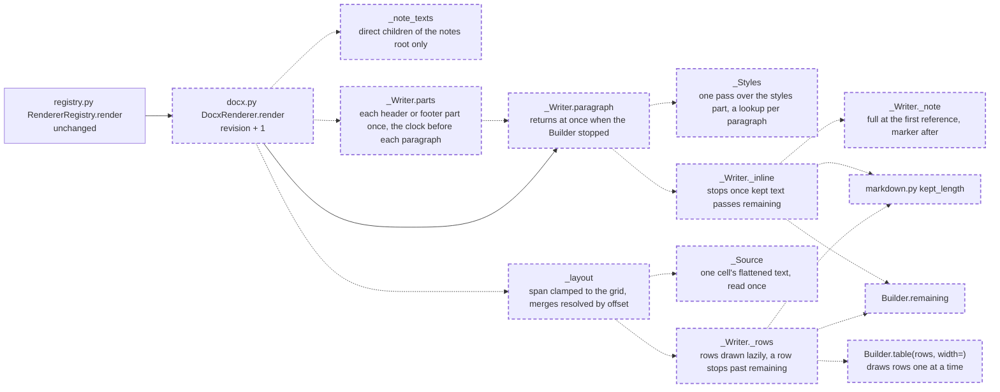

# A docx note is written once and a span is clamped: the docx renderer does work in proportion to the text it writes, and consults the budget before it collects

A fix to the docx renderer (`src/vfs/rendering/docx.py`) and a small addition to the rendering Builder (`src/vfs/rendering/markdown.py`). It is not structural: no public verb, schema, rights, SQL or dialect change, so the engine legs are not needed; the docx renderer's revision rises by one, so each docx entry re-renders once on the next index pass. It answers two medium findings of the 0.1.0a1 security audit, run `vfs-run-1-2026-11-07` at commit `3586750`: `vfs.rendering.docx:note-reference-inline-expansion` and `vfs.rendering.docx:table-gridspan-expansion`, and four smaller shapes of the same class found while reading the module. No intention and no research memo: the costs are plain in the source and were counted here on small, well-formed documents. It is the second of three rendering fixes for that audit. [The container spec](2026-11-13-an-office-container-is-measured-before-it-is-opened.md) lands first; it bounds the decompressed input before any library opens it, and this spec bounds what the renderer does with that input. [The xlsx spec](../active/2026-11-13-an-xlsx-sheet-is-read-under-the-clock-and-its-tables-stream.md) lands third and builds on the Builder as this spec leaves it. The order among the three is fixed; their place in the rest of the queue is not, so every count of existing nodes below reads as at `5d47a21a`, plus what earlier landings add. Code is cited at `5d47a21a`, whose `src/vfs/rendering/` and `tests/rendering/` equal the audited commit's (EXECUTED: `git diff --stat 35867501 5d47a21a` over both folders is empty).

## The problem

Labels: EXECUTED means a probe ran here, in the session scratchpad, on documents of a few kilobytes built with the pinned python-docx 1.2.0 (`uv.lock`); READ means read in the cited file; INFERRED means reasoning.

READ. Every limit a rendering honours (`RenderLimits`: characters, the output-to-input ratio, the unit cap, the seconds) is enforced inside the Builder, line by line, as text is appended (`markdown.py:275-289`), and the clock only at unit boundaries and between table rows. Nothing bounds the work a renderer does before it hands the Builder a string. Any place where the docx renderer's work is set by a repetition or a declared attribute of the input, and not by the text that reaches the Builder, escapes every limit. The findings name two such places; reading the module found five more of the same class, the fifth found by [the spec review](../../reviews/2026-11-13-a-docx-note-is-written-once-and-a-span-is-clamped-spec-review.md).

READ, the first finding. `_Writer._inline` (`docx.py:131-149`) builds a paragraph's whole string before `Builder.paragraph` sees it, and at every footnote or comment reference it appends a fresh copy of the whole note (`_note`, `docx.py:152-154`). Nothing limits how often one note is copied, and the budget is consulted only after the string exists. Section headers and footers take the same path. EXECUTED on a small document: the characters handed to the Builder grow with the number of references, and a paragraph the budget cannot hold is still built whole before the Builder refuses it.

READ, the second finding. `_Writer.table` (`docx.py:127-129`) builds every row of a table as `[cell.text for cell in row.cells]` before `Builder.table` sees any of it. In python-docx 1.2.0 `_Row.cells` yields one entry per grid column a cell declares it spans (`docx/table.py:396-435`), reading the declared value with no comparison to the table's grid, and the renderer reads the cell's text once per entry. EXECUTED on a small table: the cells built and the cell-text reads follow the declared span, not the grid.

READ and EXECUTED, four of those five. A vertically merged cell is resolved by python-docx walking up the column, one row at a time, for every continued cell (`_tc_above`, `docx/oxml/table.py:739-742`), so a merged column costs the square of its height, and the merged cell's text is read again in every continued row. A header or footer part named by several sections' own definitions is walked once per section that names it (`docx.py:56-58`, `66-68`). The footer loop runs after the body loop has stopped, and each paragraph is walked by `_inline` whether or not the Builder has already stopped. And `_note_texts` (`docx.py:90-101`) visits every note element at any depth and joins every text below it, so note elements nested inside one another are read once per level. Each grows with the shape of the input, not with the text written.

READ, the fifth, from the spec review. `_Writer.paragraph` reads `paragraph.style.name` for every paragraph (`docx.py:118`). With no declared style python-docx walks every style element to find the default (`docx/oxml/styles.py:292-300`), and a declared id is placed into a query over the styles part (`docx/oxml/styles.py:307`). So each lookup costs work the styles part sets, and an empty paragraph charges nothing to the budget, so no budget stop ends it. The header and footer loops read no clock. EXECUTED by the reviewer, on both trees: style elements visited grow as paragraphs times styles, in the body and in a header alike, and a declared id holding a quote mark makes the render raise the library's query error.

READ, what is already bounded. Runs, tabs, breaks, hyperlinks, simple and complex fields, tracked insertions, text boxes and picture placeholders are each visited once by `element.iter()` and add at most their own text. Deleted text, field instructions, endnotes, body-level content controls and tables nested in cells are not read at all. Picture placeholders are capped by `RenderLimits.embedded_count`. Each costs work in proportion to the input, and the container spec bounds that input.

READ and EXECUTED, pptx. `pptx.py` shares the Builder but has neither finding's shape. Its rows yield each table cell element once, whatever span it declares, and it has no note references; a slide's notes belong to that slide. Its renderer is out of this spec (Scope).

READ, reach. Rendering runs when the index pass renders pending bytes rows, on the shared offload pool of the host process, for any principal who can write a file, when the docx extra is installed, as both findings' traces record; the registry turns only a raised exception into a state (`registry.py:105-108`).

## Architecture

Dashed is what this spec adds or changes.

Page this changes: none; the architecture folder was retired on 2026-10-31, and the landing notes will say so in one line.

Terms. A character is **kept** when no line rule of the Builder can drop it: anything but whitespace (as `str.isspace` defines it) and NUL. **Remaining** is the number of characters the character budget still admits. A cell's **source** is the cell element that holds its text: itself, or for a vertical continuation the cell it continues.

## Decisions

### 1. A note's text is written in full at its first reference in the rendering, and every later reference to the same note is its bare marker, ` [footnote 7]` or ` [comment 0]`

A renderer does work in proportion to the text it emits, and a note referenced again adds no new text. The bare marker is the form a note with no text already takes (`docx.py:154`), so the grammar gains nothing, and the id ties the marker to the full text above it. Word writes one reference per footnote and per comment, so an ordinary document renders exactly as today; only a document that repeats a reference changes, and only after the first one.

### 2. `_Writer._inline` reads `Builder.remaining` once and stops collecting a paragraph as soon as the kept characters it holds exceed it

Every kept character costs one character of budget on whatever line it lands, so a paragraph holding more kept characters than remain cannot fit, and the Builder will cut it. The cut lands on the same line it lands on today: the lines before the stopping piece are today's lines, and the line holding it costs at least as much as today's longer line, so both are refused. Counting every character instead would stop early on whitespace the Builder drops, and a paragraph that fits would lose its tail with no cut recorded. The overshoot is one piece: one text run's own text, or one note's text, once.

### 3. `_Writer.paragraph` returns at once when the Builder has stopped

The footer loop, and the paragraphs after a cut inside a header, still reach the writer once the Builder has stopped. Nothing they collect can be written, so collecting it is work no text pays for.

### 4. Each header or footer part is written once, at the first section whose own definition names it, keyed by the part object

A part named again holds no new text. Python-docx loads one part object per part name, so the object identifies the part however many relationships reach it, and a set of them costs one lookup per section. Python-docx's own `add_section` writes no reference for a later section (EXECUTED: one reference, then none), and Word links such sections the same way (INFERRED from python-docx's linked-header model, which the suite's `test_a_linked_header_is_written_once` pins), so an ordinary document renders as today.

### 5. `_note_texts` reads only the direct children of the notes part's root

The schema puts every footnote and comment directly under its part's root, so an ordinary document reads the same notes. A note element nested in another is read as part of the note that holds it, and each text element is then read once.

### 6. The table writer walks the parsed table's own elements and never `_Row.cells` or `_Cell.text`: its rows from `tbl.tr_lst`, its cells from `tr.tc_lst`, its grid from the `w:gridCol` children of `w:tblGrid`, and a cell's text as `"\n".join(p.text for p in tc.p_lst)`

That is the text `_Cell.text` returns, read from the element python-docx already parsed, so no class of the optional library is named. The renderer reaches python-docx only through `self.library`, and a fix that named a library class the writer was never handed has failed before on exactly that. The writer already reads `paragraph._p` the same way. It also reads `table._tbl`, `tr.grid_before`, `tc.grid_span` and `tc.vMerge`, python-docx's parsed-element properties at 1.2.0 (`docx/oxml/table.py:72`, `:473`, `:542`), and decision 15's style table stands on `styles.element._iter_styles()`, `style.styleId`, the raw `w:val` of the style's `w:name` child, read as decision 15 reads the type and the default, because python-docx's `name_val` raises on a `w:name` with no value and the pass reads every style, and `paragraph._p.style` in the same way, and finds the grid with `tbl.find` so that a table with no `w:tblGrid` reads as no grid rather than raising. A change to any of these in a later python-docx raises inside `render`, which the registry stamps `failed` for every docx entry; the pinned lock and this suite meet it before an upgrade lands.

### 7. A cell's declared span is read as at least one, and adds copies only while its row has fewer cells than the grid has columns; every cell element keeps one cell

A span cannot make more cells than the table has columns, and every cell the input holds stays visible. A well-formed table's spans fill its grid exactly, so it renders as today. A table with no `w:tblGrid`, or one that declares no `w:gridCol`, takes as its grid the most cell elements any one of its rows holds, a count of the input's own elements, so a span there adds copies only up to that width.

### 8. A vertical continuation takes the source that starts at its grid offset in the row above, copied as many times as that source's own span allows, and a continuation with nothing above it holds its own text

The offset is the row's `grid_before` plus the declared spans of the cells before it, which is how python-docx finds the cell above, and each row keeps a map from offset to source, so each continuation costs one lookup and not a walk up the column. The text is the source's, read once, so a merged column renders the root's text in every row, as today. Today a continuation in the first row, or one with no cell at its offset above, makes the whole render fail with python-docx's `ValueError`; treating it as a cell that starts there renders the table, as a word processor does.

### 9. A source's text is flattened once and its kept length counted once, and the writer hands the Builder the flattened text

`table_cell` flattens again and escapes, and flattening is idempotent, so the line is byte for byte today's. Copies of one source share one string, so text that the Builder flattens to nothing costs nothing per copy.

### 10. The table's width is computed from the layout, before any text is read, and its rows are drawn lazily: the Builder pulls each row only after the line before it was written, and a row stops collecting once its kept characters exceed `Builder.remaining`, read when the row is drawn

The width must be today's, the longest row's cell count, or the header's padding would change; the layout gives it from counts alone. Drawing lazily lets the Builder's own per-line budget and per-row clock stop the table, so no row past the cut is read. A stopped row is refused for the reason decision 2 gives, and the writer draws nothing after it.

### 11. The Builder gains three things, and only these: the property `Builder.remaining`, the function `kept_length(text)` in `markdown.py`, and a keyword `width` on `Builder.table`, with which rows may be any iterable drawn one at a time

`remaining` is `0` once the rendering has stopped, and otherwise the budget less the characters written, never negative; it does not fold in the ratio guard, because passing the ratio is a loud failure, not a cut. `kept_length` lives beside `flatten` because the Builder's cost rules are its own. `table(rows)` without `width` reads every row first and takes the longest row's length, exactly as today, so every existing call keeps its meaning. The xlsx spec, landing third, streams its rows through this same keyword.

### 12. A cut stays the existing, honest truncation, and no new limit is added

Every stop here leaves the Builder to cut, so the rendering is `truncated` with today's notice and detail, or `empty` when nothing fit, exactly as today. No `RenderLimits` field is added and nothing caps what vfs stores: the bounds are the budget the rendering already has and the grid the document declares.

### 13. `DocxRenderer.revision` rises by one over the value it holds when this spec is built, 1 at `5d47a21a`

A changed rendering must carry a new generation, or the skip law keeps the old text. If the container spec, landing first, has already raised it, this spec raises it once more and the landing notes say so; as that spec is signed, it raises none, so the value is 2.

The cost, honestly. The new generation makes every docx row dirty for the render stage, and the first index pass after the landing pays it, whichever pass that is: in working hours a 15-minute partial pass, not the daily rebuild. That pass re-renders every docx entry; each landed rendering resets the entry's chunk and index flags, so the same pass re-splits it and re-posts its gram index entries, while embeddings of unchanged chunk text are carried by the chunk cache (`indexing.py:294`). The reference deployment does not measure its docx share. At a tenth of its 10,000,000 files, that is about 1,000,000 renders, the size of the nightly batch, landing at once, with their chunks on the per-index-visit multiplier, which is the largest one AGENTS.md names. The render stage's keyset pages and byte cuts bound each step, and the pass pays it once. The project is pre-release, so nothing spreads it.

### 14. Each bound lands with its mutant as a row of the mutant ledger, G1 to G16

The testing standard says a pinned law is proven by the mutation it kills and that the mutation lands as a ledger row. The ledger holds no row whose target is under `src/vfs/rendering/` (EXECUTED: `grep -c rendering context/standards/mutant-ledger.md` reports 0), so no row is re-anchored. The prefix is G because [the refresh spec](../active/2026-10-31-refresh-the-incremental-index-verb.md), written first, claims D1 to D10, and G is used neither by the ledger nor by any queued spec.

### 15. A paragraph's heading level is read from a style table the writer builds once, at its first paragraph, in one pass over the styles part's parsed element; python-docx's `Paragraph.style` is never called

The table maps each `w:style`'s `styleId`, the first with that id as python-docx's query finds, to whether its `w:type` is `paragraph` and to its name, mapped to the name python-docx shows (`BabelFish.internal2ui`, reached through `load_library("docx.styles")` as the pptx renderer reaches its enum); the default is the last paragraph style whose `w:default` is on. A paragraph's id is its own `w:pPr/w:pStyle/@w:val` (`paragraph._p.style`); an id that is empty, missing from the table or not a paragraph style falls back to the default, as python-docx does (`docx/styles/styles.py:76-115`). The type, the default and the name are read as raw attributes, so an unrecognised value reads as not paragraph and not default, and a style whose `w:name` is missing or has no value has no name: the pass never fails on it, and a paragraph that uses it reads as body text. Each lookup is then one dictionary probe, so the work is one pass over the styles part per render, never paragraphs times styles. A declared id is never placed in a query, so an id holding a quote mark renders the paragraph as body text where today the render fails. The pass is `document.styles.element._iter_styles()`, python-docx's own walk of the `w:style` children (`docx/oxml/styles.py:318-320`), which criterion 15's spy counts. Like decision 6's properties, a change to it in a later python-docx raises inside `render` and is stamped `failed`. A `_Writer` made without a style table, as the suite's `_inline` node makes one, reads every paragraph as body text.

### 16. The header and footer loops read the clock before each paragraph, as the body loop does before each block

The body loop asks `builder.boundary` once a block, which reads the clock (`markdown.py:136-147`); the header and footer loops asked nothing. `_Writer.parts` now calls `builder.out_of_time()` once before each paragraph and stops when it answers true, so the rendering is `partial` with today's detail, and the same cadence holds everywhere: one clock read per block written.

## Intent

After this spec, rendering one docx costs work in proportion to the text the rendering writes plus one pass over the input. A note's text is built once. A header or footer part is walked once. A style is looked up in a table read once. A span never makes more cells than the grid. A merged cell is resolved by one lookup and read once. Once the budget is spent, nothing more is collected, and every loop that writes reads the clock once a block. Every ordinary document renders byte for byte as today, cut or not.

The sentence was checked against every loop the Design keeps or adds. The body's block list and the section list are one pass each. Each distinct header or footer part is walked once, with a clock read and a stopped check per paragraph. Each paragraph costs one style probe and an `element.iter()` walk that ends at decision 2's stop. The notes parts and the styles part are read once each. A table's layout is one pass over its cell elements, and its rows are drawn only while the Builder takes them. Pictures are one per placeholder element and capped. No loop runs per reference, per section naming a part, per declared span, per merge height or per style.

Output changes in exactly these places, each a document Word does not write: a repeated note reference after its first (decision 1); a header or footer part named by more than one section (decision 4); nested note elements (decision 5); a span past the grid or below one, and in a table that declares no grid a span past its widest row (decision 7); a vertical continuation with nothing above it (decision 8), and a styles part or style id python-docx cannot query, or a paragraph using a style it cannot name (decision 15), each of which renders where today the render fails; and, under decision 16, a rendering the clock cuts no longer carries the header or footer paragraphs that today are written after the clock has run out; its status and detail are today's.

## Design

**`src/vfs/rendering/markdown.py`.** `kept_length(text) -> int` after `table_cell`: `len("".join(text.split())) - text.count("\x00")`, with a docstring saying appended text costs at least this much. `Builder.remaining`, a property beside `spent`. `Builder.table(rows: Iterable[Sequence[object]], *, width: int | None = None) -> bool`: if stopped, `False`; with no width, rows become a list and the width is the longest row's, `0` for none; the first row is drawn, and none means `True`; then today's loop over `chain((first,), drawn)`, the clock checked before every row after the first, as today. `Iterable` joins the `TYPE_CHECKING` imports and `chain` the top imports. The module docstring gains one sentence on the three.

**`src/vfs/rendering/docx.py`.** `DocxRenderer.revision` per decision 13, and `render` calls `writer.parts(...)` for the headers and then for the footers. In `_Writer`: a `_written` set of `(kind, id)` and the method `_note` (decision 1), replacing the module function; `parts(items)` with its clock read before each paragraph (decisions 4 and 16); `paragraph` with its early return (decision 3) and its level from `_Styles.name(paragraph._p)` (decision 15), `_Writer` taking the `_Styles` as an optional third argument so the suite's existing `_Writer(builder, notes)` call keeps working; `_inline` with decision 2's stop; `table` and the generator `_rows` (decisions 6 and 10). New private helpers under the Internal helpers banner: `_Styles` (decision 15), `_Source` (decision 9) and `_layout(rows, grid)` (decisions 7 and 8), with the grid found by `tbl.find` and its fallback (decisions 6 and 7). `_note_texts` per decision 5. A constant `_ON`, the on values of an OOXML boolean (`1`, `true`, `on`), sits with the module's constants, and `load_library` joins the import from `seam`. The module docstring names the bound in two sentences. All imports stay at the top, and no python-docx name is imported.

**Tests.** A new module, `tests/rendering/test_docx_bounds.py`, holds the nodes of criteria 1 to 10 and 14 to 18 with their small document builders, made with python-docx and edits to its parsed elements, as `test_footnotes_are_written_at_their_reference` stages its note today. It counts with spies installed by `monkeypatch`: `CT_P.text` reads, `_Writer._inline` calls, the characters handed to `Builder.paragraph`, the rows the Builder draws, the style elements `CT_Styles._iter_styles` yields, and the clock reads of `vfs.rendering.markdown.monotonic`, replaced by a counter that answers "not yet" a set number of times and then "past", so no test reads a clock. It also holds `test_a_stopped_row_ends_the_draw`, which drains `_Writer._rows` directly over a two-row layout under a budget of one character and asserts it yields exactly one partial row; this covers the stop's `return`, which the Builder never reaches because it refuses that row. `tests/rendering/test_markdown.py` gains a class `TestWhatIsLeft` with criteria 11 to 13. Every import in both files stands at the top of the file, `kept_length` among `test_markdown.py`'s; no test imports inside a function. No existing test changes.

**Tests first.** Every criterion node is written and seen failing on the base tree before the code changes. EXECUTED on a scratch build of this design over a copy of `5d47a21a`: the fourteen nodes of criteria 1 to 13 fail on the base and pass on the build; of the four nodes the review added, the style, clock and stopped-row nodes fail on the base and pass on the build, and the no-grid node passes on both, because it pins output this spec keeps, so its red is its mutant (G16); criterion 14's node was not run there and is red on the base by construction, whose revision is 1; the existing nodes, 96 in `tests/rendering/` and 41 in `tests/storage/database/test_render.py` at `5d47a21a`, pass unchanged on the build; at the build those counts are `5d47a21a`'s plus what earlier landings add, the container spec's nodes under `tests/rendering/` among them; and coverage of `docx.py` and `markdown.py` is 100% over all of them.

**Scale.** Per rendered document, in operations: one pass over the body's elements, one over each distinct header and footer part, one over each notes part, one over the styles part and one dictionary probe per paragraph; one clock read per block written, body, header or footer; per table, one layout pass over its cell elements and one text read per source drawn; and the text built never exceeds what the Builder writes plus one piece or one row. Nothing grows with references, sections, declared spans, merge height or styles. The reference deployment's multiplier is the per-index-visit one, about 11,000,000 visits a day, of which docx renders are a share; this spec makes each one cheaper, and the one-time re-render of decision 13 is paid by the first pass after the landing, as that decision says.

**`context/standards/mutant-ledger.md`** gains rows G1 to G16 after K12, provenance "a docx note is written once and a span is clamped": G1 the note-once check dropped; G2 the paragraph stop dropped; G3 the stop counting every character, not kept ones; G4 the part set dropped; G5 the stopped return in `paragraph` dropped; G6 notes read at every depth again; G7 copies taken as the declared span; G8 a source's text read on every call; G9 a continuation never resolved upward; G10 the in-row stop dropped; G11 `table` with a width reading every row first; G12 `remaining` ignoring a stopped Builder; G13 `kept_length` counting NULs; G14 the style table undone, two directions: `_Writer.paragraph` reading `paragraph.style` again, or the table reading each name through `name_val`; G15 the clock read in `parts` dropped; G16 the no-grid fallback dropped. EXECUTED on the scratch build, G1 to G13 before decisions 15 and 16 were added to it and G14 to G16 after: each fails at least one criterion node and no existing node; G14 fails criterion 15 alone, G15 criterion 16 alone, G16 criterion 17 alone.

## Scope

In: decisions 1 to 16. Files: `src/vfs/rendering/docx.py`, `src/vfs/rendering/markdown.py`, `tests/rendering/test_docx_bounds.py` (new), `tests/rendering/test_markdown.py`, `context/standards/mutant-ledger.md`, and this spec's landing notes.

Order and neighbours. This spec lands second of the three rendering fixes. It shares `src/vfs/rendering/docx.py` with [the container spec](2026-11-13-an-office-container-is-measured-before-it-is-opened.md), which lands first and adds the container check's call, as that spec gives it, before `docx.Document` opens the bytes; this spec rebases on that call and on whatever revision it leaves (decision 13). That spec also adds nodes under `tests/rendering/`, in `test_seam.py` and `test_renderers.py`, and ledger rows of its own prefix; this spec edits neither of those test files, and its rows take G. It shares `src/vfs/rendering/markdown.py` and `tests/rendering/test_markdown.py` with [the xlsx spec](../active/2026-11-13-an-xlsx-sheet-is-read-under-the-clock-and-its-tables-stream.md), which lands third and builds on the Builder as decision 11 leaves it; it also edits `Builder.build`, on lines disjoint from this spec's, and its reviewer applied the two to one copy, where they compose. Of the other specs queued under `specifications/active/`, only [the rebuild refactor](../active/2026-11-12-the-full-pass-is-named-rebuild-and-its-pipeline-leaves-the-backend.md) touches `src/vfs/rendering/`: it renames one word in docstrings of `seam.py` and `registry.py`, files this spec does not edit, so no line is shared. None of them edits `tests/rendering/`. So this spec is parallel-safe with them. It must land before [the refresh spec](../active/2026-10-31-refresh-the-incremental-index-verb.md), which runs the render step on an automated pass. [The release-audit spec](../active/2026-11-07-the-release-audit-is-a-review.md) waits on this fix; this spec does not edit it.

Out: the pptx and xlsx renderers, each with its own spec or none, because neither has these findings' shapes; endnotes, body-level content controls and tables nested in cells, which are not rendered today and adding them is a feature; a Rust kernel for the docx walk, which python-docx's tree makes moot; and any bound on the input's own size, which is the container spec's.

## Acceptance criteria

Counts and states, never clocks. Each named node fails on the base tree and passes on the build, as the Design records, except criterion 17's, which pins kept output and whose red is its mutant. Nodes 1 to 10 are in `tests/rendering/test_docx_bounds.py`.

1. A paragraph that refers to one 40-character comment five times renders as the full comment at the first reference and ` [comment 0]` at the other four, and the characters handed to `Builder.paragraph` equal that line's length. Test: `test_a_repeated_note_is_written_once_and_marked_after`.
2. Under `RenderLimits(chars=200)`, a document of a short paragraph and a paragraph of 500 kept characters in 50 runs renders as `truncated` with today's detail and text, and the characters handed to `Builder.paragraph` are at most the short paragraph's, plus 200, plus one run's. Test: `test_a_paragraph_stops_collecting_once_it_cannot_fit`.
3. Four sections whose definitions name one header part of four paragraphs render the header once, and `_Writer._inline` is called eight times: four header paragraphs, three section-break paragraphs and the body's one. Test: `test_a_header_part_named_by_many_sections_is_written_once`.
4. When the budget is spent inside the body, `_Writer._inline` is called twice, for the paragraph written and the one cut, and never for the footer's paragraphs. Test: `test_nothing_is_walked_once_the_budget_is_spent`.
5. Ten nested footnote elements of one character each read as one note of ten characters. Test: `test_nested_note_elements_are_read_once`.
6. On a two-column table whose first cell declares a span past the grid, the row has three cells, the first cell's text twice and the second's once, and `CT_P.text` is read twice. Test: `test_a_span_never_makes_more_cells_than_the_grid`.
7. A one-column table merged down eight rows renders the root's text in all eight rows, as today, with one `CT_P.text` read and no `_tc_above` call. Test: `test_a_vertical_merge_reads_its_text_once`.
8. Under `RenderLimits(chars=300)`, a forty-column header row whose one cell of 20 kept characters spans the grid is drawn with twelve cells, its text read once, and the rendering is `empty`, as today. Test: `test_a_table_stops_drawing_once_the_budget_is_spent`.
9. Under `RenderLimits(chars=300)`, a table of a header row and nineteen rows of two 20-character cells, after one short paragraph, renders `truncated` with today's text, and `CT_P.text` is read eleven times. Test: `test_a_long_table_stops_reading_rows_once_cut`.
10. Ordinary documents render as before: a three-by-three table with one horizontal and one vertical merge, made by python-docx's own `merge`, renders exactly today's text, captured at `5d47a21a`, with nine `CT_P.text` reads, one per paragraph of each source; and for every budget from 1 to 419 characters, a document mixing headings, whitespace runs, breaks, a marker-like line, pipes and a merged table renders identically with `Builder.remaining` and with it patched to no limit, and at every budget from 1 to 419 the mixed document's rendering equals the base's, captured at `5d47a21a` as a fixture: one SHA-256 over the 419 renderings' status, detail and text, held as a literal in the test (EXECUTED: the digest is the same on the base and on the scratch build). Tests: `test_ordinary_documents_render_as_before`, `test_a_cut_lands_where_it_landed_before`. Every existing node of `tests/rendering/` and `tests/storage/database/test_render.py` passes unchanged.
11. `remaining` counts down by each line written and its blank, and is `0` once a line is refused. Test: `tests/rendering/test_markdown.py::TestWhatIsLeft::test_remaining_counts_down_and_is_zero_once_stopped`.
12. `kept_length` is 0 for the empty string, drops whitespace including U+3000 and NUL, and keeps a pipe. Test: `tests/rendering/test_markdown.py::TestWhatIsLeft::test_kept_length_drops_whitespace_and_nuls`.
13. `table(rows, width=2)` over a generator draws only the rows it writes and the one it refuses, pads the header to two cells, and is cut. Test: `tests/rendering/test_markdown.py::TestWhatIsLeft::test_a_table_with_a_width_draws_each_row_after_the_line_before`.
14. `DocxRenderer().version` begins with the revision of decision 13. Test: `tests/rendering/test_docx_bounds.py::test_the_docx_generation_names_its_new_revision`.
15. Twenty empty paragraphs in the body and twenty in a header, over the default styles part of N styles, make `CT_Styles._iter_styles` yield N style elements in all, and render as today; a paragraph whose declared style id holds a quote mark renders as body text; and the same document also holding an unused paragraph style whose `w:name` has no value renders as today, that style counted among the N. Test: `tests/rendering/test_docx_bounds.py::test_a_style_is_looked_up_once`.
16. With the markdown module's clock replaced by a counter that answers "not yet" twice and "past" after, a header of five paragraphs is walked twice, `_Writer._inline` is called twice, and the rendering is `partial` with the first two header paragraphs. Test: `tests/rendering/test_docx_bounds.py::test_header_paragraphs_read_the_clock`.
17. A three-by-three table with its first two header cells merged and no `w:tblGrid` renders today's text, `r0c2` in the third column. This node pins output kept, so it passes on the base too; its red is G16. Test: `tests/rendering/test_docx_bounds.py::test_a_table_with_no_grid_keeps_its_columns`.
18. `_Writer._rows`, drained directly over a two-row layout under a budget of one character, yields exactly one partial row. Test: `tests/rendering/test_docx_bounds.py::test_a_stopped_row_ends_the_draw`.
19. Rows G1 to G16 stand in the ledger, each replayed under the safe-restore rule and killed by at least one failure, the counts in the landing notes; and `scripts/ci.sh` is green at 100% coverage on the tree as committed.

## Landing notes

Built on 2026-11-13 on the lane `lane/rendering` over `18b76739`, the commit that landed [the container spec](2026-11-13-an-office-container-is-measured-before-it-is-opened.md), by a sub-agent of the session lead (Claude Opus 5.5) who wrote the code from this spec's text and [its spec review](../../reviews/2026-11-13-a-docx-note-is-written-once-and-a-span-is-clamped-spec-review.md), and left uncommitted for a code review by an agent who did not write it. No text above these notes was changed by the build; the file as signed has a SHA-256 beginning `b8a7bc4648f1`, checked before the build began and again before these notes were written. The order of work was the test module and `TestWhatIsLeft`, run red on the unedited source, then `markdown.py` and `docx.py`, then the ledger mutations and a hunt for the mutants the ledger does not list, the nodes that hunt called for, each seen red where it could be, and these notes. It is the second of the three rendering fixes; the xlsx spec is built after it on this tree. Nothing under `crates/` changed.

The anchors. The spec cites lines at `5d47a21a`; the build stands on `18b76739`. `markdown.py` is unchanged between the two (EXECUTED, `git diff --stat 5d47a21a 18b76739` over `src/vfs/rendering/` names `docx.py`, `pptx.py`, `seam.py` and `xlsx.py` only), so every `markdown.py` anchor is where the spec puts it: `_append` at 275-289, `boundary` at 136-147, the row cells at 202-203. `docx.py` moved by six lines, because the container landing put its `container_refusal(...)` call, five lines, directly after `started = monotonic()`, and changed one import line: the header loop is at 62-64 (the spec's 56-58), the footer loop at 72-74 (66-68), `_note_texts` at 96-107 (90-101), `paragraph.style.name` at 124 (118), `_Writer.table` at 133-135 (127-129), `_inline` at 137-155 (131-149) and `_note` at 158-160 (152-154), its bare marker at 160 (154). `registry.py`'s exception arm is at 106-109, not 105-108. The python-docx 1.2.0 anchors stand as cited (READ in this tree's `.venv`): `_Row.cells` at `docx/table.py:396-435`, `_tc_above` at `docx/oxml/table.py:739-742`, `grid_before` at `:72`, `grid_span` at `:473`, `vMerge` at `:542`, `default_for` at `docx/oxml/styles.py:292-300`, the id query at `:307` and `_iter_styles` at `:318-320`. Starting counts that differ from the spec's figures: `tests/rendering/` collects 123 nodes, the 96 of `5d47a21a` plus the container landing's 27 (its spec counted 25; its code review's round added two); `tests/storage/database/test_render.py` collects 41, as the spec says. The mutant ledger's last rows are Z1 to Z4, so G1 to G16 follow Z4, not K12; and decision 14's "`grep -c rendering` reports 0" no longer holds, since Z1 to Z4 target `src/vfs/rendering/`. None of them is re-anchored by this build: Z1's docx direction deletes the container call, whose text this build did not touch. `DocxRenderer.revision` was 1 at `18b76739` (the container spec raised none, as its decision 13 says), so decision 13's value is 2. No module this spec edits is over the 1,000-line ceiling, before or after, so `MODULE_LINE_BASELINE` in `tests/lint/allowlist.py` names none of them and no entry was touched.

Tests first. With the new module and `TestWhatIsLeft` written and `src/` untouched, `uv run pytest tests/rendering -q -n 0 --continue-on-collection-errors` gave 93 passed and 2 errors: `test_docx_bounds.py` at collection on `ImportError: cannot import name '_layout' from 'vfs.rendering.docx'`, and `test_markdown.py` on `ImportError: cannot import name 'kept_length' from 'vfs.rendering.markdown'`, which held every new node red and also kept that file's 30 existing nodes from being collected in that run. To see each node fail for its own reason, the two files were copied to the session scratchpad with those two imports removed and run against this tree's configuration on the unedited source: 18 failed and 31 passed. The 31 are `test_markdown.py`'s 30 existing nodes and criterion 17's, which pins kept output and passes on the base, as the spec says; its red is G16. The reasons, by criterion: 1, the text with five full copies of the comment; 2, `assert 505 <= 215`, the characters handed to `Builder.paragraph`; 3, the header written four times; 4, 5 inline walks where 2; 5, ten notes where one, `'2': 'bcdefghij'` among them; 6, a row of six cells, `first` five times; 7, `(8, 28) == (1, 0)`, eight text reads and 28 walks up the column; 8, `[40] == [12]`, the cells drawn; 9, `40 == 11` text reads; 10, `13 == 9` reads in the first node and `Builder has no attribute 'remaining'` in the second, after its digest had matched; 14, `'1+python-docx-1.2.0'`; 15, `13120 == 164` style elements yielded; 16, `ok` with all five header paragraphs where `partial` with two; 18, `'_Writer' object has no attribute '_rows'`; 11 to 13, `remaining` absent, `kept_length` undefined and `table() got an unexpected keyword argument 'width'`. After the hunt below added nodes and assertions, the same run on the base gave 20 failed and 32 passed: the two new nodes that can fail there do, the style node on its last case with `InvalidXmlError` (its ten earlier cases of the eleven it then held pass on the base, which shows they read as python-docx reads them; after the code review it holds thirteen, and its twelve before "no name value" pass on the base) and the offsets node with `ValueError: no tr above topmost tr`; criterion 8's node now fails first on `module 'vfs.rendering.docx' has no attribute 'kept_length'`; the full-budget node pins kept output and passes on the base, its red being the boundary mutant it exists for.

What was built, by decision. 1: `_Writer._note`, a method holding a `_written` set of `(kind, id)`; a note with text is written in full at its first reference and as its bare marker after; the module function is gone. 2: `_Writer._inline` reads `Builder.remaining` once and breaks after the piece that takes its kept characters past it. 3: `_Writer.paragraph` returns first when the Builder has stopped. 4 and 16: `_Writer.parts(items)`, called by `render` with the sections' headers and then their footers, skips a linked item and a part already in the writer's one `_parts` set, and asks `builder.out_of_time()` before each paragraph, returning when it answers true. 5: `_note_texts` reads `root.findall(tag)`, the root's direct children. 6 to 10: `_Writer.table` reads `table._tbl`, its `tr_lst`, the `w:gridCol` children of the `w:tblGrid` found with `tbl.find`, falling back to the most `tc_lst` elements of any row when there is none or it holds none, builds `_layout(rows, grid)`, takes the width as the longest row's sum of copies, and hands `self._rows(layout)` to `Builder.table` with that width. `_layout` keeps per row a map from offset to `(source, span)`, offsets from `tr.grid_before` plus declared spans, the first source at an offset kept; a `vMerge` of `continue` takes the source above at its offset with that source's span, and one with nothing there is its own source; copies are `1 + max(0, min(span - 1, grid - count - 1))`. `_Source` holds the cell element, its flattened text and its kept length as `functools.cached_property` values. `_Writer._rows` reads `remaining` as each row is drawn, appends a copy and its kept length, and on passing it yields the row and returns. 11: `Builder.remaining`, beside `spent`; `kept_length(text)` after `table_cell`; `Builder.table(rows, *, width=None)` exactly as the Design gives it, `chain` among the top imports and `Iterable` under `TYPE_CHECKING`; the module docstring gains one sentence on the three. 12: no limit is added; every stop leaves the Builder to cut. 13: `DocxRenderer.revision = 2`. 14: rows G1 to G16, below. 15: `_Styles(document, ui_name)`, given `load_library("docx.styles").BabelFish.internal2ui` by `render`, builds its table at its first lookup in one pass over `document.styles.element._iter_styles()`: the type, the default (against `_ON`, the values `1`, `true` and `on`) and the `w:val` of `w:name` read raw, the first style of each `styleId` kept, a non-paragraph first leaving its id to the default, the last paragraph default kept; `name(p)` reads `p.style` and answers the table's name for a truthy id it holds and the default's otherwise. `_Writer` takes it as an optional third argument, and with none every paragraph is body text. The docx module docstring names the bound in two sentences; no python-docx name is imported.

Per criterion, each node green on the tree as built; every node named is in `tests/rendering/test_docx_bounds.py` unless it says otherwise. 1: `test_a_repeated_note_is_written_once_and_marked_after`, the comment in full once and ` [comment 0]` four times, and the characters handed to `Builder.paragraph` equal to the line's length, 105. 2: `test_a_paragraph_stops_collecting_once_it_cannot_fit`, `truncated` with "1 of 2 units within 200 characters" and today's text, 205 characters handed where 505 today. 3: `test_a_header_part_named_by_many_sections_is_written_once`, the header once and 8 inline walks. 4: `test_nothing_is_walked_once_the_budget_is_spent`, 2 walks where 5. 5: `test_nested_note_elements_are_read_once`, `{"1": "abcdefghij"}`. 6: `test_a_span_never_makes_more_cells_than_the_grid`, `| first | first | second |` and 2 reads. 7: `test_a_vertical_merge_reads_its_text_once`, 1 read and 0 walks up the column. 8: `test_a_table_stops_drawing_once_the_budget_is_spent`, `empty`, one row drawn of 12 cells, 1 read. 9: `test_a_long_table_stops_reading_rows_once_cut`, `truncated` with today's text, 11 reads where 40. 10: `test_ordinary_documents_render_as_before`, today's text with 9 reads where 13; `test_a_cut_lands_where_it_landed_before`, the 419 renderings' digest `5df689925798…` equal to the base's and every rendering equal with `remaining` patched to `sys.maxsize`. 11 to 13: `tests/rendering/test_markdown.py::TestWhatIsLeft`, its three nodes. 14: `test_the_docx_generation_names_its_new_revision`, `2+python-docx-1.2.0`. 15: `test_a_style_is_looked_up_once`, 164 style elements yielded over 42 paragraph lookups, 165 with the nameless style, and the quoted id as body text. 16: `test_header_paragraphs_read_the_clock`, `partial` with `h1` and `h2`, "0 of 1 units within 60 seconds", 2 walks and 3 clock reads. 17: `test_a_table_with_no_grid_keeps_its_columns`. 18: `test_a_stopped_row_ends_the_draw`, `[["ab"]]`. The 123 existing nodes of `tests/rendering/` and the 41 of `tests/storage/database/test_render.py` pass unchanged; with the new nodes, 186 passed. Coverage of `docx.py` and `markdown.py` is 100% over `tests/rendering/` and `test_render.py`.

The ledger. Rows G1 to G16 of [the mutant ledger](../../standards/mutant-ledger.md). Each mutation was applied with an edit to the tree as built, checked with `cmp` to differ from its copy in the session scratchpad, run over `tests/rendering/`, restored with `cp` from the copy and checked with `cmp` to be identical; after the last restore both source files were identical to their copies. G1 to G16 were run over the folder at 144 nodes, before the full-budget node below existed, and G2 and G3 again at 145, the only rows whose mutation reaches that node's path. Every row was killed, and no existing node failed under any of them: G1, 1 failure (criterion 1); G2, 1 (criterion 2); G3, 2 of 145 (criterion 10's cut node and the full-budget node); G4, 1 (criterion 3); G5, 1 (criterion 4); G6, 1 (criterion 5); G7, 2 (criterion 6 and the offsets node); G8, 5 (criteria 6, 7, 8, 9 and 10's first node); G9, 4 (criteria 7 and 10's two, and the offsets node); G10, 3 (criteria 8, 9 and 18); G11, 2 (criteria 9 and 13); G12, 1 (criterion 11); G13, 1 (criterion 12); G14, 2 under each direction, `paragraph.style` read again and `name_val` read in the pass (criterion 15 and the style node); G15, 1 (criterion 16); G16, 1 (criterion 17), and its second direction, the fallback taken only for a missing `w:tblGrid`, 1 (criterion 17, on its gridless-columns case).

Mutants the ledger does not list, each executed under the same protocol over `tests/rendering/`. Killed: the paragraph stop reading `builder._budget`, the whole budget, in place of `remaining`, 1 (criterion 2, on its exact count; under that mutant 215 characters are handed over, which the criterion's own bound of 215 admits, so the node also asserts the exact 205 the stop gives); the row stop reading `remaining` once a table, 1 (criterion 9); the stopped row's `return` made `break`, 1 (criterion 18); the paragraph stop and the row stop each checked before the piece or the copy is kept, 5 and 4; offsets from 0 in place of `grid_before`, offsets advanced by clamped copies, the last source at an offset kept, a continuation copied by its own span, and an orphan continuation looked up with `[]`, 1 each (the offsets node); a `restart` resolved upward like a continuation, 2 (criterion 10's two nodes); the clamp's `max(0, …)` dropped, 2, and one copy past the grid, 1 (criterion 6); the width counted from cell elements, 1 (criterion 6); `_Source.kept` recounted per copy, 1 (criterion 8, on its count of `kept_length` calls); the style table read at every lookup, 1 (criterion 15); a later style of an id winning, a default of any type, any default value read as on, the first default winning, a missing type read as paragraph, an empty id looked up, a style of another type naming a paragraph, and `on` or `true` dropped from `_ON`, 1 each (the style node); notes keyed on the id alone, 1 (criterion 1's staged footnote and comment of one id); an empty note written in full, 1 (the existing `TestDocx::test_footnotes_are_written_at_their_reference`); the linked-part test dropped, 2 (criteria 3 and 4); a stopped Builder drawing a table, 1 (criterion 13, on its stopped draws); an empty table reported cut, 1 (the existing `TestTables::test_an_empty_table_emits_nothing`); `remaining` ignoring the notice reserve, 2 (criteria 8 and 9); `kept_length` dropping spaces only, 1 (criterion 12); the paragraph stop at `>=`, 1 (the full-budget node; before it the mutant passed all 144, and it is not equivalent: with the budget filled exactly, a footer whose first piece is a tab stops at that tab, writes nothing and is dropped with the rendering reported `ok`). Survived, each equivalent in every output and every count the suite takes: the row stop at `>=`, because a row is drawn only when the Builder pulls it and any row line costs at least the four characters of `|  |`, so a row whose kept characters reach what remains is refused whole or stopped; the clock stop in `parts` made `break`, which leaves each later distinct part's paragraph list built and its walk ended at its first paragraph by the remembered clock, no paragraph walked and no clock read; and the `style_id is None` test dropped from the style pass, because `name` probes only a truthy id, so a `None` key is never read; the test keeps the set of ids typed. Not executed: the style table built at construction rather than at the first lookup, which changes only a document with no paragraph, from no pass to one.

Departures from the signed text, none of which changes a decision, a default or the scope. First, criterion 10's literals, the 3x3 table's text and the 419 renderings' digest, were captured on `18b76739` before any edit, not on `5d47a21a`: `markdown.py` is the same at both, and `docx.py` differs only by the container check, which answers `None` for every fixture here (the container spec's criterion 10). The mixed document is this build's, because the author's prototype was not in the tree: headings, whitespace runs, a break and a tab, a marker-like line, pipes, a blank paragraph and a merged table with pipes in its cells; its rendering is 339 characters, so the budgets 1 to 419 cross the 256-character reserve threshold and reach 80 past the uncut rendering. Its styles part is cut to the four styles it uses, which took a render from 10.5 to 1.85 milliseconds on this machine and left the digest the same (EXECUTED, both in the scratchpad), so the node's 838 renders cost about 1.6 seconds and it is not marked `slow`. Second, the spec counts 19 new nodes and the build lands 22: three nodes the criteria do not name, each from the hunt above, `test_a_style_reads_as_python_docx_reads_it` (eleven cases of a style read as python-docx reads it as first built, thirteen after the code review; it also covers the duplicate-id branch of the style pass, which no criterion reaches and coverage required), `test_a_continuation_finds_its_source_by_offset` (a late-starting row, an orphan continuation, a span of zero and a continuation under a spanning source) and `test_a_paragraph_at_a_full_budget_is_still_cut`; and five criterion nodes gain assertions beyond their criterion, criterion 1 a footnote and a comment of one id staged against `_inline`, criterion 2 the exact 205, criterion 8 one `kept_length` call, criterion 13 a stopped Builder drawing nothing and refusing an empty table, and criterion 17 a grid that declares no column. As first built the folder held 145; the code review's round added three more nodes, below, so `tests/rendering/` holds 148 nodes when this lands, not 142, and the xlsx spec rebases on 148; `test_docx_bounds.py` holds 22 and `test_markdown.py` 33. Third, decision 13's cost paragraph says the re-render is paid by "the first index pass after the landing, whichever pass that is: in working hours a 15-minute partial pass"; the signed refresh spec now has a refresh's render step read only `pending` rows, so a renderer version bump is paid by the next rebuild, never by a refresh. Today, before the refresh verb lands, the only such pass is the full one. The text above is left as signed. Fourth, `Builder.remaining` has no `max(0, …)`: no line or blank is ever written past the budget, so `budget - chars` cannot fall below zero, and a clamp would be a mutant no node can kill; its docstring says why. Fifth, the ledger's "Replay protocol" section still tells a replay to use a git worktree; these mutations used the copy-and-restore protocol of [the testing standard](../../standards/testing.md), as the earlier landings on this lane did. Sixth, from the code review's round (its H2): two files outside the signed Scope changed. `pyproject.toml`'s `docx` extra was `python-docx>=1.1`, and decision 6 names `tr.grid_before`, which python-docx 1.1.0 does not have (the review READ its source and EXECUTED the build on it: every docx holding a table rendered `failed`), so the floor is now `python-docx>=1.2`, the version the lock pins and every gate runs: the floor now says what is tested. `uv lock` rewrote `uv.lock`: python-docx still resolves to 1.2.0 and the requirement's specifier moved from `>=1.1` to `>=1.2`; the lock's format line, which this machine's uv 0.13.6 rewrote from `revision = 3` to `5`, was restored to 3 by the session lead, by hand, and `uv lock --check` accepts the file, as does `uv sync --all-extras --group dev --locked` (the session lead's check); `git diff uv.lock` shows the specifier alone, one line, and no package version moved (EXECUTED, `git diff uv.lock` and `uv lock --check`). Seventh, also from that round: three more nodes, `test_a_row_of_wide_spans_lays_out_in_proportion_to_its_cells` (H1's counted pin), `test_a_malformed_late_start_fails_the_document` (M1) and `test_the_library_has_every_member_the_renderer_reads` (H2), and assertions in four nodes beyond their criterion, criterion 2 a paragraph of bare note markers (M2), criterion 6 a row of three spans of three (H1), the offsets node a span passed on under a spanning root and a continuation under a late-starting row (M3), the style node two defaults (M3); and one docstring in `src/`, `_Writer.table`'s, which states the layout's profile (L3). No line of code under `src/` changed in that round.

Decided at the build, each a choice the Design leaves open. The header and footer walks share one `_parts` set, so a part named as a header and as a footer is written once, at its first use. `_Styles` takes the document and the name map and reads `document.styles` only at its first lookup, so a document with no paragraph pays no pass. `Builder.table` keeps the Design's `chain((first,), drawn)` loop, so with a width it pulls a row before asking the clock for that row; the pulled row is bounded by `remaining`, which is the most a row past the clock can cost. The test spies are plain functions over `monkeypatch`, installed after each document is built so that no setup is counted: property reads of `CT_P.text` and `CT_Tc._tc_above`, `_Writer._inline` calls, the lengths handed to `Builder.paragraph`, the rows `Builder.table` draws, the elements `CT_Styles._iter_styles` yields and the texts `kept_length` counts in the docx module. Criterion 16's node drives three clocks, the docx module's and `vfs.deadline`'s at 0.0 and the markdown module's counter, so the container check's deadline and the Builder's sit at 60 seconds and no assertion depends on the machine's uptime.

Flagged to Clay. A `w:pStyle` or `w:gridSpan` element with no `w:val`, or a span that is not an integer, still raises inside `render` and is stamped `failed`, as today. A `w:gridBefore` with no value, or one that is not an integer, rendered today, because python-docx's `_Row.cells` never reads it, and now fails the document, as a malformed `w:gridSpan` always has (the code review's M1, EXECUTED there; `test_a_malformed_late_start_fails_the_document` pins both shapes as a classified `failed`). Such an entry, `ok` today, re-renders to `failed` under the new revision and loses its content row. Decisions 6 and 15 name python-docx's `paragraph._p.style`, `tc.grid_span` and `tr.grid_before`, which validate, and the build reads them as named, by the session lead's ruling on M1. Reading those three raw, as the style pass reads the type, the default and the name, would render such a document; that is a change to two decisions' text, left to a later spec. The `docx` extra's floor is raised to python-docx 1.2 (the sixth departure), which a host pinned to 1.1 meets at install. Also, for the xlsx build: `Builder.table` with a width pulls each row before it reads the clock for that row, as the Design's loop is written; the xlsx spec's decision 5 says "the row must be built when it is drawn", which this form keeps, and its stop at `remaining` bounds the one row a passed clock lets through.

What did not run. The other CI legs, 3.11, 3.12 and 3.14, are CI's on the push; here everything ran on 3.13.11. The ledger rows' scope is `tests/rendering/`; `tests/storage/database/test_render.py` was run on the tree as built, not under each mutant. No Docker was started.

Engine legs: not run, and no criterion needs a server engine: the change issues no SQL statement and touches no builder, batch loop, dialect profile or row; the re-render the new revision causes lands through the render stage's existing landing, which `tests/storage/database/test_render.py` holds on SQLite.

After the code review. [The code review](../../reviews/2026-11-13-a-docx-note-is-written-once-and-a-span-is-clamped-code-review.md) ended "Does not land yet" on H1 and H2, with M1 to M3 and L1 to L3; its Disposition holds the answer to each. Each new assertion was seen failing under its mutant, by the protocol above over `tests/rendering/` at 148 nodes, and passing on the tree as built. G17, `count += copies` made `count += 1` in `_layout`: 2 failures, criterion 6's row of three spans of three and the new wide-spans node, on `assert 20100 == ((2 * 200) - 1)`; before them it passed all 145. G18, the kept count taken for `w:t` pieces only: 1, criterion 2 on its bare markers, whose exact count is 229 characters handed, `x` and nineteen markers. G19, `above = {**above, **here}`: 1, the offsets node on its late-start table, `| top | z |` where `|  | z |`. G20, `(source, span)` stored for the row below: 1, the offsets node on its third row under a spanning root, `root` once where twice. G21, the default test moved below the id test in `_Styles._read`: 1, the style node on "default with no id". M1's node, with the late start not read (`offset = 0`): 2, that node with `('ok', …) == ('failed', None)` and the offsets node. H2's node, called in a scratchpad test with one member removed by `monkeypatch.delattr`: `CT_Row.grid_before`, `CT_Styles._iter_styles` and `BabelFish.internal2ui` each fail it by name. On the unedited source, with the two new-name imports removed from a scratchpad copy as before, `test_docx_bounds.py` gives 19 failed and 3 passed: the full-budget, no-grid and member nodes, each pinning what the base already does; the offsets node's first assertion, the span passed on, and the style node's twelve cases before "no name value" pass there before each node fails on its later case, which shows those documents read as python-docx reads them.

Counts as built. `tests/rendering/` 123 to 148 nodes, which is what the xlsx spec rebases on; `test_render.py` 41. Module sizes by `wc -l`, base to build: `src/vfs/rendering/docx.py` 170 to 337 (332 as first built), `src/vfs/rendering/markdown.py` 294 to 325, `tests/rendering/test_markdown.py` 267 to 311, `tests/rendering/test_docx_bounds.py` new at 655 (557 as first built, 650 after the code review's first round; the re-read's L5 adds three entries and a comment to the member node), `context/standards/mutant-ledger.md` 116 to 137, rows G1 to G21. No baseline entry.

Gates, on the tree as built with these notes written: `ruff check`, `ruff format --check` and `ty check` over `src/` and `tests/` at zero; `uv run pytest tests/lint -q -n 0` 38 passed; `tests/rendering` with `test_render.py` 186 passed; `scripts/ci.sh` green on 3.13: install, lint, format, types, tests at 100% coverage over 13,451 statements (5,020 passed, 9 skipped), the docs examples (44 passed) and the wheel (9 MB, under the 50 MB budget). The node the session lead named as flaky under load did not fail. After the code review's round, with the raised floor, the refreshed lock and these notes written: the same three checks at zero; `tests/lint` 38 passed; `tests/rendering` with `test_render.py` 189 passed, `docx.py` and `markdown.py` at 100%; `scripts/ci.sh` green on 3.13, its install step passing on the refreshed lock: tests at 100% coverage over 13,451 statements (5,023 passed, 9 skipped), the docs examples (44 passed) and the wheel (9 MB).

Architecture pages: unchanged; the architecture folder was retired on 2026-10-31.

Reviews: [the spec review](../../reviews/2026-11-13-a-docx-note-is-written-once-and-a-span-is-clamped-spec-review.md) ended "Not yet" on H1, and its standing verdict, its last dated line, on the digest beginning `b8a7bc4648f1` that this file carried before these notes, is "Fit to build". [The code review](../../reviews/2026-11-13-a-docx-note-is-written-once-and-a-span-is-clamped-code-review.md) ended "Does not land yet" on 2026-11-13, on H1 and H2; its Disposition holds the author's answer to each of its nine findings, and its standing verdict, the dated line of the reviewer's re-read of 2026-11-13 after replaying every mutant behind H1, M1, M2 and M3 and running the member node against python-docx 1.1.0 and 1.1.2, is "Lands"; the two Lows that re-read carried, L4 and L5, are answered in the same Disposition.

**Changelog:** Security — the docx renderer's work now follows the text it writes: a footnote or comment referenced again is written as its bare marker after its first full reference, a header or footer part named by several sections is written once, and a part named as both a header and a footer is written once, as the header, a cell's span never adds more cells than the table's grid, a merged cell is resolved by one lookup and read once, styles are looked up in a table read once per document, a paragraph or a table row stops being collected once it cannot fit the character budget, and header and footer paragraphs read the render clock; a few malformed documents that failed to render (an orphan merged cell, a style id holding a quote mark, a style with no name value) now render, a table row whose `w:gridBefore` has no value or a value that is not an integer, which rendered before, now fails the document as a malformed `w:gridSpan` always has, and docx entries re-render once under the new renderer revision. Changed — the `docx` extra now needs python-docx 1.2 or later.

## One line

The docx renderer now writes a note's text once, a header part once and a span no wider than the grid, looks styles up in a table read once, reads the clock in every loop, and stops collecting when the budget is spent, so its work follows the text it writes while ordinary documents render exactly as before.
