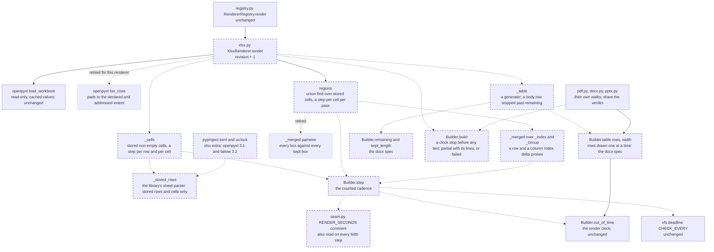

# An xlsx sheet is read under the clock and its tables stream: the renderer reads only the cells a sheet stores, steps the render clock on a counted cadence, merges regions through a row and a column index, and hands the Builder one row at a time

A fix to the xlsx renderer (`src/vfs/rendering/xlsx.py`), two changes to the rendering Builder (`src/vfs/rendering/markdown.py`): a counted step, and an honest verdict when the clock stops a rendering before any text, which every renderer on the Builder shares (decision 13), and one packaging change: the xlsx extra is bounded to the openpyxl minor line its parity test proves (decision 14). It is not structural: no module, public class, protocol method, lifecycle or seam is added or removed. It adds to `vfs.rendering`'s surface additively, one method, `Builder.step`, and changes no name in `vfs.__all__`; no page under `docs/` or `documentation/` names the Builder (EXECUTED, by grep). It changes no schema, SQL, dialect or rights path and no Rust, so the engine legs and `cargo test` are not needed, and the security lens runs in guidance mode at the code review. It changes the xlsx text of some workbooks, so the renderer's revision rises by one, from 1 to 2 at `5d47a21a`, and each xlsx entry re-renders once on the next index pass (decision 10). Neither module nears the 1,000-line ceiling (183 and 294 lines today). It answers two medium findings of the 0.1.0a1 security audit, run `vfs-run-1-2026-11-07` at commit `3586750`: `vfs.rendering.xlsx:dimension-driven-row-iteration-unclocked` and `vfs.rendering.xlsx:region-table-quadratic-materialization`, and three more defects of the same module found while reading it: a cell outside a declared dimension is dropped, the merge can leave one cell in two tables, and a row of cells naming one long string costs the string times the cells (The problem). No intention and no research memo: the costs are plain in the source and in the pinned library, and they and the alternatives for the merge were counted here on small, well-formed workbooks. It is the third of three rendering fixes for that audit, and it lands third. `context/specifications/active/2026-11-13-an-office-container-is-measured-before-it-is-opened.md` lands first and bounds the decompressed input before any library opens it; this spec bounds what the renderer does with that input. `context/specifications/active/2026-11-13-a-docx-note-is-written-once-and-a-span-is-clamped.md` lands second and adds to the Builder the members this spec stands on; what this spec assumes of them is stated exactly under Design. Code is cited at `5d47a21a`, whose `src/vfs/rendering/` and `tests/rendering/` equal the audited commit's (EXECUTED: `git diff --stat 35867501 5d47a21a` over both folders is empty, and the working tree's copies of both and of `tests/support/documents.py` equal `5d47a21a`'s).

## The problem

Labels: EXECUTED means a probe ran here, in the session scratchpad, on workbooks of a few kilobytes built with the pinned openpyxl 3.1.5 (`uv.lock`); READ means read in the cited file, the library's at its installed path under `.venv`; INFERRED means reasoning.

READ, where the limits act. `XlsxRenderer.render` (`xlsx.py:72-93`) opens the workbook read-only with cached values, and for each sheet opens a unit, writes its heading, collects its cells with `_cells(sheet)` (`xlsx.py:161-172`), finds its regions with `regions(cells)` (`xlsx.py:101-129`), and hands each region to `Builder.table` as the list `_table` builds (`xlsx.py:153-158`). Every `RenderLimits` field is enforced inside the Builder: the character budget and the ratio guard as each line is appended (`markdown.py:275-289`), the clock only at unit boundaries and between table rows (`markdown.py:128-132`, `136-147`, `197-201`). `Builder.table` takes a finished sequence and reads every row for its width first (`markdown.py:191-195`). So nothing between a sheet's heading and its first table row reads the clock or the budget, and the clock is cooperative: it is read only when the renderer calls the Builder.

READ, how the library walks a read-only sheet. `iter_rows` (`openpyxl/worksheet/worksheet.py:405-441`) starts at row 1 and column 1 whatever the sheet declares (`:436-437`) and ends at the dimension the sheet declares. `ReadOnlyWorksheet._cells_by_row` (`openpyxl/worksheet/_read_only.py:60-102`) yields one padding row for every row index the sheet skips, between two stored rows and from row 1 to the first stored row (`:89-92`), each as wide as the declared dimension (`:69-73`); it stops at the declared last row and pads nothing past the last stored row (`:86-87`, `:100-102`). `_get_row` (`:105-127`) pads each stored row from column 1 to the declared last column, or, with no declared width, to the row's own last stored cell, and drops a cell outside the declared columns (`:121`). `reset_dimensions` (`:164-170`) clears the declared last row and last column and nothing else.

EXECUTED, what today's walk visits against what a sheet stores. Every sheet below stores two cells, except the last.

| Sheet | Rows the library yields | Padding cells read | Through the library's sheet parser |
|---|---|---|---|
| declared dimension wider and taller than its cells, second cell 199 rows down | 200 | 5,198 | 2 rows, 2 cells |
| the same, second cell 399 rows down | 400 | 10,398 | 2 rows, 2 cells |
| written by openpyxl itself, second cell 199 rows down | 200 | 198 | 2 rows, 2 cells |
| written by openpyxl itself, second cell 399 rows down | 400 | 398 | 2 rows, 2 cells |
| written by openpyxl itself, second cell in row 2, column 394 | 2 | 786 | 2 rows, 2 cells |
| three rows of three cells, written by openpyxl itself | 3 | 0 | 3 rows, 9 cells |

So today's read costs the extent a sheet declares and the extent its cells address, not the cells it stores, and an honestly written workbook pays its addressed extent too, because the writer's own dimension covers a far cell. EXECUTED, what resetting the dimension does: on the first four sheets the padding cells read fall to 0 and the rows yielded stay 200, 400, 200 and 400, one empty row per skipped index; on the fifth the padding cells fall from 786 to 393, because a stored row is still padded from column 1 to its last cell. So resetting the dimension takes the declared width out of the walk and nothing else: every skipped row index still costs a row, a sheet whose first cell is far down is still reached from row 1, and a stored row still costs every column up to its last cell. INFERRED: a clock read inside that walk would bound its time and not its shape; a sheet of a few cells at far indexes would spend the whole render clock (`RENDER_SECONDS`, 60 seconds, `seam.py:55`) yielding padding and render none of them.

EXECUTED, a fidelity defect of the same cause. A sheet that declares a dimension smaller than its cells renders only the cells inside it: with a declared dimension of one cell and a second cell two rows and two columns away, the second cell is absent from the rendering, so text the file holds is kept out of grep and search by what the sheet declares.

READ, the library's sheet parser. `WorkSheetParser.parse` (`openpyxl/worksheet/_reader.py:125-169`) yields one pair per row element the sheet stores, its index and a list of the cells that element holds (`parse_row`, `:282-304`); `_cells_by_row` builds it with six arguments (`_read_only.py:78-83`) and adds the padding around it. With cached values the parser never reads a formula (`_reader.py:208`), and a shared string is the one Python string the shared-string table holds (`:226-227`). EXECUTED: read through the parser, every sheet in the table above yields exactly its stored rows and cells, and the three-by-three sheet yields the same nine values the walk does.

READ, the region tables. `regions` joins cells that touch by side or corner (`xlsx.py:120`), so a region's bounding box can be far larger than its cells: cells that run along two edges of a box, or that touch only at corners, make one region whose box is the square of their count. `_table` builds every position of that box as lists before `Builder.table` sees a row. EXECUTED: one region of 100 corner-touching cells builds 10,201 grid positions and one of 200 builds 40,401, under a 4,000-character budget that writes only a few rows of either; a region of 199 cells along two edges builds 10,201, and one of 399 builds 40,401.

READ and EXECUTED, the merge. `_merged` (`xlsx.py:137-150`) compares each box with every box kept so far, so boxes that never overlap cost a comparison per pair: 79,800 at 400 boxes and 1,279,200 at 1,600, exactly k(k−1)/2. It also does not always finish its fold: in 29 of 2,000 seeded random sheets of 3 to 12 rows and columns, two of the boxes it returns still overlap, and in the smallest of them one cell is rendered in two tables. A box kept early is not compared again once a later fold widens a neighbour over it. The docstring's "no cell is rendered twice" (`xlsx.py:105-106`) does not hold.

READ and INFERRED, a third shape: one row of many cells naming one long string. `Builder.table` builds a whole row's line, every cell through `table_cell`, before the fit test (`markdown.py:202-203`), and every cell naming a shared string holds the same long string, so such a row costs the string's length times its cells before it is refused. EXECUTED at the renderer: a sheet whose first row holds 50 cells naming one 10,000-character string, under a 2,000-character budget, hands 500,075 characters to `table_cell` and is then cut, `truncated` with "0 of 1 units within 2000 characters".

READ, what a clock stop before any text reports. `Builder.build` answers `empty`, "no text in N units", whenever no line of document text was written, and tests that before it tests the clock (`markdown.py:236-248`); a sheet's heading and every unit marker are structural, not text. `empty` is a settled state, and the skip law, as for every settled state, does not retry it until the bytes or the generation change (`storage/backends/database/render.py:35-38`). Today an xlsx render rarely meets this, because nothing reads the clock during the read; a pdf, docx or pptx whose library open or first units outlast the clock already does, and is stored as having no text. EXECUTED, by this spec's reviewer on a build of the first draft: criterion 4's workbook and clock gave `empty`, "no text in 1 units", where the text says `partial`. This is the review's H1, and decision 13 answers it.

READ and EXECUTED, the library's range. The extra admits `openpyxl>=3.1` with no upper bound (`pyproject.toml:63`; `uv.lock:3768` records the same specifier) while the lock installs 3.1.5. EXECUTED: each release of the 3.1 line, 3.1.0 to 3.1.5, installed alone in an isolated scratch environment, carries the five private names decision 1 uses, and its parser read gives the same cells and values as its public walk on five workbooks (mixed types, dates, times and datetimes in both epochs, a formula with its cached value, pipes and breaks, a 59-row column). No other file states the openpyxl range (EXECUTED: `git grep openpyxl` outside `uv.lock`, `context/`, the renderer and the tests finds only `pyproject.toml:63`).

READ, the costs the module's docstrings state. The module docstring says the region pass "is linear too" (`xlsx.py:14-18`) and `regions` says its pass "is linear in their number" (`xlsx.py:106-107`). The union-find is; the merge, the tables and the read are not.

READ and EXECUTED, every other place the work could follow the sheet's declarations or geometry, and its answer.

| Shape | What it costs | Answer |
|---|---|---|
| merged ranges | the read-only parse keeps one object per merge element (`_reader.py:150`) and makes no cell per merged position; EXECUTED: a merge over 100 by 100 cells stores 1 cell and 1 merge element, but the writer's dimension covers the range, so today's walk reads 10,000 positions | fixed here, by reading stored cells (decision 1) |
| hidden rows and columns | one entry per row element with attributes and one per column element (`_reader.py:275-279`, `:299-301`), never spread over a span; EXECUTED: 100 hidden columns are 1 column element | bounded already; hidden cells render, as hidden sheets do |
| many sheets | one sheet object each at load; each sheet is a unit, and `Builder.unit` reads the clock and the unit cap (`markdown.py:149-162`) | bounded already |
| defined names | parsed at load, one per name, a print area kept as its string (`openpyxl/reader/workbook.py:89-119`); the renderer reads none | bounded already |
| formulas and cached values | with cached values no formula is parsed or translated (`_reader.py:208`); the cached value renders | bounded already |
| styles and dates | the stylesheet is read once at load; a cell costs one set lookup and at most one date conversion | bounded already |
| a long digit string | Python refuses an integer string past its digit limit (EXECUTED: 5,000 digits raise `ValueError`), and the registry classifies a renderer's raise as `failed` | bounded already |
| shared strings | read once at load; a cell holds a reference to its string | the row of many references is fixed here (decision 6) |
| very wide rows | padded to the declared width or to the last stored cell (above) | fixed here (decisions 1, 6 and 7) |
| cells far apart | skipped indexes padded (above); cells far apart are separate small regions | fixed here (decision 1) |
| the library's load | shared strings, styles, the workbook part and each sheet's header are read before the clock is first consulted, in time linear in those parts | out: the office-container spec bounds the decompressed parts and lands first |

READ, reach, from the audit's records. Rendering runs in the index pass's render stage, on the shared offload pool of the host process, for any principal who can write a file, when the xlsx extra is installed (`backend.py:1287-1288`, `registry.py:105-108`); a worker already running cannot be interrupted, so the render clock is the only bound on a render, and nothing reads it during the read, the region pass or the table build.

## Architecture

Dashed is what this spec adds or changes; dotted is what it retires. The Builder members marked "the docx spec" are added by that spec, which lands second.



Page this changes: none; the architecture folder was retired on 2026-10-31, and the landing notes will say so in one line.

Terms. A **stored cell** is a cell element the sheet's own XML holds, with a value or without. The **declared dimension** is the extent the sheet's header states; the **addressed extent** runs from the first row and column to the farthest stored cell. **Padding** is a row or cell the library yields that the sheet does not store. A **step** is one item of a renderer's walk over its input, counted by `Builder.step`. In the merge, a **group** is a set of region boxes folded into one, with the box that bounds them; a **fold** is the merge taking a box and the groups it overlaps into one group; a **probe** is one lookup of one row's or one column's list in the index, with one bisection of the list when it exists. **Remaining** and **kept** are the docx spec's terms: the characters the budget still admits, and the characters no line rule of the Builder can drop.

## Decisions

### 1. The renderer reads a sheet through the library's own sheet parser, `WorkSheetParser` in `openpyxl.worksheet._reader`, built with the six arguments `ReadOnlyWorksheet._cells_by_row` gives it, and never through `iter_rows`; the private names this needs are confined to one helper, `_stored_rows`, and a parity node pins it against the public walk

The parser yields exactly the rows and cells the sheet stores (The problem, EXECUTED), so the read costs the stored cells and no extent enters it. Each alternative leaves an extent in. The walk as today costs the declared extent times the skipped rows. Resetting the dimension, the audit's suggested first step, still costs a row per skipped index and a cell per column up to each row's last cell. A clock read inside the walk bounds the time and not the shape, so a sheet of a few far cells would spend the whole clock and render nothing. Parsing the sheet's XML in vfs would duplicate the library's value decoding (shared strings, inline strings, dates, the 1904 epoch, booleans), which is the library's job. The private names are `WorkSheetParser`, `ReadOnlyWorksheet._get_source`, `ReadOnlyWorksheet._shared_strings`, `Workbook._date_formats` and `Workbook._timedelta_formats`. The parity node proves the parser against the public walk in vfs's own CI, and decision 14 bounds the extra to the minor line that node and this spec's probe proved, so a deployment cannot install a release no test ran; the library's version is part of the renderer's generation (`seam.py:282-285`), so an upgrade within that line re-renders every xlsx entry. The reader module is resolved through `load_library`, as the pptx renderer resolves its enum module (`pptx.py:41-42`), because the extra may be absent and imports stay at the top.

### 2. The declared dimension is ignored: every stored cell renders at its own address, a cell outside a declared dimension included, and where a malformed sheet stores one address twice, the first non-empty value renders

Today the declared dimension cuts the walk, and a sheet can keep text it holds out of the rendering, and so out of grep and search (The problem, EXECUTED). The rendering follows what the file holds, as it does for hidden sheets, whose hiding the rendering spec calls a view property ([the binary bodies spec](../active/152-binary-bodies-and-text-renderings/spec.md), section 4). A repeated address only comes from a malformed file; today's walk keeps the first of two rows with one index and the last of two cells in one row, and one rule is simpler than two. The same rule renders the other cells a malformed sheet stores that today's walk drops: a row stored after a row with a higher index, a row whose index is 0 or below (under that number), and the cells of a row element stored twice.

### 3. The Builder gains `step() -> bool`, the counted cadence: each call counts one item; the clock is read before every `CHECK_EVERY`-th call, the 64 of `vfs.deadline`; it answers `False` once the clock has run out or the rendering has stopped; and a clock stop inside an open unit closes that unit incomplete, as a clock cut inside a table does today

The clock is cooperative, and the Builder owns it and the verdict, so the Builder is where a renderer's own loops read it. A counted step costs an increment per item and a clock read per 64, the cadence [bounded work has one home](2026-11-07-bounded-work-has-one-home.md) made the one default (its decision 3). Each item here is small: a stored cell, a union-find step, a bisection, an index entry read. A stored row is also one item, though the library parses its element whole before yielding it; that parse is linear in the row's bytes, which the container spec bounds. A unit stopped mid-read is not complete, so it is not counted, as `markdown.py:198-201` already decides for a table; what the rendering then reports when no document text was written is decision 13's. The Builder keeps its own instant and its own reading of the clock: that spec's decision 2 leaves the five renderer modules as the clock's other readers, and its lint pins the list (`tests/lint/test_code_shape.py:72-75`). Moving the renderers onto the `Deadline` value would change all five and that lint, a structural change of its own, and nothing here needs it.

### 4. Every loop the xlsx renderer runs over its input steps: the sheet read once per stored row and once per stored cell, `regions` once per stored cell in each of its two passes, and the merge once per box it takes, once per probe and once per index entry it reads; a loop whose step answers `False` returns `None`, and the renderer stops without laying out the rest of that sheet

The merge also steps once per index entry it inserts and once per entry it collapses, and a round grows its bounds and its clear box from the groups that round met, so each round costs its own probes. `_table` reads at most the remaining characters' worth of one row between two of the Builder's per-row clock reads. Then no loop over input-sized data runs past 64 items without a clock read. One residual is the library's: it parses each row element whole, and the elements between rows, before it yields, with no clock. One such gap costs time linear in the bytes it parses, at most the sheet part's decompressed size, which the container spec's declared total bounds, and the read's next step reads the clock. A partly read sheet is not laid out, because its regions would be cut at the row where the read stopped and could render as tables the sheet does not have. The rendering is `partial` with the text so far, exactly as a clock cut is today. The sorts the region pass makes run in C over at most one entry per region and are not stepped.

### 5. The renderer hands each region to `Builder.table` as a generator with its width, `width = box.right - box.left + 2`, on the Builder the docx spec leaves (its decision 11), which draws rows one at a time when given a width and keeps the sequence form the pptx renderer uses

The Builder's per-row clock and budget checks (`markdown.py:197-206`) stop a table only if the next row is not built before them, so the row must be built when it is drawn. The width is known from the box before any row exists, which is what lets the Builder write the header and its separator first. The docx spec decides the Builder's side of this and says the xlsx spec streams its rows through the same keyword; this spec decides only how the xlsx renderer uses it, and adds nothing to `table`.

### 6. `_table` stops building a body row once the kept characters of its cells exceed the Builder's remaining characters, and yields the row as far as it got

A shared string is one value many cells name, so a row naming one long string many times costs the string times the cells before today's fit test. Every kept character costs one character of budget, so a row holding more kept characters than remain cannot fit, and the Builder refuses it whether it is whole or stopped; the rendering is cut by characters, exactly as today. A row that fits is built whole, so every rendering that fits is unchanged. A stopped row costs the remaining characters plus one cell. This is the docx spec's rule for its rows, read through its `Builder.remaining` and `kept_length`, so the two renderers stop a row the same way.

### 7. `_table` is a generator: the header row, then one body row at a time, each built when the Builder draws it

Each body row the Builder writes is at least three characters per cell plus one, because every cell costs its separator, so with decisions 5 and 6 the grid positions one table builds are at most the character budget over three, plus the header row and the row that does not fit. A region box is at most the library's column cap wide, so those two rows are bounded too.

### 8. The merge is a worklist over a row index and a column index of the groups formed so far, each box probing the rows it spans and each fold probing only the rows and columns its bounds add beyond the largest box already known to meet no other group

For each region box in top-then-left order, the box probes each of its rows over its own columns. A probe bisects that row's list, which holds the groups spanning the row ordered by their left edge, to the first group reaching the probe's left edge, then reads groups while their left edge is at most the probe's right edge; each group read is one the box overlaps. A box that meets no group is indexed as a group of its own. Otherwise it folds in rounds. Its bounds grow to cover the groups that round met. The clear box is the largest, by rows plus columns, of the bounds before the round and the boxes of the groups that round met, since each indexed group meets no other. The round probes each row of the new bounds outside the clear box's rows across the new bounds' columns, and each column outside the clear box's columns across the clear box's rows. A round that meets no new group ends the fold: the largest group met survives, the box and every other group met join it by union-find, the survivor's bounds become the fold's, and the box's own rows and columns are indexed. No group's bounds change while a fold runs, so every list stays ordered; a finished fold meets no other group, so its entries lie together in each list. A run of entries naming one group is collapsed to one entry when a probe reads it.

The cost, as built. A region of c cells touching by side or corner spans at most c rows and c columns, so the index holds at most two entries per stored cell, each inserted once. The probes are one per row of each box as it enters, plus, in each fold, one per row or column its bounds add beyond its clear box; the entries read are the groups met plus collapsed entries, and each collapsed entry is deleted once. A fold's probes telescope to the rows and columns its bounds gain past its first clear box, because every later clear box is at least the bounds before its round. Its entries read add the groups it met again in later rounds, and a round that leaves a group's rows out must have a clear box larger than all before it, so such rounds grow geometrically. With a step on every index insert and collapse, the spec review measured at most 8.17 steps a stored cell on every shape it built or searched for, an adversary built to re-read a comb every round among them, and 6.00 at most on criterion 6's three shapes; the order is inferred to be cells times log cells, and the stepped clock bounds the time whatever the shape.

EXECUTED, the alternatives, counted in the scratchpad on the region boxes of four shapes. Isolated: cells no two of which touch. Widening: a tall region folding in, one at a time, boxes that each widen it by a column. Enclosed: a region along two edges of a square, holding isolated cells inside its box. Nested: regions along two edges of squares, each enclosing the last. Comparisons are calls of `Box.overlaps`; for the two indexes, bisections plus the reads their key makes.

| Shape and boxes | Today's pairwise merge | A sweep by top that retires a box once passed | A row index alone | A row and a column index |
|---|---|---|---|---|
| isolated, 400 | 79,800 | 3,800 | 380 + 1,080 | 380 + 1,080 |
| isolated, 1,600 | 1,279,200 | 31,200 | 1,560 + 5,720 | 1,560 + 5,720 |
| widening, 101 | 100 | 100 | 20,500 + 20,599 | 100 + 100 |
| widening, 201 | 200 | 200 | 81,000 + 81,199 | 200 + 200 |
| enclosed, 401 | 400 | 400 | 400 + 780 | 400 + 780 |
| enclosed, 1,601 | 1,600 | 1,600 | 1,600 + 3,160 | 1,600 + 3,160 |
| sheets of 400 seeded random trials whose result differs from folding any overlapping pair until none is left | 42 | 47 | 0 | 0 |

The pairwise merge is quadratic in boxes that do not overlap, and wrong on 42 sheets. The sweep grows as the boxes to the power of one and a half, because every live box on a row is read, and it is wrong more often, because a box it has retired can be overlapped later by a fold that widens. The row index alone is quadratic on the widening shape, since each widening re-probes every row of the tall region. A grid index of fixed buckets inserts each box in every bucket it covers, which is its area: an L-shaped region of 199 cells takes 169 entries of an eight-cell bucket and one of 399 takes 676, the same area shape the fix removes. The row and column index's whole work per stored cell, its bisections, key reads, entries read and collapses together, was 3.65 at 400 isolated cells and 4.04 at 784, 0.74 and 0.75 on the widening shape at 807 and 1,607 cells, 4.04 and 4.29 on the enclosed shape at 485 and 901, and 2.44 and 2.47 on the nested shape at 40,300 and 160,600: constant within a doubling of the cells, with a logarithm's drift. Small structures stay stdlib Python: `bisect` with a key, lists and dicts, as AGENTS.md asks.

### 9. The merge folds until no two groups' boxes overlap, so no cell is in two tables

Today's merge leaves overlapping boxes on some sheets, and a cell in two tables (The problem, EXECUTED), which its own docstring says cannot happen. The worklist of decision 8 ends every fold only when a round meets nothing, so the groups it returns are pairwise apart. On the sheets where today's merge stops short, the rendering changes: their overlapping tables become one.

### 10. `XlsxRenderer.revision` rises by one over the value it holds when this spec is built, 1 at `5d47a21a`

Decisions 2 and 9 change the text of some workbooks, and a bundled renderer bumps its revision when its own output changes (`seam.py:266-273`). The generation carries the revision, and the skip law re-renders an entry whose generation changed, once, and an ordinary workbook re-renders to the same text. In the reference deployment's terms: of its 10,000,000 files, the spreadsheets are a share no public measurement gives, an assumption; at 5 percent the bump is 500,000 renders, half the nightly batch's file count. Every one of them is stale at once, so the first index pass that runs the render stage after the landing pays all of them, each bounded by this spec's clock and budget: today that is the reindex, and once the refresh spec lands it is whichever pass runs first. It is paid once and spread by nothing; a host that wants it off its working hours runs that first pass at night. If the container spec, landing first, has already raised it, this spec raises it once more and the landing notes say so, as the docx spec's decision 13 does for its renderer.

### 11. The module docstring, the docstring of `regions` and the Builder's class docstring state the costs as built

They state costs the code does not have (The problem). The module docstring states that a sheet's read costs its stored cells, the region pass is linear in them, the merge costs decision 8's terms, a table builds at most a budget's worth of rows plus two, and one sheet's stored non-empty cells and the merge index are held at once, with a region pass that streams named as the direction. The Builder's docstring adds that the clock is also read on every `CHECK_EVERY`-th step a renderer counts.

### 12. No limit is added and `RenderLimits` is unchanged

Every bound here is the existing character budget and clock reaching work they did not reach. Nothing caps the cells, rows, regions or sheets a workbook may hold, as AGENTS.md's production posture requires; a workbook too large for the budget is `truncated` and one too slow for the clock is `partial`, both as today.

### 13. A rendering the clock stopped before any document text is never `empty`: `Builder.build` tests the clock before it tests for text, and when the clock has run out, no document text was written and no character or unit cut stands, it answers `partial` with the lines written so far (unit markers and structural headings) and today's clock detail, or, when not one line was written, `failed` with that detail followed by ", before any line was written"

A clock stop with text is already `partial`, the text so far kept (the binary bodies spec's status table), and a clock stop before text is the same event earlier, so it takes the same status wherever there is a line to carry it; a sheet's marker and heading are such lines, and the unit table then says which unit the clock stopped. `empty` says the file holds no text, which nobody knows when the clock stopped the walk. A rendered status needs text (`settle`, `seam.py:211-213`), and a rendering with no line at all has none to serve, so that case is `failed`, the status that carries a reason and no content row; its detail names the clock and says no line was written. The index treats all three alike: `empty`, `partial` and `failed` are settled, and the skip law retries none of them until the bytes or the generation change (The problem), so the choice changes what the row says, not how often it is rendered. A caller's read changes with it (`storage/backends/database/reads.py:886-910`, READ). Where an `empty` row read as an empty string with no note, a `failed` one reads with no content and an `unsupported`, not-retryable warning naming the status. A marker-only `partial` one reads its markers and headings with the cut-short note, and grep and search can match those lines, which are the file's own unit titles. Grep and search see no row for `empty` or `failed` either way. This is a change in what callers see, and the landing notes' changelog line says it in these words: "A render that runs out of time before its first text is now `partial`, keeping its unit markers and headings, or `failed` when it wrote nothing, where it was `empty`, which said the file had no text." The rule is one change to `build`, so pdf, docx and pptx take it through the same lines: a render that times out before its first text says `partial` or `failed` with the clock's detail where today it says `empty`, "no text in N units"; a cut by characters or by the unit cap before any text stays `empty`, as today, because the cut, not the clock, ended it. Stored renderings change only when re-rendered. No revision is bumped for pdf or pptx (docx's rises by its own spec and xlsx's by decision 10): the changed outcome depends on how fast the machine was, not on the file, so no generation change can single out the rows it would correct, and the project is pre-release, so no deployed corpus holds such a row; a bump would re-render every pdf and pptx to reach none. The change is disjoint from the docx spec's Builder lines: it adds `remaining` beside `spent`, `kept_length` after `table_cell` and a new `table` body, and this spec touches `build`, adds `step` after `out_of_time`, one `__init__` line, one import line, and the class docstring, which that spec leaves alone. One existing assertion follows the rule: `tests/rendering/test_markdown.py:240`, in `test_the_clock_starts_where_the_renderer_says`, expects `empty` for a Builder whose clock ran out before its first unit, and expects `failed` after.

### 14. The xlsx extra is bounded to the minor line its parity test proves, `openpyxl>=3.1,<3.2`, in `pyproject.toml` and the regenerated `uv.lock`

The reader stands on a private parser, and the parity test proves it for one minor line: every release of 3.1 carries the five names and reads what the public walk reads (The problem, EXECUTED), and nothing proves 3.2 or later. A later minor line is admitted the same way, by re-running the parity test against it and widening the bound in a vfs change; if openpyxl's parser ever moves past what that test can accept, the direction is a standard-library parse of the sheet XML held to the same parity test, never the padded public walk. This is a packaging choice the session lead flags to the developer; the extra stays optional, and no other file states the range.

## Intent

After this spec, rendering an xlsx sheet costs work in proportion to the cells it stores and the text it writes. A sheet that declares, or whose cells address, an extent far beyond its cells costs only its cells; every stored cell renders at its address, whatever the sheet declares. Every loop the renderer runs over a sheet reads the render clock on a counted cadence of 64 items, so a render stops within a small constant amount of work once its clock runs out, and says `partial`; a render of any format the clock stops before its first text says so, `partial` with its markers or `failed` with no line, and never claims the file has no text. A region's table is built a row at a time and only as far as the character budget can write it. No two tables share a cell, and the merge no longer compares every region with every other. Ordinary workbooks render exactly as before.

## Design

**What this spec stands on from the docx spec.** That spec's decision 11 and its Design, as written on 2026-11-13, give the Builder three things and only these, and this spec uses all three as they state them: `Builder.remaining`, a property that is `0` once the rendering has stopped and otherwise the budget less the characters written, never negative; `kept_length(text) -> int` in `vfs.rendering.markdown`, the characters of `text` that are neither whitespace nor NUL; and `Builder.table(rows: Iterable[Sequence[object]], *, width: int | None = None) -> bool`, which with a width draws each row only after the line before it was written, checks the clock before every row after the first as today, and pads a short row to the width, and which without a width reads every row first and takes the longest, exactly as today. Nothing else in the Builder's signatures or its clock changes there. If that spec lands without one of the three, this spec's build adds that one exactly as stated here, in `markdown.py`, with its node in `tests/rendering/test_markdown.py`.

**`src/vfs/rendering/markdown.py`.** `from vfs.deadline import CHECK_EVERY` at the top. `Builder.__init__` sets `self._steps = 0`. `step(self) -> bool`: if the rendering has stopped or the clock was already seen out, answer `False`; else count the step, and on every `CHECK_EVERY`-th count read `out_of_time()`, and if it has run out set `self._open = False` and answer `False`; else answer `True`; it sits directly after `out_of_time`. `build` gains decision 13's branch after the ratio guard and before the test for text: when `self._timed_out`, no document text, and `self._cut_by is None`, it trims trailing blank lines and answers `Rendering("partial", text, units, detail)` with the lines so far, or `failure("failed", detail + ", before any line was written")` when there are none, `detail` being today's clock detail. The class docstring's clock sentence gains the step and the rule. About thirty lines, none of them a line the docx spec edits (decision 13).

**`src/vfs/rendering/xlsx.py`.** `revision` per decision 10. `Step = Callable[[], bool]` among the module's shared types. `Callable` is imported at the top at runtime, because `Step` is a runtime alias; `Iterator` stays under `TYPE_CHECKING`. `_unbounded` sits directly under `Step` among the shared types, because it is the default of a public signature. `render` resolves the reader with `load_library("openpyxl.worksheet._reader")` (asserting it, as `pptx.py:42` does: the package opened the file, so its reader module is present), and per sheet calls `_cells(_stored_rows(reader, workbook, sheet), builder.step)`, then `regions(cells, builder.step)`, breaks out of the sheet loop when either answers `None`, and per box calls `builder.table(_table(cells, box, letter, builder), width=box.right - box.left + 2)`, breaking as today when it answers `False`. `_stored_rows(reader, workbook, sheet)` is a generator that opens the sheet's source with `sheet._get_source()` in a `with` block, so a walk the clock stops closes it, and yields from `reader.WorkSheetParser(source, sheet._shared_strings, data_only=workbook.data_only, epoch=workbook.epoch, date_formats=workbook._date_formats, timedelta_formats=workbook._timedelta_formats).parse()`; its docstring says why it does not use the public walk and names the private names. `_cells(rows, step) -> Cells | None` steps once per row and once per cell, skips a value of `None` or an empty text, keeps the first non-empty text at each address, and answers `None` at the first `False`. `regions(cells, step=_unbounded) -> list[Box] | None` keeps today's union-find and box pass, steps once per cell in each, and returns `_merged(sorted(boxes), step)`; `_unbounded()` answers `True`, so `regions(cells)` serves today's callers. The return type stays honest, with no overload, cast or ignore: a caller that needs a list narrows it, and the one existing test line that takes `len` of the result, `tests/rendering/test_renderers.py:265`, becomes `boxes = regions(sparse)` followed by `assert boxes is not None and len(boxes) == 4_000` (Scope). The merge group holds `_Group` (slots `top`, `left`, `bottom`, `right`, `parent`; `box()`; `size()`, rows plus columns), `_Index` (`rows` and `columns`, each a `dict[int, list[_Group]]`; `meet(lines, line, low, high, found, step)`, one probe as decision 8 states, with `bisect_left` keyed by the root's far edge, taking a step before each collapsed entry it deletes; `add(group, box, step) -> bool`, one `insort` keyed by the root's near edge per row and per column of the box's own extent, with one step before each `insort`, `False` at a stopped step, on which `_merged` answers `None`; the union-find `find` with path halving), and `_merged(boxes, step) -> list[Box] | None`, decision 8's worklist, returning the surviving roots' boxes sorted. `_table(cells, box, column_letter, builder)` yields the header row, then for each row of the box a list that starts with the row number and adds each column's text, read as `cells.get((row, column), "")`, stopping once the kept characters added exceed `builder.remaining` read as the row starts. `bisect_left` and `insort` come from `bisect`, `Callable` from `collections.abc` at runtime and `Iterator` under `TYPE_CHECKING`, and `kept_length` from `vfs.rendering.markdown`. The module docstring, `regions`'s docstring and the docstrings of the new functions state decision 11's costs.

**`pyproject.toml` and `uv.lock`.** The `xlsx` extra reads `["openpyxl>=3.1,<3.2"]` (`pyproject.toml:63`), and `uv lock` regenerates the lock, whose `openpyxl` specifier for the extra (`uv.lock:3768`) then reads the same; the installed version stays 3.1.5.

**`src/vfs/rendering/seam.py`.** The `RENDER_SECONDS` comment, which the container spec leaves as two full lines, is rewritten whole within two lines, because a comment is at most two (AGENTS.md, "Code comments"), carrying that spec's facts and this one's:

```python
# Wall seconds one render runs under: a container still being verified is refused; a rendering stops at its
# next unit, table row or 64th counted step and keeps its lines as partial; a library's own open runs on.
```

**`tests/support/documents.py`.** `xlsx_bytes` gains `dimension: str | None = None`: when given, each worksheet's dimension element in the saved package states it in place of the one the writer computed. Nothing else changes in the helper.

**Tests first.** The nodes the criteria name are written into `tests/rendering/test_renderers.py` (new classes `TestXlsxRead` and `TestXlsxTables`, three nodes added to `TestXlsxRegions` and one to `TestXlsx`) and `tests/rendering/test_markdown.py` (two nodes added to `TestMarkersAndClock`), and each is seen failing before `xlsx.py` and `markdown.py` change. Two existing lines change with the code they follow, and no other: `tests/rendering/test_markdown.py:240` expects `failed` (decision 13), and `tests/rendering/test_renderers.py:265` narrows the result of `regions` (the `xlsx.py` paragraph). A fake clock is a function counting its own reads, patched on `vfs.rendering.xlsx.monotonic` and `vfs.rendering.markdown.monotonic`; no test reads a real clock or sleeps. The fold-until-none reference for criterion 7 is written in the test: the regions of a sheet by breadth-first search over side and corner neighbours, their boxes, and any overlapping pair folded until none is left.

**The ledger rows the landing adds** to [the mutant ledger](../../standards/mutant-ledger.md), each proven by the code review on a scratch copy under the safe-restore rule:

Each row's provenance is "an xlsx sheet is read under the clock and its tables stream".

| id | mutation (intent → anchor) | target | scope | recorded killers (advisory) | provenance |
|---|---|---|---|---|---|
| X1 | the read reverts to the public walk: `_stored_rows` yields each row of `sheet.iter_rows()` as the parser's cell dicts | `src/vfs/rendering/xlsx.py` | `tests/rendering/` | criteria 1, 2, 3 | this spec |
| X2 | the declared dimension filters again: `_cells` drops a cell past `sheet.max_row` or `sheet.max_column` | same | same | criterion 3 | this spec |
| X3 | the read takes no step: the two `step()` checks in `_cells` deleted | same | same | criterion 4 | this spec |
| X4 | `Builder.step` never reads the clock: its cadence test becomes `False` | `src/vfs/rendering/markdown.py` | `tests/rendering/` | criteria 4, 10 | this spec |
| X5 | `Builder.step` counts a stopped unit complete: its `self._open = False` deleted | same | same | criterion 10 | this spec |
| X6 | the merge ignores its step: the step calls in `_merged` deleted | `src/vfs/rendering/xlsx.py` | `tests/rendering/` | criterion 5 | this spec |
| X7 | the merge loses its column index: a round re-probes every row of its bounds and no column | same | same | criterion 6 | this spec |
| X8 | the merge compares pairwise again: today's `_merged` restored behind a step per comparison | same | same | criterion 6 | this spec |
| X9 | a fold ends after its first round, with no delta probe | same | same | criterion 7 | this spec |
| X10 | `_table` returns a list of every row of the box | same | same | criterion 8 (EXECUTED on this spec's scratch prototype: 10,000 and 40,000 positions built against bounds of 1,535 and 1,735, where the generator builds 1,000 and 600) | this spec |
| X11 | the renderer calls `Builder.table` without a width | same | same | criterion 8 | this spec |
| X12 | `_table` builds a body row whole: its kept-length stop deleted | same | same | criterion 9 | this spec |
| X13 | `XlsxRenderer.revision` back to 1 | same | same | criterion 11 | this spec |
| X14 | a clock stop before any text is `empty` again: `build`'s clock branch moved below its test for text | `src/vfs/rendering/markdown.py` | `tests/rendering/` | criteria 4, 13 | this spec |

**Scale.** A sheet costs one step per stored row and per stored cell to read, two per stored cell to find its regions, decision 8's probes to merge them, and per table at most the character budget over three grid positions plus two rows; every loop reads the clock every 64 steps. Memory holds one sheet's stored non-empty cells and the merge index, at most two entries per stored cell; the library's own load is linear in the decompressed parts, which the container spec bounds. At the reference deployment's multipliers, a render runs per changed xlsx file, through the partial passes and the nightly batch, and its cost now follows the file's cells and the 2 MiB budget, not what the file declares; the revision bump adds one render per xlsx file once, at this landing. No statement, batch or SQL path changes.

## Scope

In: decisions 1 to 14. Files: `src/vfs/rendering/xlsx.py`; `src/vfs/rendering/markdown.py` (the `step` method, its import, one `__init__` line, decision 13's branch of `build` and the class docstring, on the Builder the docx spec leaves); `src/vfs/rendering/seam.py` (the `RENDER_SECONDS` comment, rewritten whole within two lines); `pyproject.toml` (the `xlsx` extra's range) and `uv.lock` (regenerated by `uv lock`); `tests/rendering/test_renderers.py`, including the one existing line `:265` the honest return type of `regions` changes; `tests/rendering/test_markdown.py`, including the one existing assertion `:240` decision 13 changes from `empty` to `failed`; `tests/support/documents.py` (one keyword); [the mutant ledger](../../standards/mutant-ledger.md) (rows X1 to X14); and this spec's landing notes. Line numbers are at `5d47a21a`; the build finds the same lines after the earlier landings.

Shared files, and the order. The three rendering specs land in the order container, docx, xlsx; their place against the rest of the queue is not fixed, so every count of existing nodes this spec cites is the count at `5d47a21a`, plus what earlier landings add. With [the office-container spec](2026-11-13-an-office-container-is-measured-before-it-is-opened.md), which lands first, as its text is signed: `src/vfs/rendering/xlsx.py` (it imports `container_refusal` and calls it in `render` directly after `started = monotonic()`, before `load_workbook`, passing `limits.workbook_bytes`, 4 GiB by default, as the keyword `byte_limit`; this spec changes the lines after the open), `tests/support/documents.py` (it adds three helpers under a banner of their own; this spec adds one keyword to `xlsx_bytes`), `tests/rendering/` (it adds 25 nodes, 15 in `test_seam.py` and 10 in `test_renderers.py` in the class `TestContainerCheck`, taking the folder from 96 nodes to 121; this spec adds `TestXlsxRead`, `TestXlsxTables` and nodes in `TestXlsx`, `TestXlsxRegions` and `TestMarkersAndClock`), the mutant ledger (its rows Z1 to Z3), and `src/vfs/rendering/seam.py`, whose `RENDER_SECONDS` comment it rewrites to two full lines; this spec rewrites that comment whole within two lines, carrying both specs' facts (the text is in the Design), and the landing notes say so. It changes no renderer's revision (its decision 13), so this spec's decision 10 takes the xlsx revision from 1 to 2. With [the docx spec](2026-11-13-a-docx-note-is-written-once-and-a-span-is-clamped.md), which lands second and is signed: `src/vfs/rendering/markdown.py` (it adds `remaining`, `kept_length` and the drawn rows of `table`; this spec adds `step`, its import, one `__init__` line and decision 13's branch of `build`, none of them a line that spec edits, as the spec review showed by building both specs' Builder members together), `tests/rendering/test_markdown.py` (it adds the class `TestWhatIsLeft`; this spec adds two nodes to `TestMarkersAndClock` and changes the assertion at `:240`), and the mutant ledger (its rows G1 to G16 as that spec stands, renamed from D because the refresh spec already claims D, and this spec's X1 to X14; the landing notes take each sibling's ranges as landed); its tests live in a new module of their own, `tests/rendering/test_docx_bounds.py`, so `tests/rendering/test_renderers.py` and `tests/support/documents.py` are not shared with it. This spec is built third, on both as landed, and the build takes their names where this text differs. The eight other dated specs under `active/` (the refresh verb of 2026-10-31; scope in one shape and the release audit of 2026-11-07; close and SQLite side files, search and a deleted chunk row, the full pass named rebuild, and the scan tier's rights of 2026-11-12; and the index publishing only what its build read of 2026-11-13) touch none of these files (EXECUTED: no line of any of them names `src/vfs/rendering`, `tests/rendering`, `markdown.py` or `tests/support/documents.py`), so this spec is parallel-safe with them as to code, with one exception that shares no line: [the rebuild refactor](../active/2026-11-12-the-full-pass-is-named-rebuild-and-its-pipeline-leaves-the-backend.md) renames one word at `src/vfs/rendering/seam.py:169` (a docstring sentence on retrying an unavailable stamp) and at `src/vfs/rendering/registry.py:53`, lines at `5d47a21a`, and this spec rewrites only the `RENDER_SECONDS` comment (line 54) and does not touch `registry.py`, so no line is shared and the two land in either order. None of them names `pyproject.toml` or `uv.lock`. Every other queued spec appends rows to the mutant ledger (A, S, V and the rebuild spec's target edits); the shared ledger is the one file they have in common, and rows X1 to X14 collide with none. It must land before [the refresh verb](../active/2026-10-31-refresh-the-incremental-index-verb.md), which puts rendering on an automated pass, and [the release audit](../active/2026-11-07-the-release-audit-is-a-review.md) waits on it; neither is edited here.

Out: bounding the library's load and the decompressed parts, which is the office-container spec's; the docx renderer and the Builder members the docx spec adds; the pptx and pdf renderers; moving the renderers' clocks onto the `Deadline` value, a structural change for its own spec; a separate process that can stop a renderer, the fork [the binary bodies spec](../active/152-binary-bodies-and-text-renderings/spec.md) names for native renderers; a region pass that streams rows instead of holding a sheet's cells, the direction decision 11 names; the region rule itself (cells touching by corner join, so a sparse region can be a wide table of blanks, which the budget and the ratio guard bound); the reindex lease's behaviour around a long render.

## Acceptance criteria

Counts and states, never clocks: a clock in these tests is a fake one that counts its reads. Tests are in `tests/rendering/test_renderers.py` unless their path says otherwise; "today" is `5d47a21a`.

1. For a one-sheet workbook storing two cells, one in row 1 and one 199 rows below, whose sheet declares a dimension wider and taller than its cells (`xlsx_bytes(..., dimension=...)`), and for the same with the second cell 399 rows below, rendering reads no padding cell (reads of `EmptyCell.value`, counted by a property patched on the class: 0 at both, today 5,198 and 10,398, EXECUTED), draws no row from `ReadOnlyWorksheet._cells_by_row` (counted by wrapping it: 0 at both, today 200 and 400, EXECUTED), calls `Builder.step` the same number of times at both, and renders the two cells' tables. Test: `TestXlsxRead::test_a_declared_dimension_pads_nothing`.
2. For workbooks written by openpyxl itself, one storing cells in A1 and A400 and one storing cells in A1 and in column 394 of row 2, rendering reads no padding cell and draws no row from `_cells_by_row` (today 398 and 786 padding cells and 400 and 2 rows, EXECUTED), and renders the stored cells at their addresses. Test: `TestXlsxRead::test_a_far_row_or_column_pads_nothing`.
3. For a workbook storing A1 and C3 whose sheet declares the dimension `A1:A1`, the rendering holds both values, C3 in its own table under its own row number and column letter (today C3 is absent, EXECUTED). Test: `TestXlsxRead::test_cells_outside_a_declared_dimension_render`.
4. For a one-sheet workbook of 1,000 stored cells in 100 rows, with a fake clock that answers 0.0 for its first three reads and past the deadline after, the renderer converts at most 2 × `CHECK_EVERY` cell values (calls of `xlsx._cell_text`, counted by wrapping it; today 1,000, EXECUTED), and the rendering is `partial` with the detail "0 of 1 units within 60 seconds", the sheet's marker and heading as its text and no table line (today the same detail with three table lines, EXECUTED; on this spec's scratch prototype of the amended design, 115 conversions, `partial`, no table line, EXECUTED). Test: `TestXlsxRead::test_the_sheet_read_reads_the_clock_on_the_cadence`.
5. With a step that answers `True` 49 times and then `False`, `regions` over 400 cells no two of which touch returns `None` and calls the step exactly 50 times, and `_merged` over those 400 cells' boxes returns `None` and calls the step exactly 50 times (today neither takes a step). Test: `TestXlsxRegions::test_the_region_pass_and_the_merge_stop_at_their_step`.
6. Through `regions(cells, step)` with a step that counts and always answers `True`, the steps per stored cell are at most 8 at every size, and at the larger size at most 1.25 times those at the smaller, for three shapes: 400 and 800 cells no two of which touch; a tall region folding in 100 and 200 boxes that each widen it by a column; and 25 and 50 regions along two edges of squares, each enclosing the last (today the step does not exist, and the first shape costs 79,800 comparisons at 400 boxes, EXECUTED). Test: `TestXlsxRegions::test_the_merge_steps_in_proportion_to_the_cells`.
7. For 2,000 seeded random sheets from one `random.Random(7)`, each sheet drawing its rows, then its columns, then its probability, then each position in row-major order (rows and columns from 3 to 12 by `randint`; the probability by `choice` from 0.1, 0.2 and 0.3; a position stored when `random()` falls below it), no two boxes `regions` returns overlap, and they equal the test's fold-until-none reference (today 25 sheets have two overlapping boxes, EXECUTED in that draw order; the spec review also counted 25). Test: `TestXlsxRegions::test_no_two_tables_share_a_cell`.
8. For a one-sheet workbook of n cells each touching the next only at a corner, one region whose box is n by n, at n of 100 and 200 under `RenderLimits(chars=4_000)`, the grid positions `_table` builds, counted where they are read and not where they are drawn (the test wraps `xlsx._cells` so that it returns its cells as a mapping whose `get` counts each call), are at most 4,000 // 3 + 2 × (n + 1) at both, so a `_table` that builds every row before the Builder draws one fails (today every position of the box, 10,000 and 40,000 reads, INFERRED from the prototype's X10 count, which builds exactly what today's `_table` builds; the 10,201 and 40,401 of The problem also count the header and the row-number column; on this spec's scratch prototype 1,000 and 600, and 10,000 and 40,000 under row X10, EXECUTED), and the rendering is `truncated` with the detail "0 of 1 units within 4000 characters", as today. Test: `TestXlsxTables::test_a_region_table_builds_rows_only_while_they_fit`.
9. For a one-sheet workbook whose row 1 holds 50 cells naming one 10,000-character string, under `RenderLimits(chars=2_000)`, the characters handed to `table_cell` (counted by wrapping `vfs.rendering.markdown.table_cell` and summing the lengths of the values' text) are at most 20,000 (today 500,075, every cell of the header and of the row, EXECUTED), and the rendering is `truncated` with the detail "0 of 1 units within 2000 characters". Test: `TestXlsxTables::test_a_row_naming_one_long_string_stops_at_the_budget`.
10. A Builder built as `Builder(RenderLimits(), input_bytes=10, total_units=1, started=0.0)`, with a fake clock on `vfs.rendering.markdown.monotonic` that answers 0.0 for its first two reads and past the deadline after, after `unit("sheet", 1, "S")` and `paragraph("kept")`, answers `True` to the first 127 of 1,000 calls of `step()` and `False` to the rest, the clock is read exactly three times, and `build()` is `partial` with the detail "0 of 1 units within 60 seconds" and the text `"<!-- sheet 1: S -->\nkept\n"` (today `step` does not exist). Test: `tests/rendering/test_markdown.py::TestMarkersAndClock::test_step_reads_the_clock_before_every_check_every_th_step`.
11. `XlsxRenderer.revision` is the value decision 10 sets, 2 on the container spec as written, which changes no revision, and the renderer's version begins with that revision followed by `+openpyxl-` (today 1). Test: `TestXlsx::test_the_revision_marks_the_changed_output`.
12. Ordinary workbooks render exactly as before: the five nodes of `TestXlsx` and the six of `TestXlsxRegions` that exist at `5d47a21a`, every node of `tests/rendering/test_markdown.py` that exists at `5d47a21a`, the xlsx rows of `tests/storage/database/test_render.py`, and the four-format round trip of `tests/support/storage_contract.py` pass, unchanged but for the two lines the Design names (`test_markdown.py:240` and `test_renderers.py:265`); the nodes the container and docx landings add to these files before this build are added to that set at the build and pass unchanged too; and the new node `TestXlsxRead::test_the_stored_cell_read_matches_the_library_walk` shows that, for every workbook `tests/rendering/test_renderers.py` builds without a `dimension`, `_cells` over `_stored_rows` equals the cells a reference walk over `iter_rows` collects. This criterion holds on today's tree by design, except its new node, which names functions today's module does not have. `scripts/ci.sh` is green at 100% coverage on the tree as committed, `ty` included.
13. With a fake clock on `vfs.rendering.markdown.monotonic`: a `Builder(RenderLimits(), input_bytes=10, total_units=2, started=0.0)` whose clock answers 0.0 once and past the deadline after, after `unit("sheet", 1, "S")` succeeds and `unit("sheet", 2, "T")` is refused, builds `partial` with the detail "1 of 2 units within 60 seconds" and the text `"<!-- sheet 1: S -->\n"`; and one with `total_units=1` whose clock is past from its first read, after `boundary(1)` is refused, builds `failed` with the detail "0 of 1 units within 60 seconds, before any line was written" and no text (today both are `empty`, EXECUTED for the second on today's Builder; both outcomes EXECUTED on this spec's scratch prototype). Test: `tests/rendering/test_markdown.py::TestMarkersAndClock::test_a_clock_stop_before_any_text_is_never_empty`.
14. `pyproject.toml`'s `xlsx` extra reads `openpyxl>=3.1,<3.2` and the regenerated `uv.lock` records that specifier for the extra, with openpyxl still at 3.1.5 (today `>=3.1` in both, READ). Checked by reading the two files in the code review.

## Landing notes

Built on 2026-11-13 on the lane `lane/rendering` over `12370340`, the commit that landed [the docx spec](2026-11-13-a-docx-note-is-written-once-and-a-span-is-clamped.md) on top of [the container spec](2026-11-13-an-office-container-is-measured-before-it-is-opened.md) (`18b76739`), by a sub-agent of the session lead (Claude Opus 5.5) who wrote the code from this spec's text and [its spec review](../../reviews/2026-11-13-an-xlsx-sheet-is-read-under-the-clock-and-its-tables-stream-spec-review.md), and left uncommitted for a code review by an agent who did not write it. No text above these notes was changed by the build; the file as signed has a SHA-256 beginning `9bb160760a56`, checked before the build began and again before these notes were written. The order of work was the tests and the `dimension` keyword, run red on the unedited source, then `markdown.py`, `xlsx.py`, the `RENDER_SECONDS` comment and the extra's bound, then the fourteen ledger mutations, a hunt for the mutants the ledger does not list with the pins it called for, a red run of the finished tests on the base, and these notes. It is the third and last of the three rendering fixes. Nothing under `crates/` changed.

The anchors. The spec cites lines at `5d47a21a`; the build stands on `12370340`, where the two earlier landings moved them. `xlsx.py` (189 lines, not 183): `render` at 73-99 (the spec's 72-93), its `container_refusal(..., byte_limit=limits.workbook_bytes)` directly after `started = monotonic()` as the container spec gives it; `regions` at 107-135 (101-129), its corner join at 126 (120) and its docstring's "linear" at 112-113 (106-107); `_merged` at 143-156 (137-150); `_table` at 159-164 (153-158); `_cells` at 167-178 (161-172); the module docstring's cost sentences at 14-18, as cited. `markdown.py` (325 lines, not 294): `out_of_time` at 148-152, `boundary` at 156-167 (136-147), `table` at 211-239 with its per-row clock at 229-232 (197-201), `build` at 259-288 with its test for text at 267-268 (236-237), `_append` at 306-320 (275-289). `seam.py` (496 lines): the `RENDER_SECONDS` comment at 62-63, not 54, two full lines as the container landing left it. `tests/rendering/test_markdown.py`: the assertion decision 13 changes is at 244, not 240. `tests/rendering/test_renderers.py`: the `len(regions(sparse))` line is at 279, not 265. `pyproject.toml:63` and `uv.lock:3768` stand as cited. Starting counts that differ from the spec's figures: `tests/rendering/` collects 148 nodes, the 96 of `5d47a21a`, the container landing's 27 and the docx landing's 25 (the spec's "121" counted the container spec's first 25 alone); `tests/storage/database/test_render.py` 41. The mutant ledger ends at G21, after Z1 to Z4, so this landing's rows follow G21; the siblings landed Z1 to Z4 and G1 to G21, not the Z1 to Z3 and G1 to G16 the Scope cites. `XlsxRenderer.revision` was 1 at `12370340` (no sibling raised it), so decision 10's value is 2. No module this spec edits under `src/` is over the 1,000-line ceiling, before or after, so `MODULE_LINE_BASELINE` in `tests/lint/allowlist.py` names none of them and no entry was touched.

What the spec stands on, checked against the Builder as the docx landing left it (READ, `markdown.py`). `Builder.remaining` is `0 if self.stopped else self._budget - self._chars`, with no clamp: it cannot go negative, because no line or blank is written past the budget, as the Design assumes. `kept_length(text)` is `len("".join(text.split())) - text.count("\x00")`, as assumed. `Builder.table(rows, *, width=None)` keeps the sequence form without a width and with one draws through `chain((first,), drawn)`; it pulls a row from the iterator before it asks the clock for that row, so the row a passed clock lets through is built before it is discarded. The Design's "checks the clock before every row after the first" holds of what is written; what is built is one row more, and `_table`'s stop at `remaining` bounds that row to what is left plus one cell, which is decision 6's cost for a stopped row. None of the three was added by this build.

Tests first. With the tests and the `dimension` keyword written and `src/` untouched, `uv run pytest tests/rendering -n 0` collected 164 and gave 16 failed and 148 passed, each new node red for its own reason because the tests reach the new names through the module at call time: criterion 1, `([5198], [200]) == ([0], [0])` and `([10398], [400]) == ([0], [0])`, padding reads and walked rows; 2, `([1184], [402]) == ([0], [0])`, the 398 and 786 padding reads and the 400 and 2 rows together; 3, C3 absent; 4, `[1000] == [115]` conversions; 5 and 6, `regions() takes 1 positional argument`; 7, a sheet with two overlapping boxes; 8, 10,000 and 40,000 reads; 9, 500,075 characters; 10, `'Builder' object has no attribute 'step'`; 11, `1 == 2`; 12's parity node, `module 'vfs.rendering.xlsx' has no attribute '_stored_rows'`; 13, `('empty', None) == ('partial', ...)`; and the changed existing assertion at `test_markdown.py:244`, `'empty' == 'failed'`. The 148 that passed are the 147 existing nodes left unchanged and the library-members node, which pins the installed library as it is. After the hunt added a node and assertions, the finished tests were run again on the base, by the copy-and-restore protocol below with `12370340`'s `xlsx.py` and `markdown.py` in place: 17 failed and 148 passed, the malformed-sheet node failing on the base's `None` text.

What was built, by decision. 1: `_stored_rows(reader, workbook, sheet)`, a generator that opens `sheet._get_source()` in a `with` block and yields from `reader.WorkSheetParser(source, sheet._shared_strings, data_only=workbook.data_only, epoch=workbook.epoch, date_formats=workbook._date_formats, timedelta_formats=workbook._timedelta_formats).parse()`; `render` resolves the reader with `load_library("openpyxl.worksheet._reader")` and asserts it, as `pptx.py` does its enum module; the docstring names the five private names and says why the public walk is not used. 2: `_cells(rows, step)` reads `cell["row"]`, `cell["column"]` and `cell["value"]` as the parser gives them, ignores the dimension, and keeps the first non-empty text at an address with `setdefault`. 3: `Builder.step()` after `out_of_time`, `self._steps` in `__init__`, `CHECK_EVERY` imported from `vfs.deadline`; it answers `False` once stopped or timed out, counts, reads the clock on every 64th count and closes the open unit on a stop. 4: `_cells` steps once a stored row and once a stored cell; `regions` once a cell in each pass; `_merged` once a box, `_Index.meet` once a probe and once an entry read or collapsed, `_Index.add` once an entry inserted; each answers `None` (or `False` in `add`) at the first `False`, and `render` breaks out of the sheet loop when the read or the region pass answers `None`. 5: `builder.table(_table(cells, box, letter, builder), width=box.right - box.left + 2)`. 6: `_table` reads `builder.remaining` as each body row starts and stops the row once the kept characters of its cells pass it. 7: `_table` is a generator, the header first. 8 and 9: `_Group` (slots `top`, `left`, `bottom`, `right`, `parent`; `box()`; `size()`), `_Index` (`rows`, `columns`, `find` with path halving, `meet`, `add`) and `_merged`, the worklist, each fold probing in rounds through `_delta(index, bounds, clear)` until a round meets nothing, the largest group met surviving. 10: `XlsxRenderer.revision = 2`; the generation reads `2+openpyxl-3.1.5`. 11: the xlsx module docstring, `regions`'s and `_merged`'s docstrings and the Builder's class docstring state the costs as built. 12: `RenderLimits` is unchanged. 13: `build` answers, after the ratio guard and before the test for text, `partial` with the lines so far or `failed` with ", before any line was written" when the clock has run out, no text was written and no cut stands. 14: `pyproject.toml` reads `xlsx = ["openpyxl>=3.1.3,<3.2"]`, under a two-line comment giving the reason for both bounds, and the lock's specifier for the extra reads `">=3.1.3,<3.2"`; openpyxl stays at 3.1.5. As first built the floor was the signed `>=3.1`; the code review's M1 showed the parity node fails on releases that floor admits, and the first departure below raises it to the lowest release the parity node holds on. `seam.py`'s `RENDER_SECONDS` comment is the Design's two lines, character for character. `xlsx_bytes` gains `dimension`, which rewrites each worksheet part's dimension element after the save.

Per criterion, each node green on the tree as built; nodes are in `tests/rendering/test_xlsx_bounds.py` unless named otherwise (the code review's L4 moved them there from `test_renderers.py`, the sixth departure). 1: `TestXlsxRead::test_a_declared_dimension_pads_nothing[200]` and `[400]`, 0 padding reads and 0 walked rows at both (5,198 and 10,398, and 200 and 400, on the base), 16 steps at both, the two tables as expected. 2: `TestXlsxRead::test_a_far_row_or_column_pads_nothing`, 0 and 0 over both workbooks (1,184 and 402 together on the base), each cell at its address. 3: `TestXlsxRead::test_cells_outside_a_declared_dimension_render`, C3 in its own table under row 3 and column C. 4: `TestXlsxRead::test_the_sheet_read_reads_the_clock_on_the_cadence`, 115 conversions, at most 2 × `CHECK_EVERY`, `partial` with "0 of 1 units within 60 seconds" and the text `<!-- sheet 1: S -->\n\n## S\n`. 5: `TestXlsxRegions::test_the_region_pass_and_the_merge_stop_at_their_step`, `None` after exactly 50 calls for `regions` and for `_merged`. 6: `TestXlsxRegions::test_the_merge_steps_in_proportion_to_the_cells`, steps a stored cell 6.00 and 6.00 on 400 and 800 isolated cells, 5.18 and 5.19 on the widening shape at 100 and 200 boxes (510 and 1,010 cells), 4.43 and 4.46 on 25 and 50 nested regions (1,925 and 7,600 cells). 7: `TestXlsxRegions::test_no_two_tables_share_a_cell`, 0 of 2,000 sheets with overlapping boxes and every result equal to the reference (25 overlapping on the base, the spec's figure, EXECUTED in the criterion's draw order). 8: `TestXlsxTables::test_a_region_table_builds_rows_only_while_they_fit[100]` and `[200]`, 1,000 and 600 reads against bounds of 1,535 and 1,735 (10,000 and 40,000 on the base), `truncated` with "0 of 1 units within 4000 characters". 9: `TestXlsxTables::test_a_row_naming_one_long_string_stops_at_the_budget`, 10,075 characters (500,075 on the base), `truncated` with "0 of 1 units within 2000 characters". 10: `test_markdown.py::TestMarkersAndClock::test_step_reads_the_clock_before_every_check_every_th_step`, 127 `True` then 873 `False`, 3 clock reads, `partial` with the stated text and detail. 11: `test_renderers.py::TestXlsx::test_the_revision_marks_the_changed_output`, where the spec names it. 12: every node of `tests/rendering/` that exists at `12370340` (148, the 96 of `5d47a21a` and the 52 the two landings added) and the 41 of `tests/storage/database/test_render.py` pass, unchanged but for `test_markdown.py:244` and `test_renderers.py:279`; `TestXlsxRead::test_the_stored_cell_read_matches_the_library_walk` holds the parser's read equal to a reference walk over `iter_rows` for every workbook the xlsx nodes of both files build without a dimension, on every openpyxl release the extra admits (the first departure's table); `tests/support/storage_contract.py`'s four-format round trip passes in the gate. 13: `test_markdown.py::TestMarkersAndClock::test_a_clock_stop_before_any_text_is_never_empty`, `partial` "1 of 2 units within 60 seconds" with `<!-- sheet 1: S -->\n`, and `failed` "0 of 1 units within 60 seconds, before any line was written" with no text and no unit. 14: `git diff uv.lock` is the one specifier line, and `git diff pyproject.toml` that line with its two-line comment; `uv lock --check` exits 0, with the value the first departure sets. With the new nodes `tests/rendering/` collects 165 and, with `test_render.py`, 206 pass; coverage of `xlsx.py` and `markdown.py` is 100% over those two.

The numbers the spec states, reproduced on this tree with scripts in the session scratchpad that count and never time (the base renderer loaded in memory from copies of `12370340`'s modules, nothing checked out). The steps a stored cell grow by no more than a logarithm's drift: isolated 6.00 at 400, 800, 1,600 and 3,200 cells; widening 5.18 to 5.20 from 510 to 4,010 cells; nested 4.43, 4.46 and 4.48 at 1,925, 7,600 and 30,200; a shape of my own, an L-shaped region along two edges enclosing isolated cells, 7.15, 7.55 and 7.77 at 440, 1,680 and 6,560 cells, approaching eight from below, since each enclosed cell costs two region steps, a box, a probe, one entry read, one collapse and two inserts. Criterion 8's reads stay below the budget's bound as the box grows, 1,000, 600 and 0 at n of 100, 200 and 400 (at 400 the header and its separator alone pass the budget), where the base reads n². Criterion 9's characters stay at the string plus the header, 10,075 and 10,175 at 50 and 100 cells, where the base hands 500,075 and 1,000,175. Criterion 4's conversions are the cadence's, not the sheet's: 115 for the 1,000-cell sheet, and a 1,001-row sheet of empty row elements draws 127 rows.

The ledger. Rows X1 to X14 of [the mutant ledger](../../standards/mutant-ledger.md), as the Design gives them, and three more, X15 to X17, from the hunt below, with directions added at the build to X3, X4, X6, X12 and X14. Each mutation was applied by an edit to the tree as built, checked with `cmp` to differ from its copy in the session scratchpad, run over `tests/rendering/` (165 nodes), restored with `cp` from the copy and checked with `cmp` to be identical; after the last restore both source files were identical to their copies. Every row was killed, each by the criteria the Design's table names and in most rows by more: X1, 6 (criteria 1, 2, 3, the malformed-sheet node, and criterion 4 on its closed sources); X2, 2 (criterion 3 and the malformed-sheet node); X3, 3 (criterion 4, 1,000 conversions, and criterion 1's 12 steps where 16); X4, 2 (criteria 10 and 4); X5, 2 (criteria 10 and 4); X6, 4 (criteria 5, 6 on its exact totals, and 1's two cases); X7, 1 (criterion 6, 126.2 and 246.2 steps a cell on the widening shape); X8, 4 (criteria 6, 7 and 1's two cases); X9, 2 (criteria 7 and 6); X10, 3 (criterion 8's two cases and criterion 9); X11, 3 (the same three); X12, 1 (criterion 9); X13, 1 (criterion 11); X14, 3 (criterion 13, the changed existing node and criterion 4). After the code review's moves (the merge's types and `_merged` under the trailing banner, the new nodes into `test_xlsx_bounds.py`), every direction of every row, X1 to X17, 49 mutations in all, was replayed on the final tree by the same protocol over `tests/rendering/` (165 nodes), and every one was killed; the ledger carries each row's nodes under their new ids and its counts from that replay. Two counts moved, both upward, because criterion 13's heading case stops through `step`: X4's first direction and X5 now fail 3 nodes, not 2. The others are as first recorded: X1 6, X2 2, X3 3, 3, 3 and 1 by direction, X4's second 2, X6 4 for the whole and 3, 1, 1, 3, 3, 3, 3, 3 and 3 for its single sites and `render`, X7 1, X8 4, X9 2, X10 3, X11 3, X12 1 for each of three, X13 1, X14 3, 1, 2 and 1, X15 1, 1, 4, 1, 1, 1, 2 and 3, X16 1, 1, 1, 1, 2 and 1, X17 1, 1 and 1.

Mutants the ledger did not list, each executed under the same protocol. Before running them I read each criterion for the weakenings its own assertion cannot see and added the assertions below, so most of these mutants were never run without their pin; two were run first and seen to pass all 165, and are named as such. The assertions added at the hunt: criterion 6 asserts the exact step totals of its six sheets, 2,400, 4,800, 2,640, 5,240, 8,528 and 33,928, because its per-cell bound and doubling ratio cannot see one step site dropped; criterion 5 stops the step on every call of a mixed sheet that probes, reads, collapses, inserts and folds in rounds and asserts `None` on exactly that call, which also covered six stop returns no node reached; criterion 4 adds a clock that runs out in the region pass, a sheet of 1,001 rows of which 127 are drawn, and the six sheet sources its three renders open, all closed; criterion 9 converts its workbooks to a shared-strings part, so its fifty cells name one string as Excel writes them (openpyxl writes inline strings), and adds a row after a row that fits, 1,376 characters handed; criterion 10 adds a Builder a cut has stopped, 64 `False` answers and no clock read; the parity node adds a duration, a 1904-epoch workbook and a shared-strings workbook; and the malformed-sheet node. Killed, each by the node named: the row step alone or the cell step alone dropped from the read, and the stored rows read into a list first (criterion 4, 127, 1,000 and 1,001 where 115, 115 and 127); each single step site dropped alone, a probe's, an entry read's, a collapse's, a row insert's, a column insert's and either region pass's, and `regions` handing `_unbounded` to the merge (criterion 6's exact totals, with criterion 1's 16 steps for the sites two isolated cells reach); `render` calling `regions(cells)` with no step (criteria 1 and 4); a probe bisecting on the near edge, a probe reading while the near edge is `>=` its far end, a row list keyed by top, the clear box always the bounds before the round or the new bounds themselves, and the survivor's bounds left unchanged (criteria 5, 6 and 7); a run of one root skipped and not collapsed (criterion 6, nested 7.6 and 11.7 steps a cell); `Builder.step` counting after its cadence test, forgetting a clock already seen out, or answering past a cut (criteria 10 and 4); the clock branch ignoring a standing cut, or losing its `failed` arm (criterion 13); `render` testing only the read's `None` (criterion 4's region-pass stop, `failed` on a `NoneType` where `partial`); the width one too wide (eight nodes of ordinary output); the last value at an address kept (the malformed-sheet node); the parser built without `timedelta_formats`, `epoch`, `data_only` or `date_formats`, or with `[]` for the shared strings (the parity node, and criterion 9 for the strings); the sheet source opened outside its `with` block (criterion 4's closed sources); the row stop reading `remaining` once a table, before the header, or reading the whole budget (criterion 9's second sheet, 3,076 where 1,376). Seen to pass all 165, then killed by a pin added for it: a column list keyed by the left edge in place of the top, which merges groups that do not overlap on sheets larger than criterion 7's three to twelve rows and columns (criterion 7 now holds a nine-cell sheet, found by searching larger random sheets in the scratchpad and shrinking the first that failed; a sheet I built by hand first could not reach it, because boxes enter in top order); and the clock branch's trailing-blank trim dropped, which the registry's `settle` trims again so no rendering through it sees (criterion 13 gains a Builder with a marker and a structural heading stopped by `step`, `<!-- sheet 1: S -->\n\n## S\n`). Survived, each equivalent in every output and every count the suite takes: the row stop at `>=`, because a row line costs its kept characters plus at least five, so a row whose kept characters reach `remaining` is refused whole or stopped alike; the smallest group met surviving in place of the largest, because the survivor is only the union-find root, so the folded bounds, every probe and every counted step are the same, and only the unstepped find paths change, which path halving keeps short; `found` never updated, because a group read again in a later round adds nothing to bounds that already cover it, the next clear box is the bounds and the fold ends; the clock branch's `not self._has_text` dropped, because with text written the main path already answers `partial` with the same lines and detail; and `render` continuing to the next sheet after a stopped read, because that sheet's `unit` asks the remembered clock and the loop breaks there. One survivor is not equivalent in cost: a delta round's column probes spanning the bounds' rows in place of the clear box's rows give the same groups, since the probed region only grows, but read again the groups that round's row probes already met. Counted at the code review's request (an in-memory mutant in the scratchpad, nothing in the tree changed), it costs a constant factor and no growth: steps a stored cell are equal, build and mutant, on the widening shape at 100 and 400 boxes (5.176 and 5.194), on the nested shape at 25 and 100 regions (4.430 and 4.482), on 400 and 1,600 isolated cells (6.000) and on a staircase of folds that gain rows and columns together (4.649 and 4.662); on stacked random 40-by-40 sheets they are 4.987 and 4.990; and the worst of 3,000 random sheets at each of 12, 24 and 48 cells a side costs 1.0096, 1.0146 and 1.0130 times the build, at most 34 extra steps on 467 cells. The widening shape cannot show it, because its clear box's rows are the bounds' rows, and the nested shape cannot, because its folds have no delta round. A factor of at most about 1.015 that does not rise as the sheet's area grows sixteenfold is not pinned.

Departures from the signed text. The first changes the value one decision signs, in service of that decision's own stated reason; none of the others changes a decision, a default or the scope. First, decision 14's floor, from the code review's M1 and the session lead's ruling. Decision 14 signs `openpyxl>=3.1,<3.2` because "every release of 3.1 … reads what the public walk reads", and that does not hold: on 3.1.0, 3.1.1 and 3.1.2 the library's own read-only walk builds its parser without the duration formats, so the parity node fails there, and a cell formatted as a duration, which those releases rendered as a date-time, would render as a duration. The extra now reads `openpyxl>=3.1.3,<3.2`, the lowest release on which both the parity node and the library-members node pass, found by running them, not by reading: each public wheel from PyPI was fetched into an empty scratch folder, checked against PyPI's published SHA-256, and put first on `PYTHONPATH` with nothing installed, and the 26 xlsx nodes (`test_xlsx_bounds.py` and the `TestXlsx` and `TestXlsxRegions` classes of `test_renderers.py`) were run against it, the installed 3.1.5 as the control. The table below gives each release. The floor keeps decision 14's reason true (every admitted release is one the parity test was run on and holds on) and changes no output the locked 3.1.5 gives. `pyproject.toml` carries the reason in a two-line comment above the extra (the review's L1). Second, decision 14's lock: by the session lead's instruction `uv lock` was not run, because this machine's uv rewrites the lock's format line; the one specifier line was edited by hand, to `">=3.1.3,<3.2"`, `revision = 3` is unchanged, `git diff uv.lock` is that line alone, and `uv lock --check` exits 0, where the lock with a stale specifier and the new `pyproject.toml` fails it with exit 1 (EXECUTED on a scratch copy of the lock, for both the first value and this one). The next `uv run` reinstalled the local `vfs-py` package and no dependency. Third, decision 10's "once the refresh spec lands it is whichever pass runs first": the signed refresh spec now has a refresh's render step read only `pending` rows, so the re-render of every xlsx entry this revision causes is paid by the next rebuild, never by a refresh; today, before the refresh verb lands, the only such pass is the full one. The text above is left as signed. Fourth, the Design's names and their place, as built: `meet(lines, line, low, high, found, step)` keeps its parameters and returns the roots it met that are not in `found` (or `None` at a stopped step), and `_merged` adds them to `found`; `find` is a static method of `_Index`; four names the Design does not list carry the round: `StoredRow`, the alias of a parsed row, under `Step`; `_Probe`, a named tuple of one probe's list, line and span; and `_delta` and `_extent`. The Design places `_Group`, `_Index` and `_merged` in a merge group of their own; AGENTS.md's "File organization" defers private functions to the trailing Internal helpers banner and keeps a private type beside its user, and the standard governs a module's layout, so after the code review (its L3) `_Probe`, `_Group`, `_Index` and `_merged` sit under that banner after `_extent`, and the merge banner is gone. The move is pure: a sorted-line diff of `xlsx.py` before and after shows only the three banner lines and two blank lines gone and the new `regions` docstring sentence (the review's L2) added; the rendering scope passed after it, and every ledger row was replayed on the moved code (the ledger paragraph). No ledger anchor or note names a line number of the moved code, so none needed changing. Fifth, row X2's anchor: the mutation is applied in `_stored_rows`, the one function that holds the sheet, where the row names `_cells`. Sixth, the nodes' file: the spec names its new nodes in `tests/rendering/test_renderers.py`; after the code review (its L4) `TestXlsxRead`, `TestXlsxTables` and the three new `TestXlsxRegions` nodes live in `tests/rendering/test_xlsx_bounds.py`, as the docx landing put its bounds in `test_docx_bounds.py`, with the helpers only they use, so `test_renderers.py` holds its base nodes, the new `TestXlsx::test_the_revision_marks_the_changed_output` where criterion 11 names it, and the one narrowed line; the moved module builds the container check's xlsx fixture as its own literal, because `_office` stays with the container nodes that use it, and has its own `_render`. The node ids change accordingly; the folder still collects 165. Seventh, criterion 1's "the same number of times at both" is asserted as exactly 16 at both; the spec review's 12 predates the steps on index inserts. Eighth, nodes and assertions beyond the criteria: two node functions, `TestXlsxRead::test_a_malformed_sheet_renders_every_cell_it_stores` (decision 2's malformed shapes: a row after a higher one, a row element stored twice, one address twice) and `TestXlsxRead::test_the_library_has_every_member_the_renderer_reads` (every openpyxl member the renderer reaches, the five private names among them, and the parser's six keywords, listed by name when missing, as the docx landing's member node does); the assertions of the hunt above in criteria 4, 5, 6, 7, 9, 10 and 13; and the exact 115 in criterion 4. The folder collects 165, the 148 of the base and 17 new: the spec's thirteen node functions, two of them parametrized into four items, and the two above. Ninth, test fixtures beyond the one keyword the Scope gives `tests/support/documents.py`: `_shared` (inline strings moved to a shared-strings part) and `_sheet_data` (a sheet's rows replaced by hand-written ones) live in `test_xlsx_bounds.py`'s own helpers, so the helper module changes by the keyword alone. Tenth, the ledger's "Replay protocol" still tells a replay to use a git worktree; these mutations used the copy-and-restore protocol of [the testing standard](../../standards/testing.md), as the earlier landings on this lane did. Eleventh, the Scope says the region rule's sparse wide tables stay as they are, and they do; criterion 8's own sheet shows the cost is now the budget's.

| openpyxl | Library-members node | Parity node | What differed | Source |
|---|---|---|---|---|
| 3.1.0 | passes | fails | the duration cell: `1 day, 2:00:00` from the build, `1900-01-01T02:00:00` from the release's own walk, which builds its parser without `timedelta_formats` | the code review, and EXECUTED here |
| 3.1.1 | passes | fails | the same cell, the same two texts | EXECUTED here |
| 3.1.2 | passes | fails | the same cell, the same two texts | the code review, and EXECUTED here |
| 3.1.3 | passes | passes | nothing; all 26 xlsx nodes pass | EXECUTED here |
| 3.1.4 | passes | passes | nothing; all 26 xlsx nodes pass | EXECUTED here |
| 3.1.5, the locked release | passes | passes | nothing; all 26 xlsx nodes pass | EXECUTED here, the control |

On 3.1.1 and 3.1.2 the run also prints 146 warnings, the library's own `datetime.utcnow()` deprecation; on each of the three failing releases the parity node's one differing item is that duration cell (EXECUTED, a scratch probe listing every cell where the parser's read and the release's walk differ).

Decided at the build, each a choice the Design leaves open. `regions` and `_merged` return `None` at a stopped step and `render` breaks out of the sheet loop, so a sheet read in part lays out no table. `_cells` converts a value before it tests whether its address is already held, one conversion per stored cell either way. The clock tests drive three clocks: one counter on `vfs.rendering.xlsx.monotonic` and `vfs.rendering.markdown.monotonic`, and `vfs.deadline.monotonic` at `0.0`, so the container check's deadline and the Builder's both sit at 60 seconds and no assertion depends on the machine's uptime. The spies are plain functions over `monkeypatch`, installed after each workbook is built: property reads of `EmptyCell.value`, rows yielded by `ReadOnlyWorksheet._cells_by_row` and by `xlsx._stored_rows`, calls of `Builder.step` and `xlsx._cell_text`, `get` calls on the cells `xlsx._cells` returns, the text lengths handed to `markdown.table_cell`, and the sources `ReadOnlyWorksheet._get_source` opens.

Flagged to Clay. The `xlsx` extra now needs openpyxl 3.1.3 or later, below 3.2: decision 14 signs `>=3.1,<3.2`, and the floor rose to 3.1.3 at the code review (the first departure), because on 3.1.0 to 3.1.2 the parity test fails on a duration cell, which those releases' own walk rendered as a date-time. A host pinned to 3.1.0, 3.1.1 or 3.1.2, or to a later minor line, meets the bound at install; the lock still resolves 3.1.5, so no gate's environment moves. Widening the bound to a later minor line is a vfs change that runs the parity test on it first, as the comment in `pyproject.toml` says. Decision 13's change reaches every renderer: a pdf, docx or pptx render the clock stops before its first text now reads `partial` with its markers or `failed`, where it read `empty`, with no revision bump for pdf or pptx, as the decision says. The line ceiling's lint holds modules of `src/vfs` only; with the xlsx nodes in their own module (the sixth departure), `test_renderers.py` is 465 lines and `test_xlsx_bounds.py` 601, both under the ceiling.

What did not run. The other CI legs, 3.11, 3.12 and 3.14, are CI's on the push; here everything ran on 3.13.11. The 3.1.0 to 3.1.4 releases ran only as the xlsx nodes against their unpacked wheels on `PYTHONPATH`, never installed, and the whole suite and the gate ran on the locked 3.1.5 only. No Docker was started.

Engine legs: not run, and no criterion needs a server engine: the change issues no SQL statement and touches no builder, batch loop, dialect profile or row; the re-render the new revision causes lands through the render stage's existing landing, which `tests/storage/database/test_render.py` holds on SQLite.

Counts as built. `tests/rendering/` 148 to 165 nodes; `test_render.py` 41; 206 together. Of the 165, 26 are xlsx nodes: the 14 of `test_xlsx_bounds.py`, all new, and the 12 of `test_renderers.py`'s `TestXlsx` and `TestXlsxRegions`, one of them new; 2 more are new in `test_markdown.py`. Module sizes by `wc -l`, base to build: `src/vfs/rendering/xlsx.py` 189 to 441 (443 before the code review's L3 move dropped the merge banner and L2 added a docstring sentence), `src/vfs/rendering/markdown.py` 325 to 355, `src/vfs/rendering/seam.py` 496 to 496, `tests/rendering/test_renderers.py` 458 to 465 (1,027 before the L4 move), `tests/rendering/test_xlsx_bounds.py` new at 601, `tests/rendering/test_markdown.py` 311 to 378, `tests/support/documents.py` 336 to 358, `context/standards/mutant-ledger.md` 137 to 154, rows X1 to X17. No baseline entry.

Gates, on the tree as built with these notes written: `ruff check`, `ruff format --check` and `ty check` over `src/` and `tests/` at zero; `uv run pytest tests/lint -q -n 0` 38 passed; `tests/rendering` with `test_render.py` 206 passed, `xlsx.py` and `markdown.py` at 100%; `uv lock --check` exit 0; `scripts/ci.sh` green on 3.13: install, lint, format, types, tests at 100% coverage over 13,599 statements (5,040 passed, 9 skipped), the docs examples (44 passed) and the wheel (9 MB, under the 50 MB budget). Its two or three warnings a run, unclosed SQLite connections and `tests/test_sync.py`'s notice of a blocking call, come from code this change does not touch. After the code review's round, with these notes and its Disposition written, the same gates were run again and are green: the three static checks at zero, `tests/lint` 38 passed, `tests/rendering` with `test_render.py` 206 passed with `xlsx.py` and `markdown.py` at 100%, `uv lock --check` exit 0, and `scripts/ci.sh` green on 3.13 (5,040 passed, 9 skipped, 100% over 13,599 statements; docs 44; wheel 9 MB). The node the session lead named as flaky under load did not fail in any run.

What ordinary workbooks render as. A sweep in the scratchpad rendered 71 workbooks on the base renderer and on the build, each under the default limits and under every budget from 1 to 60 characters past its full length (sampled to 1,500 budgets for the larger ones), 55,529 renderings on each: typed values (dates, times, date-times, a small float, a long integer), a dense 40-by-8 table, a 199-column sheet, several tables to a sheet, 39 sheets, empty and blank sheets, pipes, breaks and marker-like text, merged ranges with hidden rows and columns and a formula, long rows, and 60 random sparse sheets. 67 workbooks render identically at every budget. Four, all random sparse sheets, differ in 2,840 renderings, and in each the base's merge left overlapping boxes (1, 1, 4 and 1 pairs) and the build's boxes equal the fold-until-none reference, one table fewer for each merged pair: decision 9's change, as the spec names it. No other difference was found; the changes on malformed sheets are decision 2's, pinned by the malformed-sheet node.

Architecture pages: unchanged; the architecture folder was retired on 2026-10-31.

Reviews: [the spec review](../../reviews/2026-11-13-an-xlsx-sheet-is-read-under-the-clock-and-its-tables-stream-spec-review.md) ended "Not yet" on H1, M1, M2 and M3, and its standing verdict, its last dated line, on the digest beginning `9bb160760a56` that this file carried before these notes, is "Fit to build". [The code review](../../reviews/2026-11-13-an-xlsx-sheet-is-read-under-the-clock-and-its-tables-stream-code-review.md) ended "Does not land yet" on M1, with L1 to L4; its Disposition holds the author's answer to each, and its standing verdict, the dated line of the reviewer's re-read of 2026-11-14 after running the parity and members nodes on openpyxl 3.1.3 and 3.1.2 and replaying one direction of every ledger row X1 to X17, is "Lands".

**Changelog:** Security — the xlsx renderer's work now follows the cells a sheet stores and the text it writes: a sheet is read through openpyxl's own sheet parser, so the extent a sheet declares or its farthest cell addresses costs nothing, every loop over a sheet reads the render clock on a counted cadence, overlapping region boxes merge through a row and a column index rather than every pair, and a table is handed to the Builder a row at a time and stops building a row it cannot fit; xlsx entries re-render once under the new renderer revision. Fixed — a cell outside a sheet's declared dimension now renders, as do the cells a malformed sheet stores out of order or twice (the first value at an address kept), and regions whose tables overlapped are now one table, so no cell is rendered in two tables. Changed — A render that runs out of time before its first text is now `partial`, keeping its unit markers and headings, or `failed` when it wrote nothing, where it was `empty`, which said the file had no text. Changed — the `xlsx` extra now needs openpyxl 3.1.3 or later, up to but not including 3.2.

## One line

An xlsx sheet now costs the cells it stores and the text it writes, never the extent it declares or addresses: it is read through the library's parser on a counted clock cadence, its regions merge through a row and a column index with no cell in two tables, its tables reach the Builder one row at a time, and a render of any format the clock stops before its first text says so instead of claiming the file is empty.
