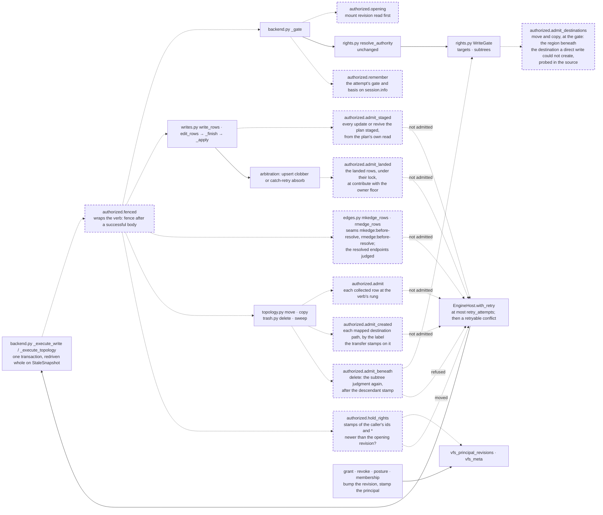

# A mutation is authorized for the rows it acts on at its commit point: the write family judges the rows its own reads return, the topology verbs judge the rows they find and the paths they create, and a fence before the commit redrives a verb whose caller's rights moved

A fix that touches rights and needs the engine legs. It is structural in four places only: it adds one module, `src/vfs/storage/backends/database/authorized.py`, and three seams, `write:before-snapshot`, `mkedge:before-resolve` and `rmedge:before-resolve`; no public class, protocol method, verb, parameter, result shape or lifecycle is added or removed. It changes no public API, no schema format and no Rust, so it does not touch the engine. It touches rights in the sense the shape names: no grant, view or ladder rule changes, but every data verb gains judgments of the rows it acts on after its gate and a fence before its commit, and move and copy gain a gate-time judgment of every path they create beneath their destination, so the security lens is mandatory in both reviews and the criteria hold leak tests (criteria 1, 4 to 15, 27 to 32, 35 and 36). It needs the engine legs: the commit-point windows are open, if anywhere, on the server engines, and criteria 27 to 33 and 36 run on the four server legs. It touches the gate's size baseline in two entries: `backend.py` ends at most 9 lines above the count it holds when this build starts and `writes.py` at most 5, each entry set to its file's count (decision 15); `rights.py` is not edited, and `dialects.py` changes one comment at its own line count (decision 18). It is not parallel-safe with [refresh, the incremental index verb](2026-10-31-refresh-the-incremental-index-verb.md): both edit `src/vfs/storage/backends/database/backend.py` (refresh its delegate, this spec `_gate`, `_execute_write`, `_execute_topology` and `_execute_transfer`) and that file's `MODULE_LINE_BASELINE` entry in `tests/lint/allowlist.py`, which refresh's decision 29 lowers, and both edit `tests/storage/database/test_races.py` and `context/standards/mutant-ledger.md` in different classes and rows. Refresh is being built now and is expected to land first; this build then rebases onto it, and the two touch different functions, so they can be built side by side. It comes from the security audit run `vfs-run-1-2026-11-07`, which recorded two leads needing validation, fingerprints `vfs/storage/database/write-arbitration-absorb-without-reauthorization` and `vfs/storage/database/topology-subtree-authorized-before-collection`; its [spec review](../../reviews/2026-11-14-a-mutation-is-authorized-for-the-rows-it-acts-on-at-its-commit-point-spec-review.md) found a wider window of the first lead in the write family's own reads (H1) and a gate-time gap beside the second, in what a transfer creates beneath its destination (M3), and this text closes both. No intention: the work is one property across the mutating paths. No research memo it stands on: every fact is read or executed here and labelled in The problem; the one fact it cannot establish, whether each commit-point window is reachable on each engine, is what its server-leg criteria execute first (decision 14). Two integrity windows it found and does not change wait in [a placeholder memo](../../research/2026-11-14-a-child-committed-inside-a-delete-or-a-move-can-be-left-behind-its-parent-on-a-read-committed-engine.md); this spec waits on nothing in it. It depends on nothing unlanded. It describes weaknesses that are not fixed, so it stays out of the public tree until the fix lands, as do its review and that memo.

## The problem

Labels: READ means read in the file cited, at `e90ec653`; EXECUTED means a command ran for this spec, on SQLite through `uv run` against an unchanged tree, with scratch probes kept in the session scratchpad that import vfs read-only (the author's `count_probe.py`, `rights_reads_probe.py`, `admin_count_probe.py` and `dest_gate_probe.py`, and the reviewer's `gap_probe.py`, `beneath_probe.py` and `dest_probe.py`, re-run here); INFERRED means reasoning. The trace this spec was commissioned on was read at `68a11d3c`. Between the two commits, of the files cited here only `backend.py`, `edges.py` and `engine.py` changed, by the rebuild move and two renames (EXECUTED, `git diff --stat 68a11d3c e90ec653 -- src/vfs/storage/backends/database/`), so `writes.py`, `topology.py`, `trash.py`, `rights.py`, `revision.py`, `serialized.py`, `staging.py`, `labels.py` and `dialects.py` keep the trace's line numbers and `backend.py`'s are re-found below.

**How a mutation is authorized today.** READ. Every data verb runs one transaction through `_mutate` (`backend.py:1476-1521`): it opens a session, runs the verb, and commits only a successful Result (`:1498-1508`). A `StaleSnapshot` or a retryable driver error reruns the whole attempt on a fresh session, at most `retry_attempts` times, 4 by default (`engine.py:352-381`, `:181`); exhaustion is one retryable `conflict` whose detail is "{op} kept losing to concurrent changes: {context}" (`backend.py:1512-1516`). The gate runs inside that transaction. `_gate` (`backend.py:1293-1309`) resolves the caller with `resolve_authority` (`rights.py:332-388`): on a cache hit, a read of the greatest stamp over the caller's ids and a read of the relabel marks; on a miss, the mount revision, the group closures, the stamps, the marks, the grant rows and the posture rows in flight. A `WriteGate` then judges each target (`targets`, `rights.py:734-763`; the verdict per target in `_decide`, `:889-948`) and, for delete, move, copy and sweep, the rows beneath each root (`subtrees`, `:792-823`, paged through `_refused_beneath`, `:825-843`). After that, nothing reads the caller's rights again before the commit. No statement compares the stamps, the marks or the mount revision the gate decided under: `bump_revision` and `hold_revision` (`revision.py:53-71`) are called only by the admin writes and the relabel (`backend.py:1328`, `rights.py:1127`, `:1162`, `labels.py:276`, `:294`, `:412`), and the one other read of the revision on a data path stamps version rows (`versions.py:86`).

**Where the rights live.** READ. A caller's own rights are its grant rows and its group memberships; every write of either stamps the principal it names with the bumped revision (`rights.py:983`, `:1028`, `:1147`, `:1178`). What everyone holds is the posture: a posture write stamps the everyone principal `*` (`rights.py:1099`) and marks a relabel, whose chunks rewrite `everyone_level` on the entry rows under one admin lock each and stamp nothing (`labels.py:269-297`). While a mark stands, every compile treats its region as a cover or a hole, so a relabel chunk changes labels and not rights; clearing the mark bumps the revision and changes no right either (`labels.py:19-31`). A named caller's cache key reads its own ids' stamps and the marks, never `*` (`rights.py:360-388`); a creation is judged against the posture rows on the target's chain, read by the gate (`rights.py:756`, `:946`), not against a label, and with no owner floor, since a fresh path has no owner.

**The write family re-reads its targets after the gate.** READ. `write` judges an absent target as a creation, at the verb's create slot, `add` (`rights.py:945-948`, `src/vfs/ops.py:150`), an occupied target it can see at the primary rung, `contribute`, with the owner floor riding (`rights.py:935-937`), and a tombstoned one as a restore, at `read_write` or by its owner (`:938-942`). Then `write_rows` and `edit_rows` read their targets again by path in `_fetch_committed` (`writes.py:201`, `:299`, `:312-340`), one statement after the gate's own `rows_by_path` (`rights.py:742`), and stage from what that second read returns: an occupied row becomes a guarded update, a tombstoned one a revive (`staging.py:269-325`, `:401-434`). The guard holds the version the plan itself read (`writes.py:677-715`), so it cannot tell a row the gate never saw. On an engine whose statements each read the latest commit, that second read can return a row the gate never judged, or a different row at the same path. EXECUTED, the reviewer's `gap_probe.py` re-run here, the rival staged on the attempt's own session right after `WriteGate.targets` returns: `bob`, holding `add` by posture, writes a path the gate saw empty, `alice`'s row lands, and the write succeeds in one attempt through the plan's update branch, leaving `alice`'s row at version 2 with `bob`'s body; `bob` edits his own file, the row at that path is replaced by `alice`'s, and the edit rewrites `alice`'s body. `mkedge` and `rmedge` have the same shape: `_endpoint_ids` resolves both endpoints by path again after the gate (`edges.py:147`, `:213`, `:339-369`), and an edge is then written or removed on whatever row the resolve returned. `mkdir` re-reads too, but stages only creates and leaves an occupant unchanged (`writes.py:249-271`). `restore`'s permit judges the rows its own builder read (`trash.py:302-321`, `backend.py:796-826`). The topology verbs re-read their targets after the gate (`topology.py:162`, `trash.py:155`, `:377`), but the row the gate judged there cannot be replaced in between, because removing it takes a delete, a sweep or a move, which serialize with them (`serialized.py:3-11`).

**A create that becomes an update by arbitration.** READ. When the insert meets a row at the same `(parent_id, name)` that the plan did not see, arbitration resolves it. On the catch-retry arm, which SQL Server, MariaDB, Oracle and the generic floor run, a plain probe reads the occupant and, for a live file under overwrite, the create absorbs it (`writes.py:646-659`), and the absorb arm updates that row by id and path (`writes.py:750-793`). On the upsert arm, which SQLite and Postgres run, `ON CONFLICT ... DO UPDATE` changes the occupant inside the insert (`writes.py:512-521`). Neither arm judges the occupant. The updated row keeps its owner, because `_CLOBBER_COLUMNS` leave `owner_id` out (`writes.py:114-135`). With the re-read above, this is the first fingerprint: a caller the gate admitted to create, or to change its own row, can change a row another principal owns and that it holds below `contribute` on.

**The topology verbs: rows found after the gate.** READ. Move collects the descendants again after its root claim and rewrites each row's path and label (`topology.py:379-403`, the collection at `:342-353`); copy mints every row its subtree read returns (`:187`, `:267-279`, `:406-478`); delete stamps every live row beneath each claimed directory with one `LIKE` update per chunk of roots (`trash.py:468-494`); sweep collects the subtree's ids until the scope reads empty and hard-deletes them (`trash.py:546-604`, the collection at `:582`). None of these judges a row. The gate's subtree read ran earlier in the same transaction (`topology.py:145`, `trash.py:153`, `:374`). The topology verbs serialize on a lock row that writes never read (`serialized.py:13-15`, `:112-123`), so an ordinary write can land a row beneath the root after the gate. The version guards on the root claims flip only for a direct child of the root, because a write bumps only its immediate parent (`staging.py:463-473`; `topology.py:308-320`; `trash.py:429-465`), and they react to no grant, label or posture change. Two existing tests pin, as intended behaviour, that a late row rides with the verb, for the system actor (`tests/storage/database/test_coherence.py::TestWriteVsTopologyCoherence::test_delete_marks_a_child_landed_after_its_snapshot`, `tests/storage/database/test_trash.py::TestPurgeHardening::test_purge_recollects_rows_committed_after_the_first_collection`). This is the second fingerprint.

**A transfer's destination is judged at its root alone.** READ. Move and copy judge each destination as one creation, at the destination path (`backend.py:1445-1447`, `rights.py:945-948`), then create every mapped path beneath it, stamping each row's label from the destination's posture rows (`topology.py:198`, `:316`, `:374`, `:457`). No direct write of those paths is ever judged. EXECUTED, the reviewer's `dest_probe.py` re-run here: with posture `add` at `/dst` and `none` at `/dst/c/sub`, `eve`'s direct write of `/dst/c/sub/f.txt` is refused `permission_denied` at `/dst/c/sub`, while her copy of `/src` to `/dst/c` succeeds and mints `/dst/c/sub` and `/dst/c/sub/f.txt`, owned by her and labelled 0. EXECUTED with `dest_gate_probe.py`: in the same shape at 10, 1,000 and 10,000 source rows, with 1 and 100 posture rows beneath `/dst/c` one of which closes `/dst/c/d0`, today's copy and today's move of `/src` to `/dst/c` both succeed. This needs no race. It is a gate-time gap beside the second fingerprint, and on every engine.

**What each engine holds in the commit-point windows.** READ for the pins, INFERRED for what a read sees.

| Engine | Isolation of a write / of a topology verb (`dialects.py`) | A row the write family's own read returns | Absorb window | Rows beneath a root after the gate | A rights change after the gate |
|---|---|---|---|---|---|
| SQLite | `BEGIN IMMEDIATE` on every writer (`engine.py:1036`) | closed: no writer commits inside | closed | closed | closed |
| Postgres | `REPEATABLE READ` (`:512`) / `READ COMMITTED` (`:513`) | closed: the gate and the plan read one snapshot | the code holds nothing; INFERRED that `ON CONFLICT` against a row the snapshot cannot see raises 40001 (`../postgres/src/backend/executor/nodeModifyTable.c:2936`, `:404`, clone at `c074737f`), which redrives | the code holds nothing; each statement sees the latest commit | the code holds nothing |
| MariaDB | `REPEATABLE READ` (`:582`) / `READ COMMITTED` (`:585`) | closed for plain reads, one snapshot; mkedge's locking resolve reads past it where `innodb_snapshot_isolation` is off (INFERRED) | the code holds nothing; INFERRED that the snapshot-bound probe finds no occupant and raises `StaleSnapshot` (`writes.py:650-651`) | as Postgres | the code holds nothing |
| SQL Server | no pin (`:541-567`): the server's `READ COMMITTED` | the code holds nothing | the code holds nothing; INFERRED that the probe sees the committed rival and the absorb follows | as Postgres | the code holds nothing |
| Oracle | no pin (`:613-633`): `READ COMMITTED` | the code holds nothing | as SQL Server | as Postgres | the code holds nothing |
| Generic floor | no pin (`:637-642`): the engine's default | as SQL Server at a `READ COMMITTED` default | as SQL Server at a `READ COMMITTED` default, as MariaDB at a snapshot default | as Postgres at a `READ COMMITTED` default | the code holds nothing |

Nobody has run any of these windows on an engine. Whether each is reachable on each engine is not established, and this spec does not claim it. What is established is that on every server engine the code holds nothing that would close them: no lock, no re-read of the rights, no judgment of the rows found later (READ, above).

**What the existing tests cover.** READ. `tests/storage/database/test_writes.py::TestArbitration`, `tests/storage/database/test_coherence.py::TestWriteVsTopologyCoherence`, `tests/storage/database/test_trash.py::TestPurgeHardening` and the server-only classes of `tests/storage/database/test_races.py` stage these windows for the system actor alone and pin integrity: no torn path, no orphan body, a redrive on a guard miss. `tests/storage/database/test_rights.py::test_an_admin_write_decides_after_it_takes_the_lock` pins the admin side only. No test runs a caller with partial rights through any of them, none changes a grant, a label or a posture inside a data verb, and none judges a transfer's destination beneath its root.

**What the verbs cost today.** EXECUTED with `count_probe.py` and `rights_reads_probe.py`, statements counted by a `before_cursor_execute` listener with the planner-statistics step left out, on a store where `bob` holds `read_write` on `/w` by a grant row and `eve` reaches `/p` through the posture `read_write` alone, each caller's rights cache warm.

| Call | system | bob | eve |
|---|---|---|---|
| write one new file | 10 | 14 | 14 |
| overwrite it | 11 | 16 | 16 |
| copy a 5- or 7-row directory | 17 | 22 | 23 |
| move the copy | 19 | 25 | 26 |
| delete the moved tree | 6 | 10 | 11 |
| sweep that tree | 15 | 19 | 20 |
| write 10,000 new files with parents | 39 | 43 | |

A warm named write reads the stamps once and the marks once and the mount revision not at all; the system actor's reads none of them. A subtree judgment costs `eve` one statement over `/p/d` and `bob` none, because `bob`'s grant covers the subtree whole. With `dest_gate_probe.py`'s world, `eve`'s copy of a 10-, 1,000- and 10,000-row `/src` costs 23, 23 and 53 statements and her move 28, 28 and 29. An admin grant by `bob` to a group he is in, with his compile warm, issues 2 `SELECT`s naming `vfs_meta` and 1 naming `vfs_principal_revisions` in 1 gate call (`admin_count_probe.py`). All EXECUTED.

## Architecture

Dashed is what this spec adds. Nothing is retired.

Page this changes: none; the architecture folder was retired on 2026-10-31, and the landing notes will say so in one line.

Terms. The **commit point** of an attempt is the one instant at which it is judged to have run: on an engine whose statements each read the latest commit, its fence; where vfs pins a repeatable snapshot for the attempt, that snapshot; on SQLite, its first statement, which takes the write lock (decision 2). The **fence** is the attempt's last statement before its commit, the read of the stamps its basis names. The **basis** of an attempt is what its gate's decision rests on: the caller's ids, its subjects and their groups, with the everyone principal `*`, and the mount revision read before anything else the gate read. A row is **staged** when the write family's plan schedules an update or a revive over it from its own read. A create **lands** on a row when arbitration turns it into a change of a row that already stood at its address: an absorb on the catch-retry arm, a clobber on the upsert arm. A row is **collected** when a topology verb reads it as one it will act on after the gate. A **mapped path** is the path a move or copy gives a source row beneath its destination: the destination root plus the row's path below the source root. The **closed region** of a destination is the set of paths strictly beneath it whose governing posture row gives everyone less than the create rung and which the caller's own spans at that rung do not cover: the paths a direct write by this caller could not create. The **attempt gate** is the `WriteGate` an attempt's `_gate` built, carried on that attempt's session. A **redrive** is `with_retry` running the whole attempt again on a fresh session, as it does today for `StaleSnapshot`.

## Decisions

### 1. The property: at its commit point, the caller's rights as they stand then admit every row the verb changes, copies or destroys, and every path it creates, in that row's or path's state then, at the rung its role needs; a gate-time refusal is the gate's, and a judgment that fails after the gate redrives

Said simply: a verb behaves as if it ran alone at one instant inside its own run, and at that instant it was allowed to touch every row it touched and to create every path it created. The instant is its commit point (decision 2). The rights are the caller's grant rows, memberships and the posture at that instant. The rows are the rows the verb actually acts on, which can include rows the gate never saw, and the paths are the ones it actually creates, which for a move or a copy include every mapped path beneath the destination. The table names, per verb, what is judged beyond today's gate, at which rung, and where.

| Verb | Judged beyond today's gate | Rung | Owner rule | Where |
|---|---|---|---|---|
| write, edit | every row the plan stages an update or a revive over | `contribute`, the primary; a revive at `read_write`, restore's primary | the owner floor rides | in memory, over the rows the plan's own read returned, before any statement acts (decision 6) |
| write | an occupant a create lands on | `contribute`, the primary | the owner floor rides | after the statement that changes it, under its row lock (decision 6) |
| mkedge, rmedge | the endpoint rows the builder resolves | the source at `contribute`, the primary; mkedge's and rmedge's target at `list`, the passing slot | the owner floor rides | in memory, over the resolve's rows (decision 6) |
| move, copy | every mapped path beneath the destination | `add`, the create slot, against the destination's posture rows and the caller's spans | none: a fresh path has no owner, exactly as for a direct write | at the gate (decision 8), and again over the collected rows' mapped paths after it (decision 9) |
| move | every descendant the rewrite collects | `read_write`, the primary | the owner floor rides | at that collection, before its rewrite (decision 7) |
| copy | every live row the copy collects | `read`, the passing slot | the owner floor rides | at that collection, before any insert (decision 7) |
| sweep | every row each purge round collects | `read_write`, the primary | the owner floor rides | at each collection, before its deletes (decision 7) |
| delete | every row beneath each claimed directory | `read_write`, the primary | the owner floor rides | the gate's subtree judgment run again after the descendant stamp (decision 7) |
| all ten data verbs | the caller's rights themselves | | | the fence (decisions 3 to 5) |

The rung and the owner rule are the gate's own for that row's role: a write's occupied target at the primary with the owner floor and a tombstoned one as a restore (`rights.py:935-942`), a subtree row at the rung the verb's gate passes to `subtrees` (`backend.py:761`, `:860`, `:1437`, `:1448`), and a fresh path at the create slot by the posture and the spans, with no owner floor (`rights.py:945-948`). `Rights.admits` and `Rights.reaches` are the judgments (`src/vfs/storage/grants.py:477-497`), so the owner floor rides exactly where it rides at the gate. mkdir and restore act on no row and create no path beyond the gate's, so the fence alone covers them: mkdir's create only adopts a directory occupant, which changes no row of it (`writes.py:249-271`); restore creates no path, and its permit judges the rows its own builder read at `read_write` by the label each kept (decision 8). The topology verbs' own targets are re-read after the gate but cannot be replaced in between (The problem). A move or copy never merges into an existing destination (decision 8). When a judgment after the gate fails or the fence finds the rights moved, the verb does not refuse from the mixed state it holds: it redrives, and its fresh gate answers from one later state (decision 11), with one exception: a destination failure on rows the call itself made in an earlier pair, which no later state can clear, refuses in place (decision 9). A gate-time judgment refuses as the gate does, because it is the gate's.

What is not promised. A rights change that commits after a verb's commit point is ordered after the verb, even when it commits before the verb's own commit returns: the two overlapped, and the verb used nothing the change wrote. On the engines where vfs pins a repeatable snapshot for writes, Postgres and MariaDB, the commit point of a write, edit, mkdir, mkedge or rmedge is its first statement (decision 2), so a revoke that commits while a long batch runs there is ordered after the batch. The read verbs keep the per-attempt rule of [search survives a chunk row deleted under its read](2026-11-12-search-survives-a-chunk-row-deleted-under-its-read.md), decision 4: they are not fenced. The system actor is never fenced, because its rights never change (decision 5). A widening change (a grant to the caller) also moves the basis and redrives the verb once; that is the price of a fence that reads stamps, not rights. Every judgment reads a row's stored label, as the gate does, so a row whose label is staler than the posture, which is what the concurrent posture-label race under Out produces, is judged by its label: this spec's property holds of each row as labelled, it is as strong as the label and no stronger, and that race's fix is what makes every label the posture's. The judgments of mapped paths read the posture rows themselves, not labels, as a direct write's creation does, so they do not inherit that race.

### 2. The commit point is the fence wherever each statement reads the latest commit, the snapshot where vfs pins one, and the write lock on SQLite

Each statement on Postgres and MariaDB topology verbs, and on every SQL Server and Oracle verb, reads the latest commit (READ, `dialects.py:513`, `:585`, `:541-567`, `:613-633`). There, the fence is the attempt's last statement: every row the verb acts on was read or locked before it, and every rights change committed before it is visible to it (decision 3). On Postgres and MariaDB, writes, edits, mkdirs, mkedges and rmedges run at `REPEATABLE READ` (`:512`, `:582`): every plain read in the attempt sees the one snapshot taken by its first statement, so the fence reads what the gate read and the snapshot is the commit point. That is sound only because a write there cannot act on a row changed after the snapshot without the engine or a guard refusing it. Postgres raises 40001 for an update or an `ON CONFLICT` against a row version the snapshot cannot see (INFERRED from `../postgres/src/backend/executor/nodeModifyTable.c:404`, `:2936`). On MariaDB the snapshot is the commit point where `innodb_snapshot_isolation` is on, the default from 11.6 and the server leg's 11.8 (READ, `docker/compose.test.yml:53`), which raises 1020 on the same (READ, the profile's comment, `dialects.py:588`); with it off, a write's locking reads and updates read past the snapshot as InnoDB does under a `mysql://` URL (decision 13), and a rights change committed after the snapshot is not seen. Decision 18 makes it a declared requirement. The fence still runs on the snapshot engines; it costs one statement there and agrees by construction (decision 12). On SQLite, `BEGIN IMMEDIATE` takes the database write lock at the first statement (`engine.py:1036`), so nothing commits inside any attempt and the first statement is the commit point. The generic floor runs at the engine's default (decision 13).

### 3. A rights change is caught by a lock-free fence: the attempt's last statement reads the greatest stamp over its basis's ids, and an attempt whose stamp is newer than the revision its gate opened under redrives

The fence is one read of `vfs_principal_revisions` through the existing `principal_revision` (`revision.py:79-93`, one statement per membership chunk; a caller's ids are dozens, so one statement). Every admin write bumps the mount revision as its first statement and stamps each principal it changes with the bumped value (`backend.py:1328`, `revision.py:94-107`), and admin writes serialize on that bump, held to commit (`revision.py:1-8`). So stamps take values in commit order, and a stamp newer than the revision the attempt read first is exactly an admin write that committed after the attempt's gate began and names the caller, one of its groups, or everyone. A stamp at or below it was committed before the gate's reads, which saw it. This is the same question the rights cache asks of a compile (`rights.py:260-270`), asked again at the last moment, so the rule has one meaning in the code.

Rejected. A shared lock on the admin row taken at the verb's first statement would hold every grant, revoke, posture write and relabel chunk behind the longest data verb in flight, and every data verb behind a waiting admin write: the lock-queue convoy, which on Postgres is designed in, since incoming share-lockers queue behind a waiting exclusive locker (`../postgres/src/backend/access/heap/README.tuplock:31-37`); a relabel chunk, which holds the admin lock up to two seconds (`dialects.py:314-325`), would park every non-system mutation on the mount for each chunk. Taken as the last statement instead, it inverts the order the relabel takes, the admin row first and entry rows after (`labels.py:276`, `:378`): a data verb holding entry rows and waiting for the admin row against a relabel holding the admin row and waiting for an entry row is the cycle the [index publish fix](2026-11-13-the-index-publishes-only-what-its-build-read.md) removed (its sibling 3). Either form writes the hot row's header on Postgres for every verb (README.tuplock:8-13), needs a table lock on Oracle, whose SQLAlchemy compiler renders a shared locking read as `FOR UPDATE` (EXECUTED: read `sqlalchemy/dialects/oracle/base.py:1637-1655` in the project's environment, SQLAlchemy 2.0.52), and would make every seam-staged rival admin write block on the verb it races, so no test could stage it. Comparing the mount revision alone redrives every verb in flight across any admin write anywhere: a 10,000-file batch by a named principal overlapping one grant a minute to anyone would redrive about one attempt in six (INFERRED from a batch of ten seconds), where the per-caller stamps redrive it only for a change that names it. Comparing the relabel marks adds nothing, because every posture write that plants a mark stamps everyone (`rights.py:1099`) and clearing a mark changes no right (`labels.py:19-31`). Share-locking the grant rows the decision rests on cannot block the narrowing that inserts a deeper posture row, a phantom no row lock covers on Postgres or Oracle.

### 4. The basis is the caller's ids with the everyone principal, and the mount revision read before anything else the gate reads

The everyone principal is in every caller's basis because a posture write is the one admin write that narrows a named caller's rights without stamping one of its ids: the gate judged a creation against the posture rows (`rights.py:946`), and a posture tightened after that read would otherwise pass the fence. The ids are the union of the ids the rights cache holds for the caller's subjects before and after the resolve (`rights.py:283-286`), so a compile replaced by a concurrent call between the two can only widen the set. A miss whose compile the cache would not keep, because an admin write landed between its two revision reads (`rights.py:386`), leaves no ids after the resolve; its basis is unsettled and its fence redrives at once without a read, because its compile may mix two states. The revision is read before the cache validation, a new first statement of every fenced gate, so no admin write can commit between what the compile read and what the fence compares against; on a miss, `resolve_authority` reads its own opening revision after it, which costs one statement on that rarer path and changes nothing. `resolve_authority` is not edited: the opening read and the basis are the gate's, in `authorized.py`.

### 5. The system actor and the admin writes are never fenced

The system actor resolves to everything without a read (`rights.py:360-361`), its rights cannot change, and its gate reads nothing new, so work run as the system actor pays nothing. An admin write resolves uncached under the admin lock it took as its first statement (`backend.py:1317-1333`), so no rival admin write commits inside it, and every stamp it writes equals the revision its gate would open under, since `_grant_write` bumps before it calls `_gate` (READ, `backend.py:1328-1329`; EXECUTED in the reviewer's `gap_probe.py`, re-run here: the revision inside the admin gate is 7 and the greatest stamp over the caller, its group and `*` after commit is 7). A fence there could only redrive through an unsettled basis, so it is skipped, which saves its two statements. `_gate` fences exactly the gates it resolves through the cache, and `_grant_write` is the only caller that resolves uncached (`backend.py:1329`).

### 6. The write family judges, from its own reads, every row it changes that its gate did not: the rows the plan stages, the rows a create lands on, and the endpoints an edge verb resolves; each failure redrives

Staged rows. `admit_staged` runs once in `_finish`, before `seam("write:before-apply")` and before any statement acts, and judges every staged entry whose persistence is `update`, with the row the plan read for it: a revive at restore's primary, `read_write`, and every other update at the verb's primary, `contribute` for write and edit, the owner floor riding, exactly as `_decide` judges an occupied or tombstoned target (`rights.py:935-942`). `_fetch_committed` gains `everyone_level` beside the `owner_id` and `path` it already reads (`writes.py:322-334`), so the judgment adds no statement. In the undisturbed case it judges the same row the gate judged, in the same state, and passes. A new seam, `write:before-snapshot`, awaited at the top of `_fetch_committed`, names the window between the gate's read and the plan's.

Landed rows. `admit_landed` takes the staged creates and the ids the plan minted, picks every create whose entry id is no longer one it minted and that did not adopt a directory (an absorb or an upsert clobber, the same test `_apply` uses to pick replaced bodies, `writes.py:427-431`), reads `path`, `owner_id` and `everyone_level` for them in one statement per membership chunk, and judges each at `contribute` with the owner floor. It runs in `_apply` right after the update pass (`writes.py:420-424`), before any version row or body is written. The rows it reads were changed by this attempt's own statement, so this attempt holds their row locks to commit and sees its own change at any isolation. On the undisturbed path no create lands, and it issues no statement. Rejected: judging the probe row before the update (`writes.py:646-649`), which reads a row this attempt does not yet hold; a rights predicate in the update's `WHERE`, which would restate in SQL a compile that lives in Python and is exact only there (`rights.py:30-38`); a local refusal, whose wording belongs to the gate's ladder (decision 11). On the upsert arm the gate has always judged the occupant on the two engines that run it, SQLite under its write lock and Postgres, where a clobber of a row its snapshot cannot see raises 40001 (decision 2), so the judgment there is a backstop that refuses nothing the gate admitted: `read_write`, which a tombstoned occupant's revive needs, includes `contribute`. The catch-retry arm never lands on a tombstoned row, because its absorb update requires `deleted_at IS NULL` (`writes.py:705-715`).

Edge endpoints. `_endpoint_ids` becomes a thin map over `_endpoint_rows`, which selects `owner_id` and `everyone_level` beside the path, id and tombstone it reads today (`edges.py:357-369`); `mkedge_rows` and `rmedge_rows` judge each resolved source row at their primary, `contribute`, and each resolved target row at their passing slot, `list` (`src/vfs/ops.py:157-158`), before any edge statement. rmedge's targets the caller may not name are already folded into the absent record before the resolve is used (`edges.py:213-214`), so only targets the gate named are judged. Two new seams, `mkedge:before-resolve` and `rmedge:before-resolve`, awaited immediately before each builder's `_endpoint_ids` call, name the window.

`src/vfs/ops.py`'s `Needs` docstring says the create slot judges "an occupied name a creation lands on", which contradicts this decision and the gate's own rule (`rights.py:935-937`); it becomes: "``create`` judges a fresh name and a directory a creation adopts; a row a file creation lands on is changed, and is judged at ``primary`` with the owner floor."

### 7. The topology verbs judge the rows they act on where they find them: move at its descendant collection, copy at its subtree collection, sweep at each purge collection, and delete by running the gate's subtree judgment again after its descendant stamp

Move judges the rows `_descendant_rewrites` returns (`topology.py:342-353`), which are exactly the rows it rewrites; a row committed after that read is not rewritten. Copy judges the live rows `_fetch_subtree` returns (`topology.py:187-190`), which are exactly the rows it mints; a row landing later is not copied, the serial history copy-then-write the docstring already names (`topology.py:427-430`). Sweep judges each round of `_purge`'s collection before that round's deletes (`trash.py:582-604`), so a row the re-collection finds is judged before it is destroyed. The three add `owner_id` and `everyone_level` (and `path`, for sweep) to a read the verb already issues, judge in memory with `Rights.admits`, and add no statement. Delete has no collection: its descendant stamp is one `LIKE` update per chunk of roots (`trash.py:468-494`). So after that stamp it calls the attempt gate's own `subtrees` over the claimed directories at the primary rung. The second judgment is a later statement than the stamp, so it sees every row the stamp tombstoned, since `descendant_filter` carries no tombstone term (`descent.py:193-202`; EXECUTED in the reviewer's `beneath_probe.py`, re-run here), and any child committed while the stamp ran, and so judges a superset of what the delete acts on. It is the gate's read, row for row: no statement when the caller's spans cover the root, otherwise the rows beneath it below the rung or in a hole, paged at 1,000 (`rights.py:792-843`). Rejected: reading back the stamped rows through `RETURNING`, which an executemany update cannot carry on every engine and MariaDB does not carry at all; a locking read of the subtree before the act, which cannot hold out a row inserted after it; skipping a row that fails, which would leave a live row under a deleted directory.

### 8. Move and copy judge, at the gate, every path they will create beneath their destination, by the rule a direct write of that path by this caller meets; a refusal is the gate's

A move or copy of `S` to `D` creates `D` and every mapped path beneath it. A direct write of one of those paths with `parents` would be judged, for each component it mints, by the create slot `add` against the deepest posture row on its chain or the caller's own spans at `add`, with no owner floor (`rights.py:922-929`, `:945-948`), and an anonymous caller by the posture alone (`rights.py:391-400`, `:917`). The gate already judges `D` that way. `admit_destinations` judges the rest without reading a row per copied row, by reading the rules instead of the rows:

1. A pair whose caller's spans at `add` cover `D`'s subtree whole, or whose resolution is whole, passes with no statement, as the grant gate skips its hole read ([the grant gate judges the subtree](2026-11-07-the-grant-gate-judges-the-subtree.md), decision 4).
2. Otherwise it reads `posture_beneath(D)` (`labels.py:167-180`): the posture in force at `D` and every posture row beneath it, the read a transfer already makes for its labels (`topology.py:198`), two statements.
3. In memory, from `posture_regions` (`grants.py:346-359`), it forms the closed region: the paths strictly beneath `D` whose governing posture gives everyone less than `add`, less the caller's spans at `add`. With none, the pair passes.
4. It shifts that region from `D` onto `S` (each bound's `D` prefix replaced by `S`; the region lies strictly beneath `D`, so every bound carries that prefix, every shifted piece lies strictly beneath `S`, and the bytewise order is kept) and probes for the least source row inside it with one `ORDER BY path LIMIT 1` seek per piece: a point piece by equality and an open piece by its two bounds, bound through the path column's type as `_refused_beneath`'s hole units are (`rights.py:808-813`, `:1292-1300`). The arms of one chunk are joined by `UNION ALL`, each wrapped as a subquery so its own `ORDER BY` and `LIMIT` stand, and a chunk holds at most `arm_budget(profile, parameter_budget, 3)` pieces, three binds an arm at most (two bounds and the limit). Every chunk is probed, and the least row over all of them is the answer; chunks are not in path order, because the pieces list their points first and their open ranges after. Copy's arms carry `deleted_at IS NULL`; move's do not, since its tombstoned descendants ride with it.
5. A row found refuses the pair, before any statement acts: for a named caller one `permission_denied` at that row's mapped path, with the pair's destination as its `target`; for an anonymous caller the `unauthenticated` refusal `unauthenticated_at` gives that path. Because a path sorts after every one of its ancestors and every ancestor of a source row beneath `S` is itself a source row, the least row over every chunk has no ancestor inside the region, so its mapped path is the component a direct write of it would be refused at. Like the subtree judgment, this runs before the per-pair ladder, so for a caller it judges, a pair the ladder would refuse `exists` or `invalid` may answer `permission_denied` first; a pair whose source or destination is the root is skipped, and the ladder refuses it. That order tells a caller nothing about a path it may not see: the refusal names a mapped path built from the caller's own destination and the names of source rows its gate has already admitted at the verb's passing or primary rung, and says only that the caller may not create there, which a direct write of that path says too; where the ladder would have said `exists`, the caller learns less about the occupant, not more (INFERRED from `backend.py:1439-1448` and `topology.py:143-186`).

The law: the statements this costs grow with the destination's governing rules, never with the rows copied or moved, and so does the work: each arm is one seek on the path index that stops at its first row, so the probe never passes over the source. EXECUTED with `dest_gate_probe.py`, a prototype of steps 1 to 5 on SQLite for `eve`, who reaches `/src` and `/dst` through the posture alone, copying and moving `/src` to `/dst/c` (the prototype spelled step 4 as one statement ORing the pieces; the per-piece form issues one statement per chunk too, so the statement counts are the same, EXECUTED with `seek_probe.py`):

| Source rows | Rules beneath `/dst/c` | Statements, copy / move | Verdict |
|---|---|---|---|
| 10 | 0 | 2 / 2 | passes |
| 10 | 1 or 100, none on a mapped path | 3 / 3 | passes |
| 10 | 1 or 100, one closing `/dst/c/d0` | 3 / 3 | refuses at `/dst/c/d0` |
| 1,000 | 0; 1 or 100 open; 1 or 100 closing | 2; 3; 3 | as above |
| 10,000 | 0; 1 or 100 open; 1 or 100 closing | 2; 3; 3 | as above |

Today's copy and move succeed in every closing row (EXECUTED, The problem). The work, EXECUTED with `seek_probe.py` on SQLite with 100 closed rules beneath `/dst/c` (200 range pieces, one chunk), counted as `sqlite3` virtual-machine steps by a progress handler every 100 steps, on the compiled statements run against the store's file:

| Source rows | Layout | Per-piece seeks, copy / move (hundreds of steps) | One statement ORing the pieces (hundreds of steps) |
|---|---|---|---|
| 10,000 | passing | 52 / 34 | 40,720 |
| 20,000 | passing | 52 / 34 | 81,423 |
| 10,000 | closing `/dst/c/d0` | 52 / 34, least `/src/d0` | 21, first `/src/d0` |
| 20,000 | closing `/dst/c/d0` | 52 / 34, least `/src/d0` | 21, first `/src/d0` |

The per-piece form's plan is one `SEARCH vfs_entries USING INDEX ix_vfs_entries_path` per arm, by `path=?` for a point and `path>? AND path<?` for an open piece (a covering index for move's arms, which read only the path), and a one-row scan of each arm's subquery; no `SCAN vfs_entries` appears, and the count does not move with the source. The OR form seeks the source's range once and filters every row in it against every piece, so on a pass its work doubles with the source. On the server engines the per-piece form is the shape each planner serves as an index seek with a stop key (INFERRED); criterion 30 runs it on all four. Budgets: `arm_budget`'s measured ceiling of 200 arms (`dialects.py:747-760`) keeps a chunk under SQLite's default limit of 500 terms in one compound select (READ, `../sqlite/src/sqliteLimit.h:128-130`, clone at `3d17c3f9e`), at three binds an arm under every engine's bind cap, 600 against SQL Server's 2,100, and under the expression-depth budget `arm_budget` already subtracts; no pinned engine declares a lower compound limit (INFERRED from their profiles, which model none). SQLite's 500 is a compile-time default, `SQLITE_MAX_COMPOUND_SELECT`, which a distributor may build lower (READ, `../sqlite/src/sqliteLimit.h:120-130`). A chunk such a build refuses reaches the runner as a driver error and leaves the call as a classified failure through `classify_failure`, which `_mutate` applies to every driver error that escapes retry (READ, `backend.py:1517-1518`, `engine.py:383-408`), never as a raw exception; the remedy is a profile field for that engine's limit, added when one is met, since none of the five pinned profiles needs one. Criterion 30's full-chunk nodes execute a chunk at the 200-arm ceiling on every server leg. So a thousand closing rules beneath one destination cost about ten probe statements, one per chunk (INFERRED). `posture_beneath` returns every posture row beneath `D` in one unpaged statement (`labels.py:474-485`), memory proportional to the rules, a few megabytes at a hundred thousand of them (READ, `labels.py:388-397`); keyset pages of `_POSTURE_PAGE`, as `_hole_beneath` reads (`rights.py:1415-1449`), are the direction if a destination ever carries more. The bounds compare bytewise on every pinned engine through the path column's type, with Oracle's `NLS_COMP` and `NLS_SORT` at their `BINARY` defaults, the same accepted degradation every range over a path column carries (the grant gate's decision 5).

A transfer never merges into an existing destination: an occupied destination root, live or tombstoned, refuses `exists` (`topology.py:180-183`); beneath an absent root no row can stand, since every row's parent chain runs through it; and a rival row that lands at a destination path after the occupant probe collides on the claim or the insert and redrives (`topology.py:321-327`, `:463-468`), so the fresh ladder answers `exists`. So no destination row is ever overwritten, and the only rule a mapped path needs is a creation's. Were a merge added, a destination row that already exists would be an overwrite, judged at `contribute` with the owner floor, as a write's occupied target is; this spec adds none. Restore creates no path: a revived row stands at its own path with the label it kept, which every relabel reaches as it reaches live rows (`labels.py:33-36`), and its permit judges each revived root at `read_write` by that label and owner and a directory's subtree by `subtrees` (`backend.py:812-822`), which is the rule a direct write at a tombstoned path meets, judged as a restore (`rights.py:938-942`). Rejected: judging every mapped path from a read of the whole source subtree at the gate, which reads every row twice, once there and once in `_fetch_subtree`; the probe as one statement ORing the pieces over the source's range, which on a pass checks every source row against every piece (the table above); a judgment after the gate alone, which decision 11 would turn into a redrive loop ending in `conflict`, since a gap that holds at every attempt never clears; refusing whenever any closed region exists beneath `D`, as the grant gate refuses an empty hole, which would refuse a copy that creates nothing there, where a direct write of each path it creates succeeds.

### 9. After the gate, move and copy judge each collected row's mapped path by the label they stamp on it; a failure redrives, unless it is on rows the call itself made in an earlier pair, which refuse in place

The gate judged the source rows that stood when it ran. A source row that lands after it, or a posture tightened beneath the destination after it, can put a mapped path in the closed region at commit. So the transfer judges every mapped path it is about to create with `admit_created`: `reaches(path, label)` at the create slot for each row, where `label` is the `label_of(postures, path)` the transfer already computes for that row from the `posture_beneath(D)` it already reads (`topology.py:198`, `:316`, `:374`, `:457`): copy over `new_paths` after that read, move in `_rewrite_descendants` over each rewrite's new path. No statement is added. A failure raises `StaleSnapshot`, and the fresh gate's decision 8 refuses in the gate's words.

One failure is no race. Transfer pairs run in order and later pairs see earlier pairs' effects (`topology.py:126-141`), so a pair whose source existed at the gate can be grown by an earlier pair of the same call: the gate probed that source when it held nothing, and every attempt's gate would see it the same way, so a redrive would repeat into a retryable `conflict` that can never clear (EXECUTED in the reviewer's `dest_shapes_probe.py`, the `grown` shape: today such a call succeeds and mints four rows in the closed region, and the gate-time probe for its second pair finds nothing). A pair whose source did not exist at the gate is already refused `not_found` by the gate's target check (EXECUTED there, the `chained` shape). So `transfer_rows` keeps, in memory as it runs, the entry ids its earlier pairs minted (copy's `id_map` values) or moved (move's root and the ids its rewrite collected), with no statement and no read per row. When every row that fails `admit_created` is in that set, the failure is the caller's own work and the pair is refused in place: it first awaits `hold_rights`, so a basis that moved since the gate redrives instead and the fresh attempt answers from the later rights, and only then refuses, before any later statement, with `permission_denied` at the least failing mapped path for a named caller and `unauthenticated` for an anonymous one; the batch fails whole and nothing commits. The row is the caller's own work, so naming its path tells the caller nothing it did not do. Any other failure redrives. The set holds one id for every row the call has created or moved, for the length of the call: about a megabyte at 10,000 rows (INFERRED: roughly 75 to 100 bytes for each ULID string and its slot in a set), the same order as the subtree each pair already reads, and it grows with the call's own work, never with the corpus. If it ever binds, the same test can read paths instead of ids: a failing row whose path lies at or beneath a destination an earlier pair of this call created is this call's own work, because no other transaction can see beneath a root this call has not committed. That is the direction, not the decision, because a path test must also follow a destination a later move pair of the same call relocates, which the ids follow for free.

### 10. The attempt's gate and basis ride on the attempt's session

`_gate` puts the gate and its basis into the session's `info` mapping under one key, and the fence and every judgment after the gate read them from the session they are already handed. A session lives for exactly one attempt and is discarded on a redrive (`backend.py:1498-1508`), so the record cannot outlive the decision it carries. `remember` replaces any record already on the session; no verb calls `_gate` twice in one attempt today, and one that did would be judged by its last gate. The alternative, a new parameter threaded through `write_rows`, `_finish`, `_apply`, `mkedge_rows`, `rmedge_rows`, `transfer_rows`, `_execute_move`, `_rewrite_descendants`, `delete_rows`, `sweep_rows`, `_purge` and every direct test call of them, changes eleven signatures for no gain in safety: a builder runs only inside a runner's attempt, and one run with no gate on its session, the system actor or a direct test call, judges nothing, exactly as `authority=None` does today. What keeps a verb from forgetting is a criterion per verb (criterion 16), not a signature.

### 11. Every failure after the gate redrives, at most `retry_attempts` times, with one exception, and exhaustion is the existing retryable conflict with one of two fixed phrases

The exception is decision 9's: a destination failure on rows the call itself created or moved in an earlier pair refuses in place, because no later state can clear it. Every other judgment that fails after the gate was made from the gate's rights and a later row set, or the fence found those rights moved; either way the attempt holds a mixed state, and the honest answer is the gate's from one later state. So each raises `StaleSnapshot`, `with_retry` runs the attempt again on a fresh session (`engine.py:352-381`), and the fresh gate refuses, if it refuses, with the ladder's own wording and visibility. This is the codebase's existing rule for a guard miss: "the fresh ladder returns the honest per-pair refusal with the caller's own attribution — never a classification off mid-race state" (`serialized.py:16-21`). It is bounded by counting attempts, never a clock: a rival that changes the caller's rights, or lands an unjudgeable row, inside every attempt exhausts the budget, and the caller gets the existing retryable `conflict`, path `None`, whose detail is "{op} kept losing to concurrent changes: the caller's rights changed while it ran" for the fence and "{op} kept losing to concurrent changes: a row it acts on is beyond the caller's rights as it now stands" for a judgment. Neither phrase names a path or an id, as the envelope requires of a detail (`src/vfs/results/envelope.py:239`). No new kind, record, parameter or budget: a second vocabulary for the condition every redrive already reports would make callers handle two spellings of one fact.

What a redrive costs, plainly. It reruns the whole attempt: for a 10,000-file batch by a named principal, its 45 statements and every row's insert and body again, about the batch's own time. A posture write redrives every non-system mutation in flight on the mount once. A mutation whose compile missed the cache redrives whenever any admin write lands between the compile's two revision reads (decision 4). A principal whose ids an admin migration stamps more often than one of its batches runs ends each batch in the retryable `conflict` after `retry_attempts`. What an operator does: the conflict is retryable, so a pipeline retries the batch after the migration settles; and whether bulk ingest runs as the system actor, which is never fenced, or as a principal outside the migration, is a deployment choice this spec names and does not make.

### 12. SQLite and the in-memory backend change no mechanism; the same code runs there, and their closed windows are pinned

On SQLite every writer holds the write lock from its first statement (`engine.py:1031-1040`), and the in-memory backend is the same code over one connection whose host lock spans each session (`src/vfs/storage/backends/memory.py:12-17`, `engine.py:1095-1140`): no rival commits inside an attempt on either. The fence and the commit-point judgments run there too and always pass in production, because one spelling with no per-engine branch cannot be skipped by a later change to an isolation pin. The gate-time destination judgment (decision 8) is no race at all and refuses there exactly as on a server engine. The closed windows are pinned by criterion 26, so a future change that opens one fails a test; and because a genuine second writer cannot commit inside an attempt there, the mechanism's own criteria stage the rival on the attempt's own session, the idiom `TestWriteVsTopologyCoherence` and `test_an_admin_write_decides_after_it_takes_the_lock` already use. That idiom tests the judgment and fence code the server engines run; it cannot test isolation, a real rival's parent bump, or the refusal after the redrive, since the staged rival rolls back with its attempt, and the server-leg criteria carry those three.

### 13. The generic floor gets the same code at the engine's default isolation, and what that default gives is stated, not designed around

An unknown dialect runs no isolation pin (`dialects.py:637-642`). At a `READ COMMITTED` default it is as SQL Server. At a snapshot default whose updates read past the snapshot without refusing, which is InnoDB at `REPEATABLE READ` under a `mysql://` URL, delete's `LIKE` stamp can reach a row committed after the attempt's snapshot; delete's second subtree judgment still sees it, because an attempt always sees its own changes, but judges it against the rights at the snapshot, and the fence reads the snapshot too. So on such an engine a rights change committed between the snapshot and that row's arrival is not seen (INFERRED). That is the floor's isolation, not this mechanism's: the direction is the engine's own profile with a `topology_isolation` pin, as Postgres and MariaDB declare (`dialects.py:513`, `:585`). No pin is added to the generic floor here, because an isolation name an unknown driver may not accept would fail every topology verb there.

### 14. The server-leg criteria are the first execution of the leads, and the Landing notes record, per engine and per node, what the unfixed tree did

Nobody has staged any of these windows on an engine (The problem). The tests-first rule runs criteria 27 to 33 and 36 on the unfixed tree before any source line changes, on all four server legs. That red run is the first execution of the two leads and of the review's H1 window: a node that fails there shows the window open on that engine; one that passes shows the engine closing it by itself (the trace predicts Postgres and MariaDB redrive the absorb and close the plan's re-read with one snapshot, and the root guard catches a depth-one row). Criterion 30, the destination gap, is no race and is expected red on all four. The Landing notes record the result per node and per engine, as EXECUTED, and the audit's records cite them. The spec makes no claim that any window is reachable, and its property does not depend on which.

### 15. One new module holds the property's code; `backend.py` ends at most 9 lines and `writes.py` at most 5 above the counts they hold when this build starts, each entry set to its file's count; `rights.py` is not edited

`authorized.py` holds every line that can leave a listed module: the session key, the two phrases, `RightsBasis`, `Attempt`, `opening`, `remember`, `fenced`, `hold_rights`, `judging`, `admit`, `admit_staged`, `admit_landed`, `admit_beneath`, `admit_destinations` and `admit_created`, about 230 lines, under the 1,000-line ceiling and on the database adapter's rung, which `LAYERS` names as a package (`tests/lint/test_code_shape.py:50-52`). What stays in the listed modules is wiring. In `backend.py`: the import, the opening read and the `remember` call in `_gate`, `fenced(fn, self._host)` in place of `fn` in `_execute_write` and `_execute_topology`, and the `admit_destinations` call in `_execute_transfer`'s gate. EXECUTED on a formatter-clean scratch copy at `e90ec653`, a variant of the first three that also threaded a keyword through `_resolution` grew `backend.py` by 6 lines (1,527 over 1,521); this text drops that keyword and adds the destination call, which wraps over at most 3 lines, so 9 is the bound. In `writes.py`: the import, the one `admit_landed` call in `_apply` (EXECUTED on the same copy: those two, 1,290 over 1,288), and one line each for `everyone_level` in `_fetch_committed`, the new seam and the `admit_staged` call in `_finish`, so 5 is the bound. The `_update_materials` docstring's "last-writer-wins between writes by design" becomes "last-writer-wins between writers the landing admits" at its own line count.

The gate's spec says a landing that grows a listed module moves out as much as it adds, or raises the entry and links the active spec that carries the module's reduction ([the gate's spec](2026-11-07-the-gate-and-the-review-read-the-layer-map-and-the-size-baseline.md), decision 7). For `backend.py` that spec is [refresh](2026-10-31-refresh-the-incremental-index-verb.md), whose decision 29 lowers `backend.py`'s entry by about 13 lines. It is expected to land first; this build then rebases, measures its growth over refresh's count, and sets the entry to the file's `wc -l` count, at most 9 above it and still below today's 1,521, linking refresh's decision 29 as the reduction. If this build lands first, it sets the entry at most 9 above 1,521 and refresh lowers it from there. Either way the bound is "at most 9 lines more than the file holds when this build starts". For `writes.py` no active spec reduces it: this spec moves out everything that can move, and the five lines are the calls without which the property is not wired where every write passes; the code review records the raised entry with this decision as its answer. `topology.py` (519), `trash.py` (658), `edges.py` (556) and the new module stay unlisted.

### 16. Each law lands with its mutant as a row of the mutant ledger, rows H1 to H21

[Testing](../../standards/testing.md) says a pinned law names the one-line mutation that breaks it and lands as a ledger row. The rows are listed in the Design with their killers; each is proven red under its mutation before landing, with the file restored from a scratchpad copy.

### 17. The cost is two point reads per non-system mutation, two or three per partial caller's transfer pair, no statement per row, and no lock

Costed in the Design's Scale paragraph against [the reference deployment](../../../AGENTS.md#the-reference-deployment-the-scale-every-idea-is-filtered-through). The fence and the opening read are each a single-row or a dozens-of-keys indexed read that takes no lock on an MVCC engine and writes nothing, so no row becomes a serialization point. The destination judgment reads the destination's rules and probes the source with one index seek per range piece, so its statements and its work grow with the rules beneath the destination and never with the rows copied (decision 8). The other judgments add no statement except delete's second subtree read, which costs what its gate's already costs for that caller, and the landing read, issued only when a create lands.

### 18. MariaDB's snapshot isolation is a declared requirement, written where the profile is, and pinned on the server leg

vfs neither sets nor checks `innodb_snapshot_isolation` today (EXECUTED: no occurrence under `src/`, `docs/`, `docker/` or `tests/`). Decision 2's MariaDB commit point needs it on. The default is on from 11.6, and the server leg runs 11.8 (READ, `docker/compose.test.yml:53`). So this spec declares it a requirement for a MariaDB mount, written in the MariaDB profile's comment beside the 1020 code (`dialects.py:588`, reworded at its own line count: "1020 is the snapshot-isolation conflict; vfs requires innodb_snapshot_isolation on, the 11.6+ default"), and pins with criterion 33 that the leg's server runs with it on. A first-touch check that refuses `unavailable` when it is off is the direction, its own change, because the engine host applies no per-session settings on MariaDB today (READ, `engine.py:1020-1030`, the SQLite checkout listener) and a check needs a new profile field.

## Intent

After this spec, a caller with partial rights who writes, edits, makes a directory or an edge, deletes, restores, moves, copies or sweeps is allowed every row its call actually touches and every path it creates, as each stands, under the rights in force at the call's commit point. A write or edit that finds, by its own read, a row its gate never saw is judged on that row; a create that lands on another principal's row is refused unless the caller could have changed that row; an edge verb whose endpoint was replaced is judged on the replacement. A copy or move into a destination is refused wherever a direct write of a path it would create would be refused, with no race involved. A delete, move, copy or sweep that finds a row the caller could not act on, because it arrived after the gate, is refused at its root as its gate would have refused it; and a revoke, a membership removal or a posture tightening committed while the call runs makes the call run again and answer from the later rights, on every engine where the call's statements read the latest commit. A call by the system actor, a call nothing races, and every read cost what they cost today, apart from two point reads on each non-system mutation and two or three on a partial caller's transfer pair.

## Design

**Tests first.** Every node in the criteria is written and run on the tree this spec builds on before any source line changes. The SQLite and in-memory nodes (criteria 1 to 26 and 35) each show the red result their criterion names. The server-leg nodes (criteria 27 to 33 and 36) run on the four legs through the `db_test` cycle, and their result per engine and per node, red or green, is recorded for the Landing notes (decision 14) before the code changes.

**`src/vfs/storage/backends/database/authorized.py`, new.** Module docstring: what a mutation proves between its gate and its commit, the commit point per engine in one paragraph, the gate-time destination rule in one, and the rule that a failure after the gate redrives. Constants: `ATTEMPT_KEY: Final = "vfs_attempt"`, the `session.info` key; `RIGHTS_MOVED: Final = "the caller's rights changed while it ran"`; `BEYOND_RIGHTS: Final = "a row it acts on is beyond the caller's rights as it now stands"`. Types: `RightsBasis(NamedTuple)`, `ids: tuple[str, ...] | None` (sorted, with `EVERYONE_NAME`; `None` when the compile is unsettled) and `revision: int`; `Opening(NamedTuple)`, `revision: int` and `before: tuple[str, ...] | None`; `Attempt(NamedTuple)`, `gate: WriteGate` and `basis: RightsBasis | None`. Functions, in the order a caller meets them:

- `async def opening(session, tables, authority, cache) -> Opening | None`: `None` for the system actor and for `cache is None`; otherwise `read_revision` and `cache.ids(authority.subject_names)`.
- `def remember(session, gate, opened, cache) -> WriteGate`: puts `Attempt(gate, basis)` under `ATTEMPT_KEY`, replacing any record there, and returns the gate; the basis is `None` when `opened` is `None`, otherwise the union of `opened.before`, `cache.ids(...)` and `EVERYONE_NAME`, or ids `None` when `cache.ids(...)` is `None`.
- `async def admit_destinations(session, gate, operations) -> list[ResultError]`: decision 8's steps 1 to 5 for every pair whose destination is not its source and neither of whose ends is the root, at `gate.needs.create`: per piece one `select(path).where(…).order_by(path).limit(1)`, wrapped by `.subquery().select()`, joined per chunk of `arm_budget(profile, parameter_budget, 3)` by `union_all`, the least row over every chunk kept; copy's arms carry `deleted_at IS NULL`, move's do not.
- `def fenced(fn, host) -> Callable[[AsyncSession], Awaitable[Result]]`: runs `fn`; on a successful Result awaits `hold_rights(session, host.tables, host.profile, host.membership_budget)` and returns it.
- `async def hold_rights(session, tables, profile, membership_budget) -> None`: no attempt or no basis returns; ids `None` raises `StaleSnapshot(RIGHTS_MOVED)`; otherwise `principal_revision(session, tables, profile, membership_budget, basis.ids) > basis.revision` raises `StaleSnapshot(RIGHTS_MOVED)`.
- `def judging(session, rung) -> Rights | None`: the attempt gate's `resolution.at(rung)`, or `None` when there is no attempt or `gate.whole`.
- `def admit(rights, rows) -> None`: with `rights` not `None`, any row whose `rights.admits(row["path"], row["owner_id"], row["everyone_level"])` is false raises `StaleSnapshot(BEYOND_RIGHTS)`.
- `def admit_staged(session, op, plan) -> None`: every staged entry with persistence `update`, judged with `plan.committed[str(path)]` at `VERB_RUNGS["restore"].primary` when `revive` and at `VERB_RUNGS[op].primary` otherwise (decision 6).
- `async def admit_landed(session, entry, profile, membership_budget, creates, minted) -> None`: with `judging(session, VERB_RUNGS["write"].primary)` not `None` and a landed create (decision 6), reads `entry_id`, `path`, `owner_id`, `everyone_level` by `membership` per `chunked(ids, membership_budget)` and calls `admit`.
- `async def admit_created(session, tables, profile, membership_budget, rung, postures, rows, own) -> ResultError | None`: with `judging(session, rung)` not `None`, takes each row's mapped path and source entry id; when no path fails `reaches(path, label_of(postures, path))` it returns `None`; when every failing row's id is in *own*, the ids this call's earlier pairs minted or moved, it first awaits `hold_rights(session, tables, profile, membership_budget)`, which raises `StaleSnapshot(RIGHTS_MOVED)` when the basis moved, and only then returns the refusal at the least failing path, `permission_denied` for a named caller and `unauthenticated_at`'s for an anonymous one; otherwise it raises `StaleSnapshot(BEYOND_RIGHTS)` (decision 9).
- `async def admit_beneath(session, roots) -> None`: with an attempt whose gate is not whole, `await gate.subtrees(session, roots, gate.needs.primary)`; any refusal raises `StaleSnapshot(BEYOND_RIGHTS)`.

Imports: `vfs.ops.VERB_RUNGS`, `vfs.authority.EVERYONE_NAME`, `dialects.StaleSnapshot`, `chunked` and `arm_budget`, `descent.descendant_filter`, `labels.posture_beneath` and `label_of`, `membership.membership`, `revision.principal_revision` and `read_revision`, `rights.RIGHTS_FIELDS`, `rights.denied` and `rights.unauthenticated_at`, and `grants.posture_regions`, `intersect`, `subtract`, `normalise`, `pieces` and `RangeSet`; `WriteGate`, `Rights`, `RightsCache`, `WritePlan`, `EngineHost` and the SQLAlchemy types under `TYPE_CHECKING`. `rights.py` imports nothing from it, so no cycle forms. The range-piece predicates are built as `_piece_units` builds them; the build either imports that helper under a public name from `rights.py`, which would edit it, or spells the two comparisons in the new module; it spells them, so `rights.py` stays unedited.

**`backend.py`.** `_gate`: before `_resolution`, `opened = await opening(session, host.tables, self._named(authority), self._rights if cached else None)`; the `WriteGate` it builds is returned through `remember(session, gate, opened, self._rights)`; its docstring says the gate rides on the attempt's session and an uncached gate, an admin write's, is unfenced, at its own line count. `_execute_write` and `_execute_topology` pass `fenced(fn, self._host)` to `_mutate`. `_execute_transfer`'s gate returns `refused or await checks.subtrees(session, sources, passing) or await admit_destinations(session, checks, operations)`. `_mutate`, `_execute_maintenance` and `_execute_leased` are unchanged, so the relabel chunks, the rebuild phases and the lease commits are never fenced.

**`writes.py`.** `_fetch_committed` awaits `seam("write:before-snapshot")` first and selects `entry.c.everyone_level` beside its columns. `_finish` calls `admit_staged(session, op, plan)` before `seam("write:before-apply")`. In `_apply`, after `_update_materials` returns no errors: `await admit_landed(session, tables.entry, profile, membership_budget, creates, minted)`. The `_update_materials` docstring sentence of decision 15.

**`edges.py`.** `_endpoint_rows` selects `owner_id` and `everyone_level` beside `path`, `entry_id` and `deleted_at` and returns the live rows by path; `_endpoint_ids` maps them to ids. `mkedge_rows` awaits `seam("mkedge:before-resolve")` before its resolve and `rmedge_rows` `seam("rmedge:before-resolve")` before its; each then calls `admit` on its sources at `VERB_RUNGS[op].primary` and its named targets at `VERB_RUNGS[op].passing` before any edge statement.

**`topology.py`.** `_fetch_subtree` selects `owner_id` and `everyone_level` beside `_SUBTREE_COLUMNS`, not inside them, so `_COPIED_COLUMNS` is unchanged. In `transfer_rows`, after the copy's live filter, `admit(judging(session, VERB_RUNGS["copy"].passing), subtree)`; after the `posture_beneath` read, for copy, `await admit_created(session, tables, profile, membership_budget, VERB_RUNGS["copy"].create, postures, …, own)` over the subtree's rows and `new_paths`, whose refusal is appended to the pair's errors like any per-pair refusal. `transfer_rows` keeps `own`, a set of entry ids, and adds to it after each executed pair the ids that pair minted (copy's `id_map` values) or moved (move's root and the ids `_rewrite_descendants` collected), with no statement. `_descendant_rewrites` selects `owner_id` and `everyone_level` and returns them in each row's mapping; `_rewrite_descendants` calls `admit(judging(session, VERB_RUNGS["move"].primary), …)` over the collected rows, keyed back to their old paths, and `await admit_created(session, tables, profile, membership_budget, VERB_RUNGS["move"].create, postures, …, own)` over their new paths, before `_apply_rewrites`, its refusal returned to `_execute_move`'s caller as the pair's error. The module docstring gains one sentence: every row a transfer acts on and every path it creates are judged.

**`trash.py`.** In `delete_rows`, after `_tombstone_descendants`: `await admit_beneath(session, [Path._brand(row["path"]) for row in directories])`. In `_purge`, the collection selects `path`, `owner_id` and `everyone_level` beside `entry_id` when `judging(session, VERB_RUNGS["sweep"].primary)` is not `None`, and calls `admit` on each round before its deletes. The `_tombstone_descendants` and `_purge` docstrings each gain one sentence saying the rows they act on are judged.

**`src/vfs/paths.py`.** `Path._brand`'s docstring list of call sites gains `delete_rows`. **`src/vfs/ops.py`.** The `Needs` docstring sentence of decision 6. **`dialects.py`.** The MariaDB comment of decision 18, at its own line count.

**`tests/support/commit_worlds.py`, new.** Five worlds and three helpers the criteria share. `drop_world(storage)`: posture `none` at `/` and `add` at `/drop`; `eve` writes `/drop/e/f.txt` and `/drop/e/sub/g.txt` with parents, so she owns the four rows under `/drop/e`, and `bob` writes `/drop/b.txt`. `copy_world(storage)`: posture `none` at `/`, `read` at `/s` and `none` at `/s/priv`; the system actor writes `/s/a.txt`, the directory `/s/priv` with `owner_id="eve"`, and the directory `/t`; `alice` is granted `add` on `/s/priv` and `eve` `add` on `/t`. `dest_world(storage)`: posture `none` at `/`, `read_write` at `/src`, `add` at `/dst` and `none` at `/dst/c/sub`; the system actor writes `/src/sub/f.txt` with parents and the directory `/dst`. `grant_world(storage)`: posture `none` at `/`; the system actor writes `/g/d/f.txt` and `/g/d/sub/g.txt` with parents, an edge from `/g/d/sub/g.txt` to `/g/d/f.txt`, and `/g/old.txt`, then deletes `/g/old.txt`; `bob` is granted `read_write` on `/g` last, so his stamp is the mount's latest revision. `label_world(storage)`: posture `none` at `/` and `read_write` at `/p`; the system actor writes `/p/d/f.txt` and `/p/d/sub/g.txt` with parents. `attempts(monkeypatch, storage) -> list[Any]` wraps `storage._gate` and records the session of each call, so its length is the attempt count. `land(session, tables, path, owner, level, *, deleted=False)` inserts one file row under its parent on that session, as `test_delete_marks_a_child_landed_after_its_snapshot` does, modelling a rival's committed create, tombstoned when `deleted`; `replace(session, tables, path, owner, level)` deletes the row at `path` and lands another, modelling a committed sweep and write. `stamp(session, tables, principal)` runs `bump_revision` and `stamp_principals` on that session, modelling a committed admin write naming *principal*. Each SQLite node installs its handler on the verb's seam with `seams.installed`, self-clearing unless its criterion says otherwise, and runs the handler's statements on `attempts(...)[-1]`.

**Tests.** `tests/storage/database/test_writes.py`, new classes `TestLandingJudgment` (criteria 1 to 3) and `TestStagedRowsAreJudged` (criteria 4 to 6); `tests/storage/database/test_edges.py`, new class `TestEndpointsAreJudged` (criterion 7); `tests/storage/database/test_trash.py`, new class `TestActedRowsAreJudged` (criteria 8, 9 and 12's delete and sweep nodes); `tests/storage/database/test_topology.py`, new classes `TestCollectedRowsAreJudged` (criteria 10, 11 and 12's move and copy nodes) and `TestDestinationsAreJudged` (criteria 13 to 15 and 35); `tests/storage/database/test_authorized.py`, new, mirroring the new module, classes `TestRightsFence` (criteria 16 to 22), `TestCost` (criteria 23 to 25) and `TestClosedWindows` (criterion 26); `tests/storage/database/test_races.py`, new class `TestRightsAtCommit` (criteria 27 to 33 and 36), each node parametrized over `ENGINE_LEGS` with `server_storage(env_var, posture="none")`, its rival run through `_self_clearing` on the verb's seam where it has one, and its end `_audit(storage)`. The SQLite nodes run on `InMemoryStorage`, the unit default, except criterion 26's file legs and criterion 13's `[sqlite-…]` nodes. Criteria 1 to 3 run each arm by setting `storage._host.profile` to `dataclasses.replace(profile, arbitration=arm)` with `monkeypatch`. Exhaustion nodes set `storage._host._retry_base_delay` to `0.0`, as `test_a_pointer_that_never_settles_classifies_conflict` does. Statements are counted with a `before_cursor_execute` listener on `storage._host.engine.sync_engine` that leaves `is_statistics_statement` out (`tests/support/statements.py:19`).

**`context/standards/mutant-ledger.md`.** Rows H1 to H21, each with its intent and anchor, target, scope and recorded killers, provenance this spec's title. Scope for every row is `tests/storage/database/`; the server-leg killers are advisory, since a replay without the engine variables deselects them.

| Row | Mutation | Target | Killers |
|---|---|---|---|
| H1 | `fenced` returns `fn`'s Result without awaiting `hold_rights` | `authorized.py` | criteria 16, 17, 21, 31 |
| H2 | `remember` leaves `EVERYONE_NAME` out of the basis ids | `authorized.py` | criteria 17, 32 |
| H3 | the opening read moved after `_resolution` in `_gate` | `backend.py` | criterion 23's first-statement assert |
| H4 | the fence compares `>=` for `>` | `authorized.py` | criterion 19 |
| H5 | `_gate` passes the cache to `opening` on an uncached gate, so admin writes are fenced | `backend.py` | criterion 20's counts |
| H6 | the `admit_landed` call deleted from `_apply` | `writes.py` | criteria 1, 27 |
| H7 | `admit_landed` judges at `VERB_RUNGS["write"].create` | `authorized.py` | criteria 1, 27 |
| H8 | the `admit` call deleted from `_rewrite_descendants` | `topology.py` | criteria 10, 29's move nodes |
| H9 | the copy's `admit` call deleted from `transfer_rows` | `topology.py` | criteria 11, 29's copy node |
| H10 | the `admit` call deleted from `_purge` | `trash.py` | criteria 9, 29's sweep node |
| H11 | the `admit_beneath` call deleted from `delete_rows` | `trash.py` | criteria 8, 29's delete nodes |
| H12 | `opening` returns an `Opening` for the system actor, so it is fenced | `authorized.py` | criterion 23's system asserts |
| H13 | the `admit_staged` call deleted from `_finish` | `writes.py` | criteria 4, 5, 28 |
| H14 | `admit_staged` judges a revive at the verb's primary, not restore's | `authorized.py` | criterion 6 |
| H15 | the `admit` calls deleted from `mkedge_rows` | `edges.py` | criterion 7's mkedge node |
| H16 | the `admit` calls deleted from `rmedge_rows` | `edges.py` | criterion 7's rmedge node |
| H17 | the `admit_destinations` call deleted from `_execute_transfer`'s gate | `backend.py` | criteria 13, 30 |
| H18 | `admit_destinations` keeps the caller's spans in the closed region (the `subtract` dropped) | `authorized.py` | criterion 14's granted nodes |
| H19 | the `admit_created` calls deleted from `transfer_rows` and `_rewrite_descendants` | `topology.py` | criterion 15 |
| H20 | the own-work test dropped, so a destination failure on the call's own earlier rows redrives | `authorized.py` | criterion 35 |
| H21 | `admit_created` refuses in place without first awaiting `hold_rights` | `authorized.py` | criteria 35's third node, 36 |

**`tests/lint/allowlist.py`.** `backend.py`'s and `writes.py`'s `MODULE_LINE_BASELINE` entries are set to the counts of the build's formatter-clean tree, at most 9 and 5 above the counts the files hold when the build starts (decision 15).

**Scale, at the reference deployment.** Per verb call, about 150,000 a day: the opening read and the fence are two statements per non-system mutating call, a primary-key read of `vfs_meta` and one indexed read of `vfs_principal_revisions` over the caller's dozens of ids, chunked by `membership_budget` like every other stamp read; a warm named write of one new file goes from 14 statements to 16, the stamp reads from 1 to 2 and the `vfs_meta` reads from 0 to 1 (EXECUTED today's counts; the two added are the design's, INFERRED). At about three reads per mutation, about 37,500 mutating calls a day and at most about 90,000 if every organic write is a named call, that is 75,000 to 180,000 point reads a day, about 10 a second at the peak of 5 mutating calls a second (INFERRED). Neither read takes a lock on Postgres, MariaDB or Oracle, or under SQL Server's snapshot `READ COMMITTED`; under SQL Server's locking `READ COMMITTED` the `vfs_meta` read waits while an admin write holds the admin lock, at most one relabel chunk of about two seconds (`dialects.py:314-325`), as a resolve miss and every overwrite's version stamp (`versions.py:86`) already do today; during a posture change over a large subtree, every non-system mutation's gate waits chunk by chunk there. Neither read writes, so no row is a serialization point. Reads pay nothing. A transfer pair by a caller whose spans do not cover its destination pays two more statements for the destination's rules and, when the closed region is not empty, one probe statement per chunk of its pieces, whatever the rows copied (EXECUTED: 2 or 3 at 10, 1,000 and 10,000 rows with 0, 1 or 100 rules); the probe costs one index seek per piece, never a pass over the source (EXECUTED: 52 and 34 hundred-steps for copy's and move's probe at both 10,000 and 20,000 source rows with 100 rules, where one statement ORing the pieces costs 40,720 and 81,423); transfers are a small share of the verb calls, and a caller whose spans cover the destination pays nothing. Per file write, about 1,050,000 a day: nothing per row; the staged-row and endpoint judgments read columns their builders' reads already fetch, the fence is per call, so a 10,000-file batch by a named principal pays two statements (43 to 45, EXECUTED for 43), and the system actor's batch none. The landing read is issued only when a create lands, one statement per membership chunk of the landed rows. Move, copy and sweep add two or three columns to reads they already issue and one in-memory `admits` or `reaches` per collected row, the bisection the gate already runs per row (`grants.py:477-497`); sweep's collection carries the three extra columns only for a caller whose rights are not whole. That collection already holds a round's ids in memory, a suboptimal profile for a sweep of a very large subtree that this spec widens by a path and two small fields per row; the direction is a keyset-paged collection, which would bound both. Delete adds its gate's subtree read once more: no statement for a caller whose spans cover the root (EXECUTED), one per 1,000 rows below the rung otherwise (EXECUTED, 3 pages again for 2,502 such rows in the reviewer's `beneath_probe.py`, so 100 statements and 100,000 rows read twice at 100,000 such rows, INFERRED). A redrive reruns the whole attempt, at most `retry_attempts` times (decision 11 states its cost). Per index visit, about 11,000,000 a day: nothing; no rebuild, refresh or lease path is fenced. Per batch and per corpus: nothing beyond the two per call. No statement this spec adds grows with the batch or the rows copied: the stamp read and the landing read are chunked by `membership_budget`, the subtree read is paged at `_SUBTREE_PAGE` with its hole units chunked by `arm_budget`, the destination probe is chunked by `arm_budget` at three binds an arm over pieces that follow the rules, each chunk under SQLite's compound-select limit, and nothing here is a designed cap.

## Scope

In: decisions 1 to 18. Source: `src/vfs/storage/backends/database/authorized.py` (new), `backend.py` (`_gate`, `_execute_write`, `_execute_topology`, `_execute_transfer`, one import), `writes.py` (`_fetch_committed`, `_finish`, `_apply`, one import, one docstring sentence), `edges.py` (`_endpoint_rows`, `_endpoint_ids`, `mkedge_rows`, `rmedge_rows`), `topology.py` (`_fetch_subtree`, `transfer_rows`, `_descendant_rewrites`, `_rewrite_descendants`, the module docstring), `trash.py` (`delete_rows`, `_purge`, two docstrings) and `dialects.py` (one comment), all under `src/vfs/storage/backends/database/`, `src/vfs/paths.py` (`Path._brand`'s docstring list of call sites) and `src/vfs/ops.py` (the `Needs` docstring). Tests: `tests/support/commit_worlds.py` (new), `tests/storage/database/test_authorized.py` (new), `test_writes.py`, `test_edges.py`, `test_topology.py`, `test_trash.py` and `test_races.py`. Gate: `tests/lint/allowlist.py`, two entries. Standards: rows H1 to H21 of `context/standards/mutant-ledger.md`. And this spec's landing notes.

Out. The read verbs' rights rule: a read keeps the per-attempt rule, and a fence for reads belongs to the per-operation snapshot pin's spec that [search survives a chunk row deleted under its read](2026-11-12-search-survives-a-chunk-row-deleted-under-its-read.md) names under its Out. The concurrent posture-label race, the audit run `vfs-run-1-2026-11-07`'s other needs-validation record, fingerprint `vfs/storage/database/labels:mint-reads-posture-outside-revision-lock-stale-everyone-level`: on Postgres and MariaDB a create whose snapshot predates a posture change can stamp the label its snapshot read after the relabel has passed its path (INFERRED from `writes.py:407` and `labels.py:269-297`); this spec's judgments read stored labels and so are only as strong as them (decision 1), criterion 32 does not assert that label, and the race belongs to its own fix after an engine run. Two integrity windows, a child left live under a parent a delete tombstoned while the writer committed mid-statement, and a child left at its old path under a parent a move rewrote while the writer committed between move's collection and its rewrite: neither is caused or closed here, since a left-behind row is one the verb did not act on, and both wait in [the placeholder memo](../../research/2026-11-14-a-child-committed-inside-a-delete-or-a-move-can-be-left-behind-its-parent-on-a-read-committed-engine.md). A topology isolation pin for the generic floor (decision 13). A first-touch check of MariaDB's snapshot isolation (decision 18). Keyset paging of the posture rows beneath a destination (decision 8). A merge into an existing destination (decision 8). The admin verbs' own gate, which takes the admin lock first and is unchanged ([the grant gate judges the subtree](2026-11-07-the-grant-gate-judges-the-subtree.md)), including the write skew the review noted between a fenced verb and an admin write by a caller who is not the system actor, a gate-time property of the admin verbs. A keyset-paged purge collection, the direction under Scale. The rights cache's own key, which keeps leaving `*` out for named callers so a posture write retires no compile.

## Acceptance criteria

Counts and states, never clocks. No criterion depends on winning a race: on SQLite and in memory the rival's effect is staged on the attempt's own session at a seam (decision 12), the destination criteria need no rival, and on the server legs a seam commits a genuine rival before the verb resumes. Each SQLite node names its red result on the unfixed tree. "Attempts" is the length of `attempts(monkeypatch, storage)`. "As the system actor" means a read through `storage._host.session_factory()` of the entry rows, or a verb with `authority=SYSTEM`.

1. `tests/storage/database/test_writes.py::TestLandingJudgment::test_a_create_that_lands_on_a_row_beyond_the_callers_rung_redrives[upsert]` and `[catch_retry]`: in the drop world, `bob` writes `/drop/x.txt` with body "bob"; at `write:before-apply`, `land` puts a row at `/drop/x.txt` owned by `alice` at `add`. The write succeeds after exactly 2 attempts; as the system actor the row at `/drop/x.txt` is owned by `bob`, at version 1, with body "bob", and no version row names it. Red today: 1 attempt, the row owned by `alice` at version 2.
2. `…::TestLandingJudgment::test_a_create_that_lands_on_the_callers_own_row_absorbs_it[upsert]` and `[catch_retry]`: the same staging with the landed row owned by `bob`: exactly 1 attempt, and the row keeps the landed entry id, at version 2, owned by `bob`, with body "bob".
3. `…::TestLandingJudgment::test_a_create_that_lands_where_the_caller_may_contribute_absorbs_it[upsert]` and `[catch_retry]`: with `carol` granted `contribute` on `/drop` and writing instead of `bob`: exactly 1 attempt, and the row keeps `alice`'s entry id and owner, at version 2, with `carol`'s body.
4. `tests/storage/database/test_writes.py::TestStagedRowsAreJudged::test_a_row_that_appears_before_the_plan_reads_is_judged`: in the drop world, `bob` writes `/drop/x.txt` with body "bob"; at `write:before-snapshot`, `land` puts a row at `/drop/x.txt` owned by `alice` at `add`. The write succeeds after exactly 2 attempts, and the row at `/drop/x.txt` is owned by `bob` at version 1 with body "bob". Red today: 1 attempt, `alice`'s row at version 2 with `bob`'s body, through the plan's update branch (EXECUTED in `gap_probe.py`'s case A).
5. `…::TestStagedRowsAreJudged::test_an_edit_target_replaced_before_the_plan_reads_is_judged`: in the drop world, `bob` edits `/drop/b.txt`; at `write:before-snapshot`, `replace` puts `alice`'s row at `add` there. The edit succeeds after exactly 2 attempts, and the row at `/drop/b.txt` is `bob`'s original, edited. Red today: 1 attempt, `alice`'s row edited (EXECUTED in `gap_probe.py`'s case B).
6. `…::TestStagedRowsAreJudged::test_a_revive_the_plan_stages_is_judged_at_the_restore_rung`: in the drop world, with `carol` granted `contribute` on `/drop`, `carol` writes `/drop/y.txt`; at `write:before-snapshot`, `land` puts a tombstoned row there owned by `alice` at `add`. The write succeeds after exactly 2 attempts, and the row at `/drop/y.txt` is `carol`'s, live, at version 1. Red today: 1 attempt, `alice`'s row revived with `carol`'s body. Under row H14 the revive is admitted at `contribute`: 1 attempt, and `alice`'s row revived with `carol`'s body.
7. `tests/storage/database/test_edges.py::TestEndpointsAreJudged::test_an_endpoint_replaced_before_the_resolve_is_judged[mkedge]` and `[rmedge]`: in the drop world, with an edge from `/drop/b.txt` to `/drop/e/f.txt` made by the system actor for the rmedge node, `bob` runs mkedge of a new edge from `/drop/b.txt` to `/drop/e/f.txt`, or rmedge of that edge; at `mkedge:before-resolve` or `rmedge:before-resolve`, `replace` puts `alice`'s row at `add` at `/drop/b.txt`. The verb succeeds after exactly 2 attempts; as the system actor, for mkedge the new edge's source is `bob`'s row and no edge's source is `alice`'s, and for rmedge the world's edge is gone. Red today: the seam does not exist, so the handler never runs and each verb runs in 1 attempt; with only the seam added, each still runs in 1 attempt, mkedge writing its edge from `alice`'s row.
8. `tests/storage/database/test_trash.py::TestActedRowsAreJudged::test_a_delete_redrives_over_a_landed_row_beyond_the_callers_rung[depth1]` and `[depth2]`: in the drop world, `eve` deletes `/drop/e`; at `delete:post-collect`, `land` puts a row owned by `alice` at `add` at `/drop/e/late.txt` or `/drop/e/sub/late.txt`. The delete succeeds after exactly 2 attempts; as the system actor `eve`'s four rows are tombstoned with `trash_root_id` the id of `/drop/e`, and no row, live or tombstoned, stands at the landed path. Red today: 1 attempt, and a tombstoned row owned by `alice` at the landed path. `[depth1]` reaches the judgment only because `land` bumps no parent; a real rival trips the root guard first, so it is a backstop node.
9. `…::TestActedRowsAreJudged::test_a_sweep_redrives_over_a_landed_row_beyond_the_callers_rung`: in the drop world, `eve` sweeps `/drop/e`; at `purge:post-collect`, on the first round only, `land` puts a row owned by `alice` at `add` at `/drop/e/sub/late.txt`. The sweep succeeds after exactly 2 attempts and no row stands under `/drop/e`. Red today: 1 attempt.
10. `tests/storage/database/test_topology.py::TestCollectedRowsAreJudged::test_a_move_redrives_over_a_landed_row_beyond_the_callers_rung[depth1]` and `[depth2]`: in the drop world, `eve` moves `/drop/e` to `/drop/f`; at `transfer:post-collect`, `land` puts a row owned by `alice` at `add` at `/drop/e/late.txt` or `/drop/e/sub/late.txt`. The move succeeds after exactly 2 attempts; as the system actor the rows under `/drop/f`, itself included, are exactly `/drop/f`, `/drop/f/f.txt`, `/drop/f/sub` and `/drop/f/sub/g.txt`, and no row stands at the landed path under `/drop/e` or `/drop/f`. Red today: 1 attempt, and `alice`'s row under `/drop/f`. `[depth1]` is a backstop node, as in criterion 8.
11. `…::TestCollectedRowsAreJudged::test_a_copy_redrives_over_a_landed_row_the_caller_may_not_read`: in the copy world, `eve` copies `/s` to `/t/s`; at `transfer:post-snapshot`, `land` puts a row owned by `alice` at `none` at `/s/priv/secret.txt`. The copy succeeds after exactly 2 attempts; as the system actor the rows under `/t/s`, itself included, are exactly `/t/s`, `/t/s/a.txt` and `/t/s/priv`, and none stands at `/t/s/priv/secret.txt`. Red today: 1 attempt, and a row at `/t/s/priv/secret.txt` owned by `eve`.
12. `test_trash.py::TestActedRowsAreJudged::test_a_landed_row_the_caller_may_act_on_rides_in_one_attempt[delete]` and `[sweep]`, and `test_topology.py::TestCollectedRowsAreJudged::test_a_landed_row_the_caller_may_act_on_rides_in_one_attempt[move]` and `[copy]`: criteria 8 to 11's stagings at depth two with the landed row owned by `eve` (in the copy world, at `/s/b.txt` at `read`, owned by `alice`): exactly 1 attempt, and the landed row is tombstoned with the tree, purged, moved under `/drop/f`, or copied to `/t/s/b.txt` owned by `eve`. Green today and after: the judgment refuses nothing the caller may do.
13. `tests/storage/database/test_topology.py::TestDestinationsAreJudged::test_a_transfer_is_refused_where_a_direct_write_is[memory-copy]`, `[memory-move]`, `[sqlite-copy]`, `[sqlite-move]` and `[memory-anonymous-copy]`: in the dest world, the caller's direct write of `/dst/c/sub/f.txt` with parents returns one refusal, `permission_denied` at `/dst/c/sub` for `eve` and `unauthenticated` for the anonymous caller; then the caller's copy or move of `/src` to `/dst/c` returns `success` false with exactly one error of the same kind, at `/dst/c/sub`; as the system actor no row stands under `/dst`, apart from `/dst` itself, and `/src`'s rows stand unmoved. No rival and no seam. Red today: the copy and the move succeed and mint `/dst/c/sub` (EXECUTED in `dest_probe.py`).
14. `…::TestDestinationsAreJudged::test_a_transfer_succeeds_where_a_direct_write_does[open-copy]`, `[open-move]`, `[granted-copy]` and `[granted-move]`: the dest world with the posture at `/dst/c/sub` set to `add` (open), or with `eve` granted `add` on `/dst/c/sub` (granted): `eve`'s direct write of `/dst/c/sub/f.txt` succeeds on a fresh copy of the world, and her copy or move of `/src` to `/dst/c` succeeds and creates `/dst/c/sub/f.txt`. Green today and after; the granted nodes kill row H18.
15. `…::TestDestinationsAreJudged::test_a_source_row_landed_after_the_gate_that_maps_into_a_closed_region_redrives[copy]` and `[move]`: the dest world with the posture at `/dst/c/sub` set to `add` and a posture `none` at `/dst/c/closed`; at `transfer:post-snapshot` for copy or `transfer:post-collect` for move, `land` puts a row owned by `eve` at `read_write` at `/src/closed`. The verb succeeds after exactly 2 attempts, and no row stands at `/dst/c/closed`. Red today: 1 attempt, and a row at `/dst/c/closed`.
16. `tests/storage/database/test_authorized.py::TestRightsFence::test_every_data_verb_redrives_when_the_callers_rights_move_after_its_gate[write]`, `[edit]`, `[mkdir]`, `[mkedge]`, `[rmedge]`, `[delete]`, `[restore]`, `[move]`, `[copy]` and `[sweep]`: in the grant world, `bob` runs the verb on `/g` (write `/g/new.txt`; edit `/g/d/f.txt`; mkdir `/g/m`; mkedge from `/g/d/f.txt` to `/g/d/sub/g.txt`; rmedge the world's edge; delete `/g/d`; restore `/g/old.txt`; move `/g/d` to `/g/e`; copy `/g/d` to `/g/c`; sweep `/g/d`); at its seam (`write:before-apply` for the first three, `mkedge:before-insert`, `rmedge:before-resolve`, `delete:post-collect`, `restore:post-resolve`, `transfer:post-collect` for move and copy, `purge:post-collect`), `stamp` names `bob`. The verb succeeds after exactly 2 attempts and its effect stands once. Red today: 1 attempt for every verb; on the rmedge node because the seam does not exist yet, so its handler never runs.
17. `…::TestRightsFence::test_a_posture_write_moves_a_named_callers_basis`: in the label world, `eve` writes `/p/new.txt`; at `write:before-apply`, `stamp` names `*`. Exactly 2 attempts. Red today: 1.
18. `…::TestRightsFence::test_a_stamp_naming_another_principal_leaves_the_verb_alone`: criterion 16's write node with `stamp` naming `carol`: exactly 1 attempt. Green today and after; it kills a fence on the mount revision alone.
19. `…::TestRightsFence::test_a_caller_whose_own_grant_is_the_latest_admin_write_keeps_one_attempt`: in the grant world, with no handler, `bob` writes `/g/new.txt`: exactly 1 attempt. Green today and after; it kills row H4.
20. `…::TestRightsFence::test_an_admin_write_is_never_fenced`: in the grant world with `bob` added to `group:eng` and his compile warmed by a `stat`, `bob` grants `group:eng` `read` on `/g/d`: the grant succeeds after exactly 1 attempt and issues exactly 2 `SELECT`s naming `vfs_meta` and exactly 1 naming `vfs_principal_revisions`, the counts it issues today (EXECUTED in `admin_count_probe.py`). Green today and after; under row H5 the counts are 3 and 2.
21. `…::TestRightsFence::test_rights_that_keep_moving_end_in_one_retryable_conflict`: criterion 16's write node with a handler that is not self-clearing, the retry delay at 0: `success` false, exactly one error, of kind `conflict`, `retryable` true, `path` `None`, whose message ends "write kept losing to concurrent changes: the caller's rights changed while it ran"; exactly 4 attempts; no row at `/g/new.txt`. Red today: success after 1 attempt.
22. `…::TestRightsFence::test_rows_that_keep_landing_end_in_one_retryable_conflict`: criterion 8's depth-two staging with a handler that is not self-clearing and lands a row of a new name each attempt, the retry delay at 0: one retryable `conflict`, `path` `None`, whose message ends "delete kept losing to concurrent changes: a row it acts on is beyond the caller's rights as it now stands"; exactly 4 attempts; `eve`'s four rows live. Red today: success after 1 attempt.
23. `…::TestCost::test_a_fenced_mutation_reads_the_revision_first_and_the_stamps_once_more`: in the grant world with `bob`'s rights cache warmed by a `stat`, `bob`'s write of `/g/new.txt` issues, among its statements, exactly 2 `SELECT`s naming `vfs_principal_revisions` and exactly 1 naming `vfs_meta`, and that `vfs_meta` read is the first statement after the transaction begins; `bob`'s 10,000-file write with parents issues the same 2 and 1; the system actor's one-file write issues 0 and 0; and `bob`'s `read` of `/g/d/f.txt` issues exactly 1 and 0. Red today: 1 and 0 for both of `bob`'s writes.
24. `…::TestCost::test_the_judgments_issue_no_statement_where_nothing_landed`: with a listener active only while `authorized.admit_landed` runs, `bob`'s undisturbed write in the grant world records 0 statements and criterion 1's first attempt records exactly 1; with one active while `authorized.admit_staged` runs, both record 0; `eve`'s delete of `/p/d` in the label world issues exactly 2 `SELECT`s of `vfs_entries` ordered by path with a `LIMIT` (today 1, EXECUTED), and `bob`'s delete of `/g/d` in the grant world issues 0. Red today: the patch of `authorized.admit_landed` fails, because the module does not exist.
25. `…::TestCost::test_the_destination_judgment_reads_rules_never_rows[10]`, `[1000]` and `[10000]`: in `dest_gate_probe.py`'s world at that many source rows, with a listener active only while `authorized.admit_destinations` runs, `eve`'s copy and move of `/src` to `/dst/c` record exactly 2 statements with no rule beneath `/dst/c`, exactly 3 with 1 rule and with 100 rules none of which closes a mapped path, and exactly 3 with 100 rules one of which closes `/dst/c/d0`, where the call is refused at `/dst/c/d0`; and the same calls by the system actor, and by a caller granted `add` on `/dst`, record 0. And the probe's work is pinned as a plan, as the chunk-page plan pins are, counted and never clocked: on a file-backed SQLite store with 100 closed rules beneath `/dst/c` and none on a mapped path, the probe statement the build compiles for copy and for move, run on the store's file through `sqlite3`, shows in its `EXPLAIN QUERY PLAN` one `SEARCH vfs_entries USING` an index `ix_vfs_entries_path` line per arm and no `SCAN vfs_entries` line, and its virtual-machine steps, counted by a progress handler every 100 steps, are equal at 10,000 and at 20,000 source rows (EXECUTED in `seek_probe.py`: 52 for copy and 34 for move at both). Red today: the module does not exist. Under the OR form the plan shows one `SEARCH` for the whole statement and its steps double with the source (40,720 against 81,423, EXECUTED).
26. `…::TestClosedWindows::test_a_rival_inside_the_window_commits_after_the_verb[memory-landing]`, `[memory-late-row]`, `[memory-revoke]`, `[sqlite-landing]`, `[sqlite-late-row]` and `[sqlite-revoke]`: the rival is started as a task from the seam and not awaited there, through a second handle (in memory, the same `InMemoryStorage`; on SQLite, a second `DatabaseStorage` on the same file); after the verb returns, the task is awaited. Landing, at `write:before-snapshot`: `bob`'s write of `/drop/x.txt` succeeds in 1 attempt, the row is owned by `bob` at version 1, and `alice`'s write of the same path then answers one `permission_denied` at `/drop/x.txt`. Late row: `eve`'s delete of `/drop/e` succeeds in 1 attempt, and `alice`'s write of `/drop/e/sub/late.txt` then answers `not_found`. Revoke: `bob`'s write of `/g/new.txt` succeeds in 1 attempt, the system actor's revoke of `bob` on `/g` then succeeds, and `/g/new.txt` stands. Green today and after: it pins that the write lock and the host lock keep every rival out of an attempt (decision 12).
27. `tests/storage/database/test_races.py::TestRightsAtCommit::test_a_create_that_lands_on_another_owners_row_is_refused_below_contribute`, nodes `[postgres]`, `[mariadb]`, `[mssql]`, `[oracle]`: in the drop world, at `write:before-apply` the rival `storage.write` of `/drop/x.txt` with body "alice" as `alice` commits and succeeds; `bob`'s write of `/drop/x.txt` with body "bob" returns `success` false with exactly one error, `permission_denied` at `/drop/x.txt`; as the system actor the row is owned by `alice` at version 1 with body "alice" and no version row names it; `bob`'s read of `/drop/x.txt` answers "alice"; `_audit` passes. Its result on the unfixed tree is the first execution of the absorb lead, recorded per engine (decision 14).
28. `…::TestRightsAtCommit::test_a_row_that_appears_before_the_plan_reads_is_judged`, nodes `[<engine>-write]` and `[<engine>-edit]` for each of the four engines: in the drop world, at `write:before-snapshot`, for the write node the rival `storage.write` of `/drop/x.txt` as `alice` commits; for the edit node the system actor's `sweep` of `/drop/b.txt` and `alice`'s write of `/drop/b.txt` commit. `bob`'s write of `/drop/x.txt`, or his edit of `/drop/b.txt`, returns `success` false with exactly one error, `permission_denied` at that path, and as the system actor `alice`'s row there is unchanged, at version 1, with her body; `_audit` passes. Its result on the unfixed tree is the first execution of the review's H1 window, recorded per engine (predicted red on `mssql` and `oracle`, green on `postgres` and `mariadb`, INFERRED).
29. `…::TestRightsAtCommit::test_a_row_landed_beneath_a_topology_root_is_never_acted_on_unjudged`, nodes `[<engine>-delete-1]`, `[<engine>-delete-2]`, `[<engine>-move-1]`, `[<engine>-move-2]`, `[<engine>-sweep-2]` and `[<engine>-copy]` for each of the four engines: in the drop world (the copy world for copy), at the seam of criteria 8 to 11 the rival `storage.write` as `alice` of `/drop/e/late.txt`, `/drop/e/sub/late.txt` or `/s/priv/secret.txt` commits and succeeds; `eve`'s verb returns `success` false with exactly one error, `permission_denied` at its root (`/drop/e`, or `/s`); as the system actor `alice`'s row is live at its path, owned by `alice`, at version 1, `eve`'s rows are live at their paths, and for copy no row stands under `/t/s`; `_audit` passes. Its result on the unfixed tree is the first execution of the topology lead, recorded per engine and per node.
30. `…::TestRightsAtCommit::test_a_transfer_is_refused_where_a_direct_write_is`, nodes `[<engine>-copy]`, `[<engine>-move]` and `[<engine>-open-copy]` for each of the four engines: criterion 13's `eve` nodes and criterion 14's open copy node on the server, with the same assertions; `_audit` passes. Expected red on all four on the unfixed tree for the copy and move nodes, since the gap is gate-time; recorded per engine. And a node `[<engine>-full-chunk]` on each leg, in `dest_gate_probe.py`'s world at 10,000 source rows with 100 closing rules, one of which closes `/dst/c/d0`, so one chunk holds `arm_budget(profile, parameter_budget, 3)` arms (200 on every pinned profile): `eve`'s copy and move are refused at `/dst/c/d0`, with exactly 3 statements while `admit_destinations` runs.
31. `…::TestRightsAtCommit::test_a_revoke_committed_inside_the_window_is_seen`, nodes `[<engine>-write]`, `[<engine>-delete]`, `[<engine>-move]`, `[<engine>-copy]` and `[<engine>-sweep]` for each of the four engines: in the grant world, at the verb's seam of criterion 16 the system actor's `revoke` of `bob` on `/g` commits and succeeds. For delete, move, copy and sweep on every engine, and for write on the profiles that declare no `op_isolation` (`mssql`, `oracle`), `bob`'s call returns `success` false with the same error kinds and paths as the same call made again after it returns, and as the system actor the store holds exactly the world's rows, unmoved and live. For write on the profiles that pin `op_isolation` (`postgres`, `mariadb`), `bob`'s write succeeds and `/g/new.txt` stands: those two nodes pin decision 2's order, in which a write whose commit point is its snapshot is ordered before a revoke committed after it, and they are green on the unfixed tree too, for that reason; the Landing notes record them as such, not as executions of a lead. `_audit` passes.
32. `…::TestRightsAtCommit::test_a_posture_tightening_committed_inside_the_window_is_seen`, nodes `[<engine>-write]`, `[<engine>-delete]` and `[<engine>-move]` for each of the four engines: in the label world, at the verb's seam the system actor's `posture` of `/p` to `read` commits and its relabel runs to its end; `eve`'s delete of `/p/d`, her move of `/p/d` to `/p/m`, and, on `mssql` and `oracle`, her write of `/p/new.txt`, each return `success` false with only `permission_denied` errors, the delete one at `/p/d`, the write one at `/p/new.txt` and the move two, at `/p/d` and at `/p/m`, and as the system actor the world's rows are live and unmoved. On `postgres` and `mariadb` her write succeeds: those two nodes pin decision 2's order for the same reason as criterion 31's, are green on the unfixed tree too, and are recorded as such; the new row's label is not asserted (Scope, Out). `_audit` passes.
33. `…::TestRightsAtCommit::test_the_mariadb_leg_runs_with_snapshot_isolation`, node `[mariadb]`: `SELECT @@innodb_snapshot_isolation` on a connection of the leg's engine answers 1. It pins decision 18's requirement on the leg.
34. `tests/lint/test_code_shape.py::test_a_listed_module_never_grows_and_an_unlisted_one_stays_under_the_ceiling` passes with the `backend.py` and `writes.py` entries each set to its file's count, at most 9 and 5 above the counts the files held when the build started, and `git diff` from the build's base over `tests/lint/allowlist.py` shows those two lines changed. Every existing node of `test_writes.py`, `test_coherence.py`, `test_trash.py`, `test_topology.py`, `test_edges.py`, `test_rights.py`, `test_races.py` and `tests/support/grants_contract.py` passes unchanged. `scripts/ci.sh` exits 0 on the tree as committed, at 100% coverage, and the `db_test` cycle passes the four server legs, criteria 27 to 33 and 36 included. Each mutant row H1 to H21, applied under the safe-restore rule, fails at least one node of its scope.
35. `tests/storage/database/test_topology.py::TestDestinationsAreJudged::test_a_pair_whose_source_an_earlier_pair_grew_is_refused_in_place` and its control `test_the_same_grown_call_succeeds_where_the_region_is_open`: the dest world with posture `add` at `/tmp`, the directory `/tmp/x` written by the system actor, and posture `none` at `/dst/c/in/sub`; `eve`'s one copy call of two pairs, `/src` to `/tmp/x/in` and then `/tmp/x` to `/dst/c`, returns `success` false after exactly 1 attempt with exactly one error, `permission_denied` at `/dst/c/in/sub`, which is not retryable; as the system actor no row stands under `/dst/c` or `/tmp/x/in`. The control, with the posture at `/dst/c/in/sub` set to `add`, makes the same call succeed in 1 attempt and create `/dst/c/in/sub/f.txt`. Red today: the call succeeds and mints `/dst/c`, `/dst/c/in`, `/dst/c/in/sub` and `/dst/c/in/sub/f.txt` (EXECUTED in the reviewer's `dest_shapes_probe.py`, the `grown` shape); under row H20 it ends after 4 attempts in a retryable `conflict`. A third node, `test_a_moved_basis_redrives_an_in_place_refusal`, stages on the attempt's own session, at the second firing of `transfer:post-collect` (the second pair's) and on the first attempt only, a `stamp` naming `eve`: the call takes exactly 2 attempts and then ends in the same one `permission_denied` at `/dst/c/in/sub`, since the staged stamp rolls back with its attempt. Under row H21 it takes 1 attempt.
36. `tests/storage/database/test_races.py::TestRightsAtCommit::test_a_grant_landed_before_an_in_place_refusal_redrives_into_success`, nodes `[postgres]`, `[mariadb]`, `[mssql]`, `[oracle]`: criterion 35's grown call on the server, with the system actor's `grant` of `add` on `/dst/c/in/sub` to `eve` committed at the second firing of `transfer:post-collect`, on the first attempt only. The call succeeds, after exactly 2 attempts: the first awaits the fence before its in-place refusal and redrives, and the second's gate finds the region open; as the system actor `/dst/c/in/sub/f.txt` stands, owned by `eve`; `_audit` passes. Red on the unfixed tree on all four (the call succeeds in 1 attempt, the seam's grant changing nothing), and on the fixed tree under row H21 it ends in the in-place refusal.

## Landing notes

Built on 2026-11-14 in a git worktree the developer authorised for this effort (`.claude/worktrees/rights`, branch `lane/rights`, cut from local `main` at `e90ec653`), by a sub-agent of the session lead (Claude Opus 5.5) who wrote the code from this spec's text and its review, and left uncommitted for a code review by an agent who did not write it. No text above these notes was changed by the build; the file as signed has a SHA-256 beginning `fb694a26648e`. Every code anchor the spec cites was where it says at `e90ec653`. The order of work was the tests first, run red on the unedited `src/`, then `authorized.py`, the wiring in `backend.py`, `writes.py`, `edges.py`, `topology.py` and `trash.py`, the docstrings, the baseline entries, the mutants, the ledger rows and these notes. Nothing under `crates/` changed. The base will move: the refresh landing edits `backend.py` and lowers its entry, and the session lead rebases this lane; the counts below are on `e90ec653`.

Tests first, each SQLite and in-memory node run on the unedited `src/` (EXECUTED). 64 nodes were written for criteria 1 to 26 and 35; 45 failed and 19 passed. Red as the spec says, each on its attempt count or its outcome: criterion 1's two nodes (1 attempt where 2), 8's two, 9, 10's two, 11, 13's five (the transfer succeeded), 15's two, 16's ten (1 attempt), 17, 21 and 22 (the call succeeded), 23 (`(1, 0)` where `(2, 1)`, for the one-file write and the 10,000-file one), 24 and 25's three (the patch of `admit_landed` or `admit_destinations` fails: `module ... has no attribute`), 25's plan node (no `UNION ALL` statement is issued), and 35's grown node (the call succeeded) and its third node (1 attempt). Red for the reason the spec gives, the seam not existing yet, so the handler never ran and the verb took 1 attempt: criterion 7's two nodes and 16's rmedge node, as written, and also criteria 4, 5 and 6, whose seam `write:before-snapshot` is new too; the spec's red result for those three ("alice's row at version 2 ... through the plan's update branch") is what its probe showed with the rival staged after `WriteGate.targets`, and it shows on the built tree with the judgment removed (row H13). Green as the spec says: criteria 2 and 3 (four nodes), 12's four, 14's four, 18, 19, 20, 35's control, and 26's late-row and revoke nodes on both backends. One finding against the spec's text, not its design: criterion 26's two landing nodes cannot be green today, because their seam is `write:before-snapshot`, which this build adds; on the unedited tree the rival never starts and the node fails on an empty task list. They pass on the built tree. One node was wrong and was fixed before the code changed: the copy world first wrote `/s/priv` as the system actor with `owner_id="eve"`, but a directory's declared owner is not stored, so eve could not read the source and criterion 12's copy node failed on `permission_denied` at `/s`; the world now has eve make `/s/priv` while the mount is open, and the node then passed on the unedited tree as the spec says. With the code built, all 64 pass, and the three nodes added after the build (below) pass with them.

What was built, by decision. 1, 6 and 7: `src/vfs/storage/backends/database/authorized.py`, new, 378 lines, on the database adapter's rung, holding `ATTEMPT_KEY`, `RIGHTS_MOVED`, `BEYOND_RIGHTS`, `RightsBasis`, `Opening`, `Attempt`, `opening`, `remember`, `admit_destinations`, `fenced`, `hold_rights`, `judging`, `admit`, `admit_passed` (a departure, below), `admit_staged`, `admit_landed`, `admit_beneath`, `admit_created`, and two private helpers, `_closed_region` and `_least_inside`; `rights.py` is not edited and imports nothing from it. `admit_staged` runs in `_finish` before its `plan.errors` return, as the session lead's notes allowed, so an errored plan never answers from rows nobody judged; `_fetch_committed` awaits `write:before-snapshot` first and reads `everyone_level`; `admit_landed` runs in `_apply` right after `_update_materials`. `mkedge_rows` and `rmedge_rows` await their `:before-resolve` seams, resolve through `_endpoint_rows` (which reads `kind`, `owner_id` and `everyone_level` beside the path, id and tombstone), judge, and map the rows to ids with `_endpoint_ids`. Move judges `_descendant_rewrites`' rows at `read_write` keyed to their old paths, copy judges `_fetch_subtree`'s live rows at `read`, `_purge` judges each round's collection before its deletes (selecting `path`, `owner_id` and `everyone_level` only for a caller whose rights are not whole), and `delete_rows` runs `admit_beneath` after `_tombstone_descendants`. 2 to 5 and 10: `_gate` reads the opening revision first through `opening`, builds the gate, and returns it through `remember`, which puts `Attempt(gate, basis)` on `session.info`; `_execute_write` and `_execute_topology` hand `_mutate` `fenced(fn, self._host)`. 8 and 9: `_execute_transfer`'s gate runs `admit_destinations` after the subtree judgment; `transfer_rows` keeps `own` and judges copy's mapped paths with `admit_created` after `posture_beneath`, and `_rewrite_descendants` judges move's before `_apply_rewrites`, returning an in-place refusal to `_execute_move`'s caller. 11: both phrases are the existing `conflict` detail's context, so the exhausted messages end "write kept losing to concurrent changes: the caller's rights changed while it ran" and "delete kept losing to concurrent changes: a row it acts on is beyond the caller's rights as it now stands" (criteria 21 and 22). 15: as below. 18: the MariaDB comment reads "1020 is the snapshot-isolation conflict; vfs requires innodb_snapshot_isolation on, the 11.6+ default", at its own line count. The `Needs` docstring in `src/vfs/ops.py` carries decision 6's sentence over two more lines; `Path._brand`'s docstring names `delete_rows`' claimed directories and a transfer's mapped path among the row hydrations; the `_update_materials`, `_tombstone_descendants`, `_purge` and topology module docstrings gain their sentences, the first at its own line count.

Per criterion, each node passing on the tree as it stands. 1 to 3: `tests/storage/database/test_writes.py::TestLandingJudgment`, six nodes. 4 to 6: `::TestStagedRowsAreJudged`, three. 7: `tests/storage/database/test_edges.py::TestEndpointsAreJudged::test_an_endpoint_replaced_before_the_resolve_is_judged[mkedge]` and `[rmedge]`. 8, 9 and 12's delete and sweep nodes: `tests/storage/database/test_trash.py::TestActedRowsAreJudged`, five. 10, 11 and 12's move and copy nodes: `tests/storage/database/test_topology.py::TestCollectedRowsAreJudged`, five. 13 to 15 and 35: `::TestDestinationsAreJudged`, fourteen of its fifteen. 16 to 22: `tests/storage/database/test_authorized.py::TestRightsFence`, sixteen of its seventeen. 23 to 25: `::TestCost`, seven nodes: criterion 23 is split into `test_a_fenced_mutation_reads_the_revision_first_and_the_stamps_once_more` and the `slow` `test_a_ten_thousand_file_batch_pays_the_same_two_reads`, and criterion 25's plan pin is its own `slow` node, `test_the_destination_probe_seeks_each_piece_and_never_passes_over_the_source`, which finds exactly 200 `SEARCH vfs_entries USING ... ix_vfs_entries_path` lines and no `SCAN vfs_entries` line for copy and for move, and equal virtual-machine step counts at 10,000 and 20,000 source rows. 26: `::TestClosedWindows`, six. 27 to 33 and 36: `tests/storage/database/test_races.py::TestRightsAtCommit`, 22 nodes per server leg and the MariaDB node, 89 in all, deselected here (23 a leg and 93 in all after the code review's round added criterion 28's `edit-matching` node). 34: below. The support module `tests/support/commit_worlds.py` (254 lines) holds the five worlds, `attempts`, `land`, `replace` and `stamp`, and five helpers the Design does not name: `clearing` (the self-clearing handler), and `row_at`, `paths_under`, `version_count` and `authored_edges`, the reads "as the system actor". `land` writes a content row with a measured hash and size. Added after the build, each proven by its mutant alone and named by no criterion: `TestRightsFence::test_a_compile_the_cache_would_not_keep_redrives_once` (decision 4's unsettled basis, row H23), `TestEndpointsAreJudged::test_a_target_replaced_by_a_row_the_caller_may_not_name_redrives` (mkedge's target judgment) and `TestDestinationsAreJudged::test_a_move_pair_whose_source_an_earlier_pair_grew_is_refused_in_place` (the own-work set for a move, row H24); the first and last also covered lines the 100% gate found uncovered.

Counted costs, EXECUTED on SQLite in memory with the probe the spec's table describes (statements counted by a listener, the planner-statistics step, `BEGIN`, `SAVEPOINT` and `RELEASE` left out, so the absolute numbers sit below the spec's; caches warm; `bob` by a grant on `/w`, `eve` by the posture on `/p`), base then built: write one new file, system 7 and 7, bob 11 and 13, eve 11 and 13; overwrite, 8 and 8, 13 and 15, 13 and 15; copy a four-row directory, 14 and 14, 19 and 21, 20 and 24; move the copy, 16 and 16, 22 and 24, 23 and 27; delete, 5 and 5, 9 and 11, 10 and 13; sweep, 14 and 14, 18 and 20, 19 and 21. So the system actor pays nothing, a named caller two point reads per mutation, eve's transfer two more for the destination's posture rows (the closed region was empty, so no probe), and eve's delete one more, its second subtree read. Criterion 23 pins 2 stamp reads and 1 `vfs_meta` read for bob's one file and his 10,000-file batch, 0 and 0 for the system actor, and 1 and 0 for bob's read; criterion 24 pins 0 statements in the landing read undisturbed and 1 with a landing, and 2 ordered, limited subtree pages for eve's delete where her gate alone issues 1; criterion 25 pins 2, 3, 3 and 3 statements in `admit_destinations` at 10, 1,000 and 10,000 source rows, and 0 for the system actor and for `dan` granted `add` on `/dst`. Every new statement was compiled for the five profiles (EXECUTED, SQLAlchemy 2.0.52): a 200-piece probe chunk is one `UNION ALL` of 200 arms on every profile, each arm a derived table holding its own `ORDER BY` and limit (`LIMIT ? OFFSET ?` on SQLite, `LIMIT` on Postgres and MariaDB, `TOP` on SQL Server and `FETCH FIRST` on Oracle, the last two rendered as literals), with 700 binds on SQLite, 500 on the other four, against caps of 32,700 and SQL Server's 2,099; `arm_budget` gives 200 on every profile. The landing read and the endpoint resolve are chunked by `membership_budget` (1,000 on Oracle, 2,000 on SQL Server); the stamp read is `principal_revision`, unchanged. No statement grows with the rows copied, moved or written.

Module sizes by `wc -l`, on `e90ec653`: `backend.py` 1,521 to 1,525, entry 1525, 4 above the bound's 9; `writes.py` 1,288 to 1,293, entry 1293, the bound's 5; `topology.py` 519 to 565, `trash.py` 658 to 667, `edges.py` 556 to 582, `dialects.py` 1,145 unchanged; `authorized.py` 378, unlisted. `rights.py` and `tests/lint/test_code_shape.py` are unchanged, and `git diff e90ec653 -- tests/lint/allowlist.py` shows the two entries changed. The `backend.py` entry's reduction is [refresh](2026-10-31-refresh-the-incremental-index-verb.md), decision 29, which lands first; after the rebase the entry is set to the file's count, at most 9 above what refresh leaves. `writes.py`'s raised entry is answered by decision 15.

The ledger. Rows H1 to H21 land as the Design gives them, scope `tests/storage/database/`, server killers advisory, and each was executed: the file copied to the session scratchpad, the mutation applied by an edit, `cmp` showing it differs, the row's test files run, the file restored with `cp` and `cmp` showing it identical; after the last restore all six source files compare equal to their scratch copies and `ruff check` and `ruff format --check` pass. Every row was killed: H1 15 failures, H2 1, H3 1, H4 18, H5 1 (`(3, 2) == (2, 1)`), H6 3, H7 2, H8 2, H9 1, H10 1, H11 4, H12 7, H13 4, H14 1, H15 2, H16 1, H17 9, H18 2, H19 5, H20 3, H21 1; the ledger rows name the nodes. H1 also carries its two runner directions, added at the build. Three rows are added beyond the Design, H22 to H24, for guards the build found no node held. Beyond the ledger, one guard no test holds: `_least_inside` takes the least path over every chunk, and the mutant that keeps the first path found passes every node (EXECUTED: 1,423 of 1,423 in `tests/storage/database/`), and, corrected by the code review's L1, first and least differ only where a live row stands under a tombstoned directory, the left-behind state of the placeholder memo, and there the refusal names a different path the caller's gate admitted, never a missed refusal (the review EXECUTED it with two pieces in one chunk; `arm_budget` at 1 is not needed, as these notes first said). That is a note, not a node.

Each mutating verb in `src/vfs/ops.py` and the node that fails when its fence is removed, EXECUTED by dropping `fenced` from its runner: write, edit, mkdir, mkedge and rmedge, `test_every_data_verb_redrives_when_the_callers_rights_move_after_its_gate[write]`, `[edit]`, `[mkdir]`, `[mkedge]` and `[rmedge]` (the write runner; with them the posture, unsettled and conflict nodes, 8 failures); delete, restore, move, copy and sweep, `[delete]`, `[restore]`, `[move]`, `[copy]` and `[sweep]` (the topology runner, 5 failures). The node's parameters are `sorted(MUTATING_OPS)`, so a verb added to the table gains a node.

Departures from the signed text, none of which changes a decision or the Scope's property. First, `admit_destinations` takes `(session, host, gate, op, operations)` where the Design gives `(session, gate, operations)`: the gate's tables, profile and budgets are private to `WriteGate`, and `rights.py` is not edited, so the backend hands its host; and the op decides the tombstone term, which the gate's `needs` names only indirectly. Second, the probe arm's declared bind cost is 4, not 3: compiled on the five profiles, SQLite renders `LIMIT ? OFFSET ?` inside a derived table, four binds for a range arm. The chunk is 200 arms on every profile either way. Third, `admit_passed` is new, and mkedge's and rmedge's targets are judged through it: judged at `list` by `admits` alone, a target the gate passed as a directory on the caller's road failed and redrove into a conflict (EXECUTED: `test_ladder.py::test_mkedge_passes_a_list_target_and_a_road_directory` and `::test_rmedge_passes_a_road_directory_as_a_target` failed). It applies the gate's own rule for a `list` slot, a road directory passes, and reads the road, one statement, only for a directory the rights alone refuse. Fourth, `tests/base/test_write_at_scale.py`, outside the Scope, pins the warm write path's statement formula, and it gains the `vfs_meta` family at 1 and the stamp read at 2, the two reads this spec adds. Fifth, the support module holds five helpers the Design does not name (above), and three nodes land that no criterion names (above). Sixth, criterion 23's 10,000-file assertion and criterion 25's plan pin are separate `slow` nodes, so `-m "not slow"` keeps the rest of each criterion; every assertion the criteria give is made. Seventh, the ledger gains H22 to H24. Eighth, the `Path._brand` docstring names the transfer's mapped path as well as `delete_rows`, because `authorized.py` mints one there too and the docstring lists every call site.

Flagged to Clay. As first built, the `grants` listing verb paid the opening read; after the code review it pays none (L5). A sweep deletes every edge whose target is a purged row, including edges whose source lies outside the swept subtree and belongs to another owner (`src/vfs/storage/backends/database/trash.py:613`, unchanged by this landing and not in the spec's Out list): an edge cannot outlive its target, and the sweep's rung on the destroyed row is its rule, so it is recorded here and not fixed (the review's L6). As the code review's round left it, an edit whose target row was replaced after the gate answered its own errors from that row; that was a real disclosure and is fixed as H4 (below), no longer flagged. Criterion 26's landing nodes cannot be green on the unedited tree (above). A mkedge or rmedge naming a road directory as a target now issues one road read after the resolve, the cost of the third departure. Under SQL Server's locking `READ COMMITTED` every non-system mutation's opening read waits behind a relabel chunk's hold on the admin row, as the Scale paragraph says.

What did not run. The other CI legs, 3.11, 3.12 and 3.14, are CI's on the push. The builder started no Docker, so no server engine ran anything, and decision 14's run of criteria 27 to 33 and 36 on the code before the fix was not done in this build; the session lead runs the server legs and adds what they show, per engine and per node. The nodes, each for `[postgres]`, `[mariadb]`, `[mssql]` and `[oracle]` (the parameter id order is `[<shape>-<engine>]` or `[<engine>]`): criterion 27 `TestRightsAtCommit::test_a_create_that_lands_on_another_owners_row_is_refused_below_contribute`; 28 `::test_a_row_that_appears_before_the_plan_reads_is_judged`, `write` and `edit`; 29 `::test_a_row_landed_beneath_a_topology_root_is_never_acted_on_unjudged`, `delete-1`, `delete-2`, `move-1`, `move-2`, `sweep-2` and `copy`; 30 `::test_a_transfer_is_refused_where_a_direct_write_is`, `copy`, `move`, `open-copy` and `full-chunk`; 31 `::test_a_revoke_committed_inside_the_window_is_seen`, `write`, `delete`, `move`, `copy` and `sweep`; 32 `::test_a_posture_tightening_committed_inside_the_window_is_seen`, `write`, `delete` and `move`; 33 `::test_the_mariadb_leg_runs_with_snapshot_isolation[mariadb]`; 36 `::test_a_grant_landed_before_an_in_place_refusal_redrives_into_success`. They have been collected, never executed.

After the code review, which ended "Does not land yet" on 2026-11-14 on three Highs, four Mediums and six Lows, each finding was answered in the tree, tests first, each new node seen failing on the tree as it stood (the WIP commit `2246d22a`) or under its mutant, and in the review's Disposition; no text above these notes changed. The lesson the three Highs share, said plainly: a check after the gate that disagrees with the gate about a call the gate admitted does not refuse that call, it redrives it, and the redrive meets the same disagreement every time, so the caller gets a retryable `conflict` that never clears. H1: a delete with `cascade=False` ran the second subtree judgment though its gate never ran the first, so an emptied directory holding another owner's deleted file ended in that conflict after 4 attempts; the judgment now runs only with `cascade`, and `TestActedRowsAreJudged::test_a_cascade_off_delete_of_an_emptied_directory_runs_once` (red on `2246d22a`, 4 attempts) passes in 1. The mirror cases, each checked against its gate: restore has no judgment after its gate; sweep's gate judges the whole subtree, tombstones included, at the rung `_purge` judges, and the retention arm judges the whole mount; move's gate judges the subtree, tombstones included, as its rewrite does; copy's judges every row and the copy only its live rows, a subset; the destination probe and `admit_created` read the same posture rows by the same rule, copy over live rows and move over all. H2: `admit_passed` read the live road only, where mkedge's gate also reads the road through the trash view; it now reads the trash road too, for mkedge alone (rmedge's gate, `named`, reads the live road only), and its docstring states the gate rule it mirrors term by term and its cost, one statement for the rows everyone may name and one per owner arm, per road read (L2). `TestEndpointsAreJudged::test_an_mkedge_to_a_directory_on_the_callers_road_runs_once[trash-road]` was red (4 attempts) and passes; the reviewer's probe used a posture `list` beneath the hidden directory, and the node does the same, because with a grant `list` the live road already names the directory. H3: four nodes, each red under its mutant: `TestDestinationsAreJudged::test_a_moved_root_a_later_pair_carries_into_a_closed_region_is_refused_in_place`, `::test_a_closed_region_holding_only_a_deleted_source_row[copy]` and `[move]`, and `TestStagedRowsAreJudged::test_an_errored_plan_is_judged_before_it_answers`, rows H27 to H30. The last node is not the review's suggested edit staging: an edit whose old text misses the replaced row stages no update, so `admit_staged` judges nothing there wherever it sits; the node is a two-entry write that both stages an update over a landed row and errors on its second entry, which takes 2 attempts with the judgment before the errors return and 1 after it. One node per verb now holds the lesson: `test_authorized.py::TestGateAgreement::test_a_call_the_gate_admits_succeeds_in_one_attempt`, sixteen cases, each the widest call eve's gate admits with nothing changing underneath, and each in exactly 1 attempt: write with overwrite, without overwrite, with parents, and reviving her own deleted file; edit; mkdir with parents and with `exist_ok`; mkedge to a directory on her live road and on her trash road; rmedge with a road target; delete with cascade over her own deleted descendant and without cascade over an emptied directory holding alice's deleted file; restore; move, copy and sweep of a tree holding her own deleted descendant, beside alice's deleted neighbour. On `2246d22a` two cases failed, H1's and H2's; a companion node pins that every verb of `MUTATING_OPS` has a case. Can exhaustion tell "the rights kept moving" from "the check and the gate disagree"? The fence's phrase already names the first. The second shares the judgment phrase with a genuine late row, and telling them apart needs a second read of whether the row changed since the gate, a statement per failure on a path that should never run; so it is not done in production, and the agreement nodes are where a disagreement surfaces, as a test failure with a 4-attempt conflict, never as an answer a caller is meant to retry. M1: the copy probe's liveness term is now `case((deleted_at IS NULL, 1), else_=0) = 1`, which no index serves, so every arm seeks the path index with no planner statistics too; the plan pin now measures with statistics and after `DROP TABLE sqlite_stat1`, at 10,000 and 20,000 rows, 200 path-index seeks and equal steps in both states (red on `2246d22a` on `('none', 'copy')`). No other new statement carries a tombstone term: the landing read, the endpoint resolve and the purge collection filter liveness in Python or not at all. M3: as said under Engine legs. M4: the gate's posture reads for each destination ride on the attempt record beside the gate and its basis, and the pair reads them through `destination_postures`, so a partial caller's transfer reads its destination's posture rows once a pair; a posture written after the gate stamps everyone and the fence redrives, so the carried rows are never trusted past the commit point. `TestCost::test_a_transfer_reads_each_destinations_posture_once` pins 2 grants-table reads a pair (red: 4). M2: as said under Engine legs. L1: the note above is corrected. L3: `land` now writes the fs mirror row and the segment posting a create writes, and `replace` deletes the removed row's postings and edges; `TestLandingJudgment::test_a_landed_row_carries_the_side_rows_a_written_one_does` compares a landed row with a written one. L4, recorded: a landed tombstoned occupant is judged at `contribute`, though an upsert clobber revives it; no genuine rival reaches it on the two engines that run the upsert arm, and `read_write` includes `contribute`, so it changes no answer today; the exact rule is to read `deleted_at` in the landing read and judge such a row at restore's rung. L5: `fenced` marks its session and `opening` returns `None` on an unmarked one, so the `grants` listing verb reads no opening revision; `TestCost::test_the_grants_listing_pays_no_opening_read` pins 0 `vfs_meta` reads (red: 1). L6: flagged below, not fixed. New ledger rows H25 to H33. Sizes after the round by `wc -l`: `backend.py` 1,525 (entry 1525), `writes.py` 1,293 (entry 1293), `authorized.py` 407, `topology.py` 565, `trash.py` 668, `edges.py` 584. Departures, numbered on: ninth, the `Attempt` record carries a third field, the destination posture rows the gate read, which decision 10 does not name; tenth, `admit_passed` takes a `trashed` flag; eleventh, criterion 32's Postgres and MariaDB write nodes assert the refusal, not the success the criterion names; twelfth, criterion 28 gains the `edit-matching` parameter; thirteenth, criterion 36's rival runs on a second handle; fourteenth, `TestGateAgreement`, the side-row guard node and the cost nodes for M4 and L5 land beyond the criteria.

After the code review's re-read, which ended "Does not land yet" on 2026-11-14 on one new High, H4, with M5 and L7, on the lane rebased by the session lead onto `844ef423` (refresh landed; `2b7d303f`), each was answered, tests first. H4: when an edit's target row was replaced after the gate by a row the caller may not read, the edit's own errors were built from that row: with two or more matches the `invalid` message quotes each match with three lines of context either side, the unreadable file's text; with no match it says the file lacks the old text. Only a single match staged the row, was judged and redrove. It is reachable where a write's statements each read the latest commit (SQL Server, Oracle, the generic floor at `READ COMMITTED`), and the code before this landing had the same disclosure. The fix: `admit_targets` in `authorized.py` judges, at the verb's primary rung, every live target row the plan read, and `edit_rows` calls it right after its `live = …` line, before any matching, so no error, warning or observation of an edit is built from a target row that was not judged; a target removed after the gate is still classified by the descent ladder, which does not consult the caller's rights (`descent.py`, `classify_misses`), flagged with the transfer hint above; it adds no statement, since the plan's read already fetches the columns. `TestStagedRowsAreJudged::test_an_edit_never_answers_from_a_replaced_row_it_may_not_read[two-matches]` and `[no-match]` were red on `2b7d303f` (1 attempt) and pass in 2, with no message holding the replacement's text and bob's own row edited; row H34 kills both. The criterion 28 `[mssql-edit]` and `[oracle-edit]` failures on the fixed tree were this, and are expected to pass on the session lead's rerun for their stated reason. Every other place a mutating verb builds a message from a row read after its gate, and whether that row is judged first: write's staged updates and revives (`admit_staged`) and its landed creates (`admit_landed`), judged; write's and mkdir's `exists`, `wrong_kind` and `unchanged` answers off an occupant that landed after the gate, not judged, and they say only that a row of some kind stands there, which a caller the gate let create at that path learns from the gate's own rule (the code review records this as no finding, and so does this build); edit, judged now (H4); mkedge's and rmedge's endpoint rows, judged before any edge error or observation (`_admit_endpoints`), and mkedge's misses re-read only endpoints the gate passed; move's and copy's per-pair ladder, the source row (judged by the gate and serialized with every verb that could replace it), the descendants (judged at collection) and the destination occupant, whose `exists` the gate's creation rule admits by design ("a creation is judged by coverage alone, never by what occupies the name"); delete's and restore's per-target errors and observations, from the rows their gates judged and serialized; sweep's observations, from its judged root or the expired roots the retention gate judged over the whole mount. One item is left as it was and flagged: a transfer onto a tombstoned destination occupant answers `exists` with the trashed hint, the occupant's deletion time, whether or not the caller may read it (`topology.py`, `_occupied`); it is gate-time behaviour of the code before this landing, not a row found after the gate, and judging the occupant would change the ladder's `exists` for every hidden occupant, which this spec does not decide. M5: the session lead runs criterion 28's three nodes on the four server legs over `e90ec653`'s `src/vfs` with one line added, `await seam("write:before-snapshot")` as the first statement of `_fetch_committed` in `src/vfs/storage/backends/database/writes.py` (after its docstring, line 321 at `844ef423`, where `seam` is already imported at line 86); its result is recorded here: run on 2026-11-14 over `844ef423`'s `src/vfs` with that one line added, on all four engines. On Postgres and MariaDB the `write`, `edit` and `edit-matching` nodes all passed before the fix: the engine itself refused the stale write, so that window was already closed there, a pin that holds on both trees. On SQL Server and Oracle all three failed before the fix and pass after it: the `write` and the `edit-matching` call succeeded where the node expects a refusal, and the `edit` whose text misses answered `vfs.invalid` from the replaced row where the node expects `permission_denied`, which is the code review's H4 seen on a server engine. So the window criterion 28 guards is now observed on the unfixed code on every engine: closed by the engine on two, open on two, and closed by this landing on all four. L7: row H30's advisory killers now read "none". Sizes on the new base by `wc -l`: `backend.py` 1,511, entry 1511 (refresh's 1,507 plus this landing's 4); `writes.py` 1,294, entry 1294; `authorized.py` 413. `scripts/ci.sh` on this tree exited 0: install, lint, format and types PASS; 5,291 passed and 11 skipped; coverage 100% over 14,301 statements; 44 docs examples; the wheel 9 MB. Departures, numbered on: fifteenth, `writes.py` ends 6 lines above its starting count, one past decision 15's bound of 5, by the session lead's ruling that a disclosure fix is not shaped by a size forecast, with H4 as the reason; sixteenth, `admit_targets` is a function the Design does not name; seventeenth, `land` and `replace` take a `body` keyword.

Engine legs: run by the session lead on 2026-11-14 on exports of `2246d22a`, the tree as first built, and of the same tree with `src/vfs` from `e90ec653`, the code before the fix (`TestRightsAtCommit` alone, `-rA`). On the fixed tree: Postgres 426 passed and 2 failed, MariaDB 417 passed, 8 skipped and 2 failed, SQL Server 426 passed and 2 failed, Oracle 421 passed and 2 failed, every failure in `TestRightsAtCommit` and each answered below; `scripts/ci.sh` on the export exited 0. Before and after, per criterion, for Postgres, MariaDB, SQL Server and Oracle, said as what each shows. Criterion 27, a create landing on another owner's row: before the fix it passed on Postgres and MariaDB and failed on SQL Server and Oracle, so the write was admitted there and is refused after; on the two snapshot engines the engine itself refused the stale write before the fix, a pin that holds on both trees. Criterion 28, a row that appears before the plan reads: all eight nodes failed before the fix because the seam `write:before-snapshot` does not exist there, so the rival never ran; that is not evidence, and the server engines' behaviour in this window before the fix was not observed, since no seam on that tree lies between the gate's read and the plan's. After the fix the write nodes passed and the two `edit` nodes failed on SQL Server and Oracle on the review's M3: the rival's body lacked the text the edit replaces, so the edit failed on its own match; the node now has a third parameter, `edit-matching`, whose rival body holds that text. Criterion 29, a row landed beneath a topology root: the depth-one delete and move passed on every engine on both trees, held by the root's version guard, a pin that holds on both; the depth-two delete and move, the sweep and the copy failed before the fix on all four (the call succeeded where the node expects a refusal) and pass after, so the call was admitted before and is refused after. Criterion 30, a transfer refused where a direct write is: the copy and the move failed before on all four and pass after, the gate-time gap the spec predicted on every engine; the open copy passed on both trees, a control; the full-chunk node failed before only because it patches a name that tree lacks, not evidence, and passed after, so the 200-arm probe ran on every engine. Criterion 31, a revoke inside the window: the write passed on both trees on Postgres and MariaDB, decision 2's order, and failed before and passes after on SQL Server and Oracle; the delete, move, copy and sweep failed before on all four and pass after. Criterion 32, a posture tightening inside the window: the delete and the move failed before on all four and pass after; the write failed on Postgres and MariaDB on both trees, the review's M2, because the relabel rewrote the row of `/p` that the write bumps, so the engine refused the bump and the redriven write met the tightened posture; that refusal is the correct answer once the tightening has committed, and the node now asserts the refusal on every engine with that reason in its docstring, the assertion on SQL Server and Oracle unchanged. Criterion 33: MariaDB runs with snapshot isolation on. Criterion 36, a grant before an in-place refusal: it passed on all four before the fix and failed after on all four with three attempts where two; diagnosed from the code, not an engine: the node counted every `_gate` call on the storage, and the rival grant ran on the same storage, so its own gate was the third. Before the fix the copy took one attempt and the grant one gate, two, a coincidence that is not evidence. The call's outcome was success after the fix on every engine and the count is deterministic: two copy attempts and one grant gate. The node now runs the grant on a second handle on the same mount (`sibling`), so it counts the copy's attempts alone: 1 before the fix, 2 after. Two later runs followed, each on an export of the lane after its rebase onto `844ef423` and each with the tree before the fix beside it. On `2b7d303f`, after the first review round: `scripts/ci.sh` exit 0; Postgres 438 passed; MariaDB 429 passed, 8 skipped; SQL Server 437 passed and 1 failed; Oracle 432 passed and 1 failed, the one failure on each the criterion 28 `edit` node, which the re-read then named H4. On `a220182e`, the tree the code review's last line reads: `scripts/ci.sh` exit 0, 5,291 passed, 11 skipped, coverage 100%; Postgres 438 passed; MariaDB 429 passed, 8 skipped; SQL Server 438 passed; Oracle 433 passed; no failure on any engine. Beside that last run, `TestRightsAtCommit` on the tree before the fix (with the one seam line of M5): Postgres 14 failed and 9 passed, MariaDB 14 failed and 10 passed, SQL Server 20 failed and 3 passed, Oracle 20 failed and 3 passed; criterion 36 now fails before the fix on all four with one attempt where two are expected, as its corrected count says it must, and criterion 32's write passes before the fix on Postgres and MariaDB, the engine's own refusal. Each engine ran alone in the local containers and was torn down with its volume.

Architecture pages: unchanged. The architecture folder was retired on 2026-10-31.

Reviews: [the spec review](../../reviews/2026-11-14-a-mutation-is-authorized-for-the-rows-it-acts-on-at-its-commit-point-spec-review.md) ended "Not yet" three times on 2026-11-14 and its standing verdict, on the digest beginning `fb694a26648e`, is "Fit to build". [The code review](../../reviews/2026-11-14-a-mutation-is-authorized-for-the-rows-it-acts-on-at-its-commit-point-code-review.md), by a reviewer who did not write this change, ended "Does not land yet" on `2246d22a` (three Highs) and again on `2b7d303f` (H4, a disclosure in an edit's error), and "Lands" on its last dated line, on `a220182e`, resting on three results of the session lead's runs on that commit, each recorded in the Engine legs paragraph above: the gate green, all four engine legs with no failure, and M5's run written in.

Gates, on the tree as built: `ruff check`, `ruff format --check` and `ty check` over `src/` and `tests/` pass; `uv run pytest tests/lint -q -n 0` passes, 38 of 38; `scripts/ci.sh` ran twice. The first run exited 1 on coverage alone, 99.97%, with four lines no node reached: `hold_rights`' unsettled-basis raise, `admit_passed`'s raise, and the move's in-place refusal at its two returns; the three nodes added after the build cover them. The second, on the tree with these notes written, exited 0: install, lint, format and types PASS; 5,181 passed and 10 skipped; coverage 100% over 13,978 statements; 44 docs examples; the wheel 9 MB under the 50 MB budget. The whole suite run once before, on the tree as first built, failed six nodes this build then answered: the three `test_write_at_scale.py` formula nodes (the fourth departure), the two `test_ladder.py` road nodes (the third) and the size gate before the entries were set. After the code review's round, `scripts/ci.sh` ran twice: the first exited 1 on the plan pin alone, `database is locked`, because its direct `sqlite3` reads ran on the event loop while the backend's own statistics pass held the file's writer and could not finish; the node now runs them off the loop with a timeout. The second exited 0: install, lint, format and types PASS; 5,208 passed and 10 skipped; coverage 100% over 13,989 statements; 44 docs examples; the wheel 9 MB.

**Changelog:** Security — a write, edit, edge, delete, restore, move, copy or sweep by a caller with partial rights is now allowed every row it actually changes, copies or destroys, judged where the verb finds the row, and every path a move or copy creates beneath its destination is judged as a direct write of that path would be, so a caller can no longer overwrite another owner's file through a create that lands on it, carry a row it may not read into its own tree, or copy into a region the posture closes to it; and a revoke, a membership removal or a posture tightening committed while a call runs makes the call run again under the later rights wherever the call's statements read the latest commit. Changed — a move or copy into a destination whose posture closes a path beneath it now answers `permission_denied` at that path where it used to succeed; a call whose rights keep changing, or that keeps meeting rows it may not act on, ends in the existing retryable `conflict` with one of two fixed phrases; every non-system mutation reads two more rows, the mount revision and its caller's stamps.

## One line

Every data verb now judges the rows it actually acts on where its own reads find them, move and copy judge at the gate every path they would create as a direct write would be judged, and every verb checks just before it commits that its caller's rights have not moved since its gate, so a row that appears after the gate, a destination region the caller could not write, or a revoke committed mid-call can no longer be acted on with rights that did not cover it.
