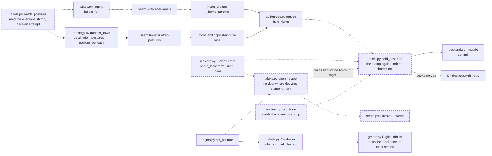

# A row minted across a posture change carries the label the standing posture gives: every mint proves its label against a posture change committed inside its window, on every engine and for the system actor

A fix, completed on 2026-11-15 from [its research memo](../../research/2026-11-14-a-mint-must-prove-its-label-against-a-posture-change-committed-inside-its-window.md), which was a placeholder and is now answered, and amended the same day after [its spec review](../../reviews/2026-11-15-a-row-minted-across-a-posture-change-carries-the-label-the-standing-posture-gives-spec-review.md) and the developer's reminder that a lock must never hold up every query on a mount many users share. It touches rights and needs the engine legs: no grant, view or ladder rule changes, but a stored label decides what a partial caller may read, so the security lens is mandatory in both reviews and criteria 1 to 4 are leak tests. It changes the schema format: provisioning writes one more row, and the format version moves from 26 to 27 (decision 10). It is structural only in that it adds three seams, each a one-line await that does nothing in production; it adds one small type, `ShareLock`, beside the profile's other types, and no module, protocol method or lifecycle, and it changes no public API and no Rust. It is not parallel-safe with two active specs: [a miss beneath a row the caller cannot read](../active/2026-11-14-a-miss-beneath-a-row-the-caller-cannot-read-answers-as-a-miss-beneath-nothing.md) also edits `authorized.py`, and [the rights compile is the same at every world size](../active/2026-11-14-the-rights-compile-is-the-same-at-every-world-size.md) also edits `tests/storage/database/test_labels.py` and the mutant ledger; neither is being built, and whichever builds second rebases. It is not parallel-safe with [on SQL Server a read never waits on a write](../active/2026-11-15-on-sql-server-a-read-never-waits-on-a-write.md) either, which edits `engine.py`, `dialects.py`, their baseline entries and `tests/storage/database/test_races.py`, and builds after this one. It comes from the release audit run `vfs-run-1-2026-11-07`, whose needs-validation lead, fingerprint `vfs/storage/database/labels:mint-reads-posture-outside-revision-lock-stale-everyone-level`, was named open under Out by [a mutation is authorized for the rows it acts on at its commit point](../archive/2026-11-14-a-mutation-is-authorized-for-the-rows-it-acts-on-at-its-commit-point.md), confirmed by an engine run on 2026-11-14 and measured on 2026-11-15. No intention: the work is one property across the mint paths. It depends on nothing unlanded.

## The problem

Labels: READ means read in the file cited, at `08c372af`; EXECUTED means a command ran and the claim reports its output, on 2026-11-15 on the four server engines unless it says otherwise, as the memo records; INFERRED means reasoning.

**What a label is.** READ. Each entry row stores `everyone_level`, a copy of the rank the deepest everyone posture on its path gives: `0` none up to `5` read_write (`src/vfs/storage/backends/database/labels.py:1-11`). The posture rows are the truth; the label is derived. A partial caller's read seeks the label through the `(everyone_level, path)` index instead of carrying every posture in its predicate. A mint stamps it when the row is created. A write, a mkdir and every parent a write creates take it from `labels_for` (`labels.py:152-164`), one plain read of the posture rows on the batch's ancestor prefixes, called at `src/vfs/storage/backends/database/writes.py:412` as the first statement of `_apply`. A copy and a move take it from `posture_beneath` (`labels.py:167-180`): read at the gate for a partial caller (`src/vfs/storage/backends/database/authorized.py:185`) or through `destination_postures` at `src/vfs/storage/backends/database/topology.py:207` otherwise, and stamped at `topology.py:334`, `:402` and `:502`. These two functions are the only label reads a mint makes (READ, a search of `src/` for their callers).

**What a posture change does.** READ. The posture verb bumps the mount revision first (`src/vfs/storage/backends/database/backend.py:1317`), stamps the everyone principal `*` in `vfs_principal_revisions`, writes the posture row and plants a relabel mark (`src/vfs/storage/backends/database/rights.py:1099-1101`). Then the relabel rewrites the labels in the posture's region, one chunk per transaction, and clears the mark on its last chunk (`labels.py:272-296`). While the mark stands, every reader ignores the label there. Once it is cleared, readers trust the label (`src/vfs/storage/grants.py:485-498`). The posture verb is the only writer of a posture row after provisioning, and the only writer of the `*` stamp (READ, a search of `src/` for writes to `tables.grants` and for `stamp_principals`).

**The defect.** Nothing orders a mint's label read against a posture write. The mint takes no lock the posture write takes, and nothing re-proves the label before the commit. A relabel does not find a row an uncommitted mint inserted. So a mint that read the posture before the posture write committed, and commits after the relabel cleared its mark, keeps the old label, and no relabel rewrites it. Said simply: the row is labelled with a posture that no longer stands, and readers believe the label.

**Which windows are open.** EXECUTED, the memo's section 2, on the unfixed tree with a seam added after each label read. A rival tightens everyone to `none` at the seam and drives its relabel to its end.

| Seam, shape, minter | Postgres | MariaDB | SQL Server | Oracle |
|---|---|---|---|---|
| `write:before-apply`, at the path or at a minted parent, either minter | open | open | closed | closed |
| `write:after-labels`, at the path or at a minted parent, granted | open | open | closed | closed |
| `write:after-labels`, at the path or at a minted parent, system | open | open | open | open |
| `write:after-labels`, at the existing parent, system | closed | closed | open | open |
| every other write node at the existing parent | closed | closed | closed | closed |
| `transfer:after-postures`, move or copy, system | open | open | open | open |
| `transfer:after-postures`, move or copy, granted | closed | closed | closed | closed |
| restore after a tightening | closed | closed | closed | closed |

An open cell is a stored label of 5 where the standing posture gives 0, with no mark standing. For the write family the loosening direction gave the same rows: where a tightening leaves a row too open, a loosening leaves it too closed. The transfer path was staged for the tightening only; its loosening legs are first run by the build (criterion 3). Every engine has an open window, and the system actor has one on all four.

**Why the commit-point fence does not close it.** On Postgres and MariaDB a write runs at `REPEATABLE READ` (READ, `src/vfs/storage/backends/database/dialects.py:512`, `:582`), so the fence's read of the stamps comes from the same snapshot as the stale posture read and agrees with it. The system actor is never fenced (READ, `authorized.py:140`). On SQL Server and Oracle the fence does close the staged windows for a granted caller, but it takes no lock (READ, `authorized.py:233`), and a posture committed after an unlocked read is missed: EXECUTED on Oracle and Postgres with a no-lock re-read, the memo's section 7.

**What a wrong label exposes.** Once no mark stands, a named caller holding no grant at the minted path, a group member whose groups hold nothing there, and any other partial caller judged through `Rights.admits` pass a row whose stored label reaches the rung (READ, `grants.py:491`): `read`, `glob`, `grep` and `search` can return a row the standing posture closes to everyone. The other direction hides a row from callers the posture admits: an availability defect, not a leak. Restore keeps the stored label and the relabel reaches tombstones, so restore is not a mint (EXECUTED: closed on all four engines).

## Architecture

Dashed is what this spec adds. Nothing is retired.

Page this changes: none; the architecture folder was retired on 2026-10-31.

Terms. A **mint** is any statement that creates an entry row or gives a row a new path, and with it a label: a write's or mkdir's insert, the parents a write creates, a copy's insert, a move's rewrite. The **label read** is the read of the posture rows a mint stamps from. A mint's **window** is the span from its label read to its commit. The **standing posture** of a path is what the posture rows as they stand give it. A **mark** is a relabel's in-flight row in `vfs_relabels`; while one covers a path, readers ignore the label there. The **everyone stamp** is the row of `vfs_principal_revisions` whose principal is `*`; a posture write, and nothing else, updates it. The **proof** is the two statements this spec adds to a mint: the **watch**, a plain read of the everyone stamp before an attempt's first label read, and the **hold**, a read of it under a shared lock as the last statement the attempt's body issues. The **door** is the table lock a posture write takes first on an engine whose row sharers do not queue behind a waiting writer.

## Decisions

### 1. The property: once no relabel mark stands over a path, every row at that path carries the label the standing posture rows give it, whatever was in flight when the posture changed

Said simply: a reader that trusts a label is never told a posture that no longer stands. Any mint whose window a posture change commits inside either stamps the label of the posture as it stands when the mint commits, or does not commit and runs again. The property covers both directions: a label more open than the standing posture (a leak) and one more closed (a row hidden from callers the posture admits). It is the property the commit-point spec's decision 1 leans on: that spec's judgments read stored labels and are as strong as them.

### 2. Every mint path is in scope, the transfer path and the system actor included

The write family's mints and the transfer path's all carry a label read with no ordering guard, and the system actor's window is open on all four engines (The problem). The system actor is in scope even though its rights never change, because the label is not its rights: it is what every other caller's read is judged by later. Restore is not a mint; it is pinned so a later change that makes restore restamp is caught (criterion 5). The relabel reads the posture rows under the admin lock and is the reference. `rebuild_labels` has no caller in `src/` and takes the lock as its last statement (READ, `labels.py:400-412`); the spec that gives it a caller takes the lock first.

### 3. Three seams are added, each outside the modules the size baseline holds, and the fix is pinned on all four server engines

The existing seam `write:before-apply` sits before the label read, so on an engine whose statements each read the latest commit it cannot enter the window; the experiment needed a seam after the read to open the system actor's window on SQL Server and Oracle. `write:after-labels` is the last line of `labels_for`, which only the write family's `_apply` calls in `src/`. `transfer:after-postures` is the last line of `destination_postures` in `authorized.py`, which only `transfer_rows` calls. `posture:after-stamp` is the last line of `open_relabel` (decision 6): it holds a posture write open with its locks taken, which criterion 7 needs. Each is a no-op with no handler (`src/vfs/storage/backends/database/seams.py:40-51`). Placed there, none of them adds a line to `writes.py`, `topology.py` or `rights.py`. Every criterion that stages a rival runs on all four legs, because the engine decides which windows are open.

### 4. A mint proves its label with two statements: it reads the everyone stamp before its first label read, and reads it again under a shared lock as its last statement, and runs again when the value moved

This is the mechanism the memo measured as `candA` and, with decision 6's door, as `candC`. Said simply: the mint checks that no posture changed since it read the postures, and holds the door shut on the next one until it has committed. It closed all 132 window nodes on the four engines (EXECUTED, the memo's sections 3 and 9). Why it is airtight, in three cases. A posture write that committed before the watch is seen by the label read, or, on a snapshot engine, makes the hold fail. A posture write that commits between the watch and the hold moves the stamp, so the hold's value differs, or the engine refuses the locking read, and the attempt runs again. A posture write that begins after the hold waits for the shared lock, so it commits after the mint, and its relabel then finds the mint's rows and rewrites them. The rejected directions, each with its evidence in the memo's section 7: a re-read with no lock (left windows open on all four engines); the mount revision row as the lock (every grant anywhere would redrive every mint, and every relabel chunk would block them); the stamp lock held from before the label read (a posture write would wait out a 10,000-file batch's whole body); the admin side waiting out older mints (no engine-portable form); readers distrusting stale labels (moves the cost onto every read and changes `Rights.admits`). The commit-point spec's decision 3 rejected a shared lock on the admin row. This lock is on the everyone stamp, which no relabel chunk takes, so the cycle it names cannot form. Its other costs apply and are accepted: Postgres writes the stamp row's header once per minting attempt, Oracle takes a table lock (decision 9), and a mint's hold queues behind a waiting posture write (decision 6).

### 5. The hold is the last statement the fenced body issues, after the fence, so the shared lock is held for the commit and nothing else

Taken last, the lock is held from the hold to the commit: a posture write waits for commits in flight, never for a batch's body. It also makes the lock the last one a mint takes, which is what keeps it out of every lock cycle (decision 11). It runs in `fenced`, after `hold_rights`, for every verb that runs under `_execute_write` or `_execute_topology` and only when the body succeeded; a failed body rolls back and has nothing to prove (READ, `backend.py:1466-1500`). On SQLite the statistics detection follows the hold inside the same transaction (READ, `backend.py:1494-1497`); on the server engines nothing stands between the hold and the commit.

### 6. A posture write waits only for the holds in flight when it arrives, on every engine; on Postgres that takes a table lock on the stamps table as its first act, the door

A hold that arrives while a posture write is waiting must queue behind it, or mints that keep arriving could hold a tightening off for as long as they keep coming, which the security lens reads as the writers a posture closes out delaying it. EXECUTED: on MariaDB, SQL Server and Oracle a later sharer queues behind a waiting posture write (the spec review's probes); on Postgres a later `FOR SHARE` is granted beside the sharers already there and the posture write waits until no hold stands (the memo's section 9). So on Postgres the posture write issues `LOCK TABLE … IN EXCLUSIVE MODE` on `vfs_principal_revisions` before it stamps. With it, EXECUTED: a later hold queues, the posture write proceeds as soon as the hold it arrived behind commits, and a plain read of the table returns at once. The door, the stamp and the mark become one function, `open_relabel`, in `labels.py`, and `set_posture` calls it in place of its two calls today. It costs a mint nothing and a posture write one statement, on Postgres only.

### 7. While a posture write is open, the only calls that wait for it are calls that create a row and other rights changes; a read, a search and an edit of an existing file never do, on Postgres, MariaDB and Oracle today and on SQL Server once its own spec lands

This is the developer's rule of 2026-11-15, now in `AGENTS.md` under the reference deployment: a lock is costed by who waits behind it. EXECUTED, the memo's section 10, eleven calls made while a posture write stood open with every one of its rows written: on Postgres, MariaDB and Oracle, reads by the system actor, a granted caller, a caller with the posture only and anonymous returned, as did a glob, a grep and a rewrite of an existing file by the system actor and by a granted caller; the two creates waited and succeeded once the posture write committed; a grant waited, as it does today, behind the admin lock. The door does not change that: its mode holds back holds and writes to the stamps table and no plain read, and no read verb writes that table. What waits is the call whose label the posture write is about to change, for one short admin transaction. Criterion 7 pins it on those three legs.

### 8. The shared form is declared per dialect in one profile field, a small type of three facts SQLAlchemy does not model

SQLAlchemy's `with_for_update(read=True)` renders `FOR SHARE` on Postgres and `LOCK IN SHARE MODE` on MariaDB, which are right. It renders nothing on SQL Server and SQLite, and `FOR UPDATE`, an exclusive lock, on Oracle (EXECUTED, the memo's section 5). So `DialectProfile` gains one field, `share_lock`, of a new type `ShareLock`: `form`, one of `"row"`, `"table"` or `"exclusive"`, default `"row"`; `hint`, the T-SQL table hint that holds a shared row lock to the transaction's end, default none; and `door`, whether a posture write takes the table lock of decision 6 first, default false. Postgres declares `door=True`. SQL Server declares `hint="REPEATABLEREAD, FORCESEEK"`: the seek keeps the lock on the one row, as `row_lock_hint` already asks, where a scan would lock every stamp (EXECUTED by the spec review: the hint works as the experiment's did). Oracle declares `form="table"`: it has no shared row lock, so the hold takes `LOCK TABLE … IN SHARE MODE` on the stamps table in a statement of its own and then reads plainly. The generic floor declares `form="exclusive"` and takes the existing `lock_rows` form: an unknown dialect may not have `FOR SHARE`, and `FOR UPDATE` is what the serialization point already asks of it, so the floor is asked for nothing new and its mints queue for the length of a commit. SQLite and MariaDB keep the defaults: on SQLite the clause renders as nothing, and its writer lock, taken at the write's first statement, already closes the window. The same code runs on every engine with no branch on the engine's name.

### 9. On Oracle the shared lock covers the stamps table, so a grant or membership write and a mint's last statement wait for each other's commit

Oracle's table lock in share mode is compatible with itself and conflicts with any row change in the table (EXECUTED by the memo's section 5 for the posture stamp and by the spec review for a grant's stamp, in both directions). A grant, revoke or membership write stamps other principals in the same table, so on Oracle it waits for the mints holding the lock, each for a commit's length, and a mint's hold waits for an admin write that has stamped and not committed. Admin writes are single short transactions at human rate, and no read waits for either (decision 7). The exclusive row lock, the alternative, would make every mint wait for every other mint, which decision 12 forbids.

### 10. Provisioning seeds the everyone stamp at revision 0, the schema format version moves to 27, and a hold that finds no stamp row refuses

A lock on a row that does not exist holds nothing, and today the stamp row is first written by the first posture verb (READ, `src/vfs/storage/backends/database/revision.py:96-107`, `src/vfs/storage/backends/database/engine.py:715`). So `_provision` inserts it beside the root posture row. A store provisioned by an earlier build has no such row; the format version moves from 26 to 27 so that store is refused at first touch with the existing re-provision message, never run unprotected. The watch reads a missing row as 0. The hold raises `StaleSnapshot(POSTURE_MOVED)` when its locked read returns no row: a format-27 store always holds it, and a mint that cannot lock it does not commit. The design is pre-release and no deployment holds a store to migrate (`AGENTS.md`, the project stage).

### 11. The lock order: a mint takes the shared stamp lock last, and a posture write reads no entry row after it takes the stamp

The orders that stand today (READ, the memo's sources): an admin write takes the mount revision row, then for a posture the `*` stamp row, then the grant row and the mark; a relabel chunk takes the revision row, then the marks, then entry rows; a topology verb takes its serialize row, then entry rows; a write takes entry rows in path order, parent bumps last. This spec adds one edge on each side. A mint, holding its entry rows, takes the shared stamp lock and then only commits, so a mint holding the stamp lock waits for nothing. A posture write, holding the revision row, takes the door where declared and the stamp row exclusively, and after that touches only the mark and the grant row (READ, `rights.py:1099-1101`), so a posture write holding the stamp waits for no row a mint holds. Neither new wait can close a cycle. EXECUTED, the memo's sections 6 and 9: sixteen writers, three posture changes with their relabels and a sweep, 804 calls on each engine, gave no deadlock and no outcome but success and the retryable conflict the unfixed tree also gives. On SQL Server with `READ_COMMITTED_SNAPSHOT` off the watch, and the fence read a named caller's mutation already makes, are lock waits too: each queues behind a posture write that is waiting for the stamp, for the length of the commits in flight; no cycle forms, since the holders only commit (EXECUTED by the spec review: both reads end in the lock timeout while the stamp update waits).

### 12. The mechanism is bounded: two statements per minting attempt, three on Oracle, never per row; on the five tuned profiles no mint waits for another mint

About 50,000 single-file writes a day, 100,000 at the design ceiling, and 100 nightly batches each issue the two statements when they create a row: at most about 200,000 single-row reads by primary key a day and 200 a night (READ, `AGENTS.md`, the reference deployment; EXECUTED, the memo's section 4, for the count per call). The shared lock is shared: EXECUTED on all four engines, a second mint takes it at once beside a first. On Postgres a shared row lock held by two transactions at once makes a multixact: 272 and 325 over 804 calls from sixteen writers with no pause between their calls (EXECUTED). At the reference peak of about 20 calls a second the lock is held for a commit, so most mints hold it alone (INFERRED), and it is the mechanism every Postgres foreign-key check uses. The profile is stated in the docstring, with no cap declared.

### 13. Any posture write on the mount redrives the mints in flight, once each

The stamp is one row for the whole mount, so a posture write at `/a` redrives a mint under `/b`. A finer proof would need a stamp per posture path and a read per ancestor. A posture write is an admin act at human rate, and a redrive is one more run of a call. Costed at the reference deployment: a redrive of a nightly batch is the batch's whole body, so a batch that overlaps one posture write anywhere on the mount runs twice, and one that overlaps a posture write in each of its four attempts (READ, `engine.py:181`) ends in the retryable `conflict` having written nothing. A named caller's batch already meets this through the fence; the system actor's meets it for the first time here. Where the comparison raised, the exhausted answer is the existing retryable `conflict` with one fixed phrase, `a posture changed while it ran`, naming no path. On Postgres and MariaDB, where the engine refuses a write's hold, it is the same `conflict` with the retry layer's own phrase (READ, `engine.py:375-378`).

### 14. The fence's own rule is not changed

A named caller's attempt now reads the everyone stamp in two places: in the fence, unlocked and among its other ids, and in the hold, locked. They prove different things, the caller's rights and the row's label, and the system actor has only the second. Folding them would change a landed spec's rule to save one read on the named path.

### 15. Two listed modules grow by what cannot live elsewhere, and one shrinks

`dialects.py` (held at 1,145 lines) gains at most 25: the `ShareLock` type, the field, its docstring paragraph and three declarations, which live nowhere but the profile. `engine.py` (held at 1,158) gains two: the seed beside the root posture row and the import of the everyone name. Each entry is raised to its file's count, and the code review's finding is answered "kept because" with a link to the document that carries that module's reduction: [whether the driver error classifiers leave the dialect module](../../research/2026-11-13-whether-the-driver-error-classifiers-leave-the-dialect-module.md) and [whether the planner statistics step leaves the engine host](../../research/2026-11-13-whether-the-planner-statistics-step-leaves-the-engine-host.md). `rights.py` (held at 1,540) loses one line, two calls becoming one, and its entry is lowered. `writes.py`, `topology.py` and `backend.py` do not change.

### 16. The reproducing node lands with the fix, and the build shows every node red first

The node is red on the unfixed tree, and the tree stays green, so it lands in the fix's one commit. Its diff is kept in the memo's studies folder, so it no longer depends on commit `6644c60f`, which no branch reaches. The build runs every criterion's node on the unfixed tree first, with only the seams added; for that run alone `posture:after-stamp` sits after `mark_relabel` in `set_posture`, and the fix moves it into `open_relabel`. It records the result per engine and per node in the Landing notes.

### 17. The audit's record cites this fix when it lands

The release audit's record for the fingerprint above cannot land while the defect is open. When this fix lands, its Landing notes give the engine results before and after, per engine and per node, as EXECUTED, and the audit's record cites this spec and those notes.

### 18. No repair verb is added; a row already wrong is rewritten by the next posture write over it

No deployment holds wrong labels to migrate. A posture write at a path relabels its whole region from the posture rows, which rewrites any label the defect left there. A caller for `rebuild_labels`, a whole-corpus write, belongs to the maintenance verbs' own spec.

### 19. On SQL Server a process can stall when its blocked calls fill the loop's threads; the proof makes that likelier, and until the SQL Server spec lands a host there gives the loop a thread for every pooled connection

The spec review asked for the contention run on SQL Server at the loop's default thread count, finished or hung. It hung. EXECUTED, the memo's section 11, 16 writers on 14 threads: with `READ_COMMITTED_SNAPSHOT` off the unfixed tree hung 2 runs of 2 and the mechanism 2 of 2; with it on the unfixed tree finished 11 of 11 and the mechanism finished 7 of 11 and hung 4. In every hang as many requests were blocked as there were threads, all on one entry row and none on the stamps table, and the session that held the row sat idle with its commit unsent: aioodbc runs each driver call on the loop's default executor, so the commit that would free everyone has no thread to run on. Said simply: the stall is in the tree today, and the proof adds one more driver call between a mint's row locks and its commit, so a mint that holds a contended row needs a free thread once more. What a host on SQL Server must set until vfs does it: the loop's default executor at as many threads as its vfs handles can hold connections, 15 a handle under SQLAlchemy's default pool (`loop.set_default_executor(ThreadPoolExecutor(n))`). EXECUTED: with 18 threads for 18 handles both trees finished every run that completed, and with the driver given an executor of its own, 15 threads an engine, both trees finished 19 runs of 19 that completed, at 14 and at 4 default threads, with the setting off and on ([the SQL Server memo](../../research/2026-11-15-on-sql-server-a-thread-for-every-connection-ends-the-stall-and-snapshot-reads-end-the-reader-waits.md)). [The SQL Server spec](../active/2026-11-15-on-sql-server-a-read-never-waits-on-a-write.md) makes vfs give the driver that executor and require the setting on; criterion 9 runs on 64 threads, more than the eighteen calls its handles can have in flight at once, until it lands. This spec does not wait for that one: the defect it closes lets a caller read what a posture closed, on every engine, and the design is unreleased. The module docstring of `labels.py` states the hazard in one sentence.

Flagged to Clay. Seven items. First, decision 10 bumps the schema format, so every store made by an earlier build is refused and must be provisioned again, your development stores included. Second, every call that creates a row costs two more statements, three on Oracle (decision 12). Third, on Postgres a posture write takes a table lock on the stamps table (decision 6); measured, it holds up calls that create a row and other rights changes for one short transaction, and no read, search or edit (decision 7). Fourth, on Oracle a grant or membership write and a mint's last statement can wait for each other's commit (decision 9). Fifth, a posture write anywhere on the mount makes every batch in flight run again, the system actor's included (decision 13). Sixth, SQL Server, where two findings are larger than this spec for a mount many users share, and one choice is yours. With `READ_COMMITTED_SNAPSHOT` off, as the test leg runs it, every call on the mount waits for any open posture write, reads included, on the unfixed tree. And a process there can stall for good when its blocked calls fill the loop's threads, which this spec's two statements make likelier (decision 19). The choice: this spec lands first and the SQL Server spec next, as written, or the other order. Seventh, the release-audit spec's landing still owes its own steps once this lands: the record's third addition, a new dated line from its reader, and the code review's re-read.

## Intent

After this spec, a caller who reads beneath a posture an admin just tightened sees nothing that posture closes, even for a file that was being written, copied or moved while the posture changed. The label a row carries is the posture's, on every engine, for every writer, the system actor included. A posture loosened while a file is written leaves that file readable by everyone the posture now admits. A call that creates a row issues two more statements than it does today, three on Oracle, and a call that creates none issues the same as today. While an admin changes a posture, calls that create a row wait for that one short transaction, and every read, search and edit of an existing file goes on as before.

## Design

**The order of work.** Tests first: the three seams, then every node of the criteria, run on the otherwise unfixed tree on SQLite and the four legs and recorded red where the criteria say; then the code below; then the same nodes green.

**`src/vfs/storage/backends/database/labels.py`** (535 lines, under the ceiling). A new group, "The proof", after "Labels for new rows". `POSTURE_MOVED` is the public constant `"a posture changed while it ran"`. The private key is `_WATCHED_KEY = "vfs_posture_stamp"`. `watch_postures(session, tables)` reads the everyone stamp with one plain select and stores it under the key in `session.info` unless one is stored; a missing row reads as 0. `hold_postures(session, tables, profile)` returns at once with no stored stamp; otherwise it reads the stamp through the private helper `_stamp_under_share` and raises `StaleSnapshot(POSTURE_MOVED)` when the row is missing or the value differs. `_stamp_under_share` spells the profile's form: `"row"` with a hint is the hinted select, `"row"` without is `with_for_update(read=True)`, `"table"` is the table lock in share mode then the plain select, and `"exclusive"` is `lock_rows`. The table lock statement, in share mode for the hold and in exclusive mode for the door, is one private helper that names the table through the dialect's identifier preparer. `open_relabel(session, tables, profile, path, revision)` takes the door where the profile declares one, stamps the everyone principal, plants the mark, and ends with the seam `posture:after-stamp`. `labels_for` calls the watch when it has at least one path and ends with the seam `write:after-labels`; `posture_beneath` calls the watch first. The module docstring gains one paragraph on the proof, which states who waits (decisions 6 and 7), the multixact profile (decision 12) and the Oracle wait (decision 9).

**`src/vfs/storage/backends/database/authorized.py`.** `fenced` calls `hold_postures` after `hold_rights`. `destination_postures` ends with the seam `transfer:after-postures`. The `fenced` docstring and the module docstring each gain a sentence.

**`src/vfs/storage/backends/database/rights.py`.** `set_posture` calls `open_relabel` in place of `stamp_principals` and `mark_relabel`, before the grant row is written; the import of `mark_relabel` becomes `open_relabel`.

**`src/vfs/storage/backends/database/dialects.py`.** `ShareLock`, a `NamedTuple` of `form`, `hint` and `door`, beside the other profile types; `DialectProfile.share_lock: ShareLock = ShareLock()` with its paragraph in the class docstring; `POSTGRES`, `MSSQL`, `ORACLE` and `GENERIC` declare their values as decision 8 says.

**`src/vfs/storage/backends/database/engine.py`.** `_provision` inserts the stamp row, principal `*`, revision 0, after the root posture row.

**`src/vfs/models/rows.py`.** `SCHEMA_FORMAT_VERSION` is 27.

**`src/vfs/storage/backends/database/revision.py`.** The module docstring says the everyone stamp is seeded at provisioning and is the row a mint's hold locks.

**Tests.** The window nodes live in `tests/storage/database/test_races.py::TestRightsAtCommit`, beside the commit-point spec's nodes, and use that class's worlds and `_audit`. The node from the lane is carried in with its helpers and gains the seam parameter. The unit nodes for the watch and the hold live in `tests/storage/database/test_labels.py`, the profile's in `tests/storage/database/test_dialects.py`, the cost pin in `tests/storage/database/test_writes.py`. Eleven existing pins of a statement count or sequence move by the two statements and are updated to the new counts, each still exact: three in `tests/storage/database/test_writes.py`, five in `tests/storage/database/test_authorized.py::TestCost`, three in `tests/base/test_write_at_scale.py` (EXECUTED, the memo's section 4). The format pin in `tests/models/test_rows.py` moves to 27.

**Scale.** Costed against [the reference deployment](../../../AGENTS.md#the-reference-deployment-the-scale-every-idea-is-filtered-through). Per call that creates a row, at most about 100,000 single-file writes and 100 batches a day: two single-row reads by primary key each, on a table with one row per principal ever stamped. Per verb call that mints nothing, per index visit and per corpus it is nothing. Per lock, the multiplier the reference deployment now names: the shared lock is held for a commit and mints share it; a posture write, a person's act a few times a day, waits for the holds in flight when it arrives and for no later one (decision 6), and while it is open the calls that create a row wait for its one transaction and no read does (decision 7); each mint in flight then runs once more (decision 13).

**Mutant ledger.** The build adds one row to `context/standards/mutant-ledger.md` per mutation, each naming the node that kills it. The watch dropped from `labels_for`, the watch dropped from `posture_beneath`, the hold dropped from `fenced`, and the comparison inverted: criterion 8's node and criterion 10's `test_a_stamp_moved_since_the_watch_redrives`. The watch moved after the posture read in either function: criterion 8's node. The watch reading again on a second label read: `test_the_watch_reads_once_an_attempt`. The hold's read made plain on each of the four forms: criterion 6's legs for the three tuned forms and criterion 11's compiled text for all four. The door dropped: criterion 6's `postgres` leg. The seed insert dropped, and the hold passing on a missing row: criterion 12's nodes. The hold moved before `hold_rights` is not a mutant, since either order is correct.

## Scope

In: decisions 1 to 19; the files the Design names; the nodes below; the ledger rows; the three baseline entries.

Out. The commit-point fence's own rule (decision 14). A repair verb or a caller for `rebuild_labels` (decision 18). A stamp per posture path (decision 13). SQL Server's reader waits and its executor stall, which [their own spec](../active/2026-11-15-on-sql-server-a-read-never-waits-on-a-write.md) carries. The rights cache's key. The read verbs' per-attempt rule. The two integrity windows of [the delete and move placeholder memo](../../research/2026-11-14-a-child-committed-inside-a-delete-or-a-move-can-be-left-behind-its-parent-on-a-read-committed-engine.md). A first-touch check of MariaDB's snapshot isolation, which the commit-point spec's decision 18 names as its own change. A topology isolation pin for the generic floor. The release-audit spec's own landing steps.

## Acceptance criteria

1. `tests/storage/database/test_races.py::TestRightsAtCommit::test_a_row_minted_across_a_posture_tightening_is_no_more_open_than_the_standing_posture`, 48 legs `[<engine>-<seam>-<shape>-<minter>]`: four engines, the seams `write:before-apply` and `write:after-labels`, the three shapes `at-path`, `at-minted-parent` and `at-existing-parent`, the minters `granted` and `system`. A rival tightens everyone to `none` at the seam and drives its relabel to its end. Every leg passes: the write is refused with `permission_denied` or a retryable `conflict` and leaves no row, or it succeeds, every minted row's stored label equals the standing posture's with no mark standing, a named caller with no grant at `/p` and anonymous are each refused `read` of the target and find no minted row by `glob` or `grep` under `/p`, and `_audit` passes. Red today on 22 legs: 8 on `postgres`, 8 on `mariadb`, 3 on `mssql`, 3 on `oracle` (EXECUTED).
2. `…::TestRightsAtCommit::test_a_row_minted_across_a_posture_loosening_is_no_more_closed_than_the_standing_posture`, the same 48 legs with the world's posture at `/p` set to `none` first and the rival loosening to `read_write`: every minted row carries label 5 once no mark stands, and a named caller holding nothing but the posture reads the target. Red today on the same 22 legs (EXECUTED).
3. `…::TestRightsAtCommit::test_a_row_moved_or_copied_across_a_posture_change_carries_the_standing_postures_label`, 32 legs `[<engine>-<verb>-<minter>-<direction>]` for `move` and `copy` of a directory of two files into a folder whose posture the rival changes at `transfer:after-postures`. In the tightening legs the rival sets the folder to `none`: the transfer is refused with `permission_denied` or a retryable `conflict` and leaves no row at the destination, or it succeeds and all four rows it created or moved carry the standing posture's label with no mark standing. In the loosening legs the folder starts at `none`, the rival loosens it to `read_write`, and all four rows carry label 5 once no mark stands. `_audit` passes. Red today on the 8 `system` tightening legs (EXECUTED); the loosening legs are first run by the build.
4. In criteria 1 and 3, wherever the call succeeds, a member of a group that holds nothing at `/p` is refused `read` of the target as the named caller is. Test: the same nodes, one more reader in their loop.
5. `…::TestRightsAtCommit::test_a_restored_row_carries_the_label_the_standing_posture_gives`, legs `[<engine>]`: a file deleted, its folder's posture tightened and relabelled, then the file restored, carries the standing posture's label. Green today on all four (EXECUTED).
6. `tests/storage/database/test_labels.py::TestProof::test_a_posture_write_waits_for_the_holds_in_flight_and_no_later_one`, legs `[<engine>]`: one session holds the hold's lock; a second session's hold returns beside it and is rolled back; a third session runs `open_relabel` and does not return; a fourth session's hold in the engine's no-wait form (`lock_timeout`, `innodb_lock_wait_timeout`, `LOCK_TIMEOUT`, `NOWAIT`) is then refused with the engine's lock error, within a counted 200 tries, each granted try rolled back; a plain read of the stamp row on a fifth session returns on `postgres`, `mariadb` and `oracle`; when the first session commits the third returns and the stamp has moved. Outcomes counted, nothing timed beyond the engine's own no-wait setting. On the `oracle` leg, while the first session holds the lock, a read, a glob and a rewrite of an existing file through a storage handle each return.
7. `tests/storage/database/test_races.py::TestRightsAtCommit::test_only_a_create_waits_while_a_posture_write_is_open`, legs `[postgres]`, `[mariadb]` and `[oracle]`: a posture write is stopped at `posture:after-stamp`; a create by the system actor and one by a granted caller are started; then a read by the system actor, a granted caller, a caller with the posture only and anonymous, a glob, a grep and a `search` by the granted caller, and a rewrite of an existing file by the system actor and by the granted caller are each awaited to their end and each succeeds; neither create has returned when the last of them has; the posture write then commits, both creates succeed, and each created row carries the standing posture's label once no mark stands. An order of returns, never a clock. The SQL Server leg is not in the list: with `READ_COMMITTED_SNAPSHOT` off every call there waits (EXECUTED), and the spec named under Out adds the leg.
8. `tests/storage/database/test_writes.py::TestLabelCost::test_a_mint_proves_its_label_in_two_statements`, on SQLite and the four legs, statements recorded by a `before_cursor_execute` listener for one new file, one 10,000-file batch with parents, one move and one copy, each by the system actor and by a named caller: each call issues exactly one watch statement before its first read of the posture rows and exactly one hold as the last statement the fenced body issues, the statistics detection on SQLite not counted, preceded on a `"table"` profile by exactly one lock statement; the 10,000-file batch issues the same; a rewrite of an existing file issues none of them. The 10,000-file legs are marked `slow`.
9. `tests/storage/database/test_races.py::TestRightsAtCommit::test_mints_posture_writes_relabel_chunks_and_a_sweep_finish_without_a_deadlock`, legs `[<engine>]`, marked `slow`: 16 concurrent writers of 50 files each, each in a folder of its own under `/p`, three posture writes at `/p` with their relabels, and one sweep of a deleted tree, on a loop whose default executor has 64 threads; every call succeeds or returns a retryable `conflict`, every row's label equals the standing posture's once the pending relabels are run to their end, and `_audit` passes; outcomes counted, nothing timed.
10. `tests/storage/database/test_labels.py::TestProof`, on SQLite: `test_a_call_that_reads_no_label_holds_nothing` (the hold issues no statement with no watch; a rewrite, an edit, a delete and a restore issue neither statement), `test_the_watch_reads_once_an_attempt` (two label reads in one attempt issue one watch), `test_a_stamp_moved_since_the_watch_redrives` (the everyone stamp advanced at each of the two mint seams with `tests/support/commit_worlds.py::stamp` called on the attempt's session, captured as `tests/storage/database/test_authorized.py::TestRightsFence` captures it, for a write, a move and a copy: the hold raises `StaleSnapshot` with `POSTURE_MOVED`, the first attempt leaves no row, and the call's second attempt succeeds), and `test_a_mint_that_loses_every_attempt_answers_a_retryable_conflict` (the stamp advanced at every attempt: one `conflict`, retryable, whose detail holds `POSTURE_MOVED` and no path, and no row). These are the single-writer forms of criteria 1 to 3. The in-memory backend is the database backend on an in-process SQLite (READ, `src/vfs/storage/backends/memory.py:1-17`), so these nodes are its nodes.
11. `tests/storage/database/test_dialects.py::test_each_profile_declares_how_a_mint_shares_the_stamp_lock`: SQLite and MariaDB declare the default `ShareLock()`; Postgres declares `door=True` and nothing else; SQL Server declares `hint == "REPEATABLEREAD, FORCESEEK"` and nothing else; Oracle declares `form == "table"`; the generic floor and a profile resolved for an unknown dialect name declare `form == "exclusive"`. And the compiled hold for each: `FOR SHARE`, `LOCK IN SHARE MODE`, the hint, `LOCK TABLE … IN SHARE MODE` then a plain select, `FOR UPDATE`, and a plain select on SQLite; and the compiled door, `LOCK TABLE … IN EXCLUSIVE MODE`, issued by `open_relabel` under the Postgres profile and by no other.
12. `tests/storage/database/test_engine.py::test_provisioning_seeds_the_everyone_stamp`, on SQLite and the four legs: a fresh store holds exactly one row in `vfs_principal_revisions`, principal `*`, revision 0. `tests/storage/database/test_labels.py::TestProof::test_a_hold_that_finds_no_stamp_row_refuses`, on SQLite: with the row deleted, a create answers the retryable `conflict` and leaves no row. `tests/models/test_rows.py`'s format pin reads 27. The existing first-touch node already pins that a store at another version is refused.
13. `scripts/ci.sh` exits 0; `scripts/docs.sh check` exits 0, since the landing edits docstrings under `src/vfs/`; and the four engine legs pass whole through the `db_test` cycle, with the counts in the Landing notes.

## Landing notes

Built on 2026-11-14 and 2026-11-15 in the working tree over `08c372af` on `main`, by the session's author (Claude Fable 5.2), and left uncommitted until Clay asks for the commit. No text above these notes was changed after the spec review's last signature; before these notes were written the file's SHA-256 began `fa3349aa926b`. Nothing under `crates/` changed. Everything below is EXECUTED unless it says otherwise.

Red first, per engine and per node, as decision 16 asks, with the three seams added and nothing else. Postgres: criterion 1's node red on 8 legs, criterion 2's on 8, criterion 3's on the 4 system legs (move and copy, tightening and loosening), criterion 7's node red. MariaDB: 8, 8, 4, and criterion 7's node red. Oracle: 3, 3, 4, and criterion 7's node red. SQL Server: 3, 3 and 4. Criteria 1 and 2 are red on the 22 legs the spec names. Criterion 3 is red on 16 legs, not the spec's 8: the system actor's loosening legs, which the spec says the build runs first, fail as its tightening legs do. Criterion 5's restore node is green before and after on all four engines, as the spec says.

Two departures from decision 16's order, said plainly. First, the SQL Server red was not taken on the unfixed tree: the fix was in the tree by the time that engine was free, so it was taken in a scratch copy of the built tree with the hold removed from `fenced`, which is ledger row E3's mutant. Second, the SQLite nodes of criteria 8, 10, 11 and 12 were first run after the code they pin was written, so none was seen red on the unfixed tree. Each can go red: the fourteen mutants of [the ledger](../../standards/mutant-ledger.md), rows E1 to E14, were each applied to a scratch copy and each killed by the node its row names, 14 of 14, and the code review replayed them, 14 of 14, and added its own on the Postgres leg (the hold deleted: 20 window nodes red, 12 green).

Green, per criterion, on the tree as it stands. 1 to 5: `tests/storage/database/test_races.py::TestRightsAtCommit`, the tightening node's 48 legs, the loosening node's 48, the transfer node's 32 and the restore node's 4; the group member of criterion 4 reads in the same loops. 6: `tests/storage/database/test_labels.py::TestProof::test_a_posture_write_waits_for_the_holds_in_flight_and_no_later_one` on the four legs. 7: `::test_only_a_create_waits_while_a_posture_write_is_open` on `postgres`, `mariadb` and `oracle`. 8: `tests/storage/database/test_writes.py::TestLabelCost::test_a_mint_proves_its_label_in_two_statements` on SQLite and the four legs, at 100 files and, `slow`, at 10,000. 9: `::test_mints_posture_writes_relabel_chunks_and_a_sweep_finish_without_a_deadlock` on the four legs. 10: `TestProof`'s SQLite nodes. 11: three module-level nodes in `tests/storage/database/test_dialects.py`. 12: `tests/storage/database/test_engine.py::test_provisioning_seeds_the_everyone_stamp`, `TestProof::test_a_hold_that_finds_no_stamp_row_refuses` and the format pin at 27. 13: below.

Gates, on the tree as it stands after the code review's fixes. `scripts/ci.sh` exited 0: lint, format and types pass; 5,343 passed and 11 skipped; coverage 100% over 14,353 statements; 44 docs examples; the wheel inside its budget. `scripts/docs.sh check` exited 0, 20 browser tests passing. The four engine legs ran whole, Postgres and MariaDB side by side, then Oracle, then SQL Server alone in `master`: Postgres 477 passed; MariaDB 468 passed and 8 skipped; Oracle 472 passed; SQL Server 476 passed.

What the gates showed on the way, none of it this change's code. The first `scripts/ci.sh` ran beside four engine legs at a load average near 78 and exited 1 on two 10,000-pattern `glob` nodes in `tests/storage/database/test_reads.py`, which returned no rows: `glob` has a wall-time budget and the run took 24 minutes; both pass alone and in every later run. The first whole legs failed one node on each engine, `TestRightsAtCommit::test_a_transfer_is_refused_where_a_direct_write_is[<engine>-full-chunk]`, a statement count this build had not moved (below), and Postgres's ranking pin once under the same load. `scripts/docs.sh check` failed once on one scroll test of the docs app and passed three times alone and whole on the next run. A whole SQL Server leg run beside Oracle's failed four nodes on the server's error 701, insufficient memory in the Docker VM, and passed whole alone. Flagged: two read nodes and one ranking node can fail on a loaded machine through a wall-time budget, which is a clock in a test's outcome.

Counted costs. A call that creates a row issues one watch before its first label read and one hold as its last statement, preceded on Oracle by one table lock: two statements, three on Oracle, at one file and at 10,000 (criterion 8). A rewrite of an existing file issues none. A transfer refused at its destination pays the watch alone, one statement, which the spec's text did not say and the module docstring now does.

Pins moved, each still exact. Twelve, where the Design counts eleven. `tests/storage/database/test_writes.py`: `<= 10` to `<= 12`, 6 to 8, and the statement-shape list gains its two selects. `tests/storage/database/test_authorized.py::TestCost`: the stamp reads `(2, 1)` to `(4, 1)` twice and `(0, 0)` to `(2, 0)`, and `admit_destinations`' counts `[2, 2]` to `[3, 3]` and `[3, 3]` to `[4, 4]` three times. `tests/base/test_write_at_scale.py`: the formula gains the family "everyone stamp" at 2. The twelfth runs only on the engine legs and was missed until they ran whole: `test_races.py`'s `full-chunk` node, `[3, 3]` to `[4, 4]`, the same one statement as `TestCost`'s. `tests/models/test_rows.py` reads 27.

Module sizes by `wc -l`, `08c372af` then now: `labels.py` 535 to 660; `dialects.py` 1,145 to 1,170, entry raised to 1170; `engine.py` 1,158 to 1,160, entry raised to 1160; `rights.py` 1,540 to 1,539, entry lowered to 1539; `authorized.py` 413 to 426; `revision.py` 107 to 110. The two raised entries are answered in the code review's Disposition by decision 15's two memos.

Departures from the signed text; none changes the property of decision 1. First, decision 7's listing is incomplete, found by the code review (M2): a create that waits for an open posture write waits with its parent's row locked, so a delete, move, copy or restore beneath that parent waits for the create, and through the mount's topology row every other topology verb waits behind that one. No read waits, and the wait is one short transaction. Decision 7 is read with that sentence added; the module docstring says it, and criterion 7's node now starts a delete of a sibling behind the creates and asserts it has not returned until the posture write commits. The node keeps its name, which criterion 7 cites: the creates are still the only calls that wait for the posture write itself. Second, decision 13 costs a redrive at a person's rate, and the rate is the posture writer's own (the code review's M1): posture writes made in a loop kept the system actor's 2,000-file batch from landing on three calls in a row, on Postgres and on Oracle, each answering the retryable conflict. Clay ruled on 2026-11-15: "I think just document for now". Decision 13 is read with this added: a host may write a posture under any authority holding `read_write` on a folder, each write redrives every mint in flight on the mount, and a batch that meets one in each of its attempts lands nothing, so a host that sets many postures does it outside its ingest window; a stamp per posture path, set aside here, is the direction if that rate is ever a tenant's. The module docstring says so. Third, `tests/storage/database/test_identity_portability.py`, outside the Design, copies the stamp row when it copies a store: a store without that row refuses every create, by decision 10. Fourth, three nodes are stronger than their criteria after the code review: criterion 6's node also runs a read by a granted caller, a posture-only caller and anonymous, a search and a named caller's rewrite beside the held hold (L4); criterion 9's node asserts that more than half of its 800 writes land and that each one that landed left its file (L3); criterion 7's node as above. Fifth, the module docstring's paragraph on who stamps a label named the wrong reader for copy and for restore before this change, and is corrected (L2).

Where the use of decision 13's limit starts, as Clay asked: it needs a long call that creates rows, in practice a large batch, and posture writes that keep landing through each of its four attempts. One posture write costs a batch in flight one more run. A script that sets the posture of hundreds of folders one call at a time while ingest runs, or a product whose users switch folders between open and closed often on a mount that is always ingesting, is where batches stop landing. A person changing a posture a few times a day is not, and a single-file write's window is a few statements long.

Flagged to Clay. The seven items above the Intent stand. On the sixth, Clay ruled on 2026-11-15, "order is fine": this spec lands first and [the SQL Server spec](../active/2026-11-15-on-sql-server-a-read-never-waits-on-a-write.md) next; that spec's review ended "Not yet" the same day and it is not fit to build as drafted. The format is 27, so every store an earlier build made is refused and provisioned again. On this machine the SQL Server ODBC driver died or hung inside `libmsodbcsql` in six experiment runs of the day, on the unfixed tree too ([the SQL Server memo](../../research/2026-11-15-on-sql-server-a-thread-for-every-connection-ends-the-stall-and-snapshot-reads-end-the-reader-waits.md)).

What did not run. The other CI legs, 3.11, 3.12 and 3.14, are CI's on the push, and nothing is pushed. SQL Server at the loop's default thread count is decision 19's and its own spec's. The generic floor was compiled and not run end to end against a server. The code review did not run `[postgres-10000]` of criterion 8; the whole Postgres leg above did.

The audit's record. This is the fix decision 17 names for the confirmed finding of run `vfs-run-1-2026-11-07`; the record cites this spec and the two paragraphs "Red first" and "Gates" above. The release-audit spec's own landing steps are not part of this landing.

Architecture pages: unchanged. The architecture folder was retired on 2026-10-31.

Reviews: [the spec review](../../reviews/2026-11-15-a-row-minted-across-a-posture-change-carries-the-label-the-standing-posture-gives-spec-review.md) stands at "Fit to build". [The code review](../../reviews/2026-11-15-a-row-minted-across-a-posture-change-carries-the-label-the-standing-posture-gives-code-review.md), by a reviewer who did not write this change, ended "Does not land yet" on 2026-11-15 on five Mediums and four Lows and no High; each is answered in its Disposition, and its standing verdict, the dated line of its re-read the same day on the working tree over `08c372af`, is "Lands". That line rests on Clay's ruling as quoted above and on the gate runs above, and says a change under `src/` or `tests/` after it is unreviewed; none has been made.

**Changelog:** Security — a file written, copied or moved while an administrator changes an everyone posture now always carries the label the standing posture gives, on every engine and for the system actor, so a caller the posture closes out can no longer read, glob or grep a file that was being created while the posture changed, and a file created while a posture was loosened is readable by everyone the posture admits. Changed — a call that creates a row issues two more statements, three on Oracle; while a posture change is open, calls that create a row wait for its one transaction; any posture change makes the row-creating calls in flight run again, and a call that keeps meeting one answers the existing retryable `conflict`; the schema format is 27, so a store made by an earlier build is provisioned again.

## One line

A file written, copied or moved while an admin changes a posture could keep the old posture's label on every engine; now each call that creates a row reads the everyone stamp before its labels and again under a shared lock as its last statement, runs again when a posture moved, and while a posture changes only calls that create a row wait.
