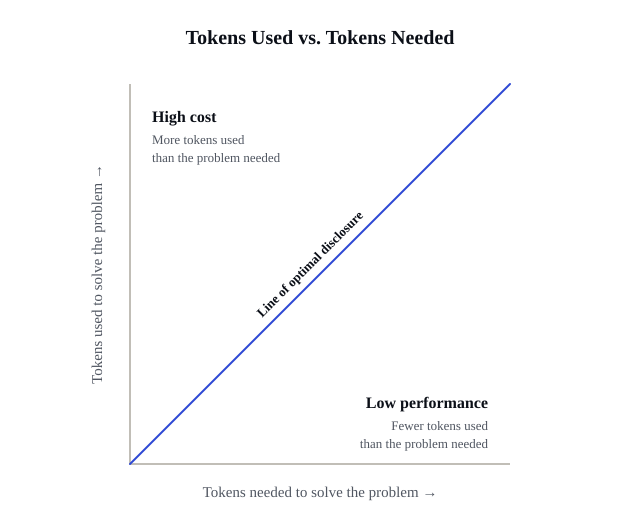
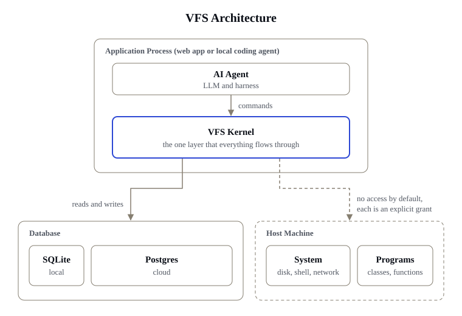

# VFS: Governed Data Access for AI Agents

Welcome to VFS, the framework that connects data and tools to AI agents. VFS lets developers easily create **navigable environments** for any type of AI agent, from a small-scale document QA use case to an agent used by an entire enterprise.

## Why VFS Was Built

VFS started from a belief, formed early in the rise of LLMs, that AI agents will expand what is possible at work and help people focus on what matters most. Developers deploying AI agents inside organizations had good and improving frameworks for managing LLM APIs and AI agent harnesses, but building transformational AI agents requires something else as well: **data**.

VFS started small. The initial goal was to make RAG better by enhancing plain vector search with technology from other domains, like web search. Along the way, we learned that this strategy would only incrementally improve AI agent performance. The reason is that search, and agentic search in particular, cannot be implemented as one algorithm. It must be an ensemble of tools that can be used together to navigate a search space. So VFS is built to be that ensemble and the framework for agentic search. It is a virtual file system that gives AI agents **one governed namespace with a small set of tools to navigate it** and enables developers to build transformational AI agents in any domain.

Five commitments set the ground rules for how VFS does that.

1. **Simple:** VFS is `pip` installable and, in the vast majority of cases, needs nothing that is not already in a developer's stack for a given use case.
2. **Governed:** VFS routes everything through a single governance layer, so permissions and reversibility are enforced on every action.
3. **Universal:** VFS is built for both AI and human users. A file system is a familiar interface for people and a powerful, CLI-based search tool for AI agents.
4. **Performant:** VFS is fast and designed to scale to enterprise-sized workloads.
5. **Open:** VFS is, and will always be, fully open source.

## Who VFS Is Built For

VFS is built for three entities and strives to deliver an exceptional product for each.

### Developers

First and foremost, VFS is built for developers. Prompting and harness design can do a lot to increase an AI agent's performance, but data is the foundation for building effective AI agents, and VFS is the **framework to engineer data for AI agents**. It is built to give developers a great experience by being easy to understand and reliable, and to help them build more effective agents. VFS is simple enough to pick up quickly and powerful enough to meet any developer use case.

### Enterprises

Most enterprises today want to use more AI to improve operations, and most modern LLMs are capable of delivering on that desire. Yet, as of 2026, [only 22% of organizations](https://www.gartner.com/en/newsroom/press-releases/gartner-survey-finds-only-22-percent-of-organizations-have-successfully-scaled-ai-across-multiple-business-units) have moved AI beyond pilots and into use across the business. A core driver of this low success rate is the [lack of AI-ready data](https://www.gartner.com/en/newsroom/press-releases/2025-02-26-lack-of-ai-ready-data-puts-ai-projects-at-risk). Future enterprises are going to look much more agentic than they do today, and VFS is built to help enterprises **build instead of buy** the technology needed to power this transition.

### AI Agents

AI agents are the consumers of VFS, and every part of its API is designed around that fact. LLMs have rapidly advanced in capability within only a few years, and in many cases, the tooling and infrastructure they use have not kept up with their needs. VFS is built by studying how AI agents work, what their workflows look like, what makes them perform better, and where they run into trouble. The result is an interface that is **native to AI agents**.

## What VFS Is Designed Around

VFS did not set out to be a file system. It set out to be a retrieval system, and after years of observing AI agents and researching how to design retrieval for them, it became clear that a file system is the right design. A file system is less a *thing* that holds files than it is an **abstraction over storage**. How data is stored and how it is presented are separate concerns, and a file system is the right presentation for an AI agent.

### Everything is a File

Adopting the everything-is-a-file design philosophy, which was popularized by Unix, means following three requirements.

- Every object is represented by a unique name.
- Operations on those objects follow one standard set of APIs.
- Objects can be used and created in a global namespace.

These requirements are a bit wonky, so it may be better to think of this philosophy as the **everything is the same thing** philosophy. When everything is the same thing, a handful of verbs (APIs) is all that is needed to complete any task.

In most environments that AI agents operate in, especially web-based chat agents, everything is a different thing. Those agents may have built-in tools, MCP connections, skill documents, user-specific preferences, and many other forms of tooling, each built to bring a specific type of information into the LLM's context in a specific way. In this setup, **all of the tooling is connected to the AI agent directly**. This direct connection means more tokens spent on the pre-loaded prompt for each piece of tooling, and then even more tokens spent on the LLM acting as the intermediary that moves data between systems. In effect, the LLM becomes a universal API instead of an agent. On top of that, the extra token usage often comes with poorer performance.

Following the everything-is-a-file philosophy leads to a different setup. The data and tooling connect to a file system, and the AI agent connects only to the file system. Nothing is taken away from the agent. Every data source and every tool is still within reach, but each one is now a file, and the agent works with all of them through the same handful of verbs. This is what VFS does. **VFS becomes the universal API**, and the LLM stays truly an agent. The agent also no longer needs to be told about everything up front, because it can look through the file system and find what it needs when it needs it.

Lastly, if everything is a file, then everything has a path, and all of those paths form one tree. That tree is the **namespace**, and it does three jobs in VFS.

- **It is the AI agent's whole world.** A developer builds the namespace by mounting data sources and tools into it. The agent sees one tree, and a path stays the same no matter which store answers it.
- **It is where the rules attach.** Permissions are written against paths, so the name an AI agent uses to find a file is the same name a developer uses to govern it.
- **It carries meaning before anything is read.** A path costs a few tokens, and where a file sits and what it is named tell an AI agent whether it is worth opening.

This leads us into philosophy number two.

### Progressive Disclosure

Progressive disclosure is a design philosophy that has traditionally been focused on designing software for people, who innately have limited **attention** and **time**. When done well, progressive disclosure is also a **teaching** tool. As a user navigates a piece of software, they learn more about how it works and how it can solve their problem. AI agents work very differently from people and need software designed around their unique needs and constraints.

Progressive disclosure for AI agents is, instead of being optimized for attention and time, built around the facts that they have a limited context window, that the cost of operation increases with every token used, and that many AI agents decrease in performance when over half of the context window is in use.

The chart below compares the tokens needed to solve a problem with the tokens an AI agent actually uses to solve it.



On the line, an AI agent uses exactly the tokens a problem needs. The trouble is that the number of tokens needed to solve a specific problem likely cannot be known ahead of time. Search is not one query that returns one answer. Each piece of information found changes what the searcher looks for next, and the need is satisfied bit by bit along the way. Progressive disclosure for AI agents is built on that idea. The goal is not to predict what an AI agent will need, but to provide the prompting and tooling that let it express each step of its own search, so that **the tokens it uses track the tokens the problem needs**.

To stay as close to the **line of optimal disclosure** as possible, VFS is built around a set of navigational primitives.

#### Navigational Primitives

Mature systems built for information search and retrieval have most, if not all, of the following concepts implemented to help users find the information they are looking for. The VFS commands that implement each one are in parentheses.

- **Drill:** Move down a hierarchy one level at a time to see what is there (`ls`, `tree`).
- **Filter:** Narrow a set of files by name, location, or type without reading them (`glob`, `find`).
- **Match:** Find files by what they say, as an exact pattern or as a ranked search by meaning (`grep`, `search`).
- **Connect:** Follow the relationships between files (`traverse`).
- **Aggregate:** Summarize a set of files with counts and totals instead of reading them (`wc`).
- **Describe:** See what a file is, such as its size and type, without reading its content (`stat`).
- **Sample:** Read a small part of a file, or of an output, to judge whether the rest is worth reading (`head`, `tail`).
- **Seek:** Go straight to a known file and read it (`cat`).

VFS also implements one other concept important for AI agents.

- **Invoke:** Call a tool or run a program by its name. A tool is a file on the path, so no special command is needed to run it.

No single primitive is a search on its own. Each one is a small step that returns feedback, and an AI agent uses that feedback to choose its next step. An ensemble of primitives that can be combined into strategic and precise searches is what defines **agentic search**.

### Command-Line Interface

The navigational primitives are what an AI agent can do. The command line is how it says it.

If you squint, you will see that an LLM really only outputs two things.

1. **Content:** This is information generally intended for humans. This could include text, images, video, audio, and other types of content.
2. **Code:** This is what tool calling is. Along with content, LLMs can output structured information that is intended to be the input to some function, to get some information back or to effect some desired change.

What makes an LLM a good model to use as an AI agent is its ability to use tools effectively, or said another way, its **ability to code**. A central goal of VFS is to create an environment that is easy for AI agents to navigate, and that means giving them an expressive, code-first interface.

A command line is that interface for two reasons. The first is that AI agents already know it. LLMs have seen an enormous amount of shell, so commands like `grep`, `ls`, and `cat` need no description in the prompt. The second is that commands compose.

```bash
grep -rn "mfa" /enterprise | head -20
```

This one call matches on content and then samples the output, and the AI agent decides how much comes back. The data that moves between the two commands never enters the context window.

The whole command line is also **a single tool in an LLM API call**. The AI agent carries one tool definition instead of dozens and discovers the rest when it needs it. It looks like a shell, but it is not a shell on a machine. Every command is a VFS command, and each one goes through the same permission checks as any other call.

## Where VFS Runs

From day one, VFS was designed to run for AI agents in the cloud, and two architectural choices were made to get there. The first is that **the VFS kernel runs in process**. It is a library installed with `pip` and imported into an application, not a separate service to deploy. The kernel also has no access to the host it runs on, so nothing an AI agent does through VFS can reach the host's disk, shell, or network unless the developer specifically provides it. The second choice is that **files are stored in a database and not on disk**. VFS works across many database dialects and manages all of the custom indexes that search needs in each one.



These choices let the same kernel run anywhere a database can be reached. For a web application, the database is a server in the cloud. For a coding agent on a laptop, it is a SQLite file. VFS supports two databases, SQLite and Postgres. SQLite serves demos and local applications, and Postgres serves production.

## How VFS Enforces Governance

A governed system is one where every action is checked against a set of rules before it happens and can be accounted for after it happens. In VFS, governance is enforced by the kernel, and **the kernel is the only path to the data**.

Every command an AI agent sends, from any interface, goes through one path in the kernel. There is no second route around it. When each tool is connected to an AI agent directly, each tool brings its own rules. When everything goes through VFS, there is one door and one set of rules.

Before any command runs, the kernel asks four questions in order and refuses at the first "no".

1. **Is the command well formed?**
2. **Is the caller identified?**
3. **Is it allowed in this part of the namespace?**
4. **Is it allowed on this file?**

These checks apply to search as well. Results never include a file the caller cannot read, and following a connection between files is checked at every hop.

Governance also covers what happens after an action. A delete moves a file to the trash, where it can be restored. An overwrite keeps the earlier version along with a record of who made the change. Permanent deletion is a developer action that no AI agent can call. The rules themselves are also out of an AI agent's reach. What is mounted and who is permitted are set by the developer, and no command changes them.

## When to Use VFS

VFS can be used in any AI agent use case, including the following.

- **Document QA and RAG:** Improve RAG-based chatbots by giving them more precise search tools to navigate a corpus of documents. VFS adds `grep`, `glob`, and `traverse` beside ranked search, so an AI agent can match an exact term or follow a link that vector search alone would miss.
- **Enterprise Knowledge Search:** Let employees ask questions across an organization's wikis, policies, and shared drives. VFS enforces permissions inside the search itself, so an answer never draws on a file the person is not permitted to read.
- **Customer Support Agents:** Ground support agents in product documentation and past tickets. VFS puts both in one namespace, where `grep` finds the exact error code or product name a customer mentions.
- **Research and Report Generation:** Support long-running research agents that gather from many sources and write up their findings. VFS lets an AI agent write its notes and drafts back as files, so its working memory lives outside the context window.
- **Workflow Automation:** Let AI agents carry out multi-step internal processes. In VFS, tools are files that an AI agent calls by name, and a mistaken delete or overwrite can be undone.
- **Web-Based Agents:** Give a chat agent in a web application a file system and a command line. VFS runs in process with its storage in a database, so no sandbox or virtual machine is needed for each user.
- **Governed Coding Agents:** Enforce stricter guardrails on coding agents by routing operations through a local VFS MCP server. Every operation passes the kernel's checks, and the agent has no access to the host's disk or shell unless that access is granted.
